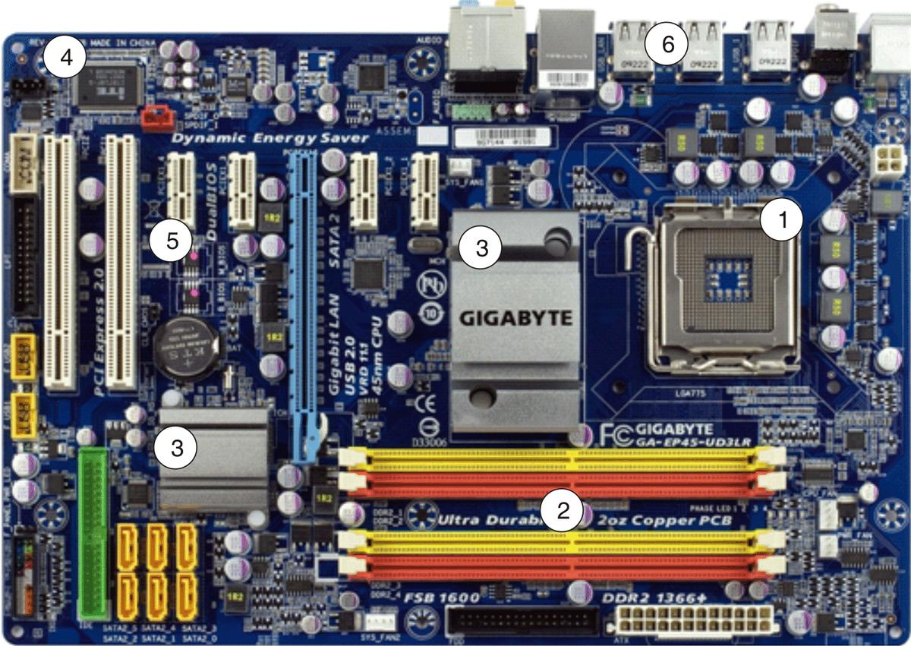
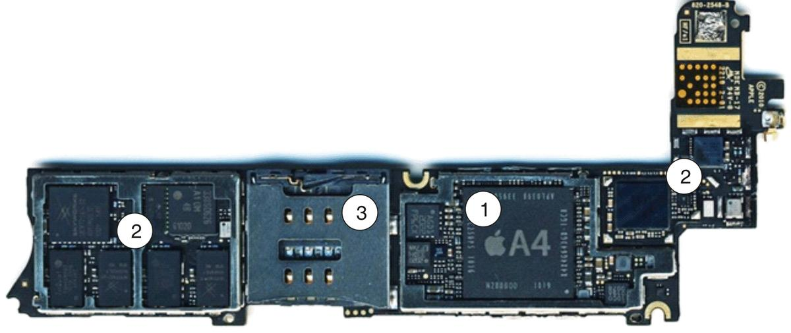
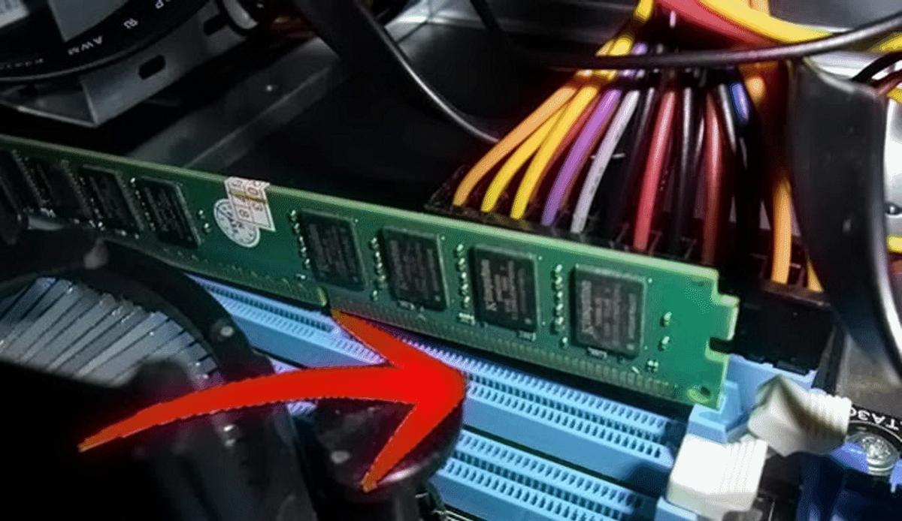
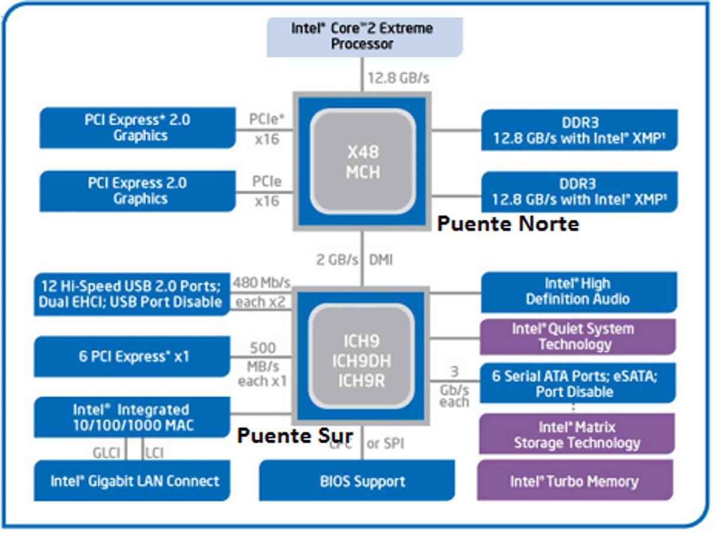
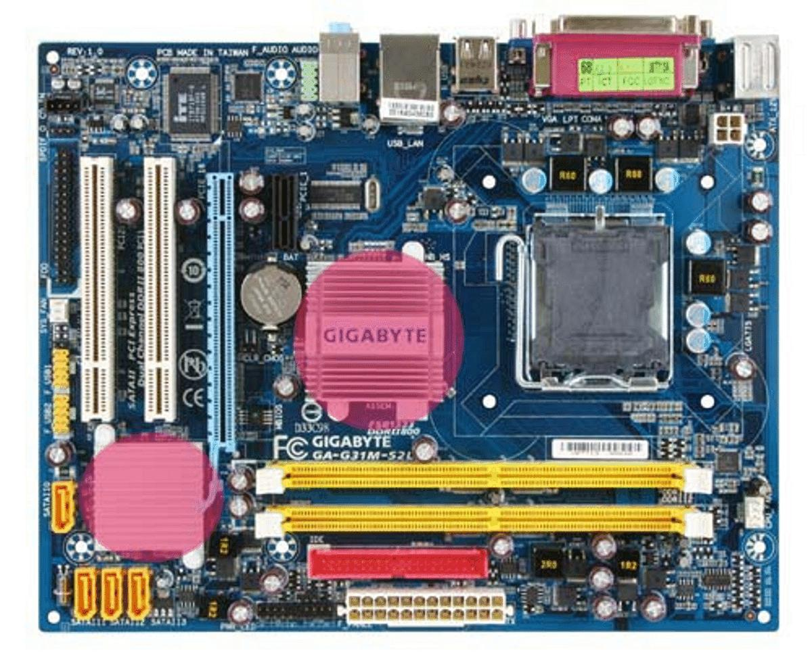
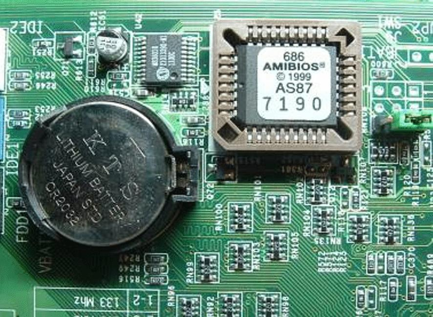
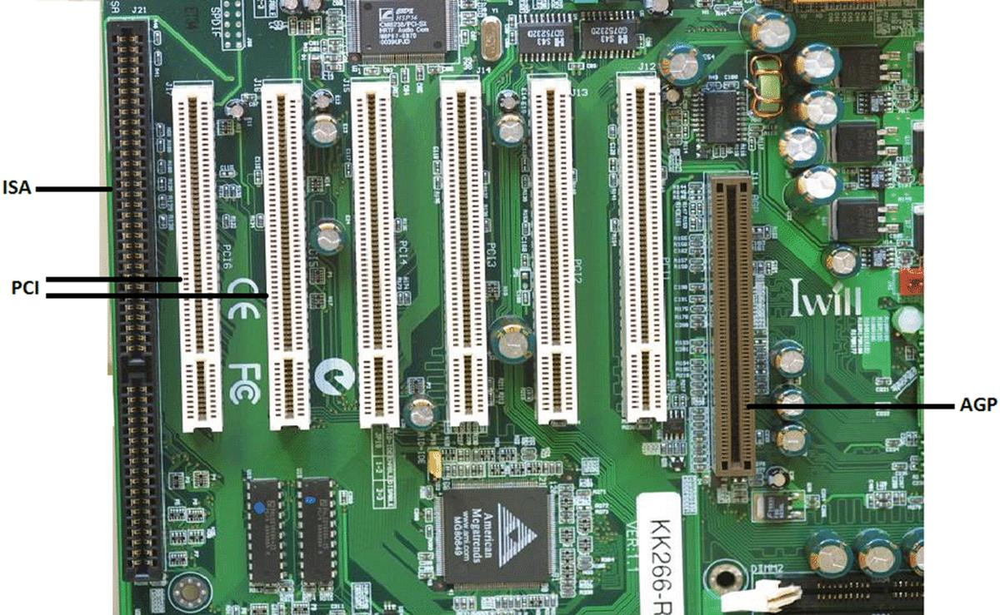
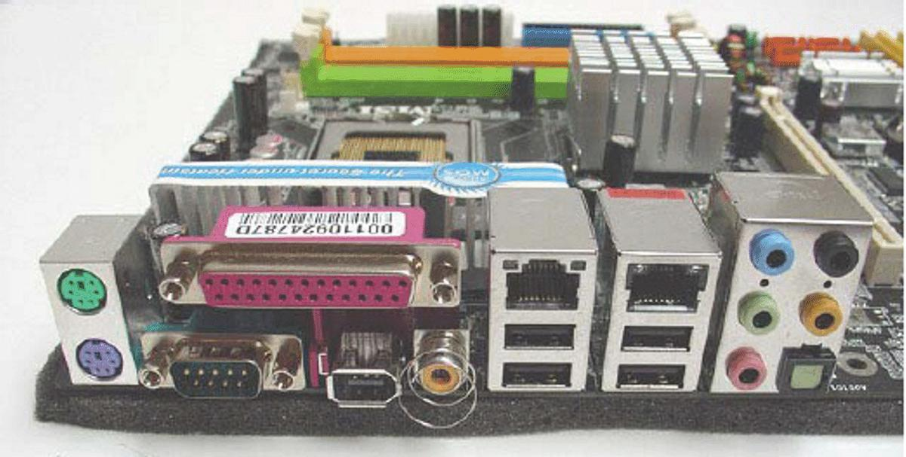
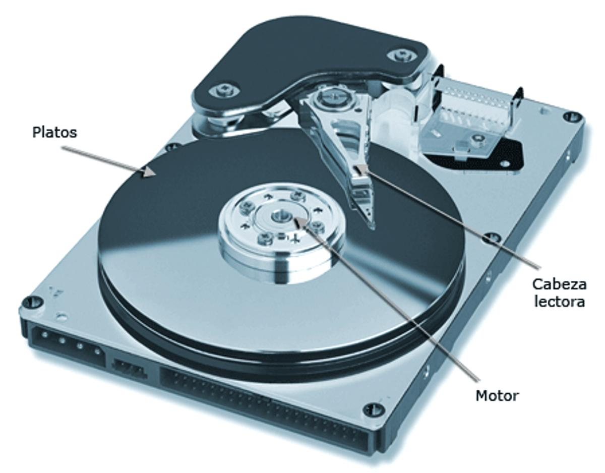
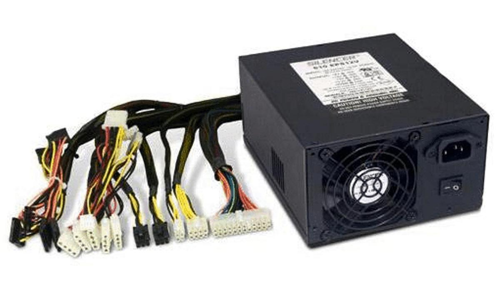

# 2. Arquitectura y organización de los sistemas de cómputo modernos

## Objetivo

- Caracterizar las arquitecturas y organización de los sistemas de cómputo modernos a través
de la descripción de sus elementos fundamentales y sus respectivas funcionalidades.

## 2.1. Introducción

En esta clase se presentan la arquitectura y organización de los computadores actuales. Se detallarán los principales componentes y sus funciones dentro del computador.

## 2.2. Tarjetas madres, definición y tipos

La placa base, placa madre o tarjeta madre (Motherboard o Mainboard), es el elemento principal de todo ordenador, en el que se encuentran o al que se conectan todos los demás aparatos y dispositivos. Físicamente, se trata de una placa de material sintético, sobre la cual existe un circuito electrónico que conecta diversos elementos que se encuentran colocados sobre ella.

Aunque el término Motherboard, o placa base, se utiliza con énfasis en los sistemas de escritorio y servidores en realidad el componente está presente en cualquier sistema electrónico. Es la superficie dónde se instalan físicamente los contactos eléctricos de los verdaderos componentes electrónicos.

### 2.2.1. Principales componentes de las tarjetas madres

En las placas base de los sistemas de escritorio y muchos servidores hay instalados conectores estándar para componentes de cómputo como el procesador, la memoria, unidades de almacenamiento persistentes o ampliación de capacidades (vídeo, sonido, red…).

**Figura 2.1.** Placa base de PC. 1) Sockets o base del microprocesador; 2) Conectores de memoria;

3) Chipset de control; 4) BIOS; 5) Conectores de expansión; 6) Conectores externos.

En las placas base de los dispositivos móviles en cambio, la superficie es menor y las capacidades fundamentales ya están embebidas en el SOC (System on Chip). Los conectores fundamentales son para puertos de comunicación USB, inalámbricos y tarjetas de memoria y de telefonía.

**Figura 2.2.** Placa base de iPhone. 1) System on Chip (SoC); 2) Sensores y componentes de

comunicación (telefonía celular, WiFi, Bluetooth…); 3) Conector para la tarjeta SIM.

#### 2.2.1.1. Socket (base o zócalo) del microprocesador

Lugar donde se inserta el “cerebro” del ordenador. Durante varios años ha consistido en un rectángulo o cuadrado donde el “micro”, una pastilla de plástico negro con patitas, se introduce.

Algunos tipos más comunes de bases, zócalo, o socket son:

- PGA: son el modelo clásico, usado en el 386 y el 486; consiste en un cuadrado de
conectores en forma de agujero donde se insertan las patitas del chip por pura presión.

Según el chip, tiene más o menos agujeritos.

- ZIF: Zero Insertion Force (socket), es decir, zócalo de fuerza de inserción nula.
Eléctricamente es como un PGA, aunque gracias a un sistema mecánico permite introducir el micro sin necesidad de fuerza alguna, con lo que el peligro de roturas del chip por romperle una patita desaparece.

- Tipo ranura: es un invento de Intel para enchufar los Pentium II, o más bien para
desenchufar a su competencia, AMD y Cyrix.

Antes del PC, el procesador se soldaba en la placa base como cualquier otro componente. La generación PC introdujo la posibilidad de intercambiar al procesador y ello también influyó en el ámbito de los servidores.

#### 2.2.1.2. Ranuras de memoria

Son los conectores de la memoria principal del ordenador, la RAM. Las memorias RAM de los computadores modernos son de tipo DDR, y las anteriores fueron SIMM y DIMM. Las memorias DDR tienen una ranura que permite que solo puedan ser conectadas de una forma en su slot correspondiente, mientras que DIMM tenía dos. No existe forma de conectar una DDR en un slot para DIMM, ni viceversa. Por su parte las SIMM, no tampoco tienen confusión, pues son más pequeñas que DIMM y DDR.

A continuación se muestra una imagen de unas ranuras para memorias RAM.

**Figura 2.3.** Ranuras para memorias RAM.

En la actualidad, la tecnología de memoria RAM dominante es la SDRAM-DDR, independientemente del formato físico y capacidad.

Ello se debe a la excelente combinación de costo de producción por bit, capacidad de integración y velocidad de comunicación con el procesador.

#### 2.2.1.3. Chipset de control

El Chipset es un conjunto de circuitos integrados que se encarga de realizar las funciones que el microprocesador delega en ellos. En los PC y otros sistemas él chipset está formado por 2 circuitos auxiliares al procesador principal:

- El puente norte se usa como puente de enlace entre dicho procesador y la memoria.
Controla las funciones de acceso hacia y entre el microprocesador, la memoria RAM, el puerto gráfico AGP, y las comunicaciones con el puente sur.

- El puente sur controla los dispositivos asociados como son la controladora de discos IDE,
puertos USB, Firewire, SATA, RAID, ranuras PCI, ranura AMR, ranura CNR, puertos infrarrojos, disquetera, LAN y una larga lista de todos los elementos que podamos imaginar integrados en la placa madre. Es el encargado de comunicar el procesador con el resto de los periféricos.

**Figura 2.4.** Esquema del Chipset.

Se debe destacar que en las motherboard modernas, el puente norte ha desaparecido, pues todas sus funciones se han incorporado dentro del microprocesador. Ejemplo de esto son los procesadores de INTEL, de la serie Core i. Esta nueva tecnología permite mejorar el funcionamiento del computador, elevando la velocidad de trabajo, mejorando el tratamiento de los gráficos y obteniendo una mejor interacción con la memoria RAM.

**Figura 2.5.** Chipset.

El Chipset es fácilmente identificable en una motherboard, pues son los únicos circuitos integrados que usan disipador térmico a parte del procesador. El puente norte es el circuito integrado más cercano al procesador.

#### 2.2.1.4. BIOS y Pila

El BIOS es el primer programa que se corre al encender una computadora. Por encontrarse encapsulado en la MotherBoard en un chip de memoria ROM también se le conoce como: ROM BIOS. Físicamente se localiza en un chip que suele tener forma rectangular, como el de la imagen.

La BIOS realmente no es sino un programa que se encarga de dar soporte para manejar ciertos dispositivos denominados de entrada-salida (Input-Output).

La BIOS del sistema es la encargada de realizar los tests post-arranque (llamado POST-BIOS), que verificará el correcto funcionamiento de todos los componentes de la placa. Suministra al Sistema Operativo el soporte a bajo nivel del hardware al encargarse de gestionar y controlar los accesos a los buses o a la controladora IDE, entre otras cosas. Actualmente son de tipo Flash, lo que significa que son fácilmente actualizables con un simple programa.

**Figura 2.6.** BIOS.

Para mantener la configuración del BIOS y que al encender la PC todos los datos estén actualizados, se hace necesaria una fuente de alimentación continua. Para esto se utiliza la pila, que en su mayoría son de litio por su alta eficiencia y por su durabilidad.

Una forma de identificar al BIOS es localizando la Pila. Regularmente se ubican en las motherboard muy cerca una de la otra.

#### 2.2.1.5. Ranuras de expansión

Las ranuras de expansión son unos conectores de cubierta plástica dónde se introducen las tarjetas de expansión. Según la tecnología en que se basen presentan un aspecto externo diferente, con diferente tamaño y a veces incluso en distinto color.

- Ranuras ISA.
- Ranuras PCI.
- Ranuras AGP.
- PCI Express.

**Figura 2.7.** Ranuras ISA, PCI y AGP. Se les denomina Slots en la bibliografía en inglés.

#### 2.2.1.6. Conectores externos e internos

Los conectores externos son todos los que permiten la comunicación del PC con el exterior, tanto para entrada como para salida de datos. Se trata de los conectores para los puertos o periféricos externos: teclado, ratón, los USB, puertos serie o paralelo para la impresora.

**Figura 2.8.** Conectores externos.

Los principales conectores son:

- Teclado y mouse: mini-DIN o PS/2 en placas ATX y muchos diseños propietarios.
- Puerto paralelo: también llamado “LPT1” (en los pocos casos que existen más de uno, el
segundo sería LPT2). Es un conector hembra de unos 38 mm, con 25 pines agrupados en 2 hileras.

- Puertos serie: o bien puertos “COM” o “RS232”. Suelen ser dos, uno estrecho de unos 17
mm, con 9 pines agrupados en 2 hileras (habitualmente “COM1”). Puerto de juegos: o puerto para joystick o teclado midi. De tamaño algo mayor que el puerto serie estrecho, de unos 25 mm, con 15 pines agrupados en 2 hileras.

- Puerto VGA: suponiendo que nuestra tarjeta de vídeo sea de este tipo (incluyendo SVGA,
XGA...). Aunque lo común es que no esté integrada en la placa base sino en una tarjeta de expansión, vamos a describirlo para evitar confusiones: de unos 17 mm, con 15 pines agrupados en 3 hileras.

- Conectores de panel frontal: en estos pines se conectan todos los leds y pulsadores que
encontramos en el frontal de nuestra caja, como el Reset o, en las cajas con fuente de alimentación ATX, el Power.

En las placas más modernas (ni siquiera en todas las ATX) pueden existir otros tipos de puertos como son:

- Puerto USB: de forma estrecha y rectangular. Se supone que en unos años casi todo se
conectará al USB, en una cadena de periféricos conectados al mismo cable.

- Conector Wake-On-LAN: este conector, al que se enchufa un cable desde la tarjeta de red,
ofrece la posibilidad de poner en marcha un equipo de forma remota enviando un determinado paquete a la tarjeta de red compatible con esta función.

- Conector de módulo de infrarrojos. A estos conectores se enchufa el módulo de infrarrojos
para enviar y recibir datos mediante luz infrarroja. Permite la misma velocidad que un puerto serie y de hecho la BIOS lo identifica como tal en el sistema.

Los conectores internos son los que permiten la conexión de la motheboard con la fuente de alimentación, con los puertos USB delanteros de los chasis de los computadores, entre otros.

## 2.3. Microprocesadores

Los microprocesadores son los componentes que ejecutan las operaciones que se realizan por los computadores. En la clase anterior se mencionaron algunos de los más significativos dentro de la arquitectura de INTEL. Se debe tener en cuenta que en la actualidad existe otro fabricante que es quién compite directamente con INTEL y que tiene desarrollos muy interesantes, hacemos referencia de AMD.

Los procesadores comerciales de INTEL actuales, están desarrollados bajo el nombre Core i, los cuales aparecieron en el año 2008 y hasta la fecha han evolucionado en 4 generaciones que han

incorporado tecnologías que hacen muy eficientes a los computadores. A continuación una breve reseña de los procesadores de la serie Core i y sus generaciones.

Aunque todavía hay segmentación del mercado en cuanto a fabricantes, el impulso reciente de los sistema móviles deja entrever que en el futuro deberá surgir una tecnología que integre las bondades del bajo consumo y simpleza de ARM con la potencia de cálculo y capacidad de multiprocesamiento de Intel y AMD.

### 2.3.1. Nehalem

Nehalem es el nombre de la arquitectura de los primeros Core i. En estos, la memoria está directamente conectada al procesador y soportan memoria de triple canal, donde cada canal puede soportar una, dos o tres memorias tipo DDR3. Están fabricados a partir de 731 millones de transistores, que permiten conformar procesadores de dos, cuatro u ocho núcleos. Poseen memoria caché L3 compartida y una tecnología de fabricación de 32 nm.

Algunas de las principales tecnologías incorporadas son:

- Escalabilidad dinámica: núcleos administrables, subprocesos, caché, interfaces y
alimentación de energía para el desempeño ecológico a pedido.

- Escalabilidad del diseño y desempeño: para PCs compatibles con dos y más de ocho
núcleos, y hasta más de 16 subprocesos mediante Intel® Hyper-Threading Technology, así como tamaños de caché escalables, interconexiones del sistema y controladores de memoria integrados.

- Desempeño inteligente a pedido: con Intel® Turbo Boost Technology que saca provecho de
la energía y el margen térmico del procesador. Se aumenta el desempeño para las cargas de trabajo que ejecutan uno o varios subprocesos.

- Memoria compartida escalable: que se distribuye entre cada procesador con los
controladores de memoria integrados y las interconexiones de punto a punto de alta velocidad de Intel.

- Caché compartida a multinivel: que aumenta el desempeño y la eficacia al reducir la
latencia de acceso a los datos más utilizados.

### 2.3.2. Sandy bridge

Nombre de la arquitectura sucesora de Nehalem, incorporada en el año 2011. Su numeración es ix-2XXX, donde el número 2 indica que es de la segunda generación. Incorporaron muchas funcionalidades debido a la reducción del tamaño de los transistores, lo que hizo es posible integrar más subsistemas en el procesador.

Los procesadores Sandy Brigde, están compuestos por transistores cuadrados de 32 nanómetros de ancho de puerta, por lo que su área se reduce a la mitad. El fabricante puede entonces tener el doble de ellos en la misma área. Esta reducción también permite al procesador funcionar con menos energía. Soportan procesadores de hasta 6 núcleos y en algunos modelos incorpora Hyperthreading.

Algunas de las principales tecnologías incorporadas son:

- Soporte de instrucciones: se han añadido nuevas instrucciones que trabajan a 256 bits.
Permiten cálculos complejos, para acelerar el tratamiento de imágenes, audio, vídeo y 3D.

- Tarjeta gráfica integrada: en muchos casos incide en que no haga falta utilizar Tarjetas
Gráficas, lo cual permite reducir costos.

- Quick Sync: para acelerar la creación, edición y conversión de vídeos.
- Overclock: permiten modificar la frecuencia de funcionamiento. Se puede aumentar mucho
la velocidad, sin llegar a quemarse, incluso usando ventilación por aire.

### 2.3.3. Ivy brigde

Ivy Brigde es el nombre en clave para la microarquitectura de microprocesadores desarrollada por Intel como sucesora de la Sandy Bridge. Incluye una tecnología de fabricación de los microprocesadores de 22 nanómetros y transistores Tri-Gate. Son retrocompatibles con la plataforma de Sandy Bridge y usan el mismo socket.

Han incorporado:

- Tecnología Transistores Tri-Gate: menos del 50% de consumo energético al mismo nivel de
rendimiento respecto de los transistores planos.

- Soporte para PCI Express 3.0.
- Soporte para memoria RAM hasta 2800 MT/s en incrementos de 200 MHz.
- Intel HD Graphics con soporte para DirectX 11, OpenGL 3.1, y OpenCL 1.1.
- La GPU se tiene que posee hasta 16 unidades de ejecución, comparado con Sandy Bridge
que su máximo es de 12.

- DDR3L de baja tensión para procesadores móviles.

### 2.3.4. Haswell

Haswell es una versión mejorada de Ivy Brigde. Mantiene la tecnología de fabricación de 22 nm, pero buscando una mejora significativa en el rendimiento como minimizando el consumo energético. Poseen un Socket LGA 1150 y mejoras en las instrucciones. Introdujeron una pequeña caché adicional para apoyar el trabajo de la GPU lo que permite nuevos gráficos integrados más potentes.

Se les ha dotado de:

- Menor consumo en standby. Esta es una de las razones por las que Haswell puede ser una
auténtica revolución. Se puede dejar la PC encendido, actualizando twitter, Facebook, correo y otro tipo de aplicaciones sin que consuma la batería.

- Chipset junto con CPU y GPU, todo en el mismo chip, logrando un consumo sensiblemente
menor. Esta solución da lugar a un SoC más eficiente y que les permite ahorrar espacio. Esto es ideal para portátiles, pues permite que los equipos son cada vez sean más finos y pequeños, menos pesados y les dure más la batería.

## 2.4. Unidades de discos

Las unidades de discos, permiten el almacenamiento masivo de datos. Pueden ser: 1.

Discos Duros (HDD). 2.

Unidades ópticas (CD, DVD, Blu Ray). 3.

Unidades de estado sólido.

**Figura 2.9.** Disco duro.

Los HDD están formados por discos de metal magnetizado, que es donde se guardan los datos.

Poseen un motor que hace girar los discos y cabezales accionados por electroimanes para leer la información. Incluyen un circuito electrónico de control, que incluye la interfaz con la PC y la

memoria caché y un brazo actuador que mueve las cabezas sobre los discos. Todo lo anterior insertado dentro de una caja hermética (aunque no al vacío), que protege el conjunto.

Las unidades ópticas leen la información contenida en los discos a través de la reflexión de luz láser. Los discos son diseñados a partir de una base de resina (policarbonato) cubierto por aluminio y almacenamiento se produce a partir de marcas que se realizan en la base del disco, los cuales giran siempre a una velocidad constante.

Las unidades de estado sólido son de reciente aparición y se diseñan sobre la base de memorias semiconductoras, al igual que las memorias flash. Esta tecnología debe imponerse como medio de almacenamiento principal de los computadores, pero aún no está del todo establecida.

## 2.5. Fuentes de alimentación

La misión de las fuentes de alimentación se divide en tres funciones diferentes: 1.

Rectificar la corriente que recibe de la red (alterna) a corriente directa (DC). 2.

Transformar de 110/220 V a 3.3, -5, +5 -12 y +12 V. 3.

Estabilizar esa corriente de salida para que el voltaje que entrega por los diferentes canales sea siempre el mismo, independientemente de las fluctuaciones que pueda sufrir la corriente eléctrica de entrada.

Se clasifican en:

- Fuentes de alimentación colineales: basadas en condensadores.
- Fuentes de alimentación conmutadas: basadas en transistores de conmutación.
En los sistenas de cómputo de escritorio y servidores, la fuente de alimentación es tan importante como cualquier otro componente. En los primeros para soportar la expansión de hardware de alto consumo como las tarjetas de vídeo de gama alta y en los segundos para mantener un servicio estable y bajo nivel de roturas.

Existen de dos tipos fundamentales: 1.

AT: el suministro de corriente a la placa lo hacen mediante dos conectores planos de 6 pines cada uno. Esto provocaba errores de colocación, que podían llegar a provocar averías. Están en desuso. Se usaron hasta la llegada del Pentium MMX. 2.

ATX: siempre están suministrando un canal de 5 v a la placa base para mantener constante su funcionamiento función. También permiten activarse mediante otros medios, como puede ser mediante la tarjeta de red o mediante el módem. Sus conectores, pasaron

de ser dos de 6 pines a uno de 20. Con la salida del Pentium 4 se les añadió un conector independiente de 4 pines y 12 V.

**Figura 2.10.** Fuente de Alimentación.

## 2.6. Conclusiones

En esta clase se caracterizaron las arquitecturas y organización de los sistemas de cómputo modernos través de la descripción de sus elementos fundamentales y sus respectivas funcionalidades. Se describieron los componentes que conforman una motherboard, haciendo hincapié en los más importantes, como el Chipset y el Microprocesador. Se mostraron otros componentes de vital importancia para el funcionamiento de un computador, como lo es la fuente de alimentación y los discos ópticos.

# Resumen
