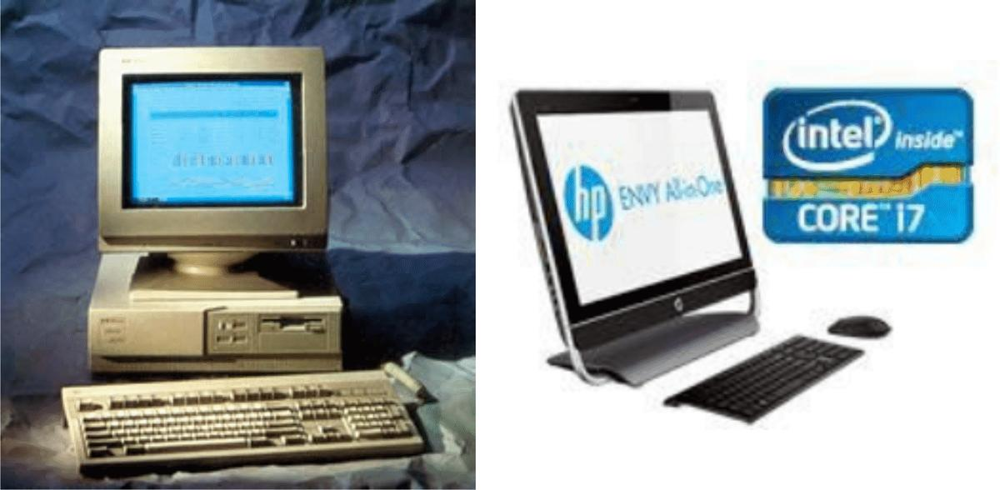
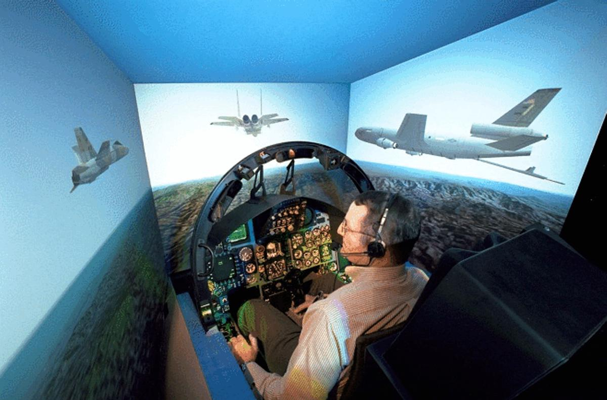
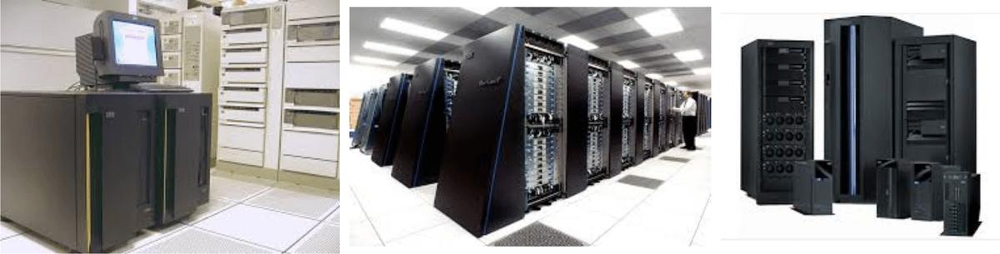
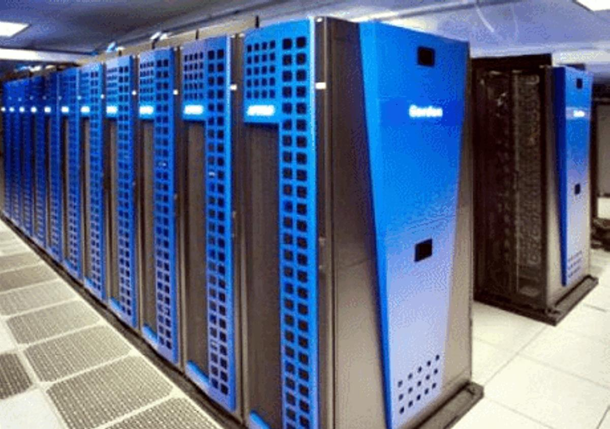
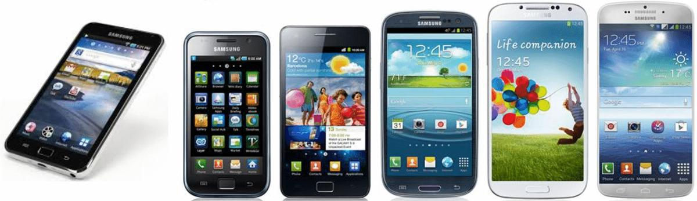

# 19. Tipos de sistemas de cómputo

## Objetivo

- Caracterizar los tipos de sistemas de cómputo.

## 19.1. Introducción

Conforme la tecnología ha avanzado, la misma tecnología de los sistemas de cómputo ha provocado que se desarrollen nuevas formas y nuevos usos. Antes solamente se utilizaban los sistemas de cómputo en actividades científicas estrictamente. En nuestros días es muy difícil, por no decir imposible, encontrar un sector en el cual los sistemas de cómputo no se encuentren profundamente arraigados. Desde los grandes centros de experimentación e innovación científica, la industria, los servicios en la sociedad, hasta la misma cotidianidad de la sociedad misma, todas estas esferas de la vida tienen un soporte por los sistemas de cómputo. En esta conferencia se analizarán los tipos de sistemas de cómputo que existen así como sus características fundamentales.

## 19.2. Clasificación de los sistemas de cómputo

Existen varios criterios para clasificar los sistemas de cómputo. Algunos de los más importantes se detallan a continuación.

Clasificación por la especificidad de uso Este criterio hace referencia al uso o propósito para el cual se diseñan y construyen: propósito general y propósito específico. 1.

Computadora de uso general: la computadora de propósito general se programa para una variedad de tareas o aplicaciones. Son utilizadas para realizar cálculos matemáticos, estadísticos, contabilidad comercial, control de inventario, nómina, preparación de inventario, etc.

Ejemplo: “mainframes” y minicomputadoras. Puede utilizarse en diferentes aplicaciones, como cálculos científicos, cálculos técnicos o de gestión administrativa. Es el usuario, quien determina qué aplicación realizar dependiendo del programa que decida ejecutar.

**Figura 19.1.** Diferentes sistemas de cómputo de propósito general. A la izquierda un PC de escritorio

basado en un procesador 386, a la derecha una laptop moderna basado en un procesador Core i7. 2.

Computadora de uso específico: la computadora de propósito especial está dedicada a un solo propósito o tarea. Pueden ser usadas para producir informes del tiempo, monitorear desastres naturales, hacer lecturas de gasolina y como medidor eléctrico.

Ejemplo: carros de control remoto, hornos microondas, relojes digitales, cámaras, procesador de palabras, etc. Regularmente suelen construirse con microprocesadores y sólo pueden utilizarse para una aplicación concreta o un grupo de aplicaciones determinado. Ejemplos: Una computadora para control de tráfico, un video-juego de bolsillo, la contenida en un robot. La mayoría son computadoras embebidas, que no son accesibles directamente por formar parte de un sistema, como en las cámaras y videograbadoras digitales y muchos otros equipos domésticos o industriales.

Un simulador es un ejemplo de las computadoras de uso específico y puede ser un simulador de vuelo, de entrenamiento y en otros campos como, la administración de plantas nucleares, los vuelos espaciales, el atletismo, la exploración marina, etc.

**Figura 19.2.** La imagen muestra un simulador de vuelo, es un ejemplo de sistemas de cómputo de

propósito específico. Note los controles de simulación con los que interactúa el usuario.

Clasificación por tecnología Atendiendo a este criterio los sistemas de cómputo pueden clasificarse en: analógicos, digitales e híbridos. 1.

Analógicos: los sistemas de cómputo analógicos son los que aceptan y procesan señales continuas, tales como: fluctuaciones de voltaje o frecuencias. Se dedican a una tarea específica, hacen cálculos o trabajos relacionados entre otras cosas con presión, temperatura, tensión o electricidad, opera sobre datos representados en medidas físicas de tipo continuo como Km, Kg, etc.

Por ejemplo: el surtidor de gasolina que trabaja con dos magnitudes: la cantidad que puede estar expresada en litros y el precio que está expresado en una unidad monetaria, y que se genera a partir de la cantidad de gasolina suministrada.

Las computadoras analógicas representan los números mediante una cantidad física, es decir, asignan valores numéricos por medio de la medición física de una propiedad real, como la longitud de un objeto, el ángulo entre dos líneas o la cantidad de voltaje que pasa a través de un punto en un circuito eléctrico. Las computadoras analógicas obtienen todos sus datos a partir de alguna forma de medición. Aun cuando es eficaz en algunas aplicaciones, este método de representar los datos es una limitación de las computadoras analógicas. La precisión de los datos usados en una computadora analógica está íntimamente ligada a la precisión con que pueden medirse. 2.

Digitales: la computadora digital es la que acepta y procesa datos que han sido convertidos al sistema binario. La mayoría de las computadoras son digitales. Este tipo de

computadoras opera sobre diversos tipos de datos alfabéticos, numéricos, imágenes, sonidos, videos. No se dedican a una tarea en específico, sino de propósito general, es decir, pueden usar gráficos, control de inventarios, diseño de nómina de contabilidad, etc.

Las computadoras digitales representan los datos o unidades separadas. Las calculadoras de bolsillo son ejemplos comunes de dispositivos construidos según los principios de la Computadora Digital. Para obtener resultados, las computadoras analógicas miden, mientras que las computadoras digitales cuentan. 3.

Híbridos: los sistemas de cómputo híbridos son sistemas digitales que procesan señales análogas que han sido convertidas a forma digital. Es decir, procesa ambos tipos de datos.

Son utilizadas para control de procesos y en robótica. Combinan las características más favorables de las computadoras digitales y analógicas tienen la velocidad de las analógicas y la precisión de las digitales. Generalmente se usan en problemas especiales en los que los datos de entrada provienen de mediciones convertidas a dígitos y son procesados por una Computadora por ejemplo las Computadoras Híbridas controlan el radar de la defensa de Estados Unidos y de los vuelos comerciales.

Capacidad de procesamiento Atendiendo a este criterio los sistemas de cómputo pueden clasificarse en: microcomputadoras, minicomputadoras, macrocomputadoras, mainframe y supercomputadoras. 1.

Minicomputadoras: se desarrollaron en la década de 1960 para llevar a cabo tareas especializadas, tales como el manejo de datos de comunicación. Son más pequeñas, más baratas y más fáciles de mantener e instalar que los “mainframes”, Usadas para dar servicios a empresas medianas y pequeñas que necesitan conexión de estaciones de trabajo y manejo considerable de información. Su mercado ha ido disminuyendo desde que surgieron las microcomputadoras. Son el punto intermedio entre una microcomputadora y una macrocomputadora, en cuanto a su forma de operar se asemeja más a una macrocomputadora ya que fueron diseñadas para: - Entornos de múltiples usuarios, apoyando múltiples actividades de proceso al mismo tiempo. - Ofrecer ciertos servicios más específicos. - Soportar un número limitado de dispositivos. - Pequeñas y de bajo costo. - Para múltiples aplicaciones. 2.

Macrocomputadoras: la macrocomputadora es un sistema de aplicación general cuya característica principal es el hecho de que el CPU es el centro de casi todas las actividades de procesamiento secundario.

Por lo general cuenta con varias unidades de disco para procesar y almacenar grandes cantidades de información. El CPU actúa como árbitro de todas las solicitudes y controla el acceso a todos los archivos, lo mismo hace con las operaciones de Entrada/Salida cuando se preparan salidas impresas o efímeras. El usuario se dirige a la computadora central de la organización cuando requiere apoyo de procesamiento.

3.

Mainframes: una computadora central o mainframe es una computadora grande, potente y costosa usada principalmente por una gran compañía para el procesamiento de una gran cantidad de datos; por ejemplo, para el procesamiento de transacciones bancarias.

Se puede traducir como “constitución principal”, son computadoras grandes, ligeras, capaces de utilizar cientos de dispositivos de entrada y salida. Procesan millones de instrucciones por segundo. Su velocidad operacional y capacidad de procesar hacen que las grandes empresas confíen en ellas. Su principal función es procesar grandes cantidades de datos velozmente. Estos datos están accesibles a los usuarios del “mainframe” o a los usuarios de las microcomputadoras cuyos terminales están conectados al “mainframe”. Requieren de un sistema especial para controlar la temperatura y la humedad. También requieren de un personal profesional especializado para procesar los datos y darle el mantenimiento.

**Figura 19.3.** Diversos mainframes.

4.

Supercomputadoras: es lo máximo en computadora, es la más rápida y, por lo tanto, la más cara. Cuesta millones de dólares y se hacen de dos a tres al año. Procesan billones de instrucciones por segundo. Son utilizadas para trabajos científicos, particularmente para crear modelos matemáticos del mundo real, llamados simulaciones. Algunos ejemplos de uso lo son: exploración y producción petrolera, análisis estructural, efectos especiales de películas y otros de igual magnitud. La Supercomputadora es un sistema de cómputo más grande, diseñadas para trabajar en tiempo real.

Estos sistemas son utilizados principalmente por la defensa de los Estados Unidos y por grandes Empresas multimillonarias, utilizan telecomunicaciones a grandes velocidades, para poner un ejemplo estas máquinas pueden ejecutar millones de instrucciones por segundo. Actúa como árbitro de todas las solicitudes y controla el acceso a todos los archivos, lo mismo hace con las operaciones de Entrada/Salida cuando se preparan salidas impresas o temporales. El usuario se dirige a la computadora central de la organización cuando requiere apoyo de procesamiento.

Como características esenciales se pueden definir que el CPU es el centro de procesamiento y están diseñadas para sistemas multiusuario.

¿Sabías que?

En febrero de 2011, el Servicio Nacional del Clima de Estados Unidos anunció planes para invertir US$502 millones en diez años en una supercomputadora que ayudará en el modelado y el pronóstico del clima. La Administración Atmosférica y Oceánica Nacional (NOAA) también usa supercomputadoras para realizar su trabajo. Las supercomputadoras de estas dos instituciones son capaces de realizar miles de millones de cálculos cada segundo. Esta velocidad permite a los meteorólogos examinar modelos climáticos con mayor rapidez y actualizar a las comunidades sobre condiciones climáticas peligrosas que se aproximen.

**Figura 19.4.** Supercomputadora utilizada para estudios meteorológicos.

5.

Microcomputadoras: la microcomputadora es conocida como computadora personal o PC.

Es la más pequeña, gracias a los microprocesadores, más barata y más popular en el mercado. Puede funcionar como unidad independiente o estar en red con otras microcomputadoras o como un terminal de un “mainframe” para expandir sus capacidades. Puede ejecutar las mismas operaciones y usar los mismos programas que muchas computadoras superiores, aunque en menor capacidad. Las microcomputadoras, computadoras personales o PC como variadamente se les llama, constituyen el grupo de computadoras que cotidianamente se observa en el trabajo, en las oficinas y hogares. La mayoría de software y hardware están diseñados para este tipo de computadoras, generalmente se presentan como estación individual de trabajo (como en la casa), pero se puede conectar con otras computadoras y formar una red.

Las microcomputadoras son las computadoras más accesibles para cualquier tipo de usuario, son máquinas personales de escritorio. Pequeñas solo en tamaño físico y accesibles económicamente, este tipo de computadoras son tan dinámicas, que lo mismo

las puede utilizar un experto en el trabajo como un niño en casa, por esta razón las microcomputadoras son las más conocidas, y ofrecen un sin número de aplicaciones.

En un principio solo era posible utilizarlas en ambiente monousuario, esto es un solo usuario a la vez, pero con los avances tecnológicos desde hace ya bastante tiempo este tipo de máquinas pueden ser utilizadas en ambientes multiusuarios, incluso como servidores de una red de computadoras. Pequeñas de bajo costo y para múltiples aplicaciones.

Tipos de Computadoras personales Los tipos de computadores personales pueden clasificarse en: escritorio, portátil, laptop y notebook. 1.

Escritorio: es el nombre para la PC que se usa en el escritorio, la que más conocemos. 2.

Portátil: pequeñas computadoras de mano, se les llama en inglés “Palmtop” o “Pock etPC”, es decir, de mano o de bolsillo. Realizan todas las funciones básicas de una computadora. Tiene capacidad limitada y la mayoría usa una batería como fuente de poder. 3.

Laptop: se traduce como plegable, son más grandes que las anteriores pero realiza las funciones básicas también. La “Laptop” tiene pantalla plana. 4. “Notebook”: se traduce como cuaderno, libreta. Es la más pequeña del grupo.

## 19.3. Conclusiones

En el mundo actual, se hace imprescindible conocer cómo elegir un sistema de cómputo. Por esta razón en esta clase se han dado detalles de computadores de escritorio, portátiles, y supercomputadores para aplicaciones de gran envergadura.

Debe quedar claro, que el mejor computador es aquel que se ajusta a nuestras necesidades y para ello se debe revisar el presupuesto, así como el tipo de uso que se les va a dar.

# Resumen

