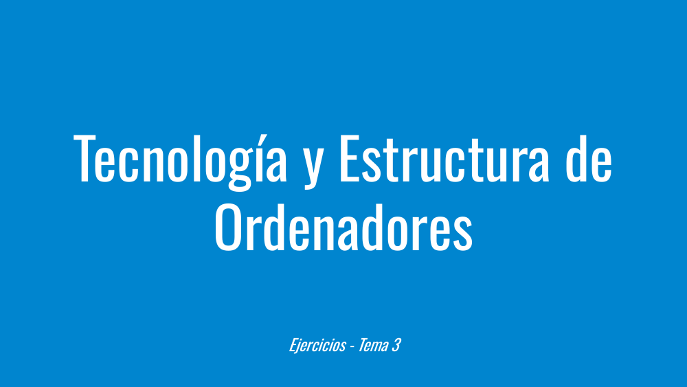
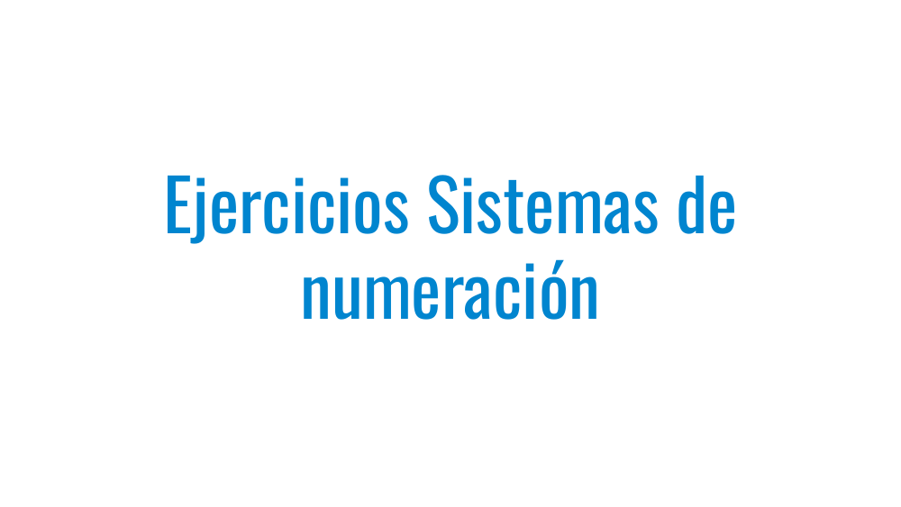
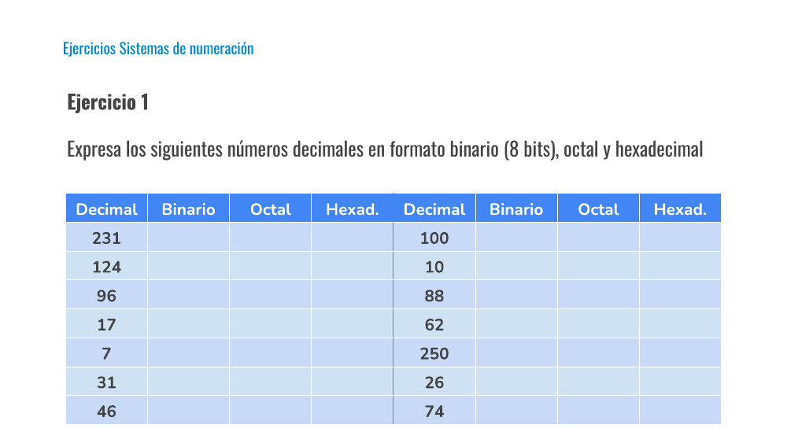
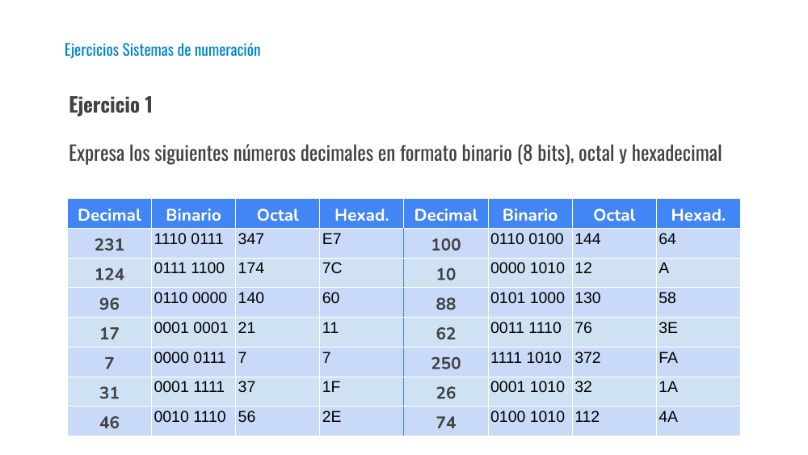
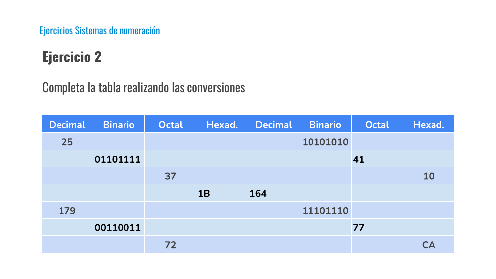
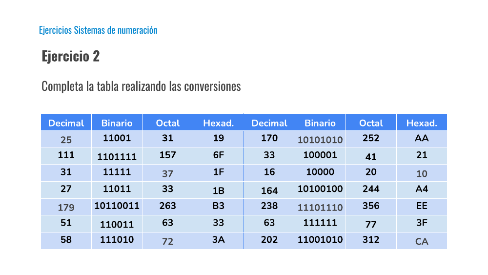
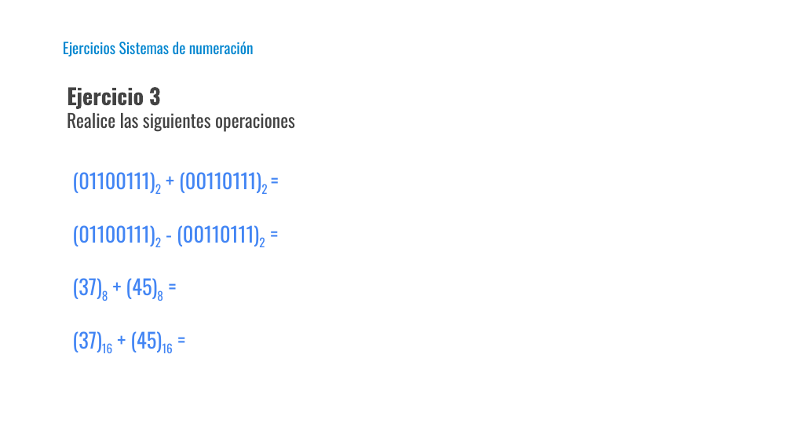

# Tema 3 - Ejercicios

Presentación de **Tecnología y Estructura de Ordenadores (TEO / IYA001)** — Universidad Europea del Atlántico.

Archivo original: [Tema 3 - Ejercicios.pdf](Tema%203%20-%20Ejercicios.pdf)

Total de diapositivas: 9

---

## Loyda Leticia Alas Castaneda

- loyda.alas@uneatlantico.es

---

## Tecnología y Estructura de Ordenadores

- Ejercicios - Tema 3

---

## Ejercicios Sistemas de numeración

---

## Ejercicios Sistemas de numeración

- Ejercicio 1
- Expresa los siguientes números decimales en formato binario (8 bits), octal y hexadecimal

| Decimal | Binario | Octal | Hexad. | Decimal | Binario | Octal | Hexad. |
| --- | --- | --- | --- | --- | --- | --- | --- |
| 231 |  |  |  | 100 |  |  |  |
| 124 |  |  |  | 10 |  |  |  |
| 96 |  |  |  | 88 |  |  |  |
| 17 |  |  |  | 62 |  |  |  |
| 7 |  |  |  | 250 |  |  |  |
| 31 |  |  |  | 26 |  |  |  |
| 46 |  |  |  | 74 |  |  |  |

---

## Ejercicios Sistemas de numeración

- Ejercicio 1
- Expresa los siguientes números decimales en formato binario (8 bits), octal y hexadecimal

| Decimal | Binario | Octal | Hexad. | Decimal | Binario | Octal | Hexad. |
| --- | --- | --- | --- | --- | --- | --- | --- |
| 231 | 1110 0111 | 347 | E7 | 100 | 0110 0100 | 144 | 64 |
| 124 | 0111 1100 | 174 | 7C | 10 | 0000 1010 | 12 | A |
| 96 | 0110 0000 | 140 | 60 | 88 | 0101 1000 | 130 | 58 |
| 17 | 0001 0001 | 21 | 11 | 62 | 0011 1110 | 76 | 3E |
| 7 | 0000 0111 | 7 | 7 | 250 | 1111 1010 | 372 | FA |
| 31 | 0001 1111 | 37 | 1F | 26 | 0001 1010 | 32 | 1A |
| 46 | 0010 1110 | 56 | 2E | 74 | 0100 1010 | 112 | 4A |

---

## Ejercicios Sistemas de numeración

- Ejercicio 2
- Completa la tabla realizando las conversiones

| Decimal | Binario | Octal | Hexad. | Decimal | Binario | Octal | Hexad. |
| --- | --- | --- | --- | --- | --- | --- | --- |
| 25 |  |  |  |  | 10101010 |  |  |
|  | 01101111 |  |  |  |  | 41 |  |
|  |  | 37 |  |  |  |  | 10 |
|  |  |  | 1B | 164 |  |  |  |
| 179 |  |  |  |  | 11101110 |  |  |
|  | 00110011 |  |  |  |  | 77 |  |
|  |  | 72 |  |  |  |  | CA |

---

## Ejercicios Sistemas de numeración

- Ejercicio 2
- Completa la tabla realizando las conversiones

| Decimal | Binario | Octal | Hexad. | Decimal | Binario | Octal | Hexad. |
| --- | --- | --- | --- | --- | --- | --- | --- |
| 25 | 11001 | 31 | 19 | 170 | 10101010 | 252 | AA |
| 111 | 1101111 | 157 | 6F | 33 | 100001 | 41 | 21 |
| 31 | 11111 | 37 | 1F | 16 | 10000 | 20 | 10 |
| 27 | 11011 | 33 | 1B | 164 | 10100100 | 244 | A4 |
| 179 | 10110011 | 263 | B3 | 238 | 11101110 | 356 | EE |
| 51 | 110011 | 63 | 33 | 63 | 111111 | 77 | 3F |
| 58 | 111010 | 72 | 3A | 202 | 11001010 | 312 | CA |

---

## Ejercicios Sistemas de numeración

- Ejercicio 3
- Realice las siguientes operaciones

- (01100111)2 + (00110111)2 =
- (01100111)2 - (00110111)2 =
- (37)8 + (45)8 =
- (37)16 + (45)16 =

---

## Diapositiva 9

---
