# Tema 4 - 2da Parte

Presentación de **Tecnología y Estructura de Ordenadores (TEO / IYA001)** — Universidad Europea del Atlántico.

Archivo original: [Tema 4 - 2da Parte.pdf](Tema%204%20-%202da%20Parte.pdf)

Total de diapositivas: 24

---

## Loyda Leticia Alas Castaneda

- loyda.alas@uneatlantico.es

---

## Tecnología y Estructura de Ordenadores

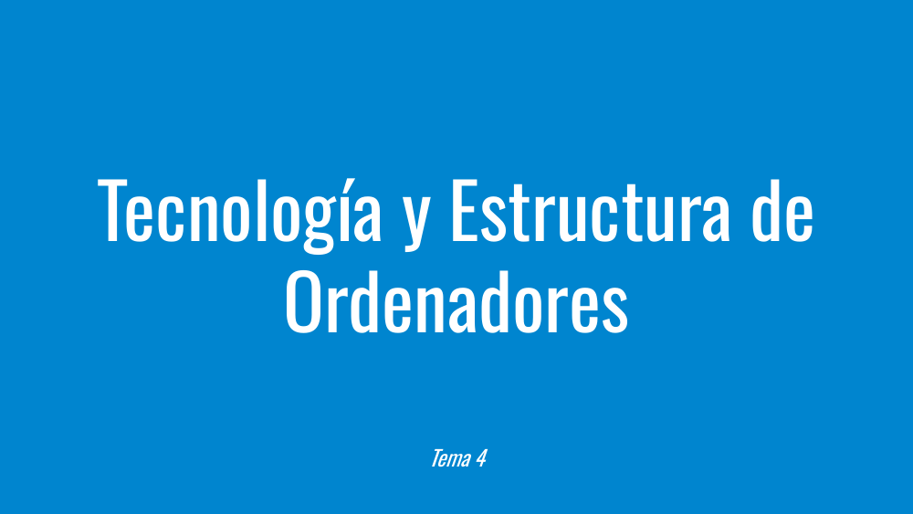

- Tema 4

---

## Representación digital de la Información

---

## Diapositiva 4

---

## Esquema Matrioshka

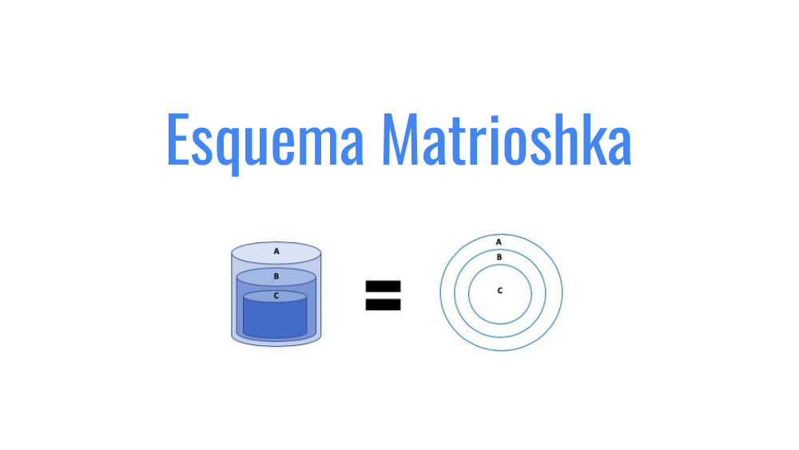

---

## Diapositiva 6

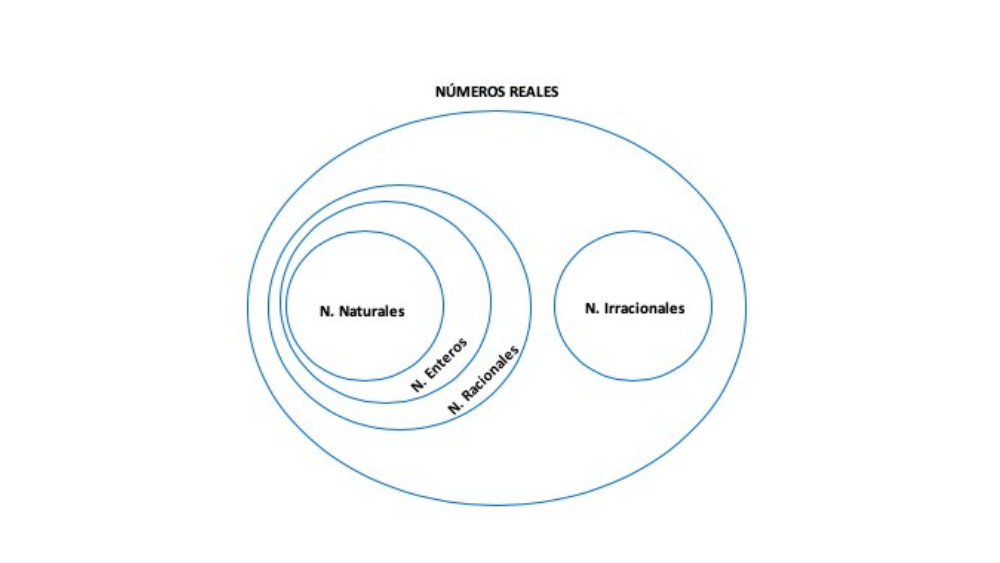

---

## Representación de números enteros y reales

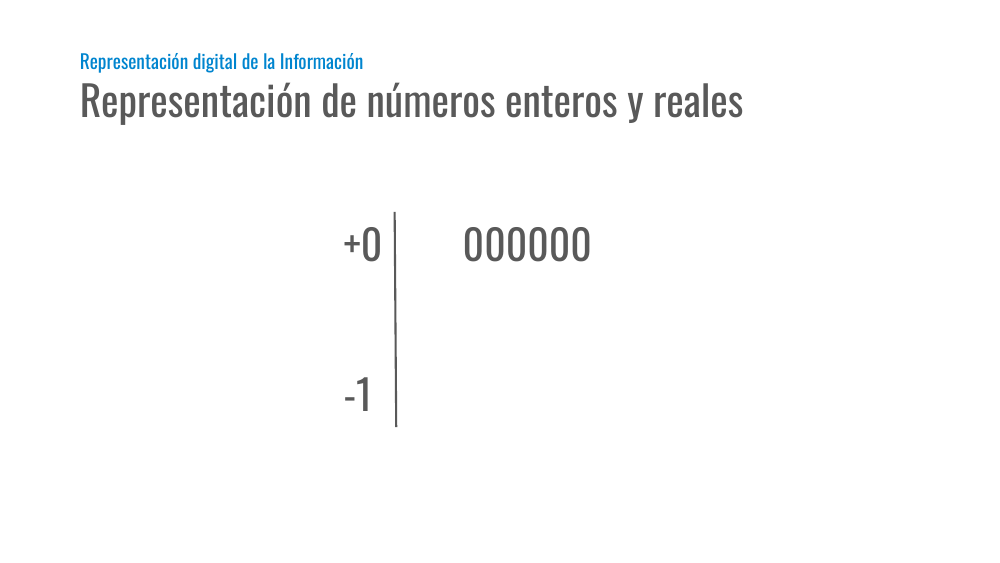

- Representación digital de la Información

---

## Representación de números enteros y reales

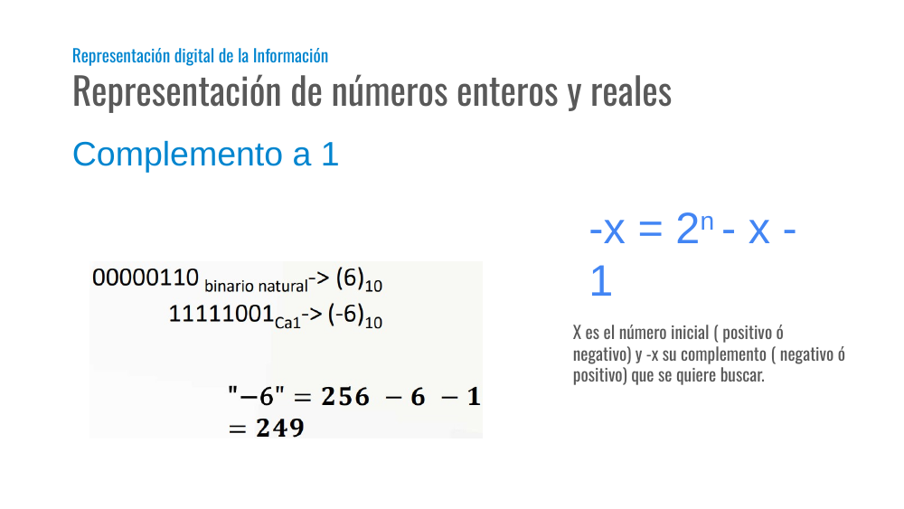

- Representación digital de la Información

- Complemento a 1

- -x = 2n - x - 1

- X es el número inicial ( positivo ó
- negativo) y -x su complemento ( negativo ó positivo) que se quiere buscar.

---

## Diapositiva 9

---

## Representación de números enteros y reales

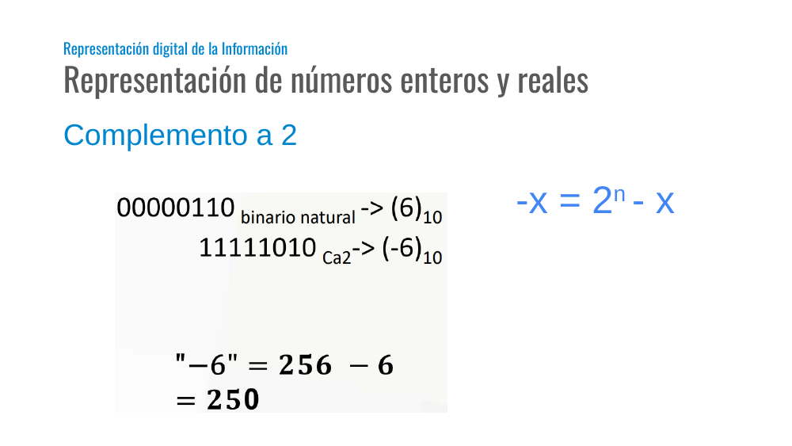

- Representación digital de la Información

- Complemento a 2

- -x = 2n - x

---

## Representación de números enteros y reales

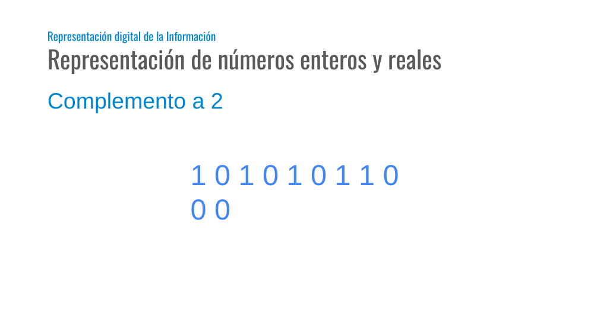

- Representación digital de la Información

- Complemento a 2

- 1 0 1 0 1 0 1 1 0 0 0

---

## Representación de números enteros y reales

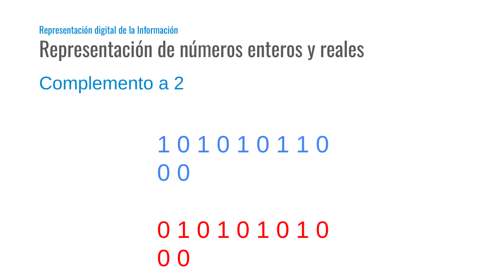

- Representación digital de la Información

- Complemento a 2

- 1 0 1 0 1 0 1 1 0 0 0
- 0 1 0 1 0 1 0 1 0 0 0

---

## Transformar BinNat, Ca1 y Ca2

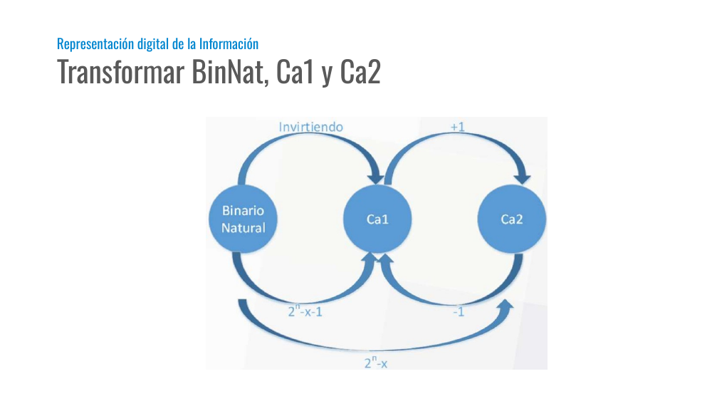

- Representación digital de la Información

---

## Código Gray

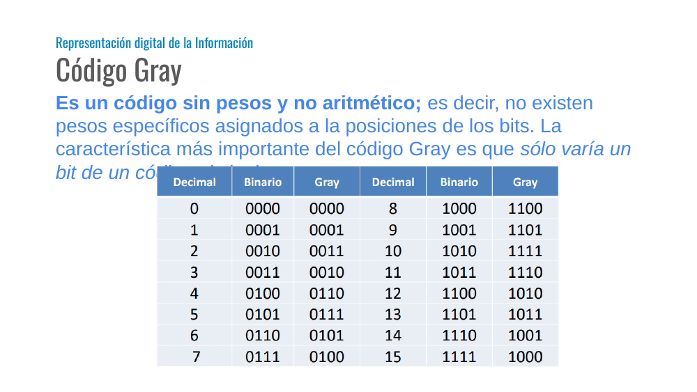

- Representación digital de la Información

- Es un código sin pesos y no aritmético; es decir, no existen pesos específicos asignados a la posiciones de los bits. La característica más importante del código Gray es que sólo varía un bit de un código al siguiente.

---

## Código Gray (Binario → Gray)

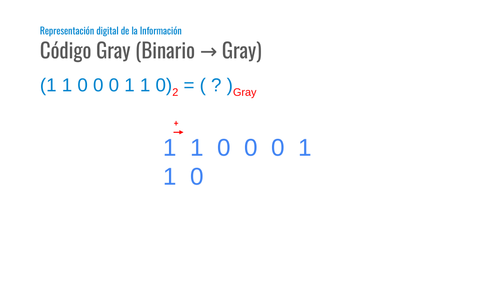

- Representación digital de la Información

- 1 1 0 0 0 1 1 0

- (1 1 0 0 0 1 1 0)2 = ( ? )Gray

- +

---

## Código Gray (Binario → Gray)

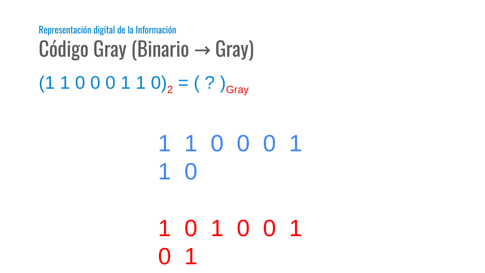

- Representación digital de la Información

- 1 1 0 0 0 1 1 0
- 1 0 1 0 0 1 0 1

- (1 1 0 0 0 1 1 0)2 = ( ? )Gray

---

## Código Gray (Binario → Gray)

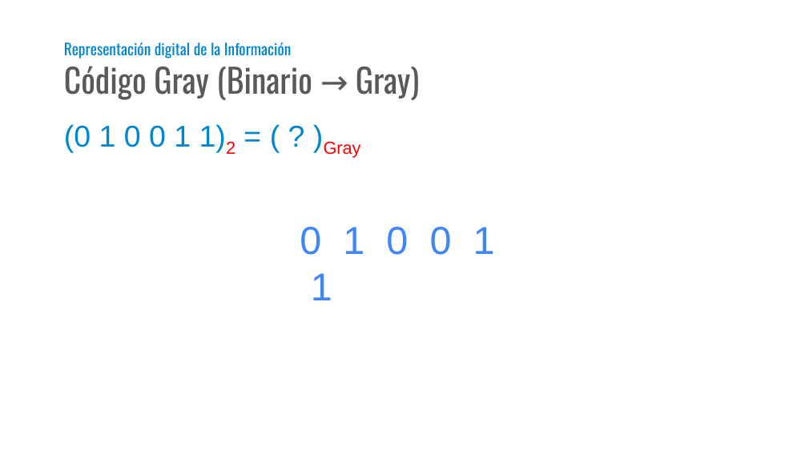

- Representación digital de la Información

- 0 1 0 0 1 1

- (0 1 0 0 1 1)2 = ( ? )Gray

---

## Código Gray (Binario → Gray)

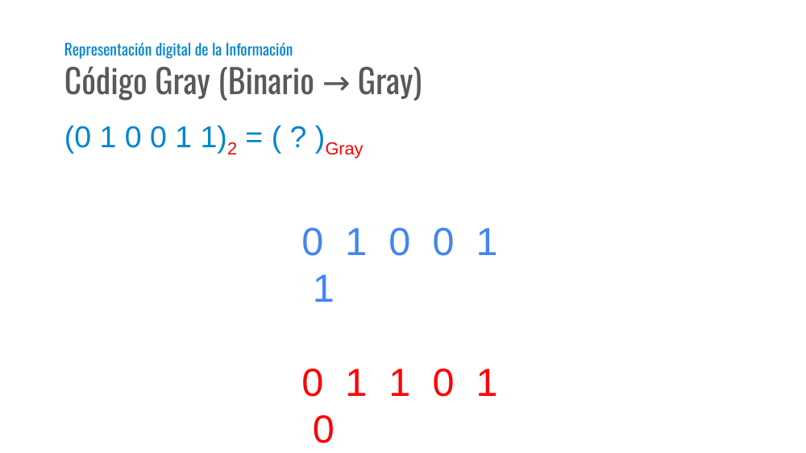

- Representación digital de la Información

- 0 1 0 0 1 1
- 0 1 1 0 1 0

- (0 1 0 0 1 1)2 = ( ? )Gray

---

## Código Gray (Gray → Binario)

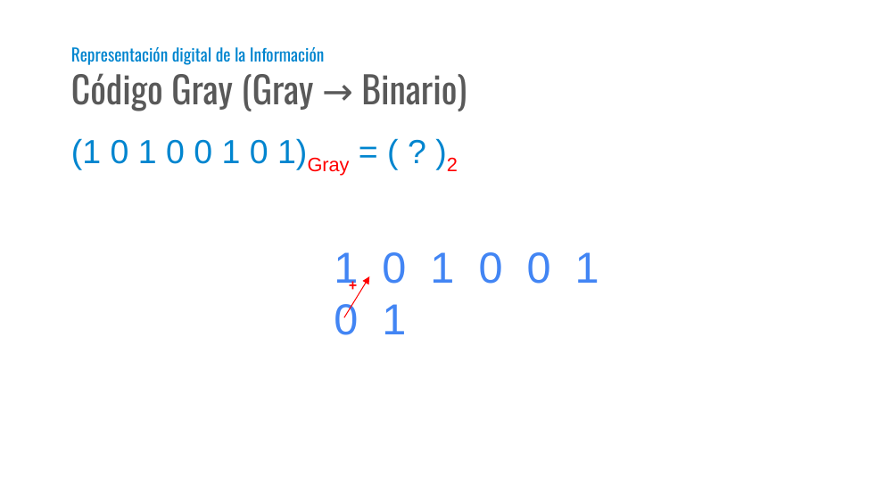

- Representación digital de la Información

- 1 0 1 0 0 1 0 1

- (1 0 1 0 0 1 0 1)Gray = ( ? )2

- +

---

## Código Gray (Gray → Binario)

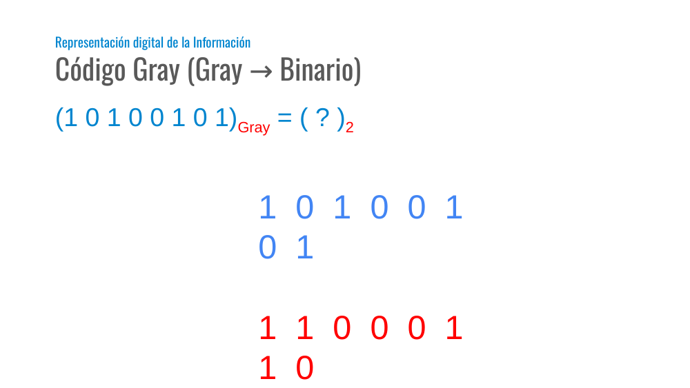

- Representación digital de la Información

- 1 0 1 0 0 1 0 1
- 1 1 0 0 0 1 1 0

- (1 0 1 0 0 1 0 1)Gray = ( ? )2

---

## Código de caracteres - ASCII

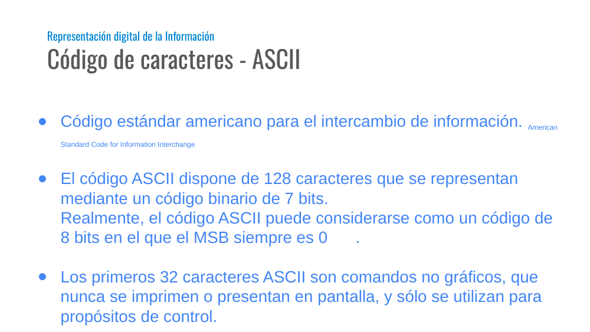

- Representación digital de la Información

- Código estándar americano para el intercambio de información. American Standard Code for Information Interchange
- El código ASCII dispone de 128 caracteres que se representan mediante un código binario de 7 bits.
- Realmente, el código ASCII puede considerarse como un código de 8 bits en el que el MSB siempre es 0 .
- Los primeros 32 caracteres ASCII son comandos no gráficos, que nunca se imprimen o presentan en pantalla, y sólo se utilizan para propósitos de control.

---

## Código de caracteres - ASCII

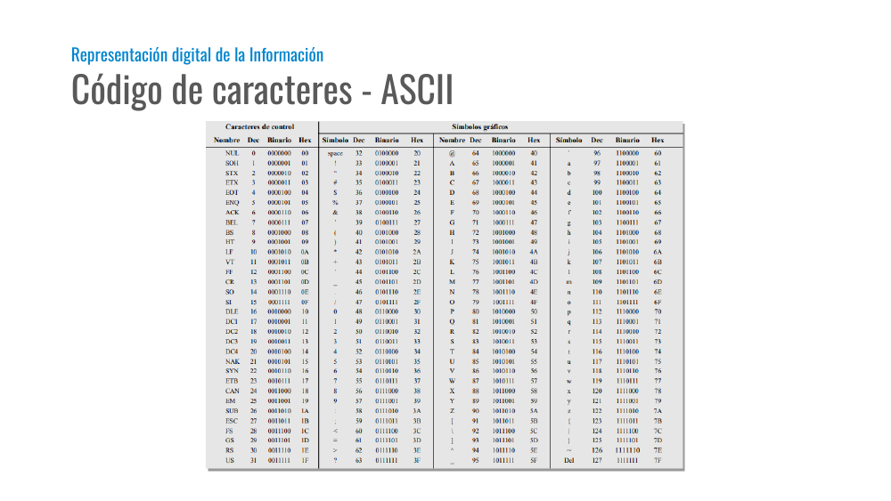

- Representación digital de la Información

---

## Diapositiva 23

---

## Diapositiva 24

---
