# Tema 5

Presentación de **Tecnología y Estructura de Ordenadores (TEO / IYA001)** — Universidad Europea del Atlántico.

Archivo original: [Tema 5.pdf](Tema%205.pdf)

Total de diapositivas: 71

---

## Loyda Leticia Alas Castaneda

- loyda.alas@uneatlantico.es

---

## Tecnología y Estructura de Ordenadores

- Tema 5

---

## Lógica binaria y Álgebra de Boole

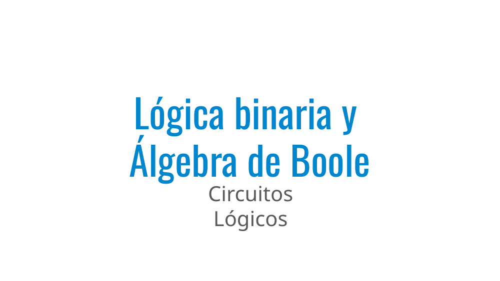

---

## Circuitos Combinacionales y Secuenciales

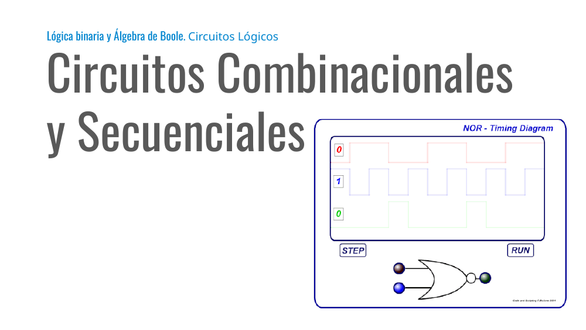

- Lógica binaria y Álgebra de Boole. Circuitos Lógicos

---

## Circuitos Combinacionales:

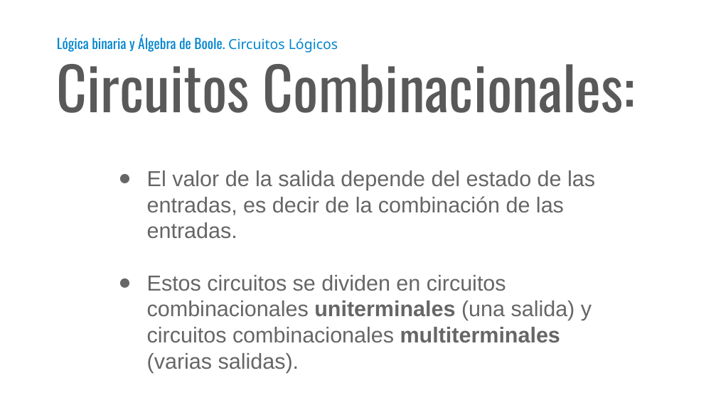

- El valor de la salida depende del estado de las entradas, es decir de la combinación de las entradas.
- Estos circuitos se dividen en circuitos combinacionales uniterminales (una salida) y circuitos combinacionales multiterminales (varias salidas).

- Lógica binaria y Álgebra de Boole. Circuitos Lógicos

---

## Circuitos Secuenciales:

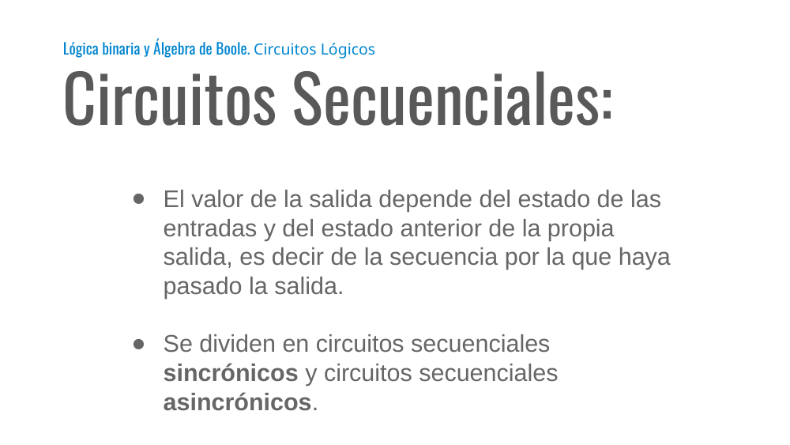

- El valor de la salida depende del estado de las entradas y del estado anterior de la propia salida, es decir de la secuencia por la que haya pasado la salida.
- Se dividen en circuitos secuenciales sincrónicos y circuitos secuenciales asincrónicos.

- Lógica binaria y Álgebra de Boole. Circuitos Lógicos

---

## Ejemplo de Circuito Combinacional

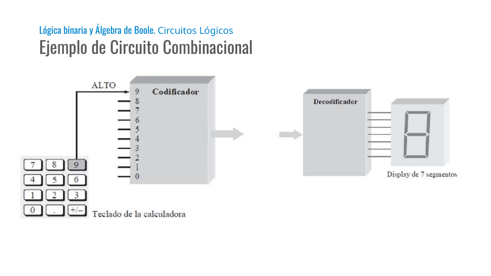

- Lógica binaria y Álgebra de Boole. Circuitos Lógicos

---

## Ejemplo de Circuito Secuencial

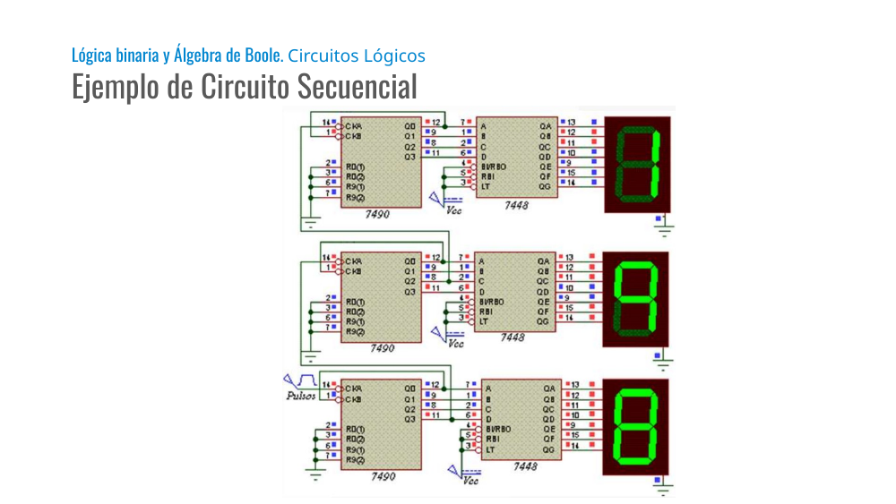

- Lógica binaria y Álgebra de Boole. Circuitos Lógicos

---

## Definiciones

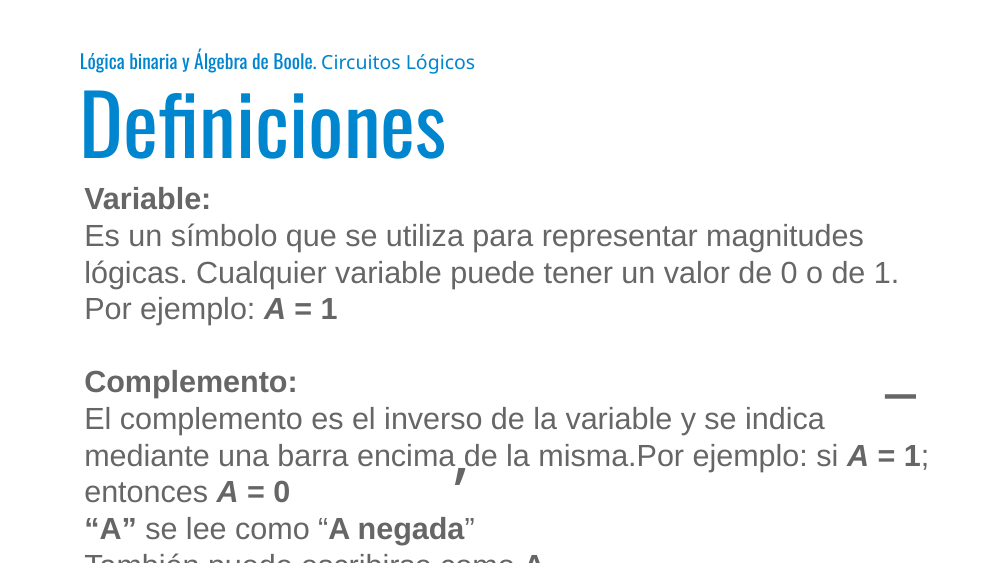

- Variable:
- Es un símbolo que se utiliza para representar magnitudes lógicas. Cualquier variable puede tener un valor de 0 o de 1. Por ejemplo: A = 1
- Complemento:
- El complemento es el inverso de la variable y se indica
- mediante una barra encima de la misma.Por ejemplo: si A = 1; entonces A = 0
- “A” se lee como “A negada”
- También puede escribirse como A

- Lógica binaria y Álgebra de Boole. Circuitos Lógicos

- _

- ,

---

## Definiciones

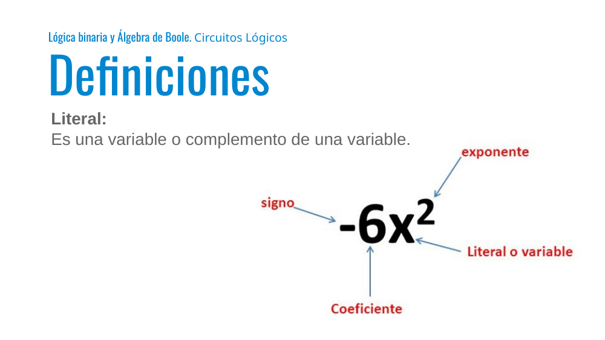

- Lógica binaria y Álgebra de Boole. Circuitos Lógicos

- Literal:
- Es una variable o complemento de una variable.

---

## Adición booleana

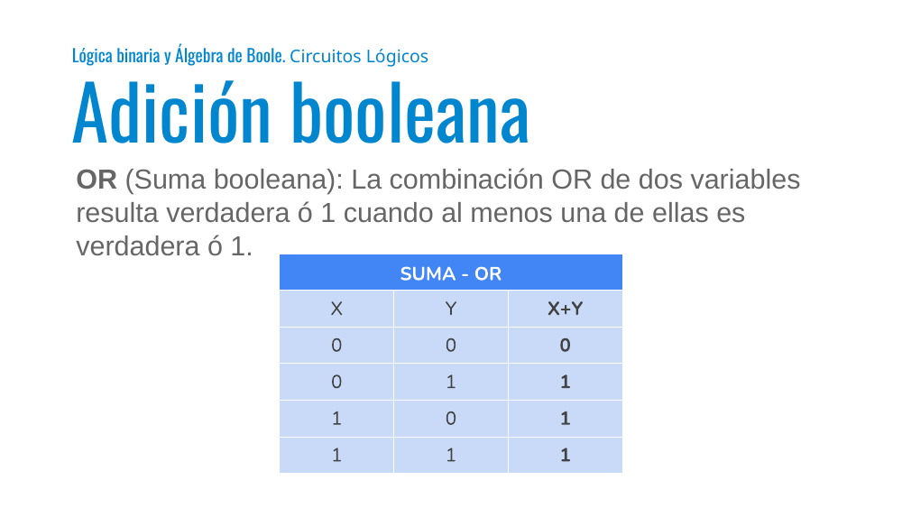

- OR (Suma booleana): La combinación OR de dos variables resulta verdadera ó 1 cuando al menos una de ellas es verdadera ó 1.

- Lógica binaria y Álgebra de Boole. Circuitos Lógicos

| SUMA - OR |  |  |
| --- | --- | --- |
| X | Y | X+Y |
| 0 | 0 | 0 |
| 0 | 1 | 1 |
| 1 | 0 | 1 |
| 1 | 1 | 1 |

---

## Operaciones

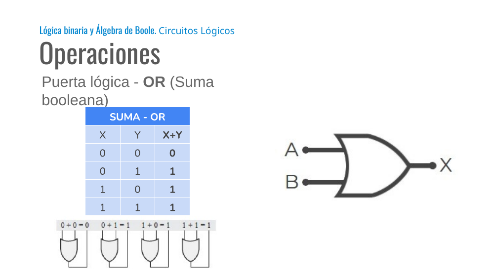

- Puerta lógica - OR (Suma booleana)

- Lógica binaria y Álgebra de Boole. Circuitos Lógicos

| SUMA - OR |  |  |
| --- | --- | --- |
| X | Y | X+Y |
| 0 | 0 | 0 |
| 0 | 1 | 1 |
| 1 | 0 | 1 |
| 1 | 1 | 1 |

---

## Puerta lógica - OR

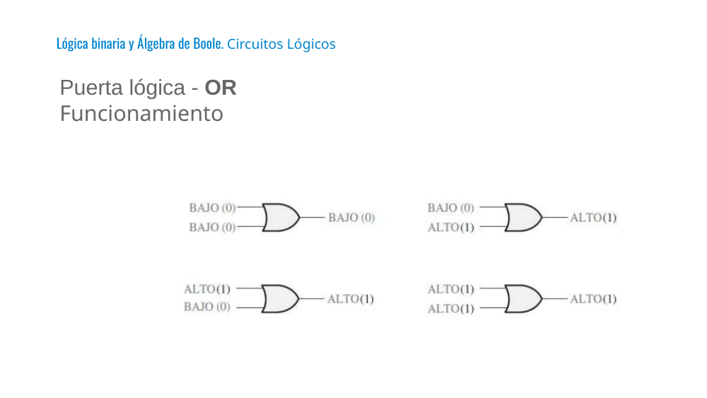

- Funcionamiento

- Lógica binaria y Álgebra de Boole. Circuitos Lógicos

---

## Puerta lógica - OR

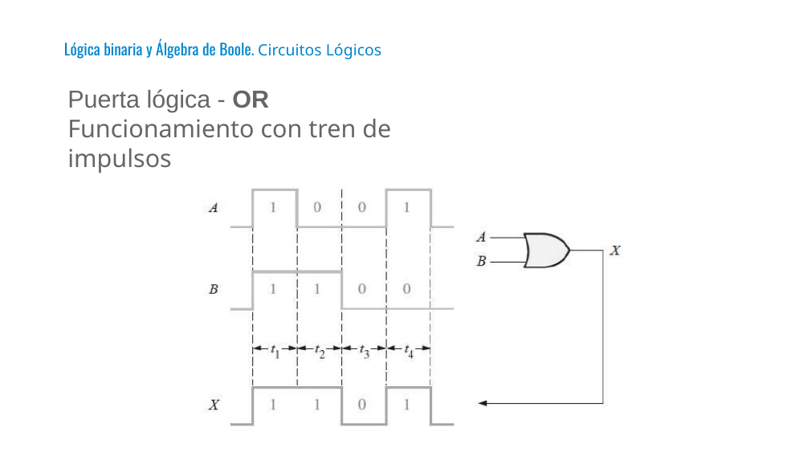

- Funcionamiento con tren de impulsos

- Lógica binaria y Álgebra de Boole. Circuitos Lógicos

---

## Puerta lógica - OR

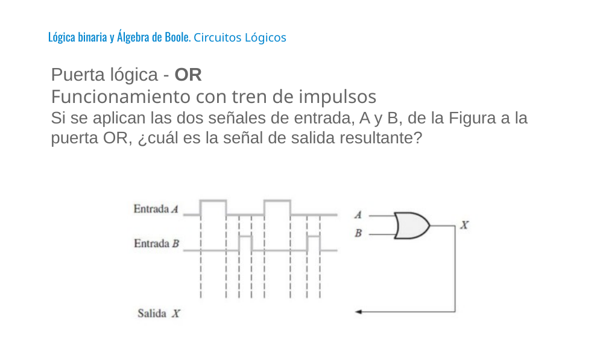

- Funcionamiento con tren de impulsos
- Si se aplican las dos señales de entrada, A y B, de la Figura a la puerta OR, ¿cuál es la señal de salida resultante?

- Lógica binaria y Álgebra de Boole. Circuitos Lógicos

---

## Puerta lógica - OR

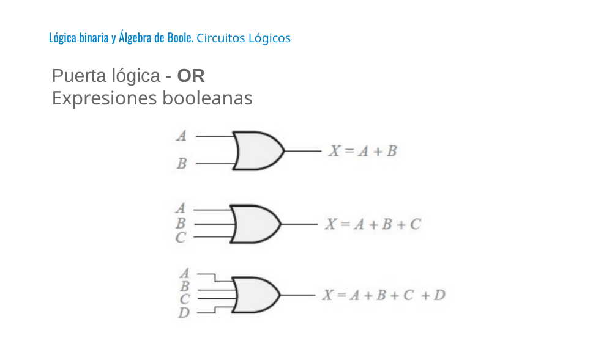

- Expresiones booleanas

- Lógica binaria y Álgebra de Boole. Circuitos Lógicos

---

## Puerta lógica - OR

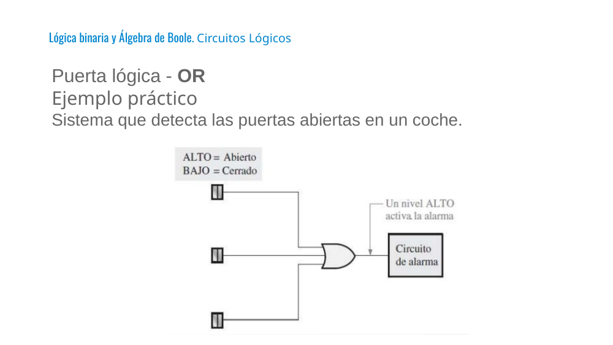

- Ejemplo práctico
- Sistema que detecta las puertas abiertas en un coche.

- Lógica binaria y Álgebra de Boole. Circuitos Lógicos

---

## Operaciones

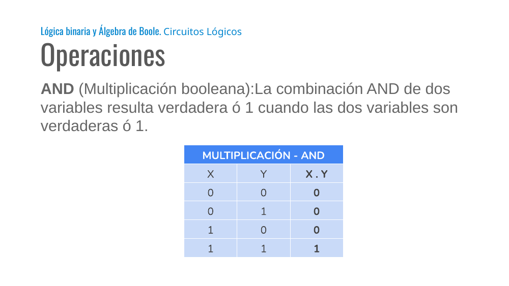

- AND (Multiplicación booleana):La combinación AND de dos variables resulta verdadera ó 1 cuando las dos variables son verdaderas ó 1.

- Lógica binaria y Álgebra de Boole. Circuitos Lógicos

| MULTIPLICACIÓN - AND |  |  |
| --- | --- | --- |
| X | Y | X . Y |
| 0 | 0 | 0 |
| 0 | 1 | 0 |
| 1 | 0 | 0 |
| 1 | 1 | 1 |

---

## Puerta lógica - AND (Multiplicación booleana)

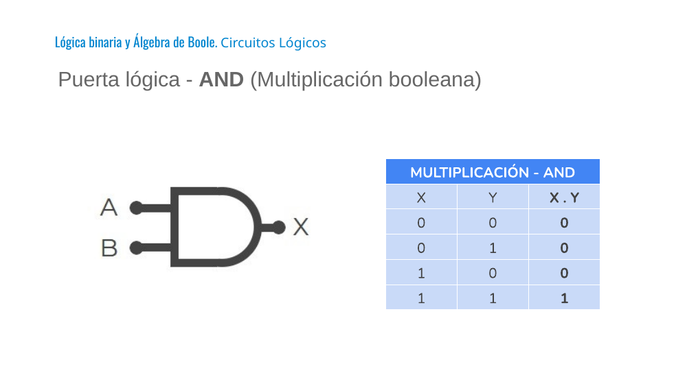

- Lógica binaria y Álgebra de Boole. Circuitos Lógicos

| MULTIPLICACIÓN - AND |  |  |
| --- | --- | --- |
| X | Y | X . Y |
| 0 | 0 | 0 |
| 0 | 1 | 0 |
| 1 | 0 | 0 |
| 1 | 1 | 1 |

---

## Puerta lógica - AND

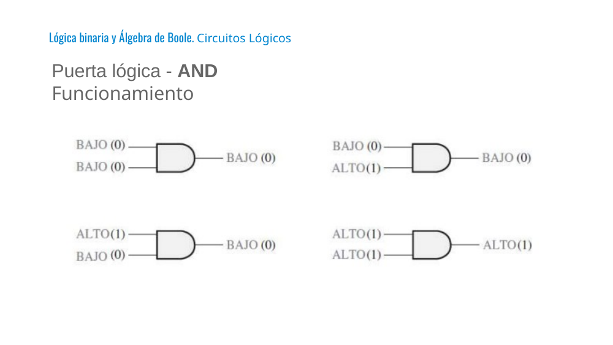

- Funcionamiento

- Lógica binaria y Álgebra de Boole. Circuitos Lógicos

---

## Puerta lógica - AND

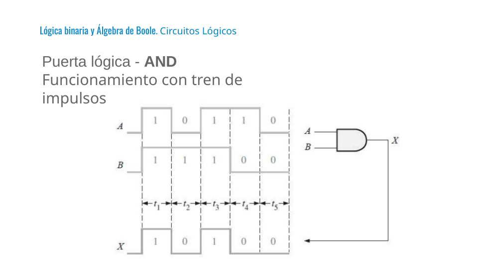

- Funcionamiento con tren de impulsos

- Lógica binaria y Álgebra de Boole. Circuitos Lógicos

---

## Puerta lógica - AND

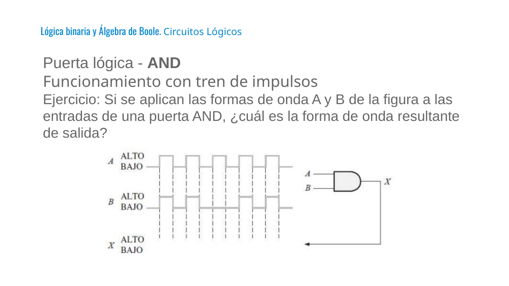

- Funcionamiento con tren de impulsos
- Ejercicio: Si se aplican las formas de onda A y B de la figura a las entradas de una puerta AND, ¿cuál es la forma de onda resultante de salida?

- Lógica binaria y Álgebra de Boole. Circuitos Lógicos

---

## Puerta lógica - AND

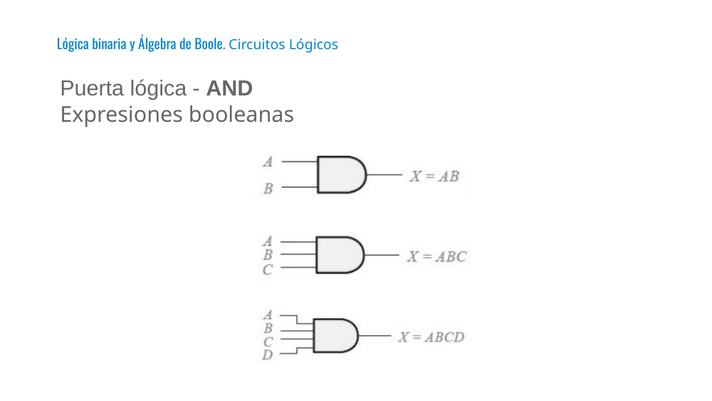

- Expresiones booleanas

- Lógica binaria y Álgebra de Boole. Circuitos Lógicos

---

## Puerta lógica - AND

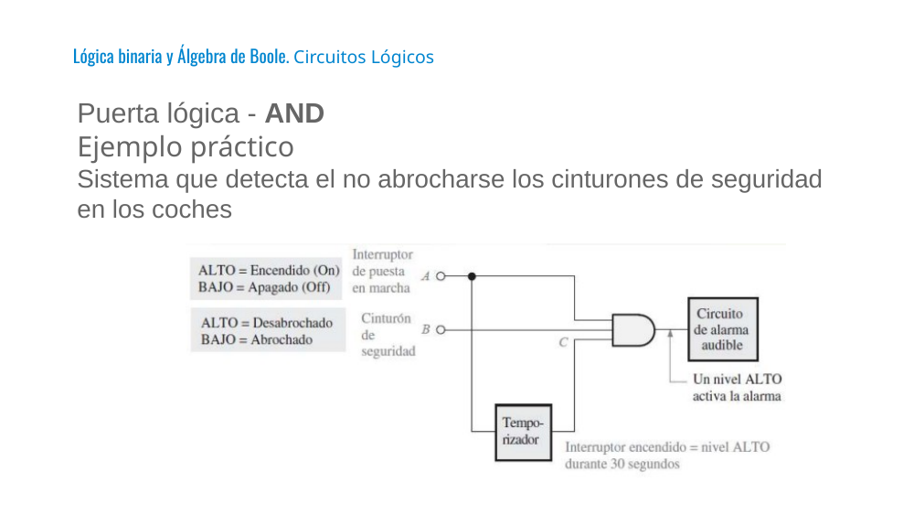

- Ejemplo práctico
- Sistema que detecta el no abrocharse los cinturones de seguridad en los coches

- Lógica binaria y Álgebra de Boole. Circuitos Lógicos

---

## Operaciones

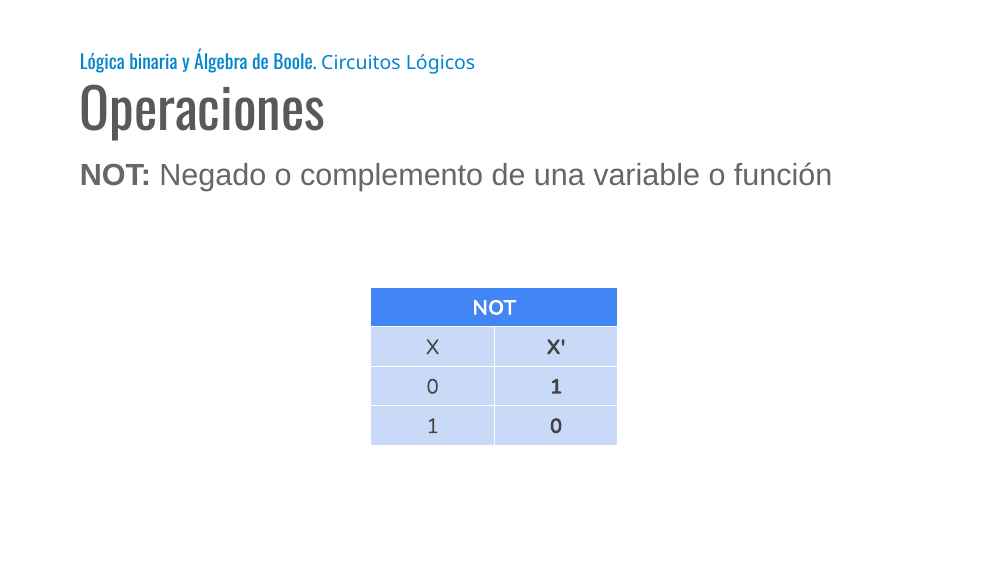

- NOT: Negado o complemento de una variable o función

- Lógica binaria y Álgebra de Boole. Circuitos Lógicos

| NOT |  |
| --- | --- |
| X | X' |
| 0 | 1 |
| 1 | 0 |

---

## Puerta lógica - NOT (El inversor)

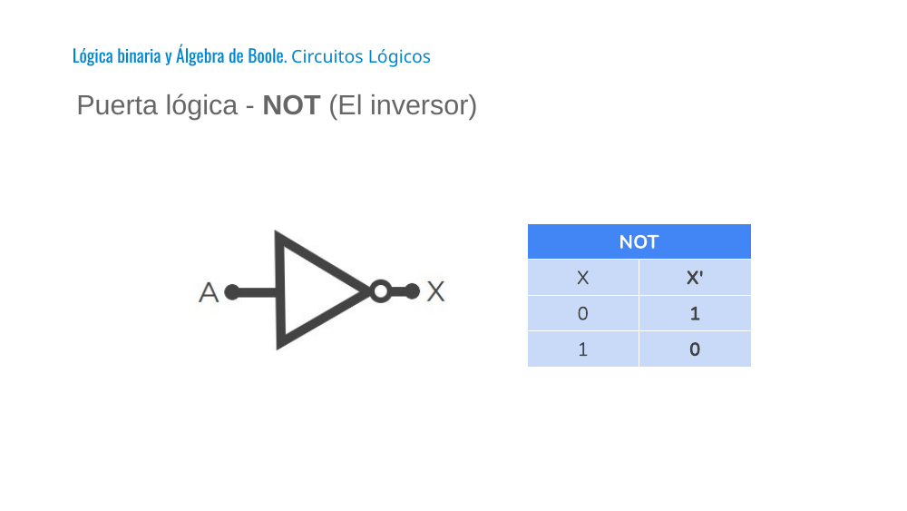

- Lógica binaria y Álgebra de Boole. Circuitos Lógicos

| NOT |  |
| --- | --- |
| X | X' |
| 0 | 1 |
| 1 | 0 |

---

## Puerta lógica - NOT (El inversor)

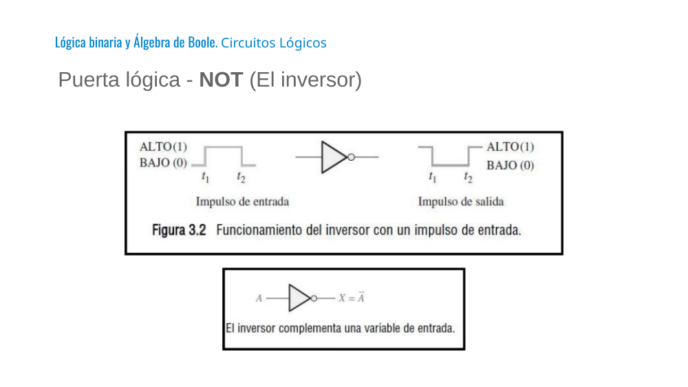

- Lógica binaria y Álgebra de Boole. Circuitos Lógicos

---

## Puerta lógica - NAND

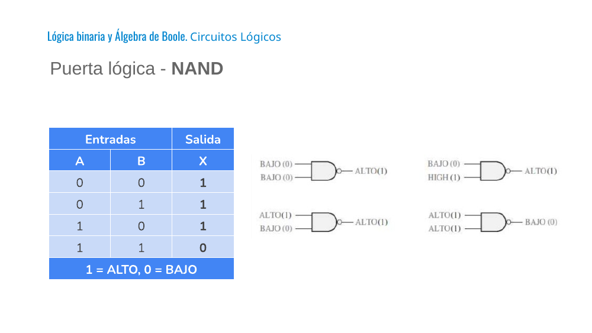

- Lógica binaria y Álgebra de Boole. Circuitos Lógicos

| Entradas |  | Salida |
| --- | --- | --- |
| A | B | X |
| 0 | 0 | 1 |
| 0 | 1 | 1 |
| 1 | 0 | 1 |
| 1 | 1 | 0 |
| 1 = ALTO, 0 = BAJO |  |  |

---

## Puerta lógica - NOR

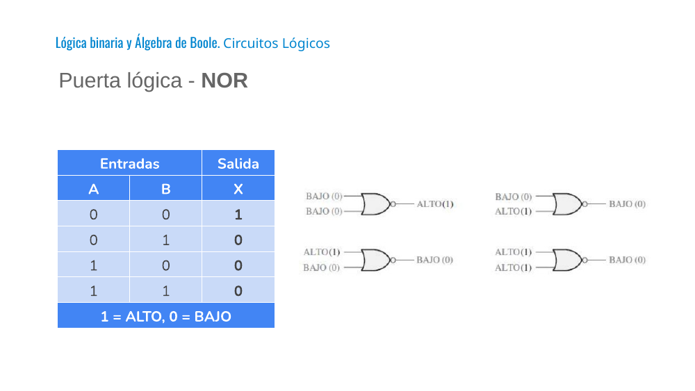

- Lógica binaria y Álgebra de Boole. Circuitos Lógicos

| Entradas |  | Salida |
| --- | --- | --- |
| A | B | X |
| 0 | 0 | 1 |
| 0 | 1 | 0 |
| 1 | 0 | 0 |
| 1 | 1 | 0 |
| 1 = ALTO, 0 = BAJO |  |  |

---

## Puerta lógica - OR Exclusiva XOR

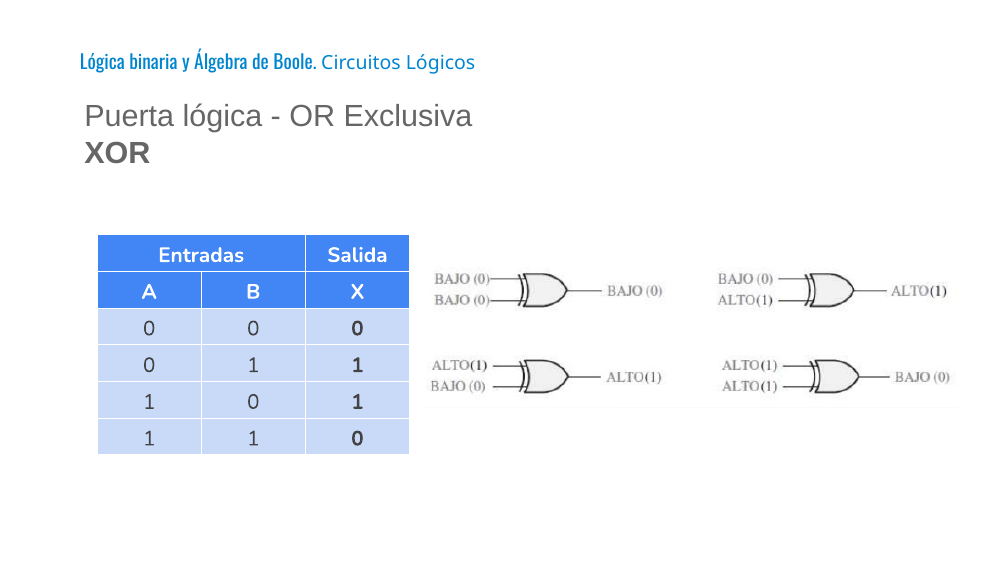

- Lógica binaria y Álgebra de Boole. Circuitos Lógicos

| Entradas |  | Salida |
| --- | --- | --- |
| A | B | X |
| 0 | 0 | 0 |
| 0 | 1 | 1 |
| 1 | 0 | 1 |
| 1 | 1 | 0 |

---

## Puerta lógica - NOR Exclusiva XNOR

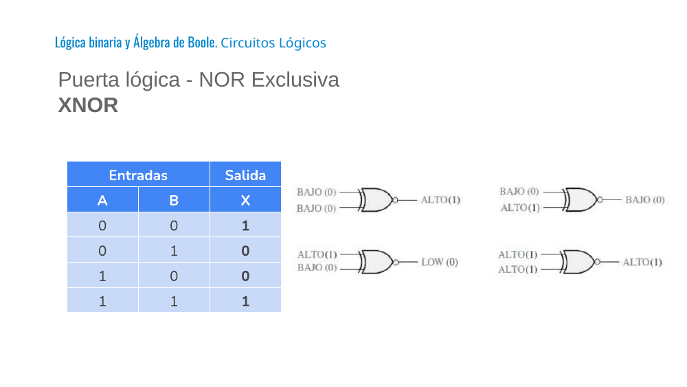

- Lógica binaria y Álgebra de Boole. Circuitos Lógicos

| Entradas |  | Salida |
| --- | --- | --- |
| A | B | X |
| 0 | 0 | 1 |
| 0 | 1 | 0 |
| 1 | 0 | 0 |
| 1 | 1 | 1 |

---

## Resumen

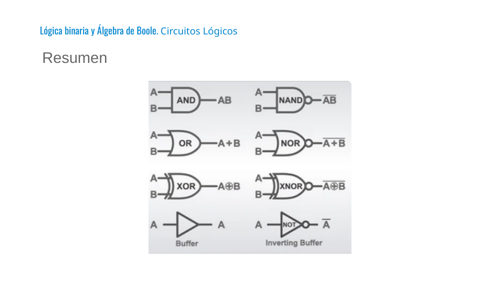

- Lógica binaria y Álgebra de Boole. Circuitos Lógicos

---

## Operaciones

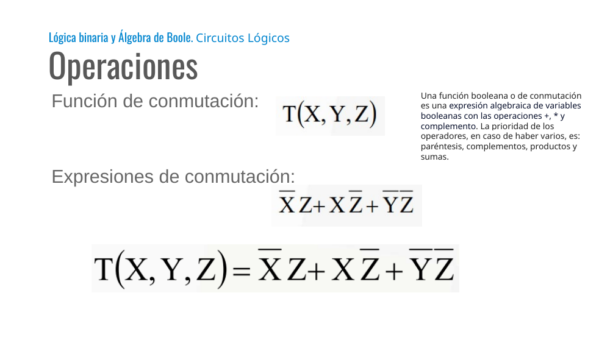

- Función de conmutación:

- Lógica binaria y Álgebra de Boole. Circuitos Lógicos

- Expresiones de conmutación:

- Una función booleana o de conmutación es una expresión algebraica de variables booleanas con las operaciones +, * y complemento. La prioridad de los operadores, en caso de haber varios, es: paréntesis, complementos, productos y sumas.

---

## Tabla de verdad:

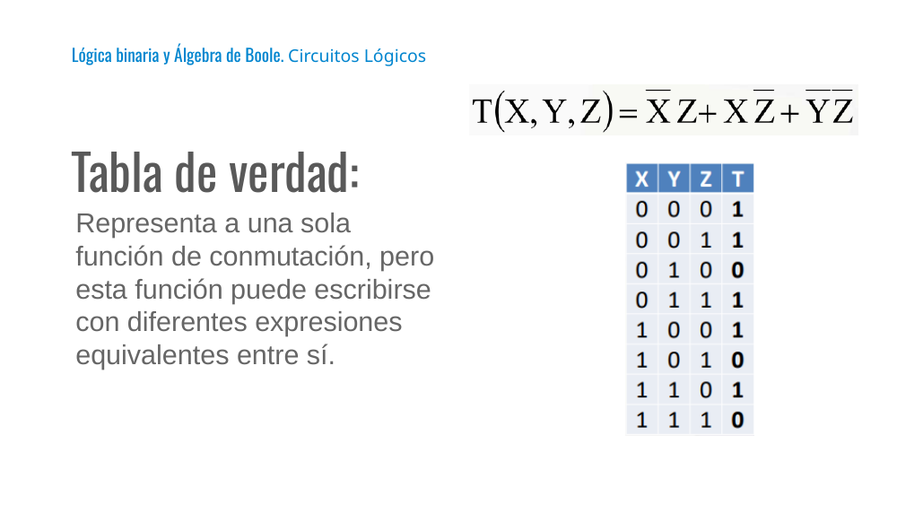

- Representa a una sola función de conmutación, pero esta función puede escribirse con diferentes expresiones equivalentes entre sí.

- Lógica binaria y Álgebra de Boole. Circuitos Lógicos

---

## Álgebra de Boole

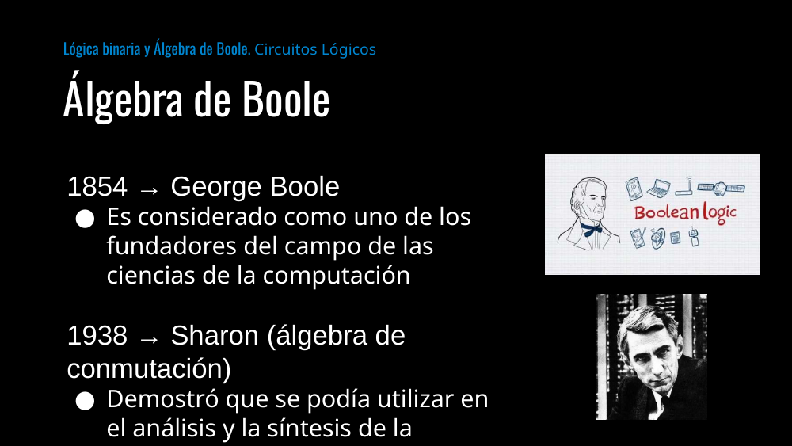

- 1854 → George Boole
- Es considerado como uno de los fundadores del campo de las ciencias de la computación
- 1938 → Sharon (álgebra de conmutación)
- Demostró que se podía utilizar en el análisis y la síntesis de la conmutación y de los circuitos digitales

- Lógica binaria y Álgebra de Boole. Circuitos Lógicos

---

## Álgebra de Boole

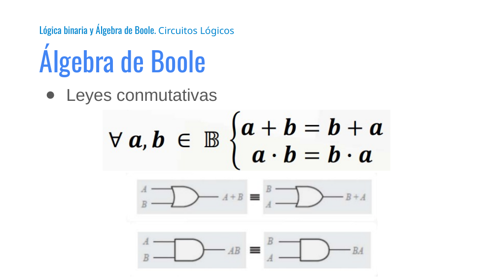

- Leyes conmutativas

- Lógica binaria y Álgebra de Boole. Circuitos Lógicos

---

## Álgebra de Boole

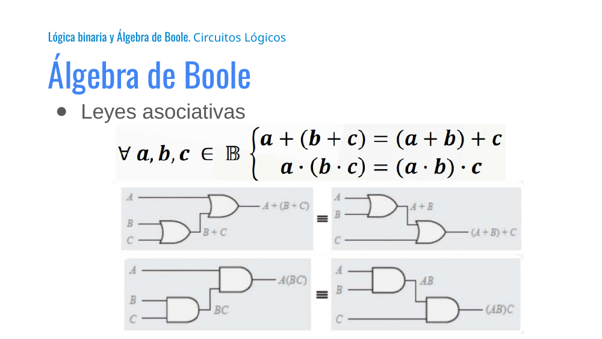

- Leyes asociativas

- Lógica binaria y Álgebra de Boole. Circuitos Lógicos

---

## Álgebra de Boole

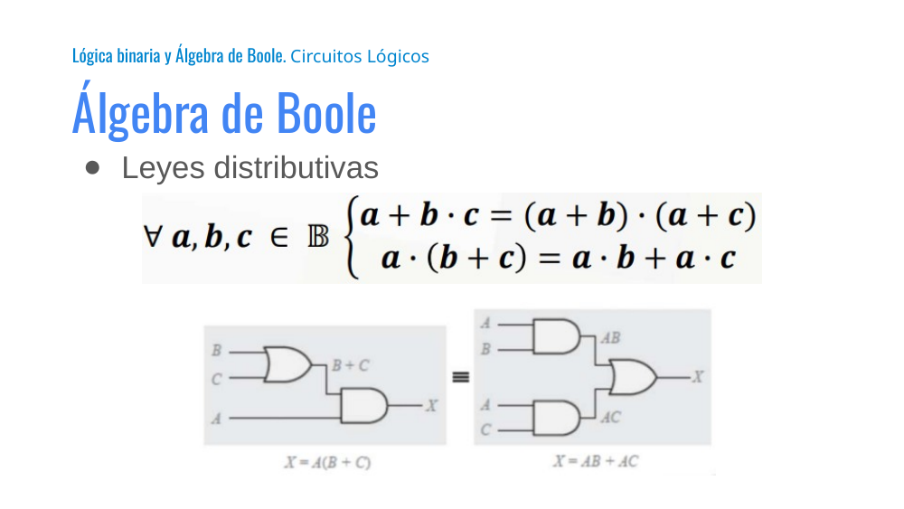

- Leyes distributivas

- Lógica binaria y Álgebra de Boole. Circuitos Lógicos

---

## Álgebra de Boole

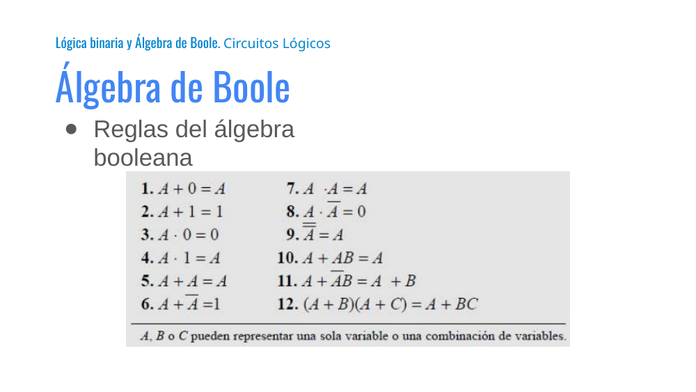

- Reglas del álgebra booleana

- Lógica binaria y Álgebra de Boole. Circuitos Lógicos

---

## Álgebra de Boole

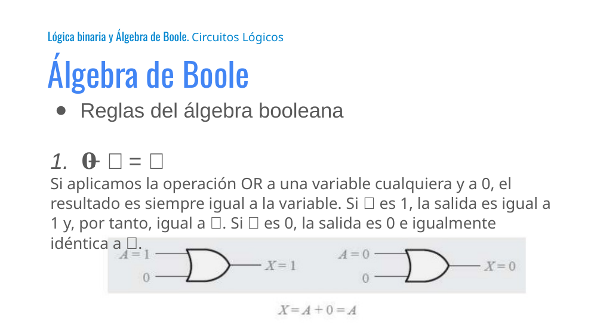

- Reglas del álgebra booleana
- 1. 𝑨 + 𝟎 = 𝑨
- Si aplicamos la operación OR a una variable cualquiera y a 0, el resultado es siempre igual a la variable. Si 𝑨 es 1, la salida es igual a 1 y, por tanto, igual a 𝑨. Si 𝑨 es 0, la salida es 0 e igualmente idéntica a 𝑨.

- Lógica binaria y Álgebra de Boole. Circuitos Lógicos

---

## Álgebra de Boole

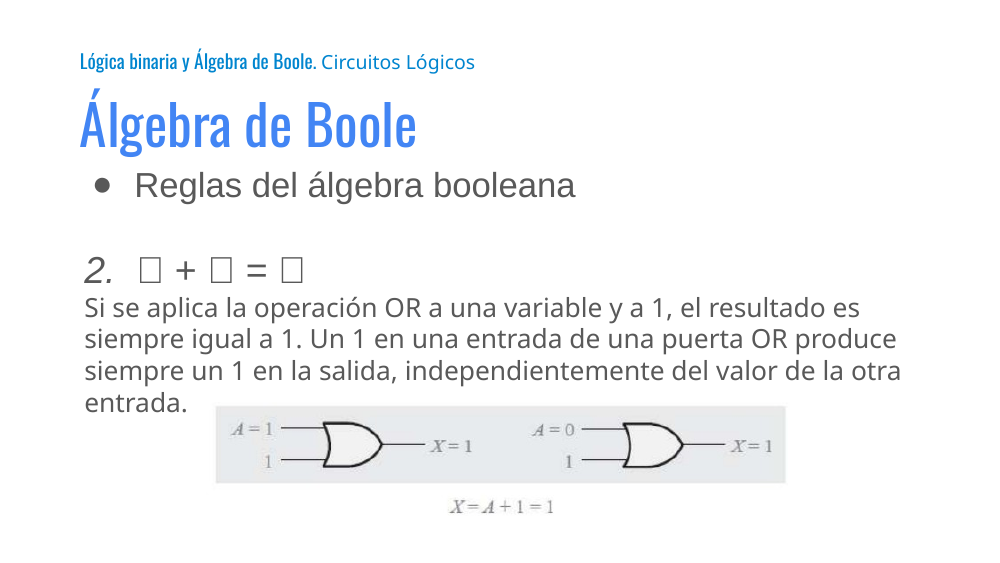

- Reglas del álgebra booleana
- 2. 𝑨 + 𝟏 = 𝟏
- Si se aplica la operación OR a una variable y a 1, el resultado es siempre igual a 1. Un 1 en una entrada de una puerta OR produce siempre un 1 en la salida, independientemente del valor de la otra entrada.

- Lógica binaria y Álgebra de Boole. Circuitos Lógicos

---

## Álgebra de Boole

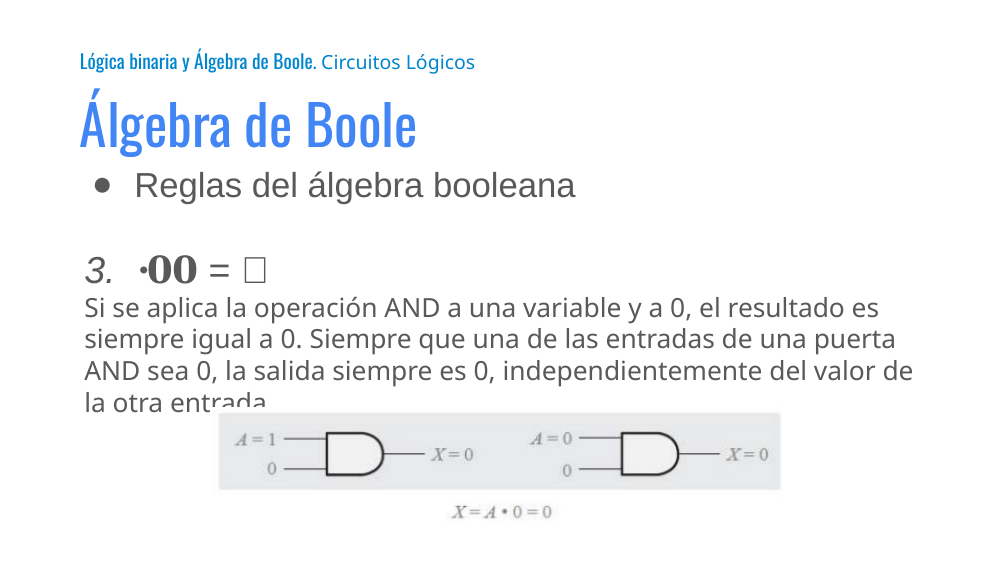

- Reglas del álgebra booleana
- 3. 𝑨 ⋅ 𝟎 = 𝟎
- Si se aplica la operación AND a una variable y a 0, el resultado es siempre igual a 0. Siempre que una de las entradas de una puerta AND sea 0, la salida siempre es 0, independientemente del valor de la otra entrada.

- Lógica binaria y Álgebra de Boole. Circuitos Lógicos

---

## Álgebra de Boole

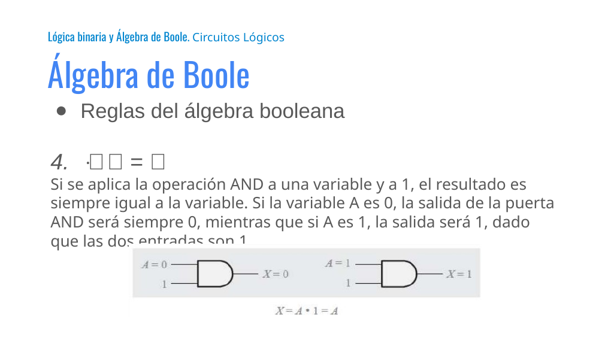

- Reglas del álgebra booleana
- 4. 𝑨 ⋅ 𝟏 = 𝑨
- Si se aplica la operación AND a una variable y a 1, el resultado es siempre igual a la variable. Si la variable A es 0, la salida de la puerta AND será siempre 0, mientras que si A es 1, la salida será 1, dado que las dos entradas son 1.

- Lógica binaria y Álgebra de Boole. Circuitos Lógicos

---

## Álgebra de Boole

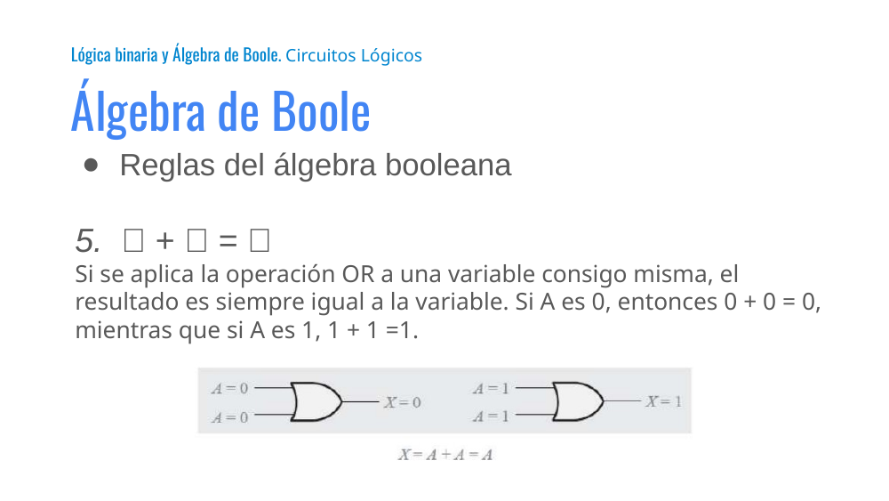

- Reglas del álgebra booleana
- 5. 𝑨 + 𝑨 = 𝑨
- Si se aplica la operación OR a una variable consigo misma, el resultado es siempre igual a la variable. Si A es 0, entonces 0 + 0 = 0, mientras que si A es 1, 1 + 1 =1.

- Lógica binaria y Álgebra de Boole. Circuitos Lógicos

---

## Álgebra de Boole

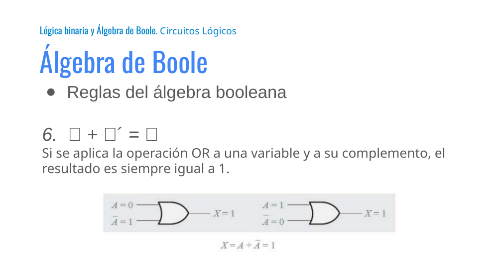

- Reglas del álgebra booleana
- 6. 𝑨 + 𝑨´ = 𝟏
- Si se aplica la operación OR a una variable y a su complemento, el resultado es siempre igual a 1.

- Lógica binaria y Álgebra de Boole. Circuitos Lógicos

---

## Álgebra de Boole

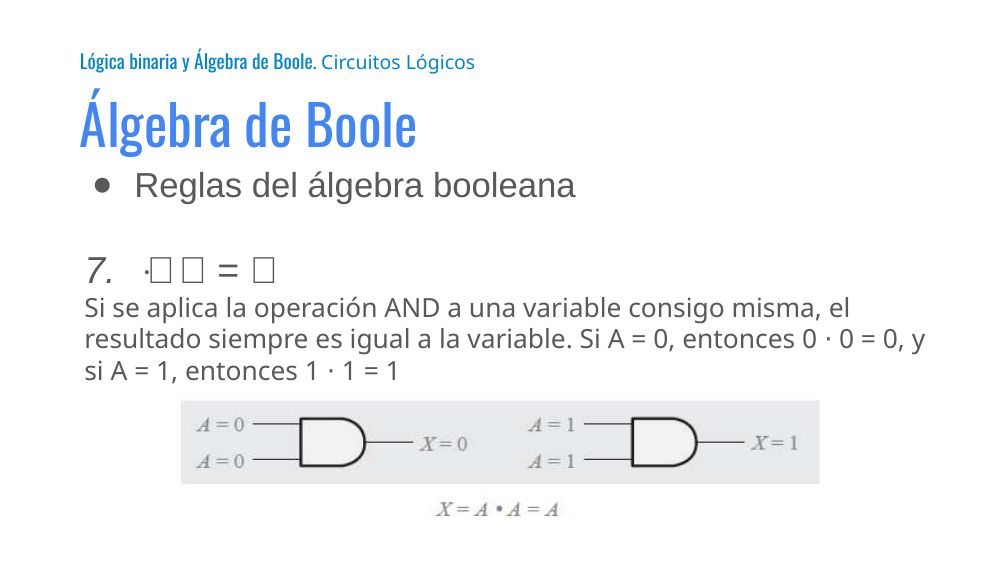

- Reglas del álgebra booleana
- 7. 𝑨 ⋅ 𝑨 = 𝑨
- Si se aplica la operación AND a una variable consigo misma, el resultado siempre es igual a la variable. Si A = 0, entonces 0 ⋅ 0 = 0, y si A = 1, entonces 1 ⋅ 1 = 1

- Lógica binaria y Álgebra de Boole. Circuitos Lógicos

---

## Álgebra de Boole

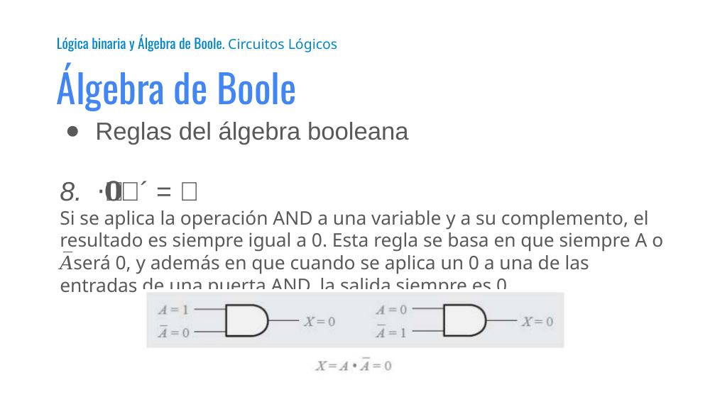

- Reglas del álgebra booleana
- 8. 𝑨 ⋅ 𝑨´ = 𝟎
- Si se aplica la operación AND a una variable y a su complemento, el resultado es siempre igual a 0. Esta regla se basa en que siempre A o 𝐴̅será 0, y además en que cuando se aplica un 0 a una de las entradas de una puerta AND, la salida siempre es 0

- Lógica binaria y Álgebra de Boole. Circuitos Lógicos

---

## Álgebra de Boole

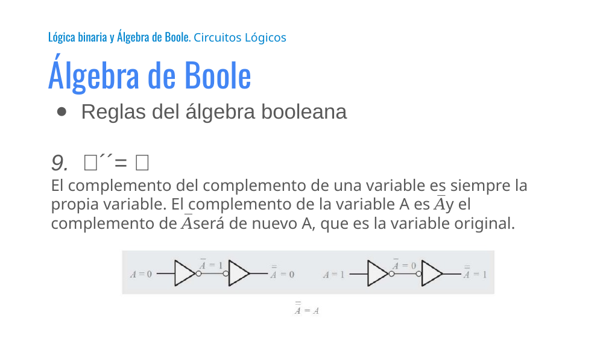

- Reglas del álgebra booleana
- 9. 𝑨´´= 𝑨
- El complemento del complemento de una variable es siempre la propia variable. El complemento de la variable A es 𝐴̅y el complemento de 𝐴̅será de nuevo A, que es la variable original.

- Lógica binaria y Álgebra de Boole. Circuitos Lógicos

---

## Álgebra de Boole

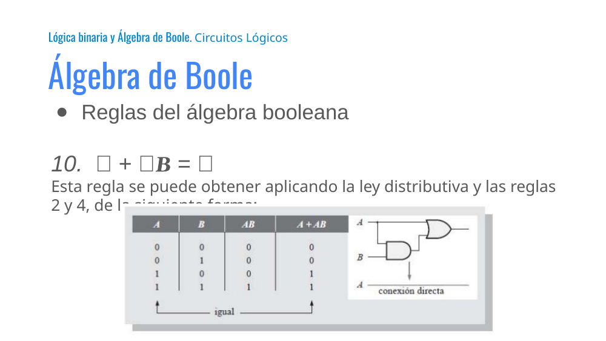

- Reglas del álgebra booleana
- 10. 𝑨 + 𝑨B = 𝑨
- Esta regla se puede obtener aplicando la ley distributiva y las reglas 2 y 4, de la siguiente forma:

- Lógica binaria y Álgebra de Boole. Circuitos Lógicos

---

## Álgebra de Boole

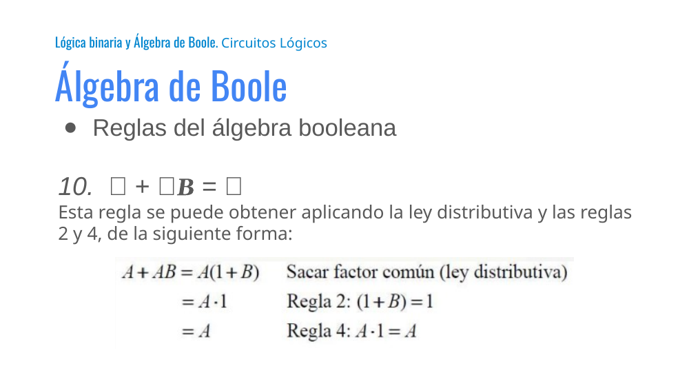

- Reglas del álgebra booleana
- 10. 𝑨 + 𝑨B = 𝑨
- Esta regla se puede obtener aplicando la ley distributiva y las reglas 2 y 4, de la siguiente forma:

- Lógica binaria y Álgebra de Boole. Circuitos Lógicos

---

## Álgebra de Boole

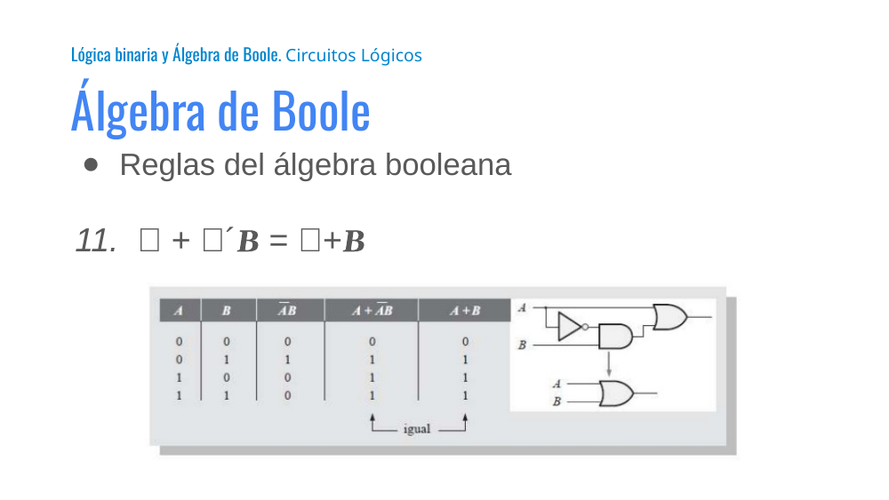

- Reglas del álgebra booleana
- 11. 𝑨 + 𝑨´B = 𝑨+B

- Lógica binaria y Álgebra de Boole. Circuitos Lógicos

---

## Álgebra de Boole

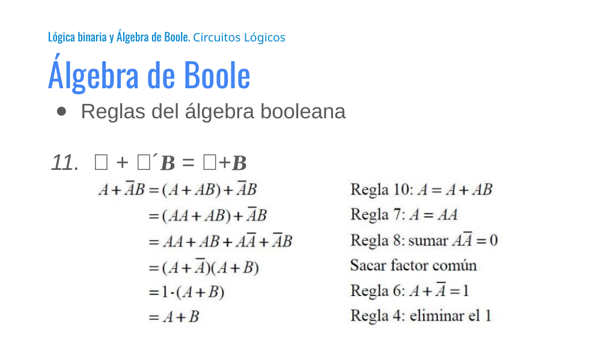

- Reglas del álgebra booleana
- 11. 𝑨 + 𝑨´B = 𝑨+B

- Lógica binaria y Álgebra de Boole. Circuitos Lógicos

---

## Álgebra de Boole

- Reglas del álgebra booleana
- 12. (𝑨 + B)(𝑨 + C) = 𝑨 + BC

- Lógica binaria y Álgebra de Boole. Circuitos Lógicos

---

## Álgebra de Boole

- Reglas del álgebra booleana
- 12. (𝑨 + B)(𝑨 + C) = 𝑨 + BC

- Lógica binaria y Álgebra de Boole. Circuitos Lógicos

---

## Álgebra de Boole

- Formas Canónicas
- Se llama término canónico de una función lógica a todo producto o suma en el cual aparecen todas las variables (ó sus complementos) de esa función.
- A los términos productos se les llama productos canónicos (minterms) y a los términos suma se les llama, sumas canónicas (maxterms).

- Lógica binaria y Álgebra de Boole. Circuitos Lógicos

---

## Álgebra de Boole

- Formas Disyuntiva Normal (FDN)
- Se basa en la operación OR de los términos o combinaciones que hacen 1 la función. Los términos o combinaciones lo componen el AND de las variables.

- Lógica binaria y Álgebra de Boole. Circuitos Lógicos

- Mintérminos

---

## Álgebra de Boole

- Formas Conjuntiva Normal
- Se basa en la operación AND de los términos o combinaciones que hacen 0 la función. Los términos o combinaciones lo componen el OR de las variables. De aquí se deriva el término Suma estándar (SE), que es el OR de todas las variables de la función complementadas o no. Es decir, para representar la función se unen en AND las SE para las cuales la función vale 0

- Lógica binaria y Álgebra de Boole. Circuitos Lógicos

- Maxtérminos

---

## Dudas…

---

## Álgebra de Boole

- Leyes de DeMorgan

- Lógica binaria y Álgebra de Boole. Circuitos Lógicos

---

## Álgebra de Boole

- Puertas lógicas - NAND - NEGATIVA-OR

- Lógica binaria y Álgebra de Boole. Circuitos Lógicos

---

## Álgebra de Boole

- Puertas lógicas - NOR - NEGATIVA-AND

- Lógica binaria y Álgebra de Boole. Circuitos Lógicos

---

## Álgebra de Boole

- Simplificación
- A la hora de aplicar el álgebra booleana, hay que reducir una expresión a su forma más simple o cambiarla a una forma más conveniente para conseguir una implementación más eficiente.
- Requiere un profundo conocimiento del álgebra booleana y una considerable experiencia en su aplicación, por no mencionar también un poquito de ingenio y destreza.

- Lógica binaria y Álgebra de Boole. Circuitos Lógicos

---

## Álgebra de Boole

- Ejercicios

- Lógica binaria y Álgebra de Boole. Circuitos Lógicos

---

## Álgebra de Boole

- Ejercicios

- Lógica binaria y Álgebra de Boole. Circuitos Lógicos

---

## Álgebra de Boole

- Aplicación de los teoremas de DeMorgan

- Lógica binaria y Álgebra de Boole. Circuitos Lógicos

---

## Álgebra de Boole

- Simplificación

- Lógica binaria y Álgebra de Boole. Circuitos Lógicos

---

## Álgebra de Boole

- Simplificación

- Lógica binaria y Álgebra de Boole. Circuitos Lógicos

---

## Álgebra de Boole

- Simplificación

- Lógica binaria y Álgebra de Boole. Circuitos Lógicos

---

## Álgebra de Boole

- Simplificación

- Lógica binaria y Álgebra de Boole. Circuitos Lógicos

---

## Álgebra de Boole

- Simplificación

- Lógica binaria y Álgebra de Boole. Circuitos Lógicos

---

## Diapositiva 71

---
