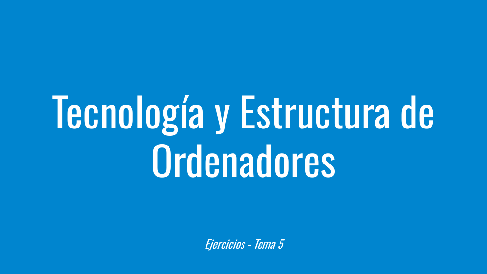
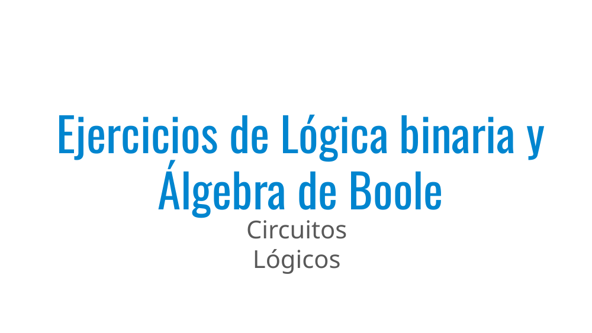
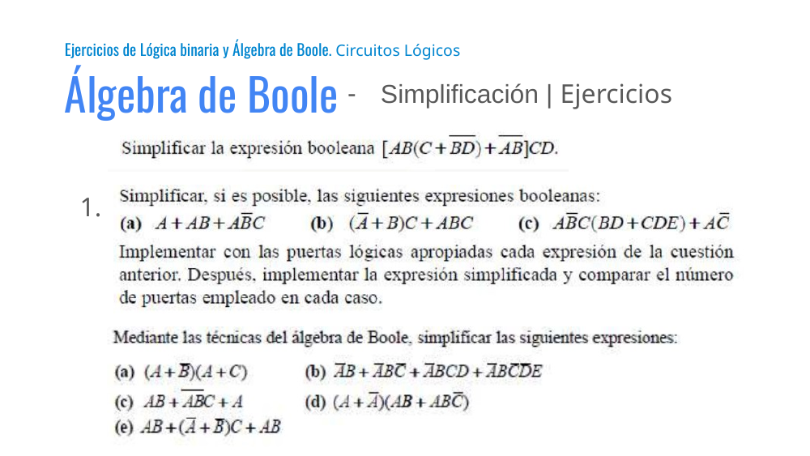
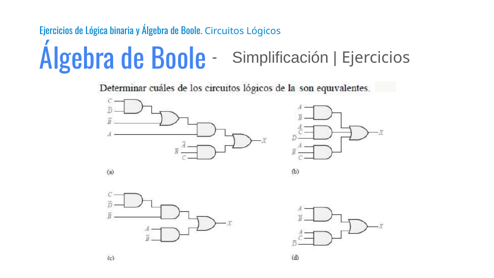
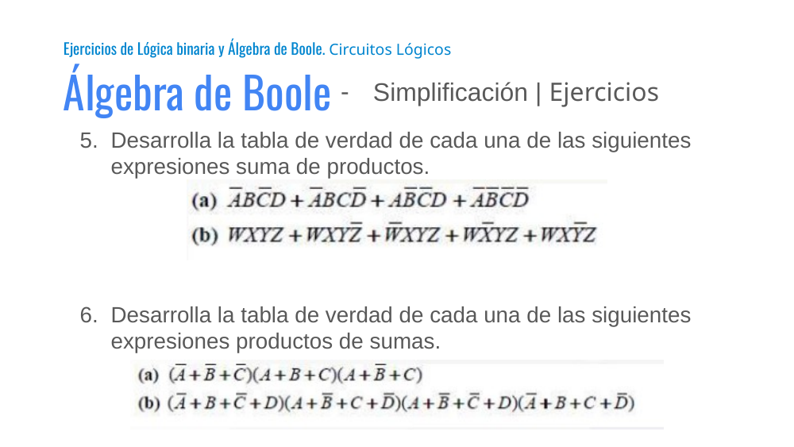
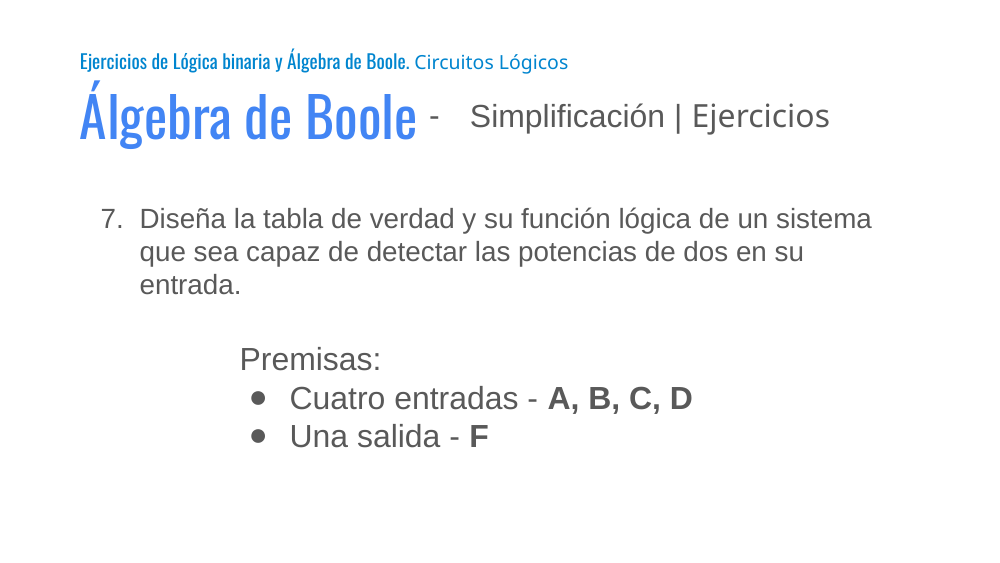
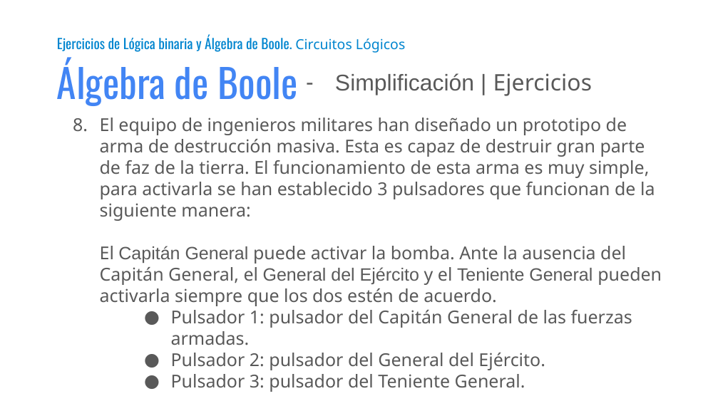

# Tema 5 - Ejercicios

Presentación de **Tecnología y Estructura de Ordenadores (TEO / IYA001)** — Universidad Europea del Atlántico.

Archivo original: [Tema 5 - Ejercicios.pdf](Tema%205%20-%20Ejercicios.pdf)

Total de diapositivas: 9

---

## Loyda Leticia Alas Castaneda

- loyda.alas@uneatlantico.es

---

## Tecnología y Estructura de Ordenadores

- Ejercicios - Tema 5

---

## Ejercicios de Lógica binaria y Álgebra de Boole

---

## Álgebra de Boole

- Simplificación | Ejercicios

- Ejercicios de Lógica binaria y Álgebra de Boole. Circuitos Lógicos

---

## Álgebra de Boole

- Simplificación | Ejercicios

- Ejercicios de Lógica binaria y Álgebra de Boole. Circuitos Lógicos

---

## Álgebra de Boole

- Simplificación | Ejercicios

- Desarrolla la tabla de verdad de cada una de las siguientes expresiones suma de productos.
- Desarrolla la tabla de verdad de cada una de las siguientes expresiones productos de sumas.

- Ejercicios de Lógica binaria y Álgebra de Boole. Circuitos Lógicos

---

## Álgebra de Boole

- Simplificación | Ejercicios

- Diseña la tabla de verdad y su función lógica de un sistema que sea capaz de detectar las potencias de dos en su entrada.
- Premisas:
- Cuatro entradas - A, B, C, D
- Una salida - F

- Ejercicios de Lógica binaria y Álgebra de Boole. Circuitos Lógicos

---

## Álgebra de Boole

- Simplificación | Ejercicios

- El equipo de ingenieros militares han diseñado un prototipo de arma de destrucción masiva. Esta es capaz de destruir gran parte de faz de la tierra. El funcionamiento de esta arma es muy simple, para activarla se han establecido 3 pulsadores que funcionan de la siguiente manera:
- El Capitán General puede activar la bomba. Ante la ausencia del Capitán General, el General del Ejército y el Teniente General pueden activarla siempre que los dos estén de acuerdo.
- Pulsador 1: pulsador del Capitán General de las fuerzas armadas.
- Pulsador 2: pulsador del General del Ejército.
- Pulsador 3: pulsador del Teniente General.
- Diseña la tabla de verdad y su función lógica

- Ejercicios de Lógica binaria y Álgebra de Boole. Circuitos Lógicos

---

## Diapositiva 9

---
