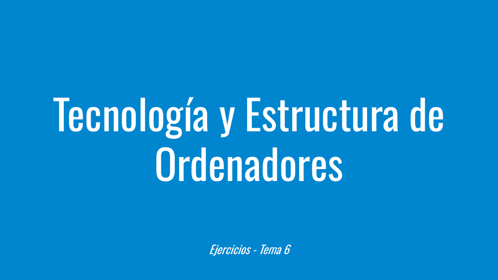
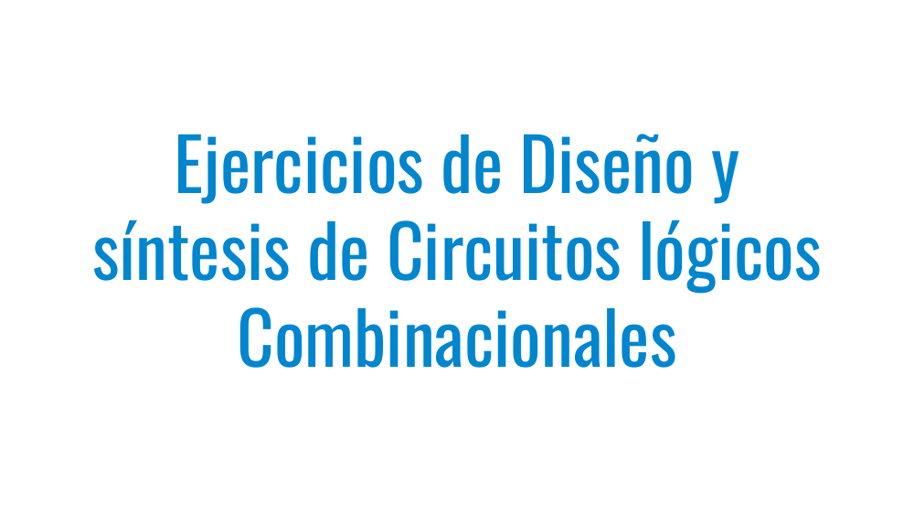
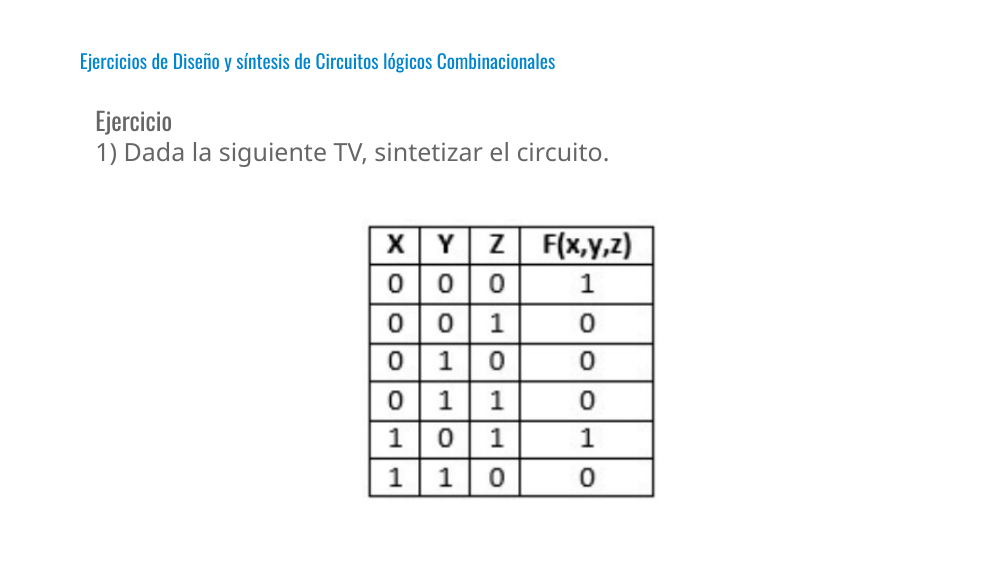
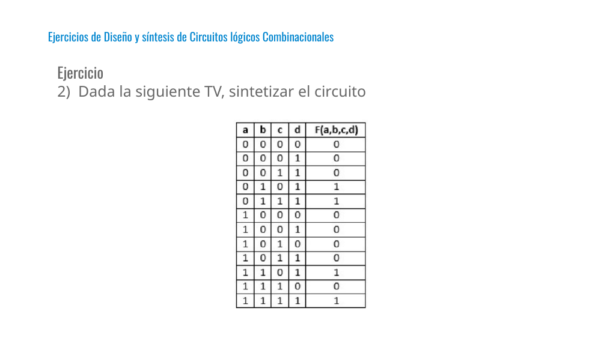
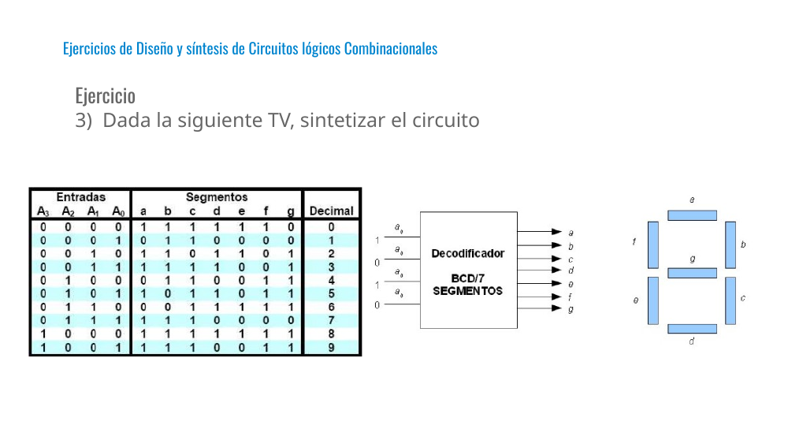

# Tema 6 - TEO - Ejercicios

Presentación de **Tecnología y Estructura de Ordenadores (TEO / IYA001)** — Universidad Europea del Atlántico.

Archivo original: [Tema 6 - TEO - Ejercicios.pdf](Tema%206%20-%20TEO%20-%20Ejercicios.pdf)

Total de diapositivas: 7

---

## Loyda Leticia Alas Castaneda

- loyda.alas@uneatlantico.es

---

## Tecnología y Estructura de Ordenadores

- Ejercicios - Tema 6

---

## Ejercicios de Diseño y síntesis de Circuitos lógicos Combinacionales

---

## Ejercicio

- 1) Dada la siguiente TV, sintetizar el circuito.

s de Diseño y síntesis de Circuitos lógicos Combinacionales

---

## Ejercicio

- 2) Dada la siguiente TV, sintetizar el circuito

s de Diseño y síntesis de Circuitos lógicos Combinacionales

---

## Ejercicio

- 3) Dada la siguiente TV, sintetizar el circuito

s de Diseño y síntesis de Circuitos lógicos Combinacionales

---

## Diapositiva 7

---
