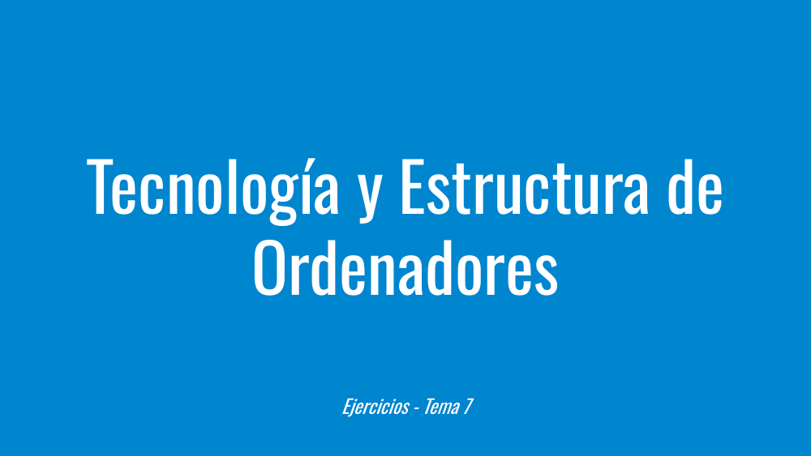
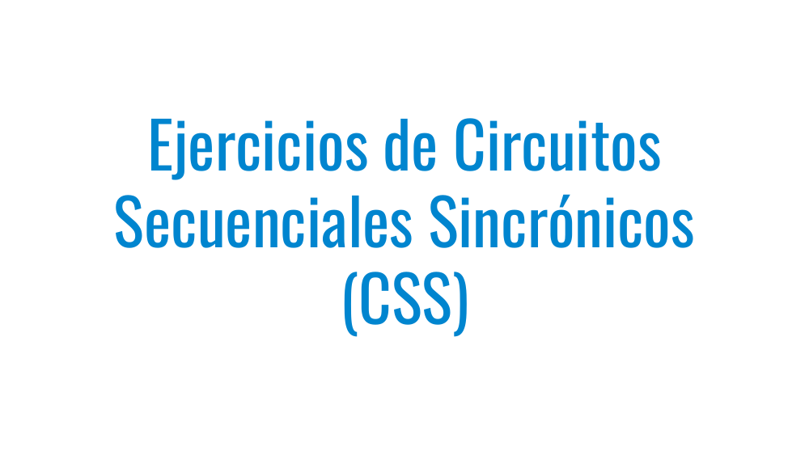
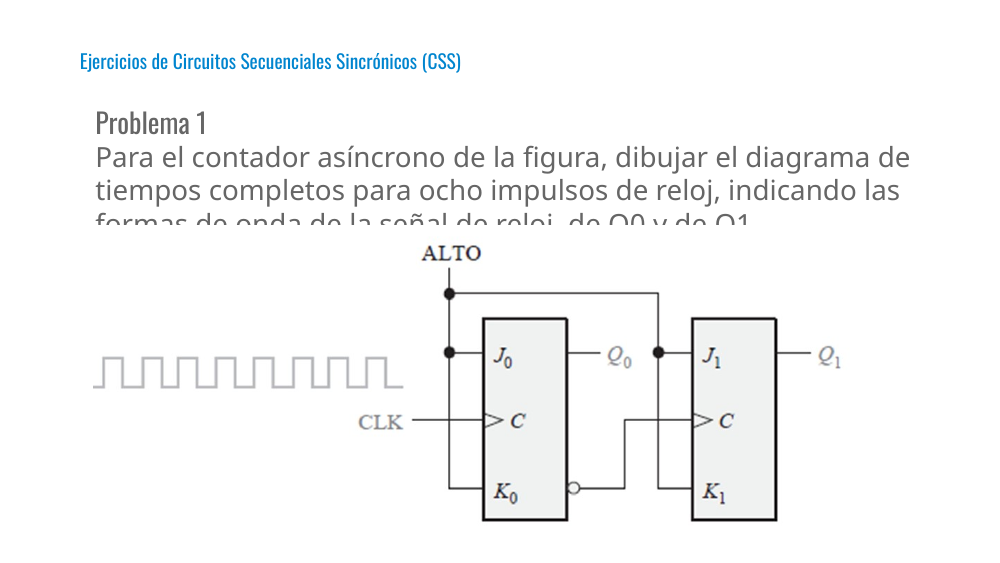
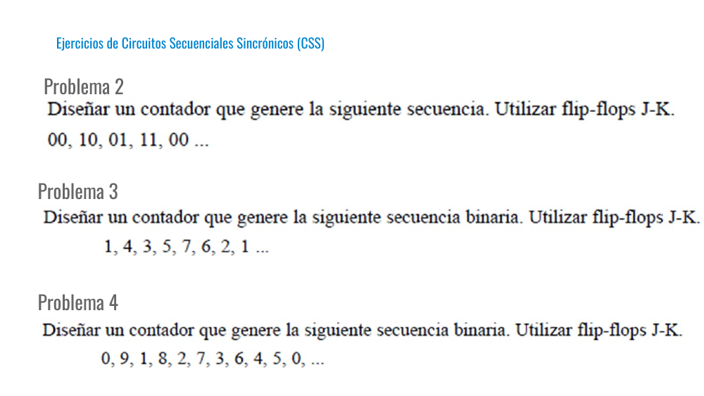

# Tema 7 - Ejercicios

Presentación de **Tecnología y Estructura de Ordenadores (TEO / IYA001)** — Universidad Europea del Atlántico.

Archivo original: [Tema 7 - Ejercicios.pdf](Tema%207%20-%20Ejercicios.pdf)

Total de diapositivas: 6

---

## Loyda Leticia Alas Castaneda

- loyda.alas@uneatlantico.es

---

## Tecnología y Estructura de Ordenadores

- Ejercicios - Tema 7

---

## Ejercicios de Circuitos Secuenciales Sincrónicos (CSS)

---

## Problema 1

- Para el contador asíncrono de la figura, dibujar el diagrama de tiempos completos para ocho impulsos de reloj, indicando las formas de onda de la señal de reloj, de Q0 y de Q1.

- Ejercicios de Circuitos Secuenciales Sincrónicos (CSS)

---

## Problema 2

- Ejercicios de Circuitos Secuenciales Sincrónicos (CSS)

- Problema 3

- Problema 4

---

## Diapositiva 6

---
