# Tema 8, 9 y 10

Presentación de **Tecnología y Estructura de Ordenadores (TEO / IYA001)** — Universidad Europea del Atlántico.

Archivo original: [Tema 8, 9 y 10.pdf](Tema%208,%209%20y%2010.pdf)

Total de diapositivas: 46

---

## Loyda Leticia Alas Castaneda

- loyda.alas@uneatlantico.es

---

## Tecnología y Estructura de Ordenadores

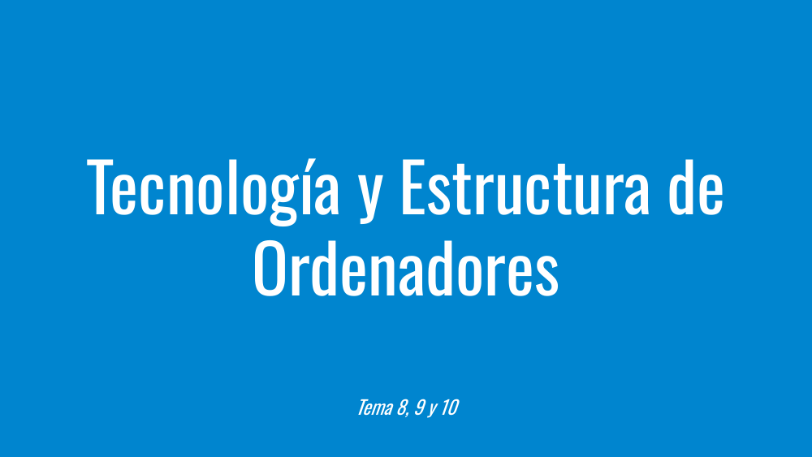

- Tema 8, 9 y 10

---

## Interacción entre procesador y memoria

---

## Microprocesador

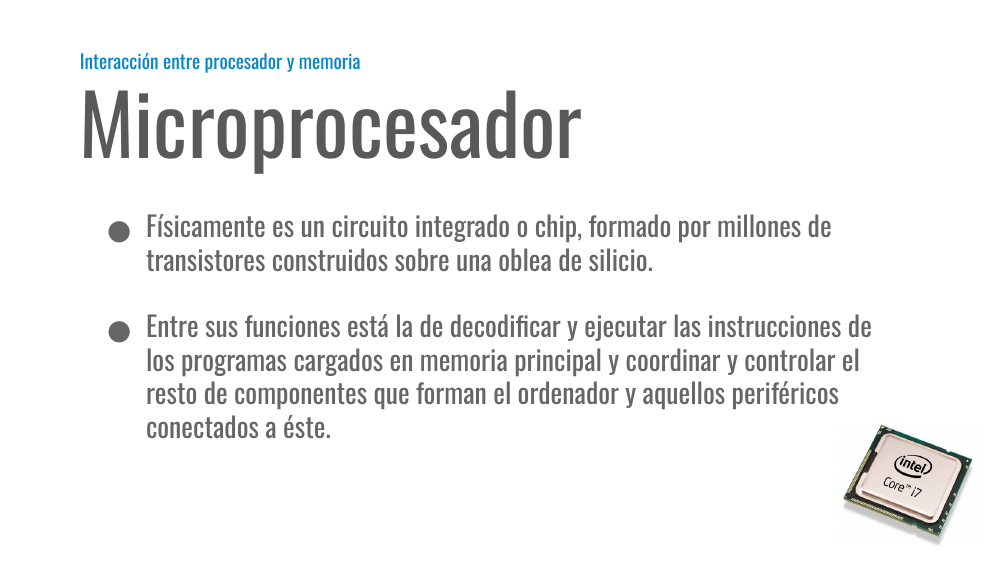

- Físicamente es un circuito integrado o chip, formado por millones de transistores construidos sobre una oblea de silicio.
- Entre sus funciones está la de decodificar y ejecutar las instrucciones de los programas cargados en memoria principal y coordinar y controlar el resto de componentes que forman el ordenador y aquellos periféricos
- conectados a éste.

- Interacción entre procesador y memoria

---

## Microprocesador | Componentes

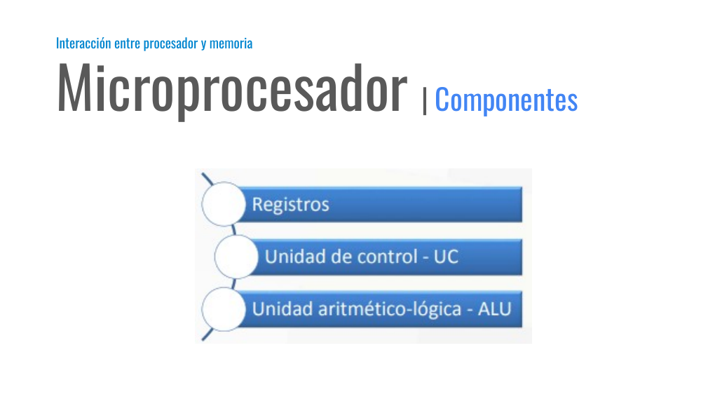

- Interacción entre procesador y memoria

---

## Microprocesador | Registros

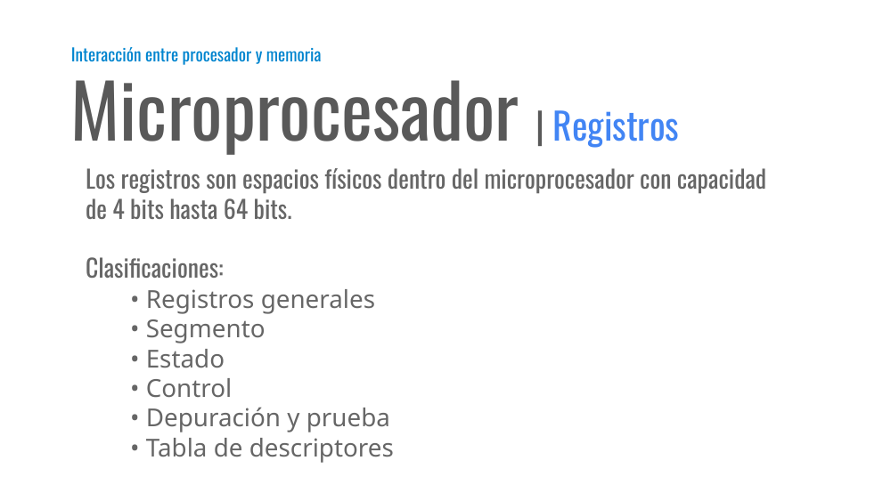

- Los registros son espacios físicos dentro del microprocesador con capacidad de 4 bits hasta 64 bits.
- Clasificaciones:
- • Registros generales
- • Segmento
- • Estado
- • Control
- • Depuración y prueba
- • Tabla de descriptores

- Interacción entre procesador y memoria

---

## Microprocesador | Registros de propósito general

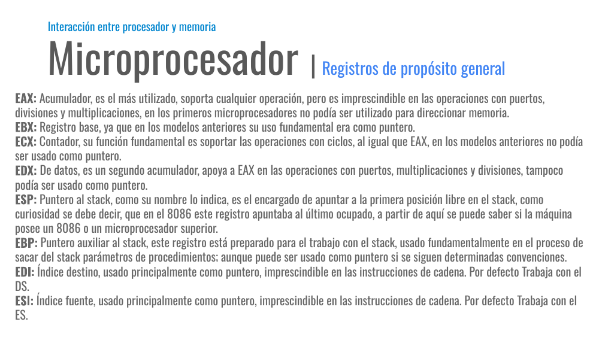

- EAX: Acumulador, es el más utilizado, soporta cualquier operación, pero es imprescindible en las operaciones con puertos, divisiones y multiplicaciones, en los primeros microprocesadores no podía ser utilizado para direccionar memoria.
- EBX: Registro base, ya que en los modelos anteriores su uso fundamental era como puntero.
- ECX: Contador, su función fundamental es soportar las operaciones con ciclos, al igual que EAX, en los modelos anteriores no podía ser usado como puntero.
- EDX: De datos, es un segundo acumulador, apoya a EAX en las operaciones con puertos, multiplicaciones y divisiones, tampoco podía ser usado como puntero.
- ESP: Puntero al stack, como su nombre lo indica, es el encargado de apuntar a la primera posición libre en el stack, como curiosidad se debe decir, que en el 8086 este registro apuntaba al último ocupado, a partir de aquí se puede saber si la máquina posee un 8086 o un microprocesador superior.
- EBP: Puntero auxiliar al stack, este registro está preparado para el trabajo con el stack, usado fundamentalmente en el proceso de sacar del stack parámetros de procedimientos; aunque puede ser usado como puntero si se siguen determinadas convenciones.
- EDI: Índice destino, usado principalmente como puntero, imprescindible en las instrucciones de cadena. Por defecto Trabaja con el DS.
- ESI: Índice fuente, usado principalmente como puntero, imprescindible en las instrucciones de cadena. Por defecto Trabaja con el ES.

- Interacción entre procesador y memoria

---

## Microprocesador | Registros de Segmento

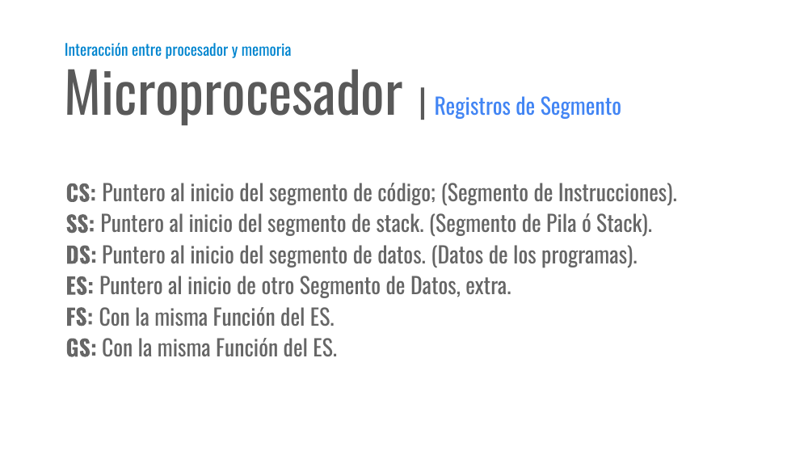

- CS: Puntero al inicio del segmento de código; (Segmento de Instrucciones).
- SS: Puntero al inicio del segmento de stack. (Segmento de Pila ó Stack).
- DS: Puntero al inicio del segmento de datos. (Datos de los programas).
- ES: Puntero al inicio de otro Segmento de Datos, extra.
- FS: Con la misma Función del ES.
- GS: Con la misma Función del ES.

- Interacción entre procesador y memoria

---

## Microprocesador | Registros de estado y control

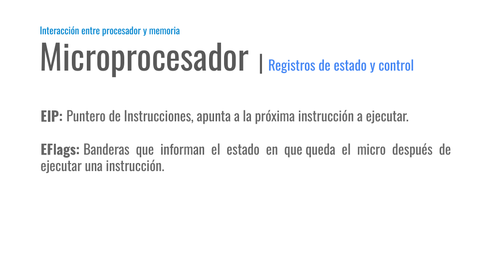

- EIP: Puntero de Instrucciones, apunta a la próxima instrucción a ejecutar.
- EFlags: Banderas que informan el estado en que queda el micro después de ejecutar una instrucción.

- Interacción entre procesador y memoria

---

## Microprocesador | Registros de coma flotante

- Registros de coma flotante
- Registros constantes

- Interacción entre procesador y memoria

---

## Microprocesador | Unidad de control

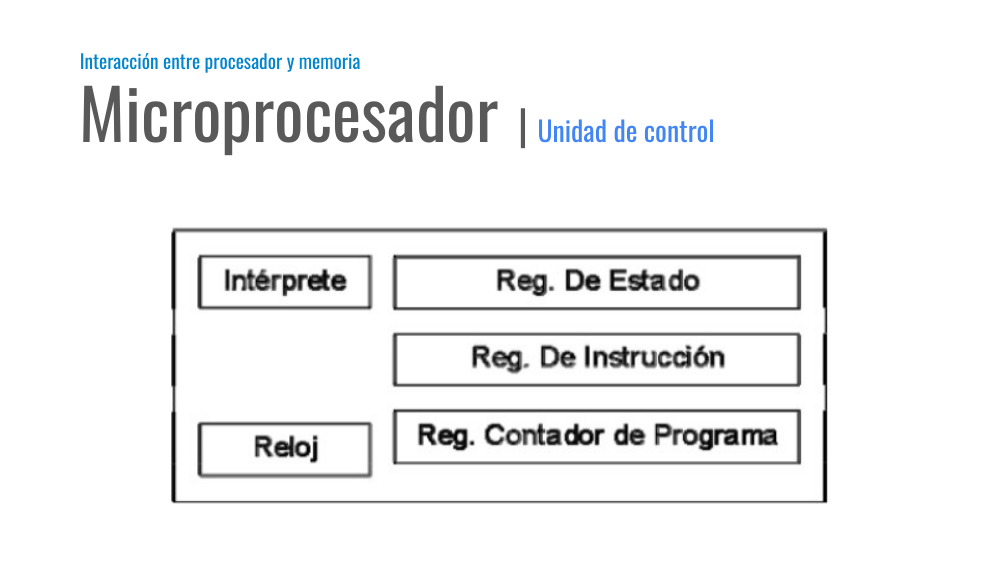

- Interacción entre procesador y memoria

---

## Microprocesador | Unidad Aritmética Lógica ALU

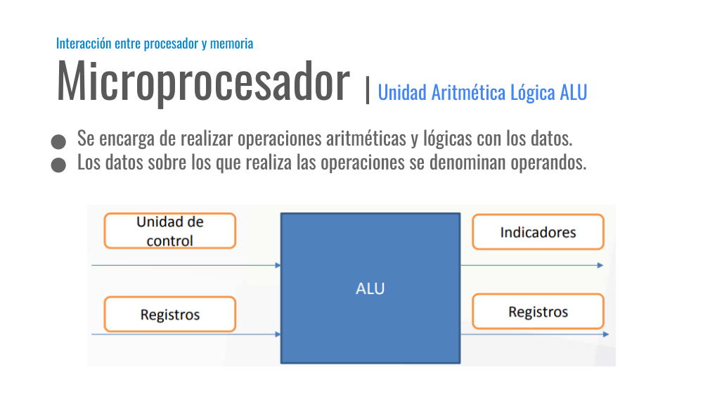

- Se encarga de realizar operaciones aritméticas y lógicas con los datos.
- Los datos sobre los que realiza las operaciones se denominan operandos.

- Interacción entre procesador y memoria

---

## Microprocesador | Unidad Aritmética Lógica ALU

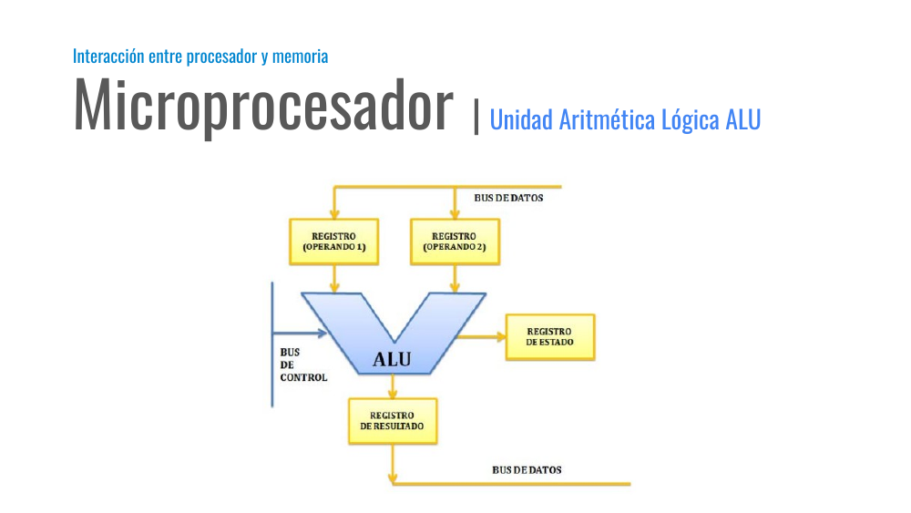

- Interacción entre procesador y memoria

---

## Microprocesador | Fases de Ejecución de instrucciones

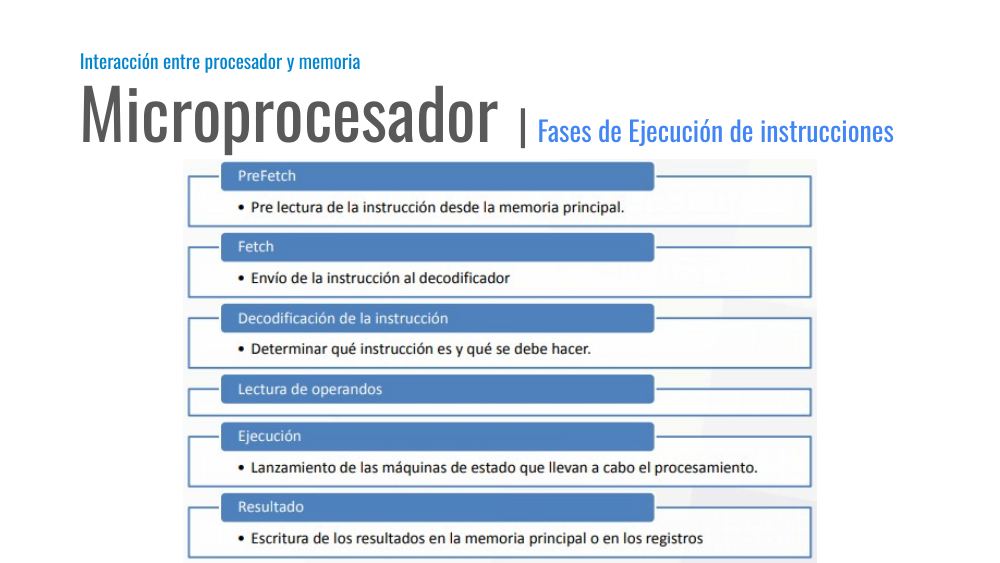

- Interacción entre procesador y memoria

---

## Interacción del microprocesador con la Memoria

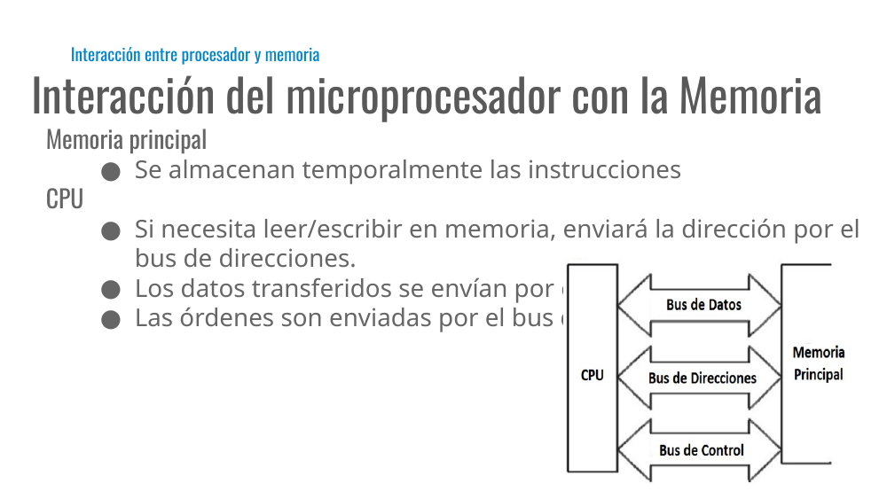

- Memoria principal
- Se almacenan temporalmente las instrucciones
- CPU
- Si necesita leer/escribir en memoria, enviará la dirección por el bus de direcciones.
- Los datos transferidos se envían por el bus de datos.
- Las órdenes son enviadas por el bus de control.

- Interacción entre procesador y memoria

---

## Buses

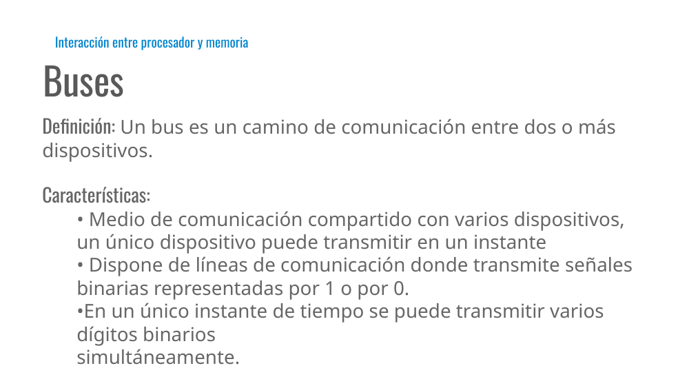

- Definición: Un bus es un camino de comunicación entre dos o más dispositivos.
- Características:
- • Medio de comunicación compartido con varios dispositivos, un único dispositivo puede transmitir en un instante
- • Dispone de líneas de comunicación donde transmite señales binarias representadas por 1 o por 0.
- •En un único instante de tiempo se puede transmitir varios dígitos binarios
- simultáneamente.

- Interacción entre procesador y memoria

---

## Buses

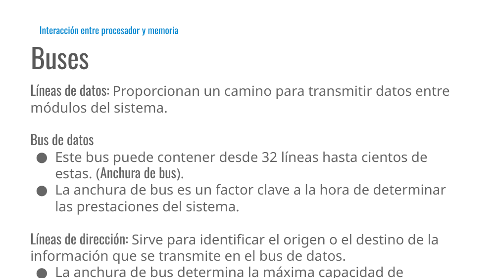

- Líneas de datos: Proporcionan un camino para transmitir datos entre módulos del sistema.
- Bus de datos
- Este bus puede contener desde 32 líneas hasta cientos de estas. (Anchura de bus).
- La anchura de bus es un factor clave a la hora de determinar las prestaciones del sistema.
- Líneas de dirección: Sirve para identificar el origen o el destino de la información que se transmite en el bus de datos.
- La anchura de bus determina la máxima capacidad de memoria posible en el sistema.

- Interacción entre procesador y memoria

---

## Buses

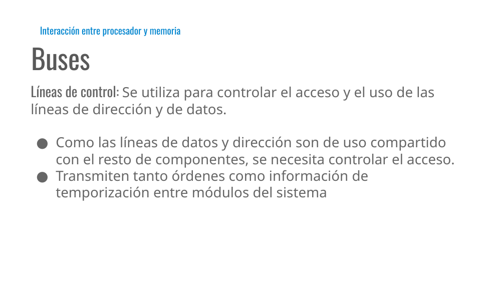

- Líneas de control: Se utiliza para controlar el acceso y el uso de las líneas de dirección y de datos.
- Como las líneas de datos y dirección son de uso compartido con el resto de componentes, se necesita controlar el acceso.
- Transmiten tanto órdenes como información de temporización entre módulos del sistema

- Interacción entre procesador y memoria

---

## Buses

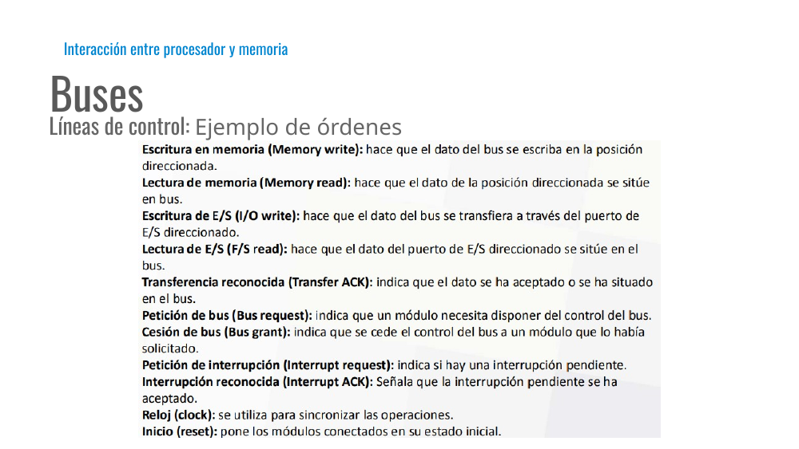

- Líneas de control: Ejemplo de órdenes

- Interacción entre procesador y memoria

---

## Buses

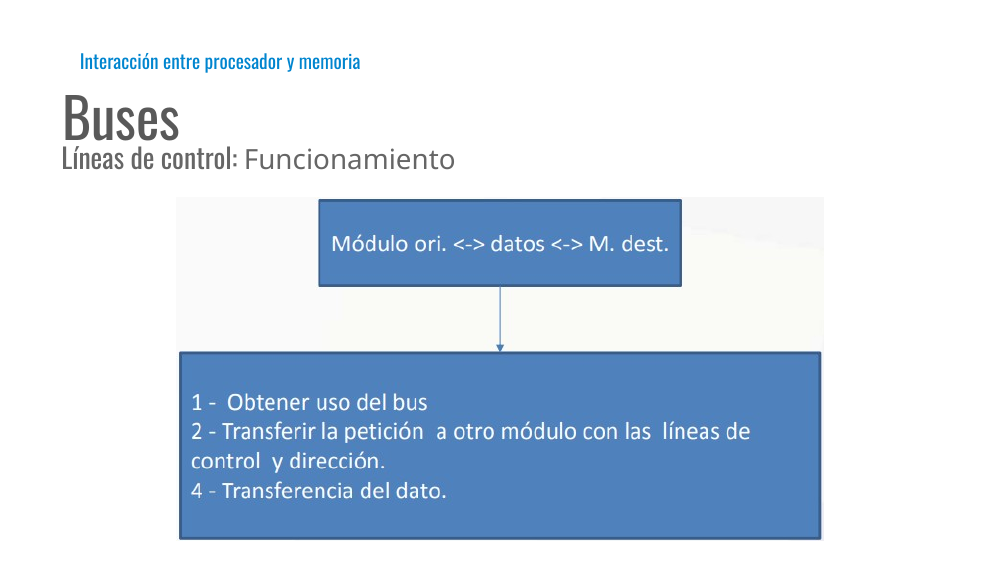

- Líneas de control: Funcionamiento

- Interacción entre procesador y memoria

---

## Ejercicios

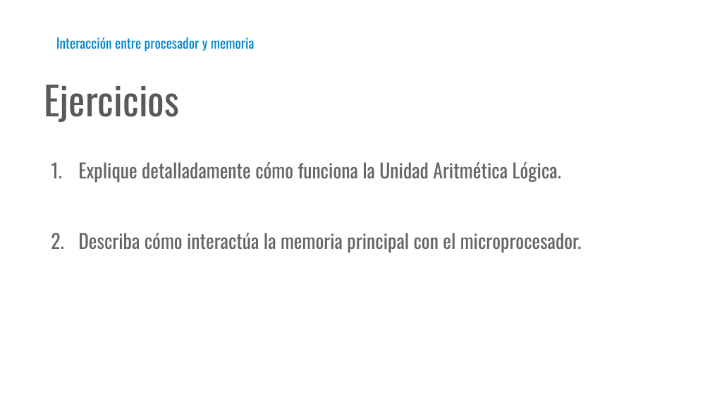

- Explique detalladamente cómo funciona la Unidad Aritmética Lógica.
- Describa cómo interactúa la memoria principal con el microprocesador.

- Interacción entre procesador y memoria

---

## Diapositiva 22

---

## Ejecución de Código

---

## Ejecución de Código

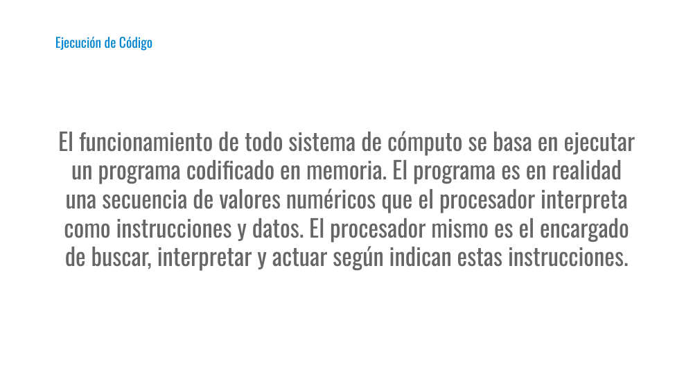

- El funcionamiento de todo sistema de cómputo se basa en ejecutar un programa codificado en memoria. El programa es en realidad una secuencia de valores numéricos que el procesador interpreta como instrucciones y datos. El procesador mismo es el encargado de buscar, interpretar y actuar según indican estas instrucciones.

---

## Ejecución de Código

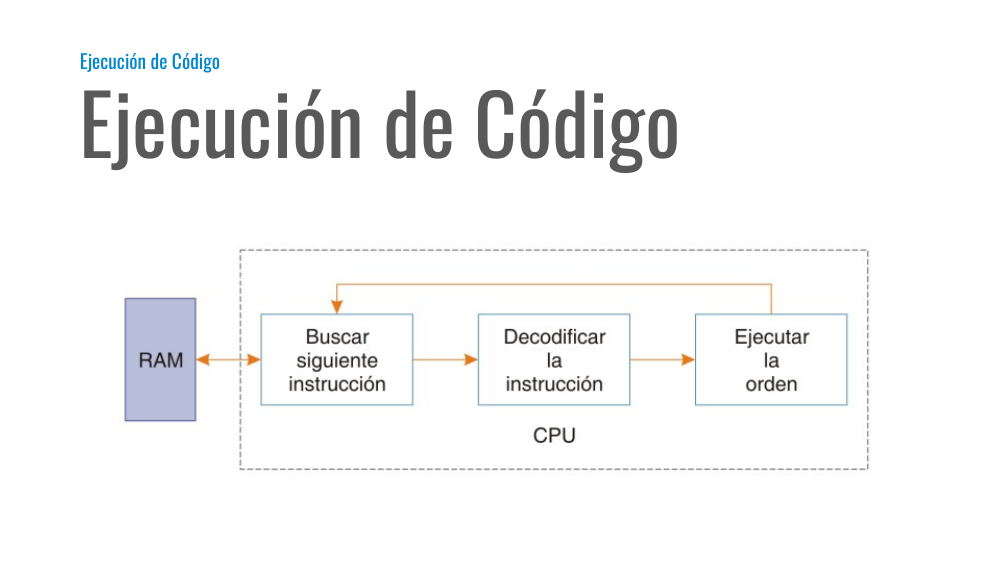

---

## Monociclo vs Multiciclo

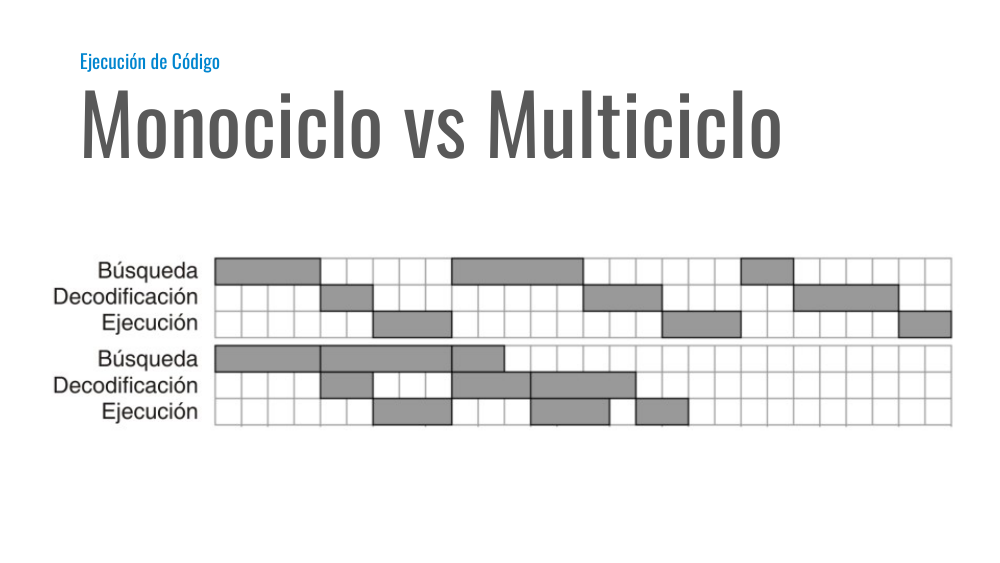

- Ejecución de Código

---

## Ciclos

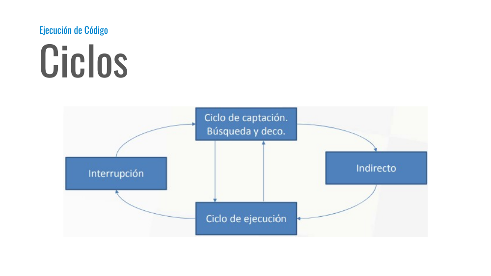

- Ejecución de Código

---

## Ciclos de búsqueda y decodificación

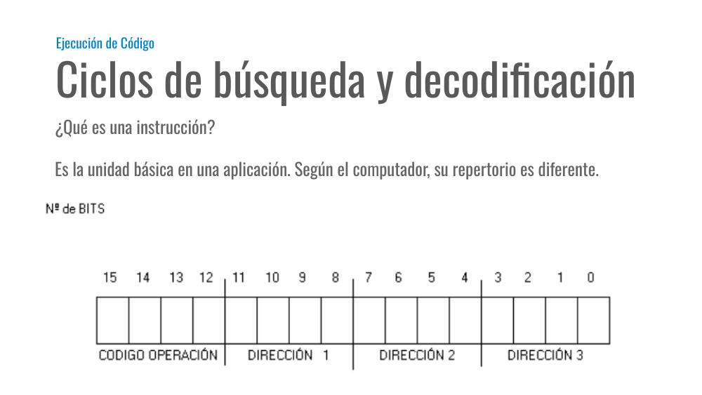

- Ejecución de Código

- ¿Qué es una instrucción?
- Es la unidad básica en una aplicación. Según el computador, su repertorio es diferente.

---

## Ciclos de búsqueda y decodificación

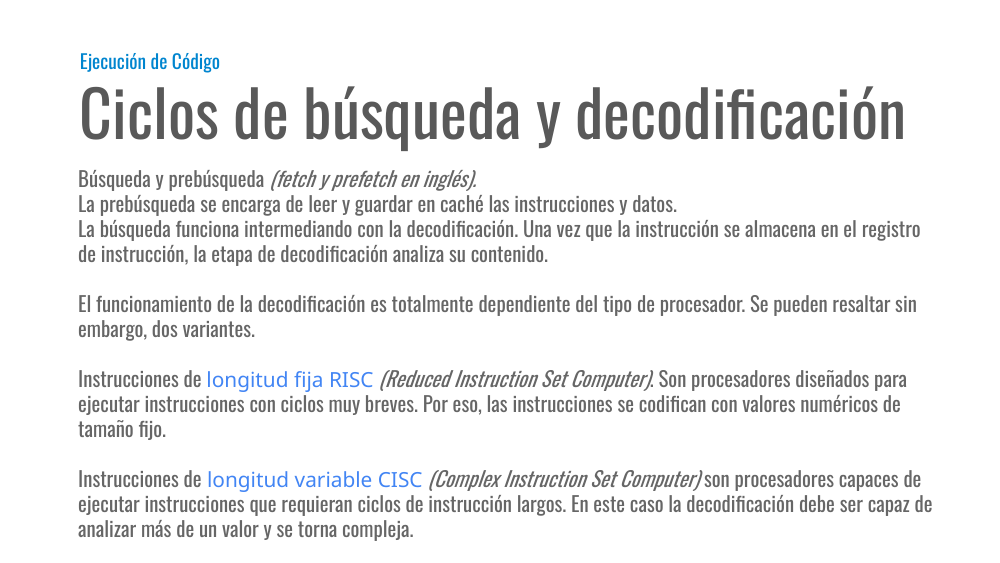

- Ejecución de Código

- Búsqueda y prebúsqueda (fetch y prefetch en inglés).
- La prebúsqueda se encarga de leer y guardar en caché las instrucciones y datos.
- La búsqueda funciona intermediando con la decodificación. Una vez que la instrucción se almacena en el registro de instrucción, la etapa de decodificación analiza su contenido.
- El funcionamiento de la decodificación es totalmente dependiente del tipo de procesador. Se pueden resaltar sin embargo, dos variantes.
- Instrucciones de longitud fija RISC (Reduced Instruction Set Computer). Son procesadores diseñados para ejecutar instrucciones con ciclos muy breves. Por eso, las instrucciones se codifican con valores numéricos de tamaño fijo.
- Instrucciones de longitud variable CISC (Complex Instruction Set Computer) son procesadores capaces de ejecutar instrucciones que requieran ciclos de instrucción largos. En este caso la decodificación debe ser capaz de analizar más de un valor y se torna compleja.

---

## Ciclos de Ejecución

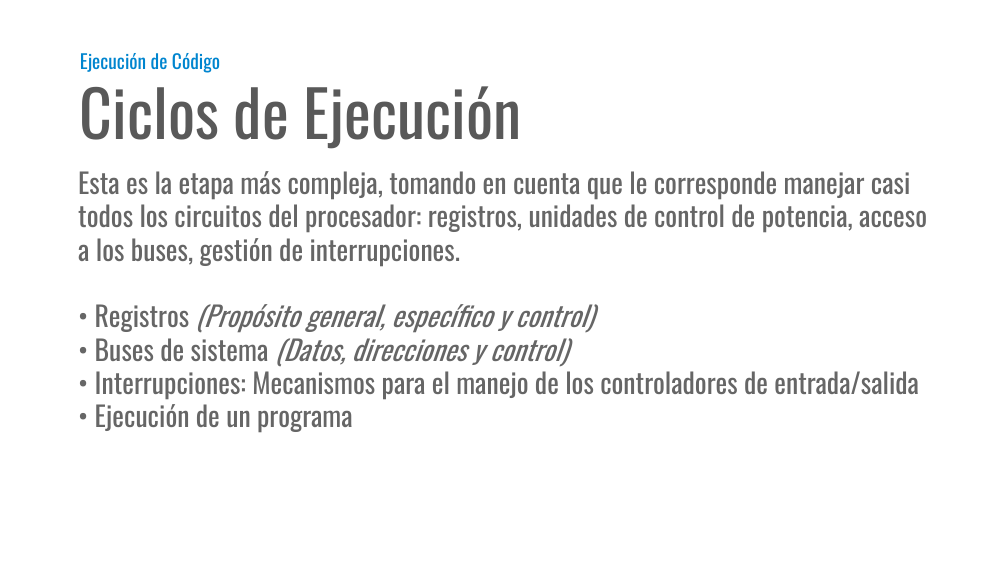

- Ejecución de Código

- Esta es la etapa más compleja, tomando en cuenta que le corresponde manejar casi todos los circuitos del procesador: registros, unidades de control de potencia, acceso a los buses, gestión de interrupciones.
- • Registros (Propósito general, específico y control)
- • Buses de sistema (Datos, direcciones y control)
- • Interrupciones: Mecanismos para el manejo de los controladores de entrada/salida
- • Ejecución de un programa

---

## Ciclos de Ejecución

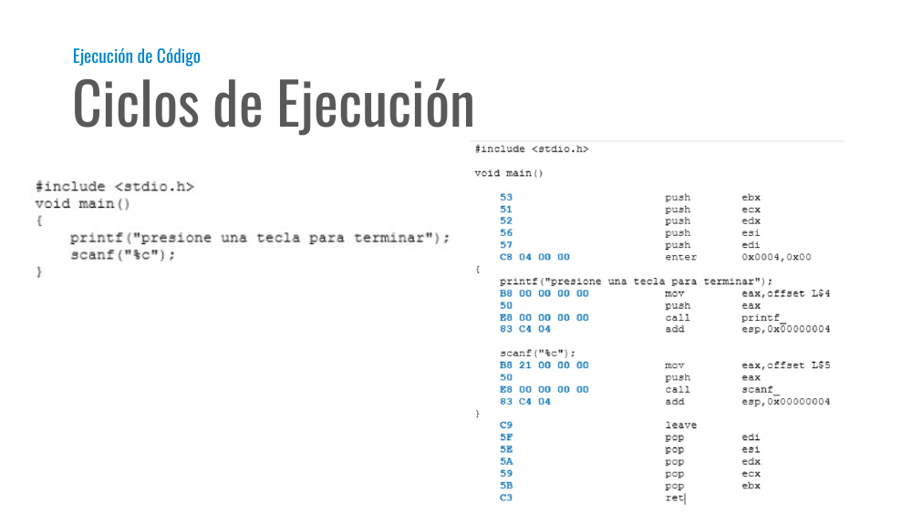

- Ejecución de Código

---

## Tipos de Memorias

---

## Introducción

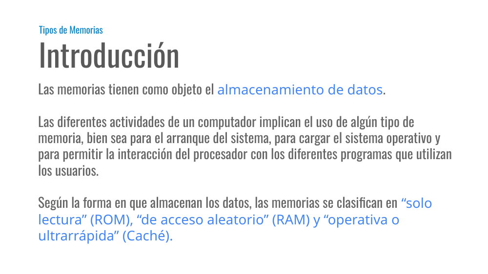

- Tipos de Memorias

- Las memorias tienen como objeto el almacenamiento de datos.
- Las diferentes actividades de un computador implican el uso de algún tipo de memoria, bien sea para el arranque del sistema, para cargar el sistema operativo y para permitir la interacción del procesador con los diferentes programas que utilizan los usuarios.
- Según la forma en que almacenan los datos, las memorias se clasifican en “solo lectura” (ROM), “de acceso aleatorio” (RAM) y “operativa o ultrarrápida” (Caché).

---

## Memoria de solo lectura ROM Read Only Memory

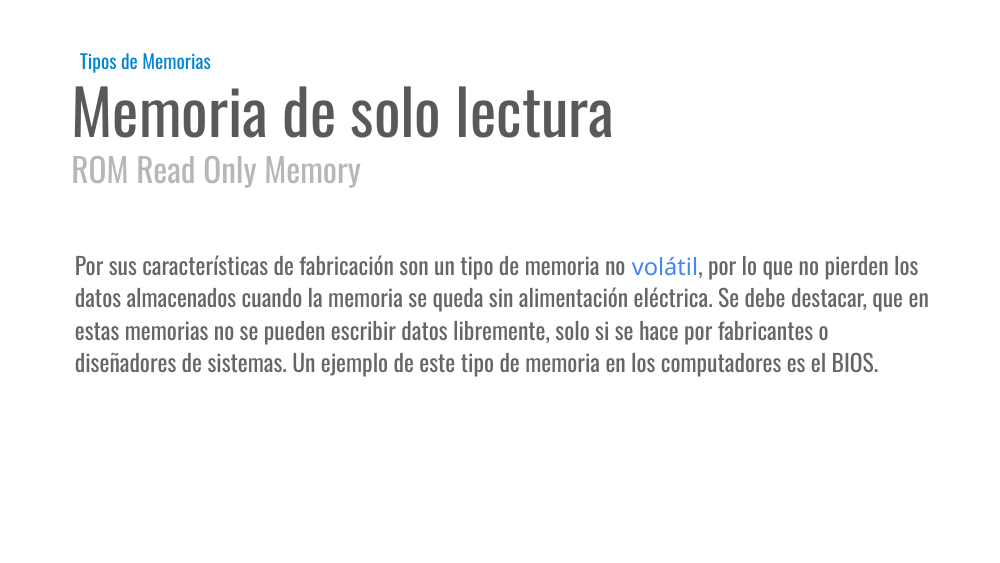

- Tipos de Memorias

- Por sus características de fabricación son un tipo de memoria no volátil, por lo que no pierden los datos almacenados cuando la memoria se queda sin alimentación eléctrica. Se debe destacar, que en estas memorias no se pueden escribir datos libremente, solo si se hace por fabricantes o diseñadores de sistemas. Un ejemplo de este tipo de memoria en los computadores es el BIOS.

---

## Memoria de solo lectura ROM Read Only Memory

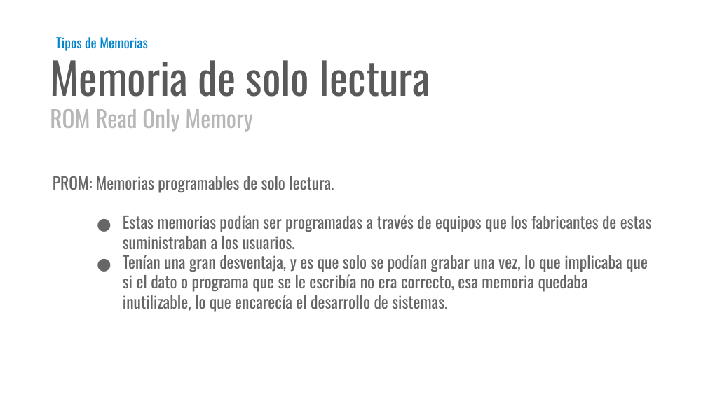

- Tipos de Memorias

- PROM: Memorias programables de solo lectura.
- Estas memorias podían ser programadas a través de equipos que los fabricantes de estas
- suministraban a los usuarios.
- Tenían una gran desventaja, y es que solo se podían grabar una vez, lo que implicaba que si el dato o programa que se le escribía no era correcto, esa memoria quedaba inutilizable, lo que encarecía el desarrollo de sistemas.

---

## Memoria de solo lectura ROM Read Only Memory

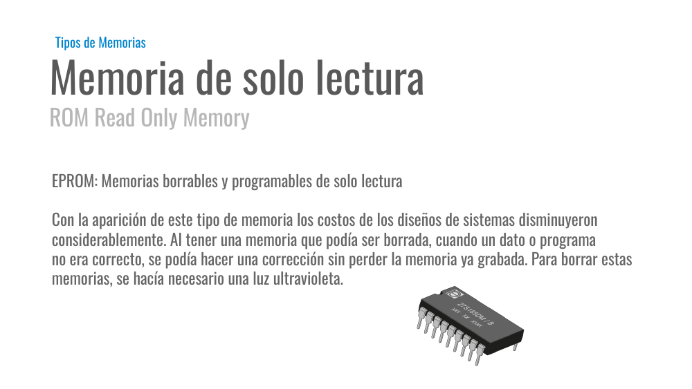

- Tipos de Memorias

- EPROM: Memorias borrables y programables de solo lectura
- Con la aparición de este tipo de memoria los costos de los diseños de sistemas disminuyeron considerablemente. Al tener una memoria que podía ser borrada, cuando un dato o programa
- no era correcto, se podía hacer una corrección sin perder la memoria ya grabada. Para borrar estas memorias, se hacía necesario una luz ultravioleta.

---

## Memoria de solo lectura ROM Read Only Memory

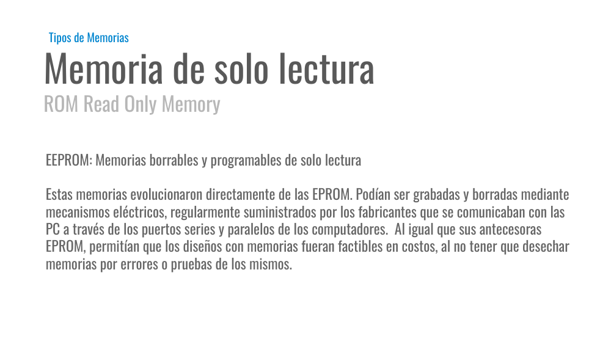

- Tipos de Memorias

- EEPROM: Memorias borrables y programables de solo lectura
- Estas memorias evolucionaron directamente de las EPROM. Podían ser grabadas y borradas mediante mecanismos eléctricos, regularmente suministrados por los fabricantes que se comunicaban con las PC a través de los puertos series y paralelos de los computadores. Al igual que sus antecesoras EPROM, permitían que los diseños con memorias fueran factibles en costos, al no tener que desechar memorias por errores o pruebas de los mismos.

---

## Memoria de solo lectura ROM Read Only Memory

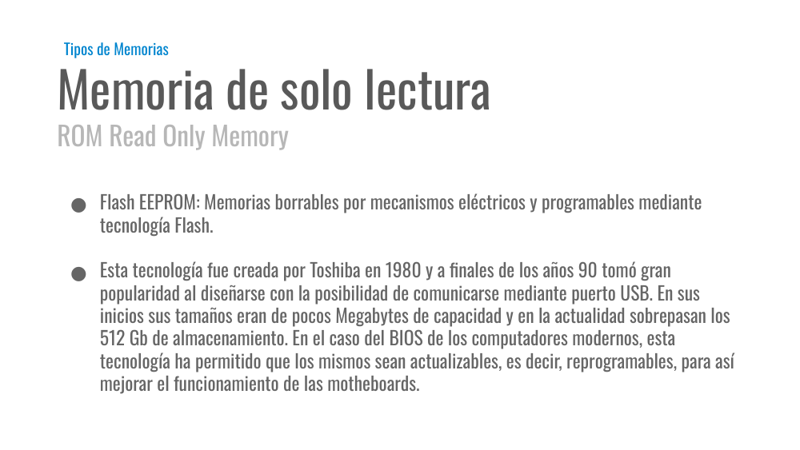

- Tipos de Memorias

- Flash EEPROM: Memorias borrables por mecanismos eléctricos y programables mediante tecnología Flash.
- Esta tecnología fue creada por Toshiba en 1980 y a finales de los años 90 tomó gran popularidad al diseñarse con la posibilidad de comunicarse mediante puerto USB. En sus inicios sus tamaños eran de pocos Megabytes de capacidad y en la actualidad sobrepasan los 512 Gb de almacenamiento. En el caso del BIOS de los computadores modernos, esta tecnología ha permitido que los mismos sean actualizables, es decir, reprogramables, para así mejorar el funcionamiento de las motheboards.

---

## Memoria de solo lectura ROM Read Only Memory

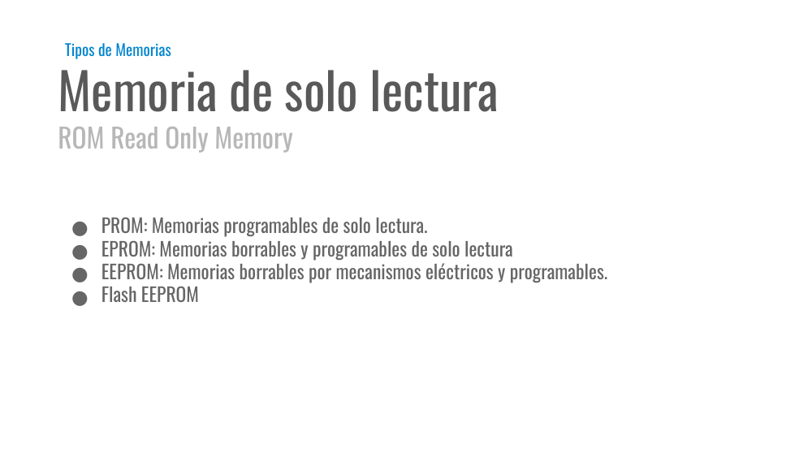

- Tipos de Memorias

- PROM: Memorias programables de solo lectura.
- EPROM: Memorias borrables y programables de solo lectura
- EEPROM: Memorias borrables por mecanismos eléctricos y programables.
- Flash EEPROM

---

## Memoria de Acceso Aleatorio RAM Random Access Memory

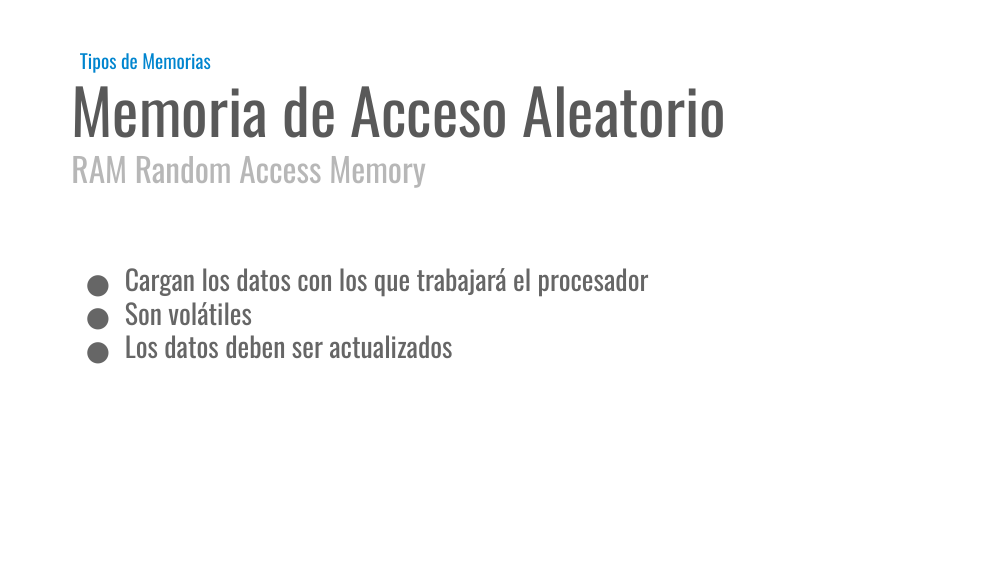

- Tipos de Memorias

- Cargan los datos con los que trabajará el procesador
- Son volátiles
- Los datos deben ser actualizados

---

## Memoria de Acceso Aleatorio RAM Random Access Memory

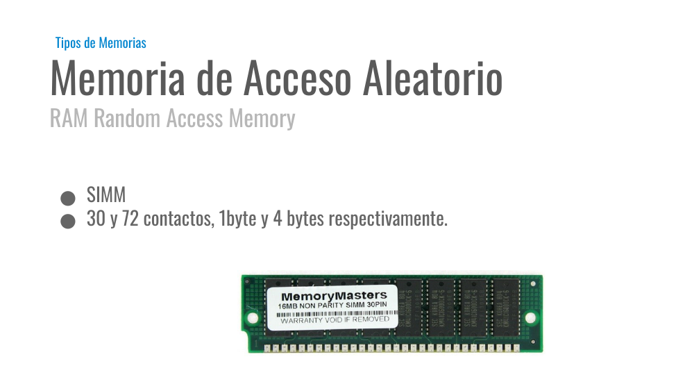

- Tipos de Memorias

- SIMM
- 30 y 72 contactos, 1byte y 4 bytes respectivamente.

---

## Memoria de Acceso Aleatorio RAM Random Access Memory

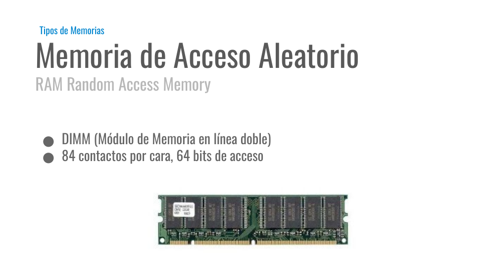

- Tipos de Memorias

- DIMM (Módulo de Memoria en línea doble)
- 84 contactos por cara, 64 bits de acceso

---

## Memoria de Acceso Aleatorio RAM Random Access Memory

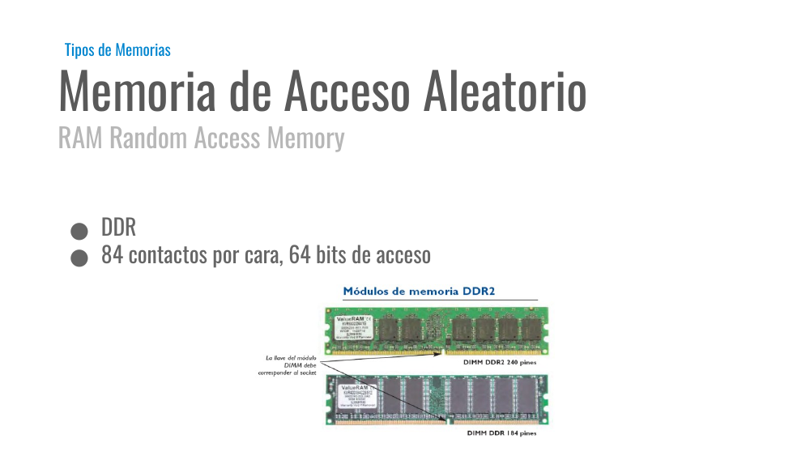

- Tipos de Memorias

- DDR
- 84 contactos por cara, 64 bits de acceso

---

## Memoria de Acceso Aleatorio RAM Random Access Memory

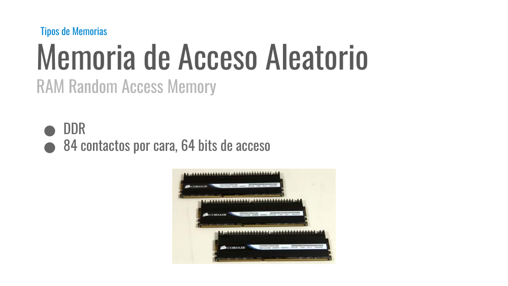

- Tipos de Memorias

- DDR
- 84 contactos por cara, 64 bits de acceso

---

## Memoria Caché

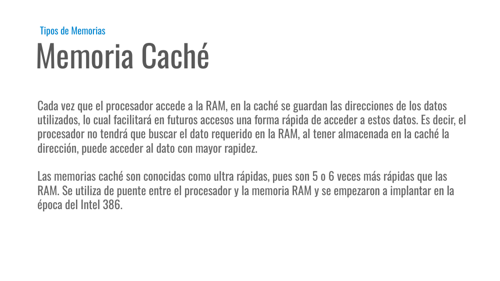

- Tipos de Memorias

- Cada vez que el procesador accede a la RAM, en la caché se guardan las direcciones de los datos utilizados, lo cual facilitará en futuros accesos una forma rápida de acceder a estos datos. Es decir, el procesador no tendrá que buscar el dato requerido en la RAM, al tener almacenada en la caché la dirección, puede acceder al dato con mayor rapidez.
- Las memorias caché son conocidas como ultra rápidas, pues son 5 o 6 veces más rápidas que las RAM. Se utiliza de puente entre el procesador y la memoria RAM y se empezaron a implantar en la
- época del Intel 386.

---

## Diapositiva 46

---
