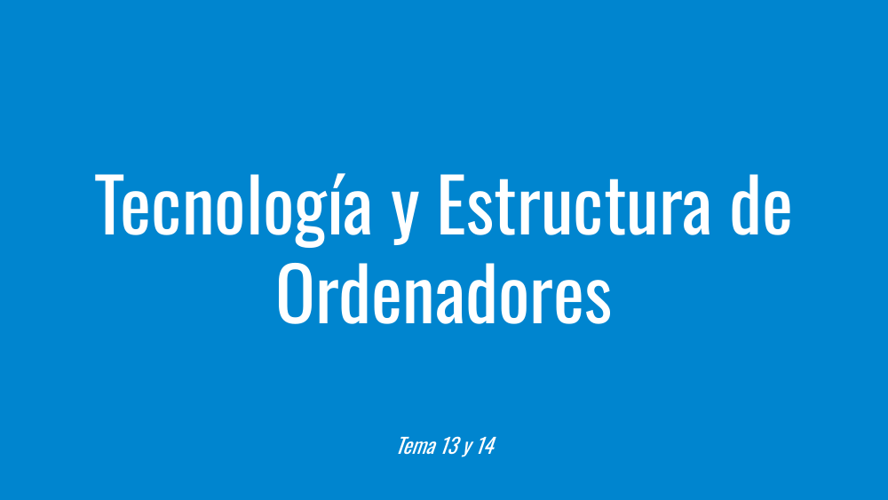
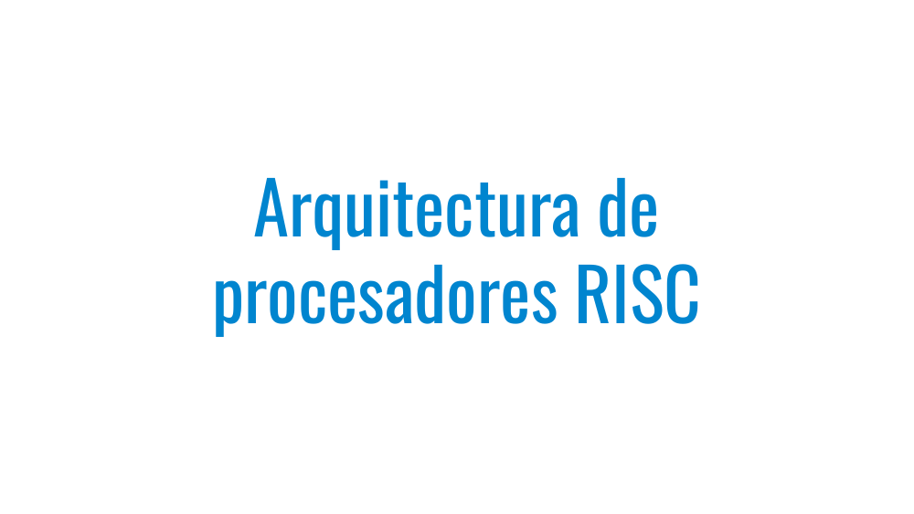
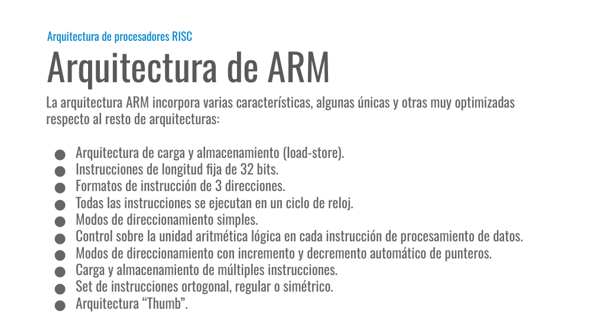
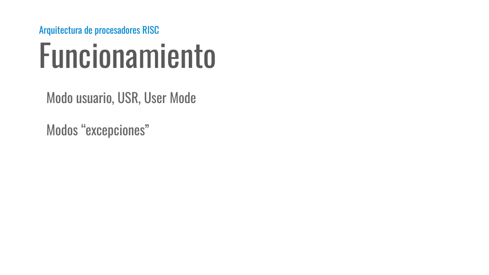
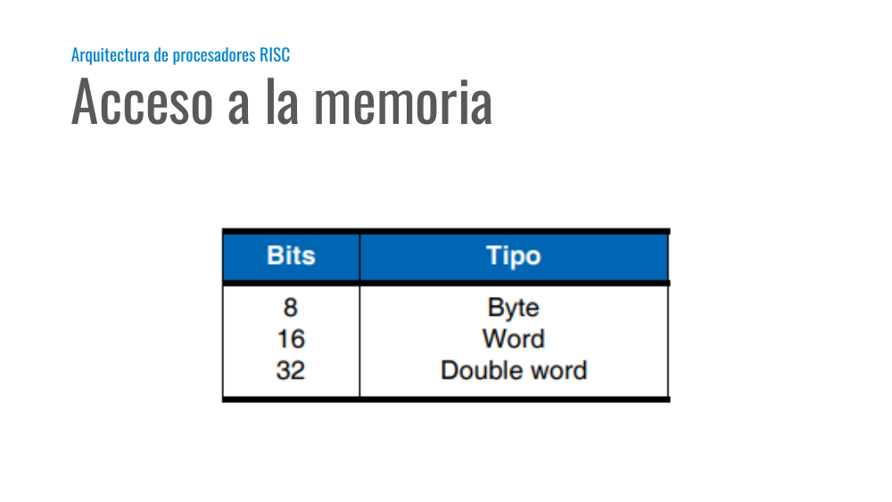
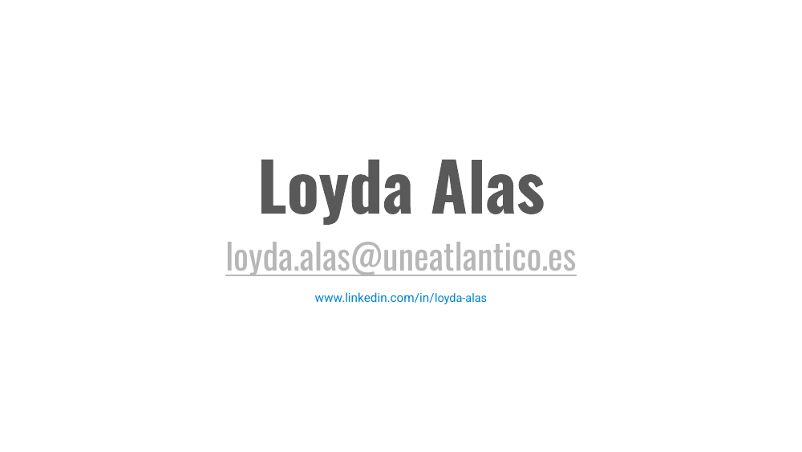

# Tema 13 y 14

Presentación de **Tecnología y Estructura de Ordenadores (TEO / IYA001)** — Universidad Europea del Atlántico.

Archivo original: [Tema 13 y 14.pdf](Tema%2013%20y%2014.pdf)

Total de diapositivas: 7

---

## Loyda Leticia Alas Castaneda

- loyda.alas@uneatlantico.es

---

## Tecnología y Estructura de Ordenadores

- Tema 13 y 14

---

## Arquitectura de procesadores RISC

---

## Arquitectura de ARM

- Arquitectura de procesadores RISC

- La arquitectura ARM incorpora varias características, algunas únicas y otras muy optimizadas respecto al resto de arquitecturas:
- Arquitectura de carga y almacenamiento (load-store).
- Instrucciones de longitud fija de 32 bits.
- Formatos de instrucción de 3 direcciones.
- Todas las instrucciones se ejecutan en un ciclo de reloj.
- Modos de direccionamiento simples.
- Control sobre la unidad aritmética lógica en cada instrucción de procesamiento de datos.
- Modos de direccionamiento con incremento y decremento automático de punteros.
- Carga y almacenamiento de múltiples instrucciones.
- Set de instrucciones ortogonal, regular o simétrico.
- Arquitectura “Thumb”.

---

## Funcionamiento

- Arquitectura de procesadores RISC

- Modo usuario, USR, User Mode
- Modos “excepciones”

---

## Acceso a la memoria

- Arquitectura de procesadores RISC

---

## Diapositiva 7

---
