# Tema 15, 16, 17 y 18

Presentación de **Tecnología y Estructura de Ordenadores (TEO / IYA001)** — Universidad Europea del Atlántico.

Archivo original: [Tema 15, 16, 17 y 18.pdf](Tema%2015,%2016,%2017%20y%2018.pdf)

Total de diapositivas: 39

---

## Loyda Leticia Alas Castaneda

- loyda.alas@uneatlantico.es

---

## Tecnología y Estructura de Ordenadores

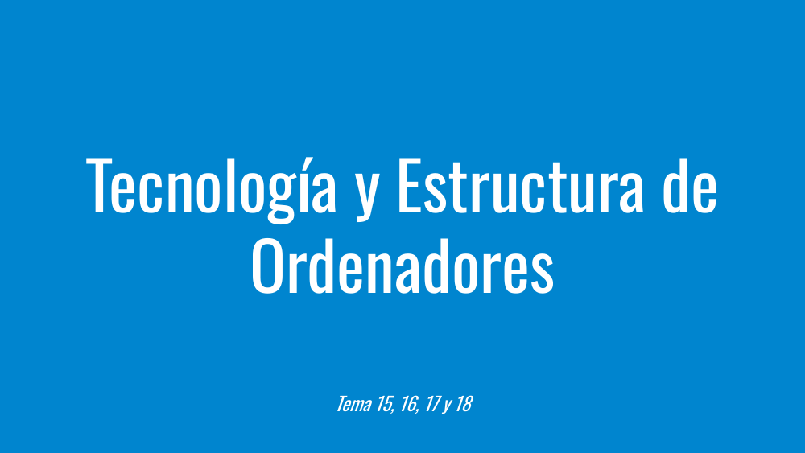

- Tema 15, 16, 17 y 18

---

## Hardware de entrada/salida y periféricos

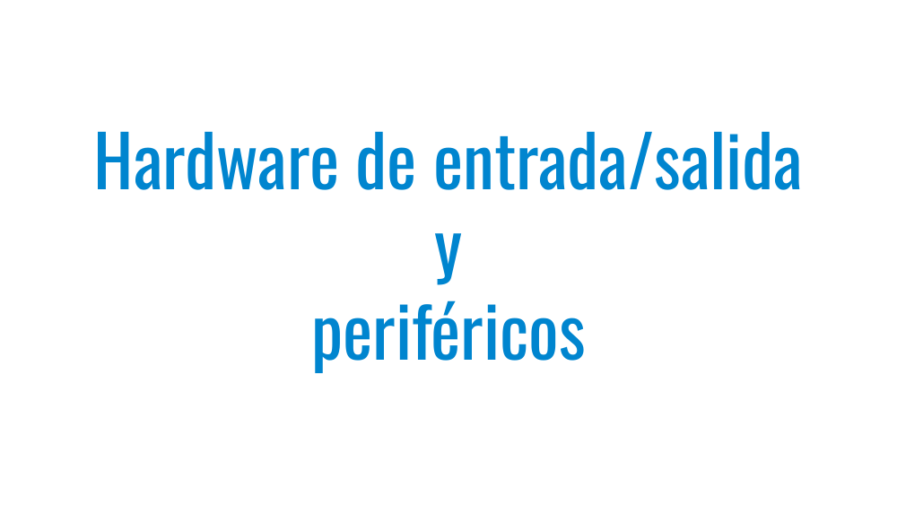

---

## Arquitectura de E/S

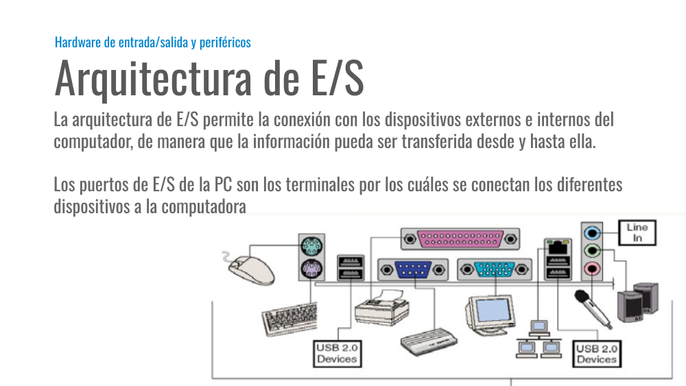

- Hardware de entrada/salida y periféricos

- La arquitectura de E/S permite la conexión con los dispositivos externos e internos del computador, de manera que la información pueda ser transferida desde y hasta ella.
- Los puertos de E/S de la PC son los terminales por los cuáles se conectan los diferentes dispositivos a la computadora

---

## Arquitectura de E/S

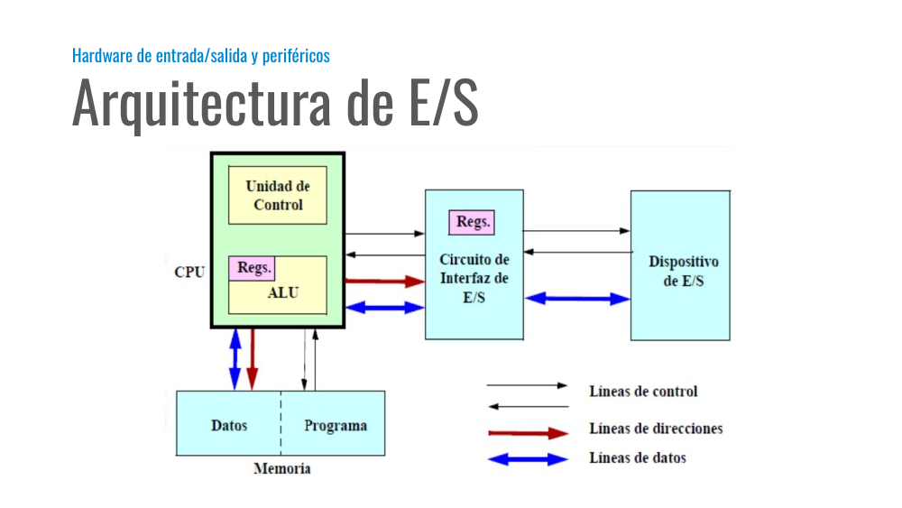

- Hardware de entrada/salida y periféricos

---

## Características de los dispositivos de E/S

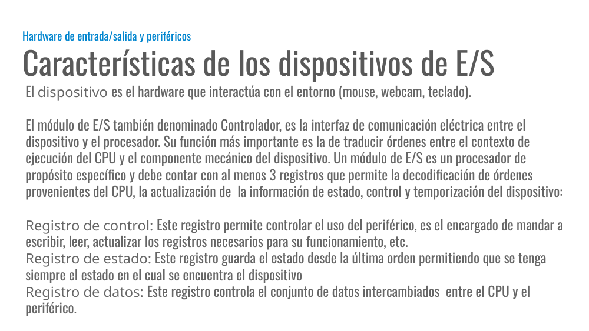

- Hardware de entrada/salida y periféricos

- El dispositivo es el hardware que interactúa con el entorno (mouse, webcam, teclado).
- El módulo de E/S también denominado Controlador, es la interfaz de comunicación eléctrica entre el dispositivo y el procesador. Su función más importante es la de traducir órdenes entre el contexto de ejecución del CPU y el componente mecánico del dispositivo. Un módulo de E/S es un procesador de propósito específico y debe contar con al menos 3 registros que permite la decodificación de órdenes provenientes del CPU, la actualización de la información de estado, control y temporización del dispositivo:
- Registro de control: Este registro permite controlar el uso del periférico, es el encargado de mandar a escribir, leer, actualizar los registros necesarios para su funcionamiento, etc.
- Registro de estado: Este registro guarda el estado desde la última orden permitiendo que se tenga siempre el estado en el cual se encuentra el dispositivo
- Registro de datos: Este registro controla el conjunto de datos intercambiados entre el CPU y el periférico.

---

## Características de los dispositivos de E/S

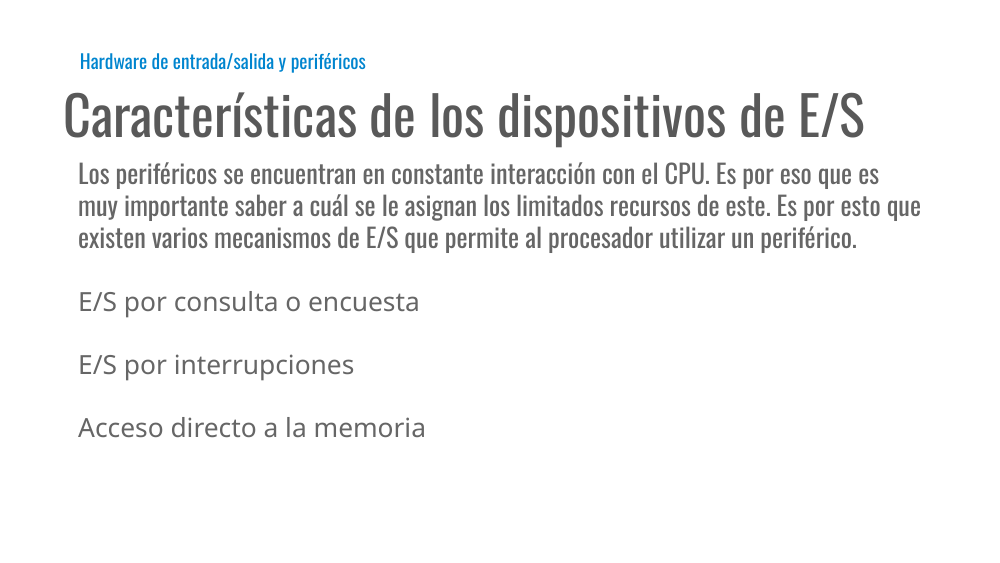

- Hardware de entrada/salida y periféricos

- Los periféricos se encuentran en constante interacción con el CPU. Es por eso que es
- muy importante saber a cuál se le asignan los limitados recursos de este. Es por esto que
- existen varios mecanismos de E/S que permite al procesador utilizar un periférico.
- E/S por consulta o encuesta
- E/S por interrupciones
- Acceso directo a la memoria

---

## Características de los dispositivos de E/S

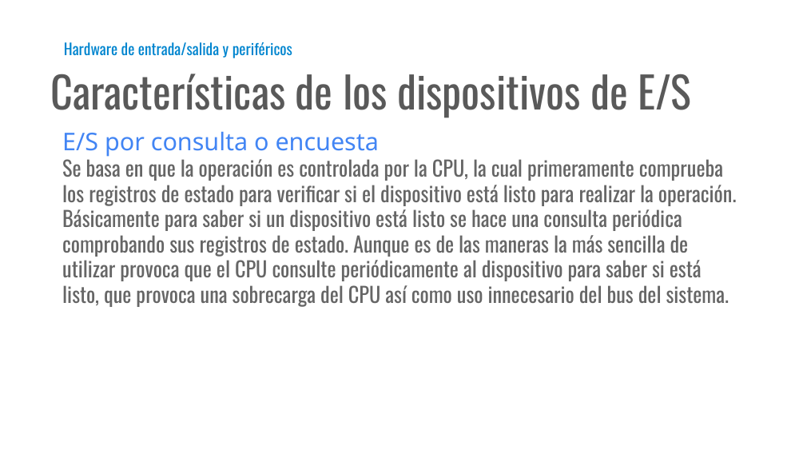

- Hardware de entrada/salida y periféricos

- E/S por consulta o encuesta
- Se basa en que la operación es controlada por la CPU, la cual primeramente comprueba
- los registros de estado para verificar si el dispositivo está listo para realizar la operación.
- Básicamente para saber si un dispositivo está listo se hace una consulta periódica
- comprobando sus registros de estado. Aunque es de las maneras la más sencilla de
- utilizar provoca que el CPU consulte periódicamente al dispositivo para saber si está
- listo, que provoca una sobrecarga del CPU así como uso innecesario del bus del sistema.

---

## Características de los dispositivos de E/S

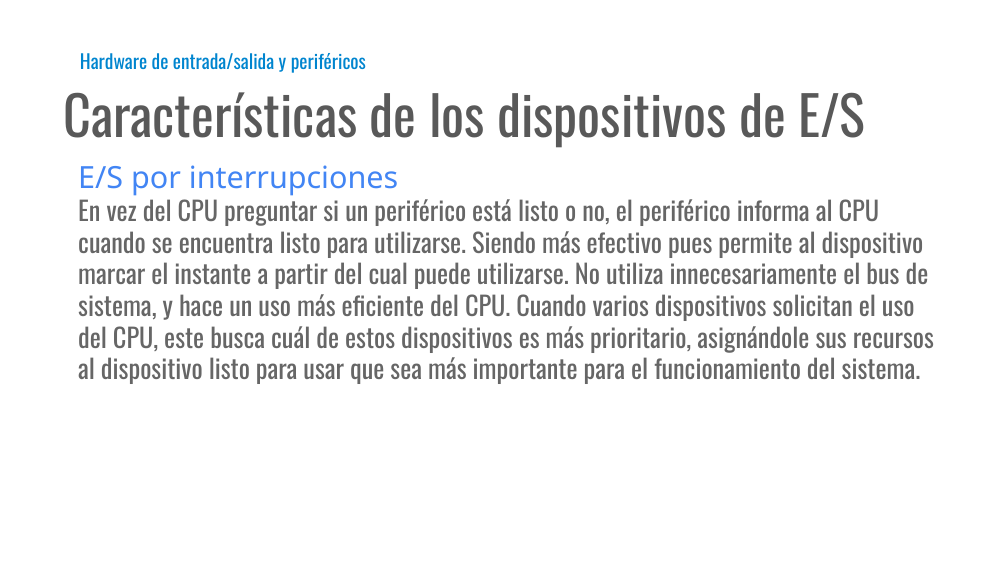

- Hardware de entrada/salida y periféricos

- E/S por interrupciones
- En vez del CPU preguntar si un periférico está listo o no, el periférico informa al CPU
- cuando se encuentra listo para utilizarse. Siendo más efectivo pues permite al dispositivo marcar el instante a partir del cual puede utilizarse. No utiliza innecesariamente el bus de sistema, y hace un uso más eficiente del CPU. Cuando varios dispositivos solicitan el uso del CPU, este busca cuál de estos dispositivos es más prioritario, asignándole sus recursos al dispositivo listo para usar que sea más importante para el funcionamiento del sistema.

---

## Características de los dispositivos de E/S

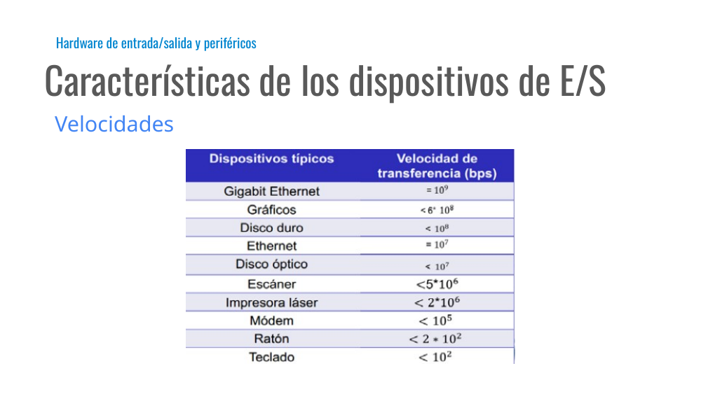

- Hardware de entrada/salida y periféricos

- Velocidades

---

## Características de los dispositivos de E/S

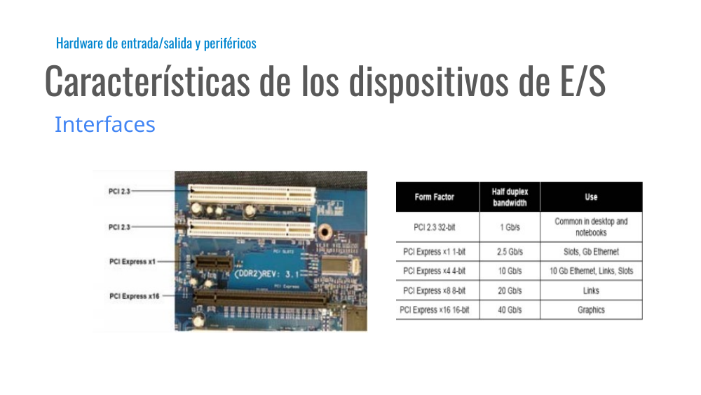

- Hardware de entrada/salida y periféricos

- Interfaces

---

## Buses serie USB y PS/2

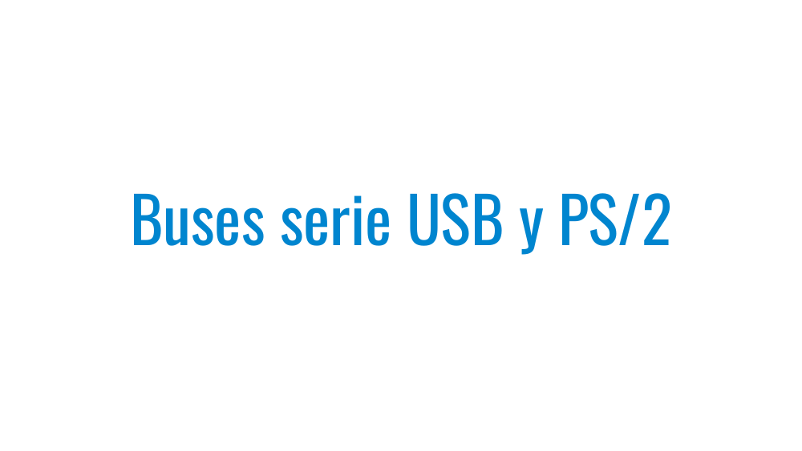

---

## Introducción

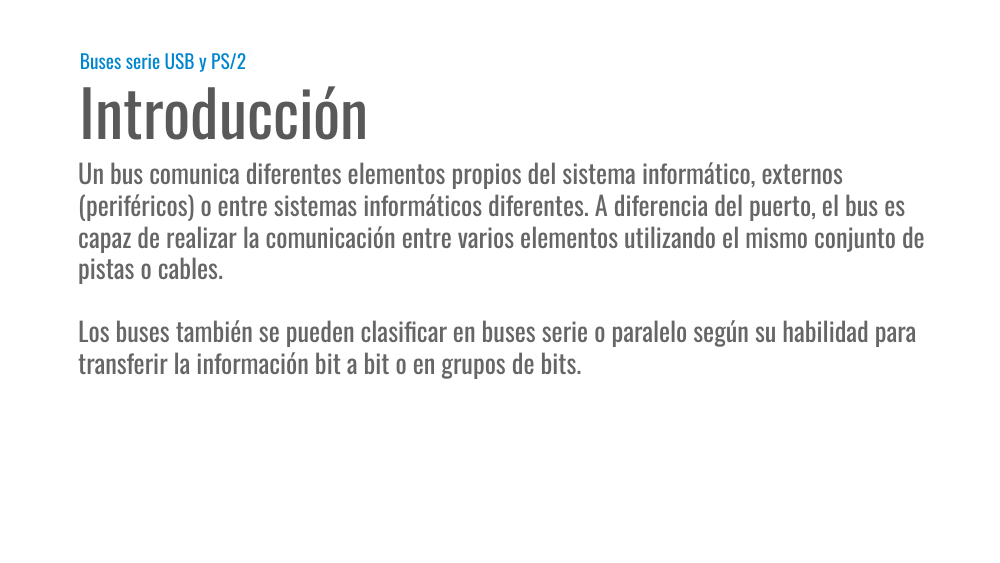

- Buses serie USB y PS/2

- Un bus comunica diferentes elementos propios del sistema informático, externos (periféricos) o entre sistemas informáticos diferentes. A diferencia del puerto, el bus es capaz de realizar la comunicación entre varios elementos utilizando el mismo conjunto de
- pistas o cables.
- Los buses también se pueden clasificar en buses serie o paralelo según su habilidad para transferir la información bit a bit o en grupos de bits.

---

## Buses | serie y paralelo

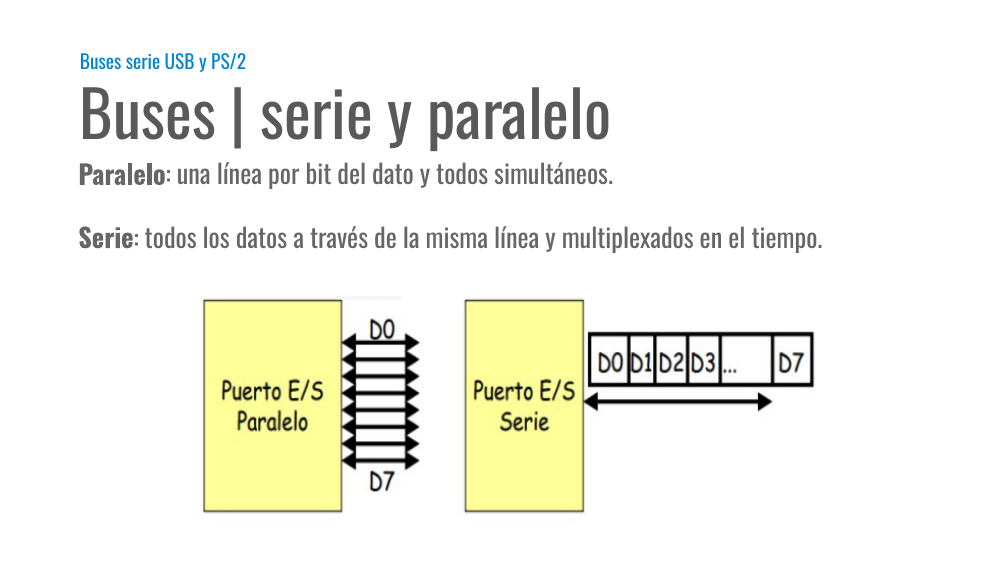

- Buses serie USB y PS/2

- Paralelo: una línea por bit del dato y todos simultáneos.
- Serie: todos los datos a través de la misma línea y multiplexados en el tiempo.

---

## Buses serie

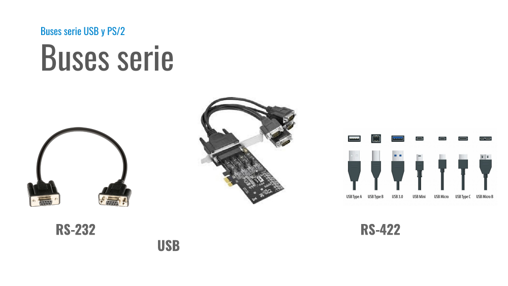

 USB y PS/2

- RS-232 RS-422 USB

---

## Buses serie PS/2

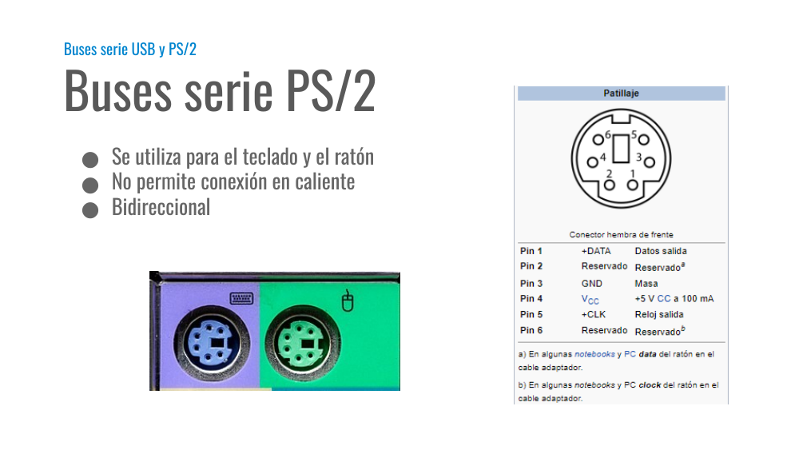

- Buses serie USB y PS/2

- Se utiliza para el teclado y el ratón
- No permite conexión en caliente
- Bidireccional

---

## Bus USB

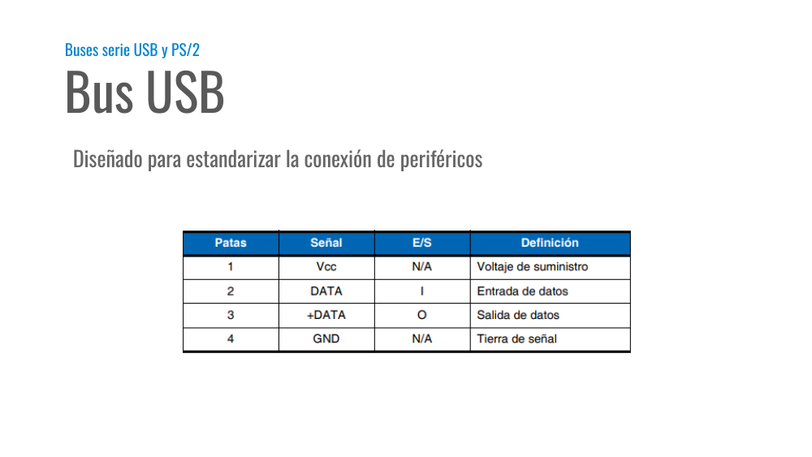

- Buses serie USB y PS/2

- Diseñado para estandarizar la conexión de periféricos

---

## Bus USB

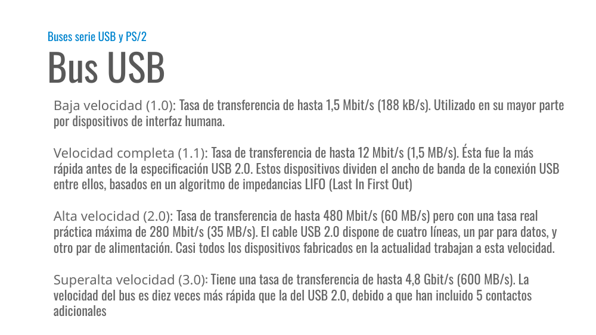

- Buses serie USB y PS/2

- Baja velocidad (1.0): Tasa de transferencia de hasta 1,5 Mbit/s (188 kB/s). Utilizado en su mayor parte por dispositivos de interfaz humana.
- Velocidad completa (1.1): Tasa de transferencia de hasta 12 Mbit/s (1,5 MB/s). Ésta fue la más rápida antes de la especificación USB 2.0. Estos dispositivos dividen el ancho de banda de la conexión USB entre ellos, basados en un algoritmo de impedancias LIFO (Last In First Out)
- Alta velocidad (2.0): Tasa de transferencia de hasta 480 Mbit/s (60 MB/s) pero con una tasa real práctica máxima de 280 Mbit/s (35 MB/s). El cable USB 2.0 dispone de cuatro líneas, un par para datos, y otro par de alimentación. Casi todos los dispositivos fabricados en la actualidad trabajan a esta velocidad.
- Superalta velocidad (3.0): Tiene una tasa de transferencia de hasta 4,8 Gbit/s (600 MB/s). La velocidad del bus es diez veces más rápida que la del USB 2.0, debido a que han incluido 5 contactos adicionales

---

## Buses paralelo PCI y PCIe

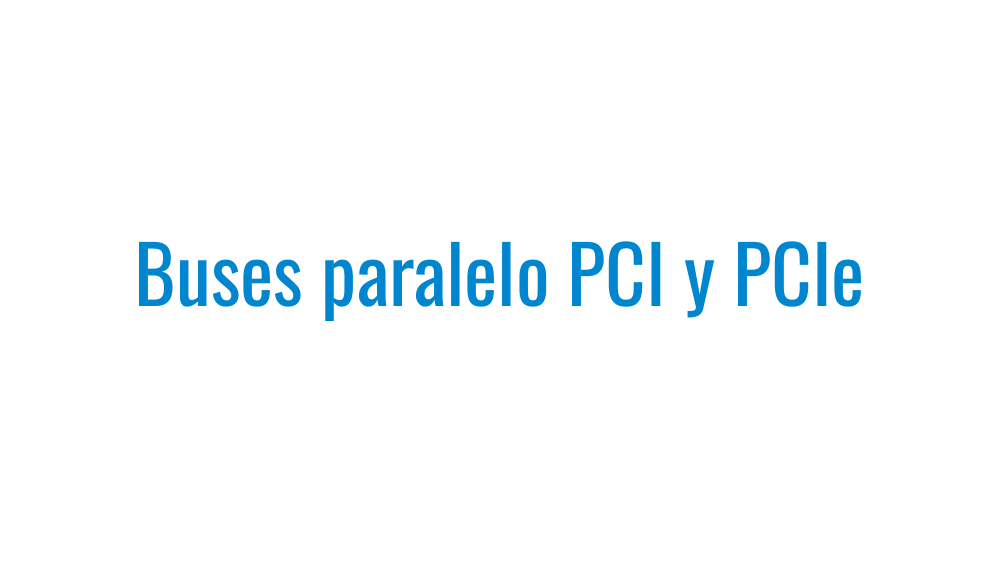

---

## Arquitectura de los buses paralelos

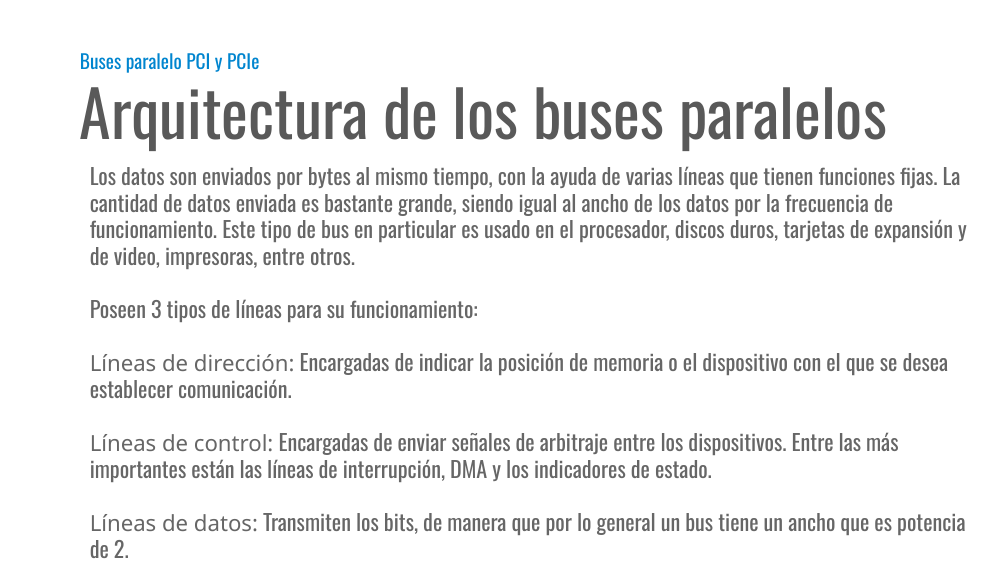

- Buses paralelo PCI y PCIe

- Los datos son enviados por bytes al mismo tiempo, con la ayuda de varias líneas que tienen funciones fijas. La cantidad de datos enviada es bastante grande, siendo igual al ancho de los datos por la frecuencia de funcionamiento. Este tipo de bus en particular es usado en el procesador, discos duros, tarjetas de expansión y de video, impresoras, entre otros.
- Poseen 3 tipos de líneas para su funcionamiento:
- Líneas de dirección: Encargadas de indicar la posición de memoria o el dispositivo con el que se desea establecer comunicación.
- Líneas de control: Encargadas de enviar señales de arbitraje entre los dispositivos. Entre las más importantes están las líneas de interrupción, DMA y los indicadores de estado.
- Líneas de datos: Transmiten los bits, de manera que por lo general un bus tiene un ancho que es potencia de 2.

---

## Bus PCI (Interconexión de Componente Periférico)

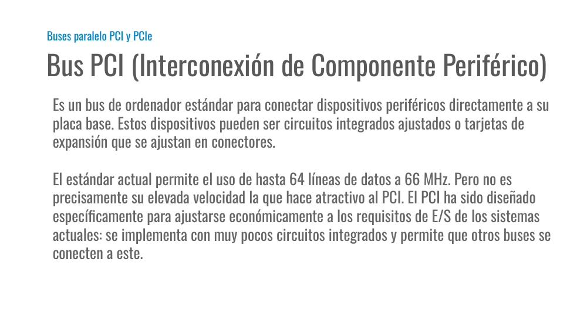

- Buses paralelo PCI y PCIe

- Es un bus de ordenador estándar para conectar dispositivos periféricos directamente a su placa base. Estos dispositivos pueden ser circuitos integrados ajustados o tarjetas de expansión que se ajustan en conectores.
- El estándar actual permite el uso de hasta 64 líneas de datos a 66 MHz. Pero no es precisamente su elevada velocidad la que hace atractivo al PCI. El PCI ha sido diseñado específicamente para ajustarse económicamente a los requisitos de E/S de los sistemas actuales: se implementa con muy pocos circuitos integrados y permite que otros buses se conecten a este.

---

## Bus PCI (Interconexión de Componente Periférico)

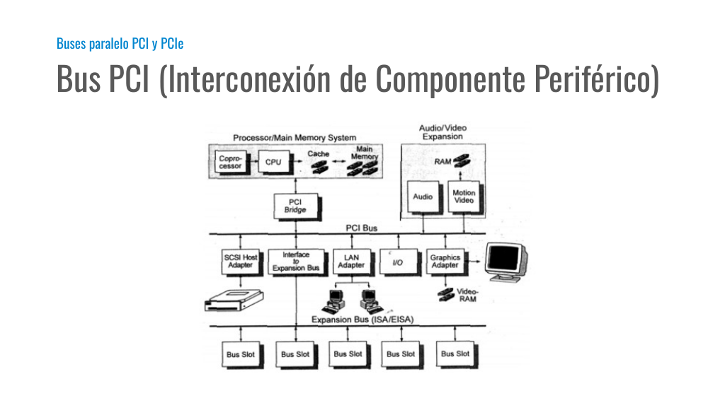

- Buses paralelo PCI y PCIe

---

## Bus PCI (Interconexión de Componente Periférico)

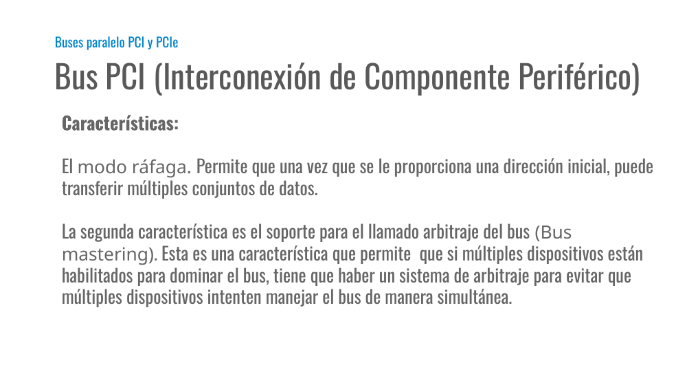

- Buses paralelo PCI y PCIe

- Características:
- El modo ráfaga. Permite que una vez que se le proporciona una dirección inicial, puede transferir múltiples conjuntos de datos.
- La segunda característica es el soporte para el llamado arbitraje del bus (Bus mastering). Esta es una característica que permite que si múltiples dispositivos están habilitados para dominar el bus, tiene que haber un sistema de arbitraje para evitar que múltiples dispositivos intenten manejar el bus de manera simultánea.

---

## Bus PCI-express

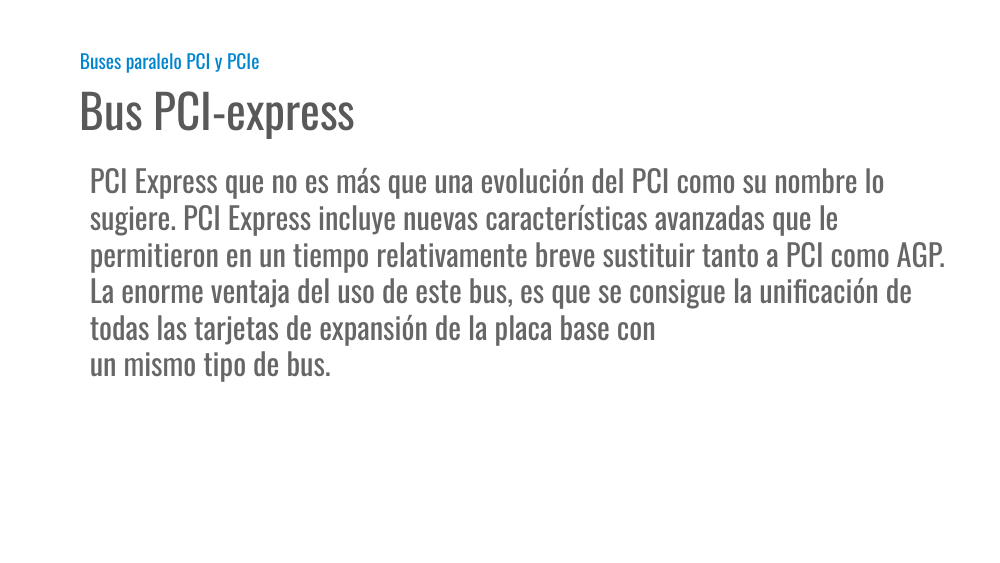

- Buses paralelo PCI y PCIe

- PCI Express que no es más que una evolución del PCI como su nombre lo sugiere. PCI Express incluye nuevas características avanzadas que le permitieron en un tiempo relativamente breve sustituir tanto a PCI como AGP. La enorme ventaja del uso de este bus, es que se consigue la unificación de todas las tarjetas de expansión de la placa base con
- un mismo tipo de bus.

---

## Bus PCI-express

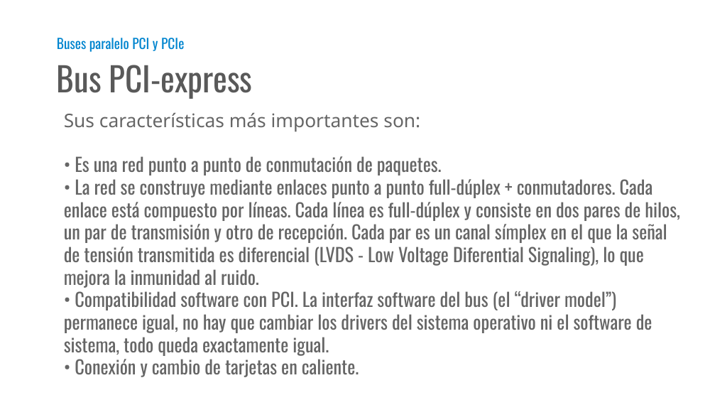

- Buses paralelo PCI y PCIe

- Sus características más importantes son:
- • Es una red punto a punto de conmutación de paquetes.
- • La red se construye mediante enlaces punto a punto full‐dúplex + conmutadores. Cada enlace está compuesto por líneas. Cada línea es full‐dúplex y consiste en dos pares de hilos, un par de transmisión y otro de recepción. Cada par es un canal símplex en el que la señal de tensión transmitida es diferencial (LVDS ‐ Low Voltage Diferential Signaling), lo que mejora la inmunidad al ruido.
- • Compatibilidad software con PCI. La interfaz software del bus (el “driver model”) permanece igual, no hay que cambiar los drivers del sistema operativo ni el software de sistema, todo queda exactamente igual.
- • Conexión y cambio de tarjetas en caliente.

---

## Bus PCI-express

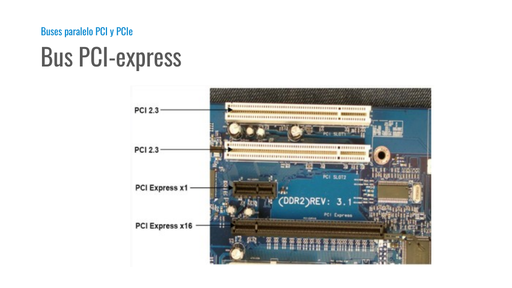

- Buses paralelo PCI y PCIe

---

## Interfaces internas y externas

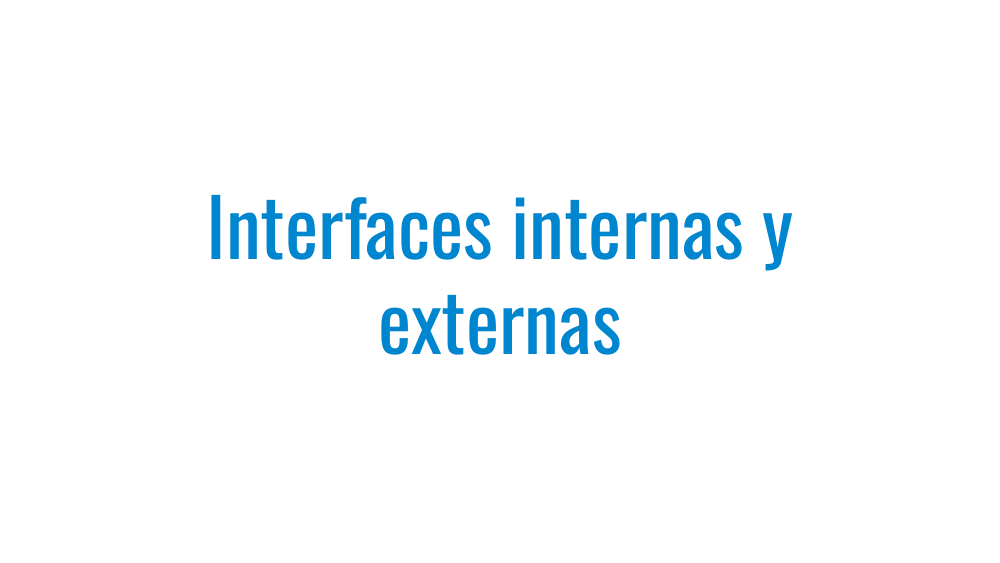

---

## Interfaces internas

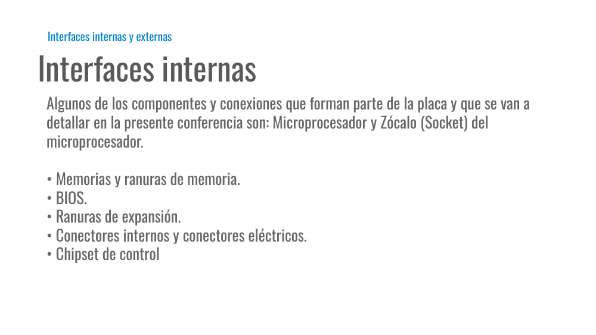

 y externas

- Algunos de los componentes y conexiones que forman parte de la placa y que se van a detallar en la presente conferencia son: Microprocesador y Zócalo (Socket) del microprocesador.
- • Memorias y ranuras de memoria.
- • BIOS.
- • Ranuras de expansión.
- • Conectores internos y conectores eléctricos.
- • Chipset de control

---

## Interfaces internas

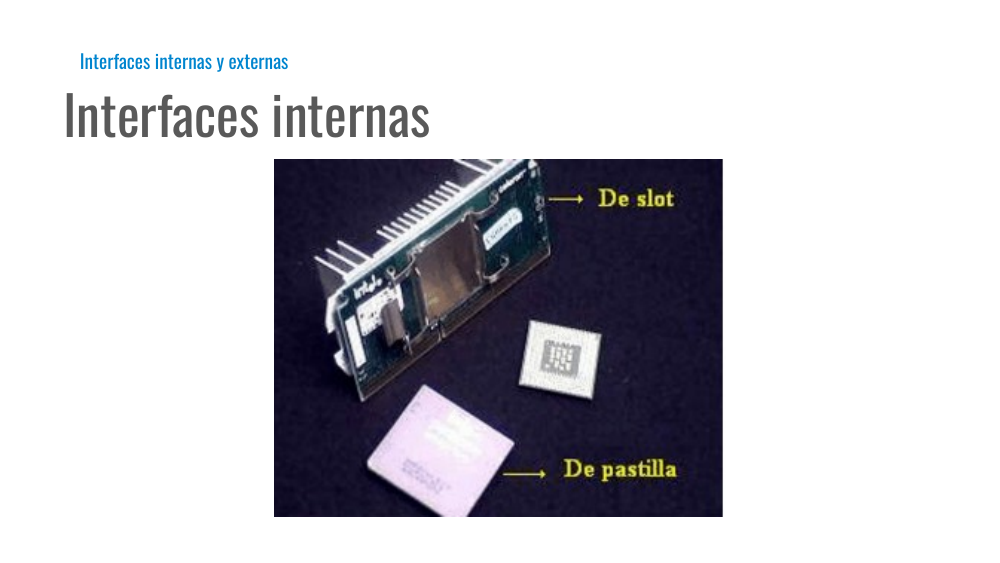

 y externas

---

## Interfaces internas

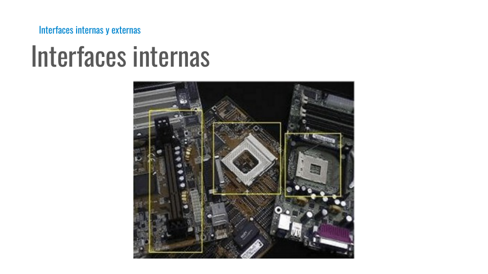

 y externas

---

## Interfaces internas

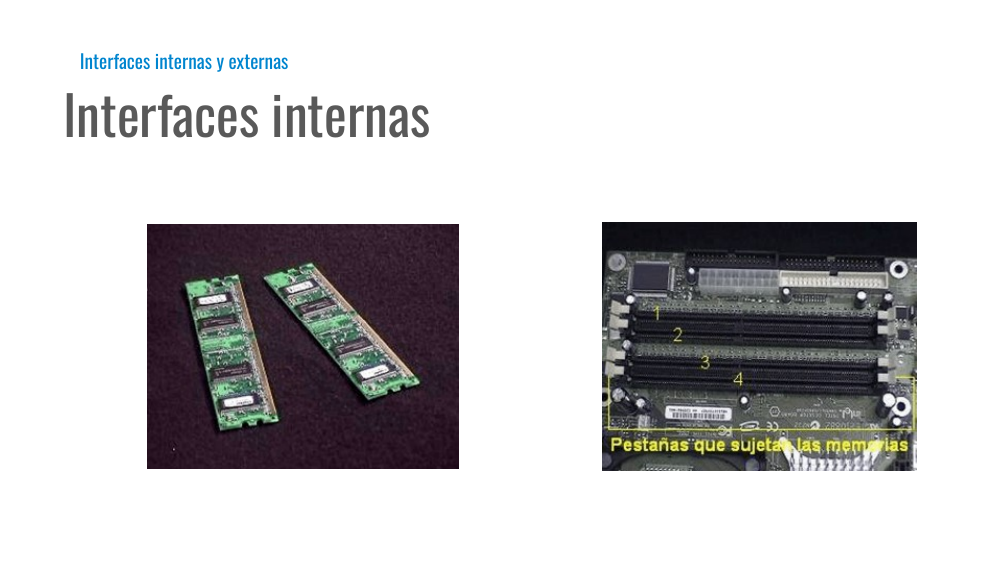

 y externas

---

## Interfaces internas

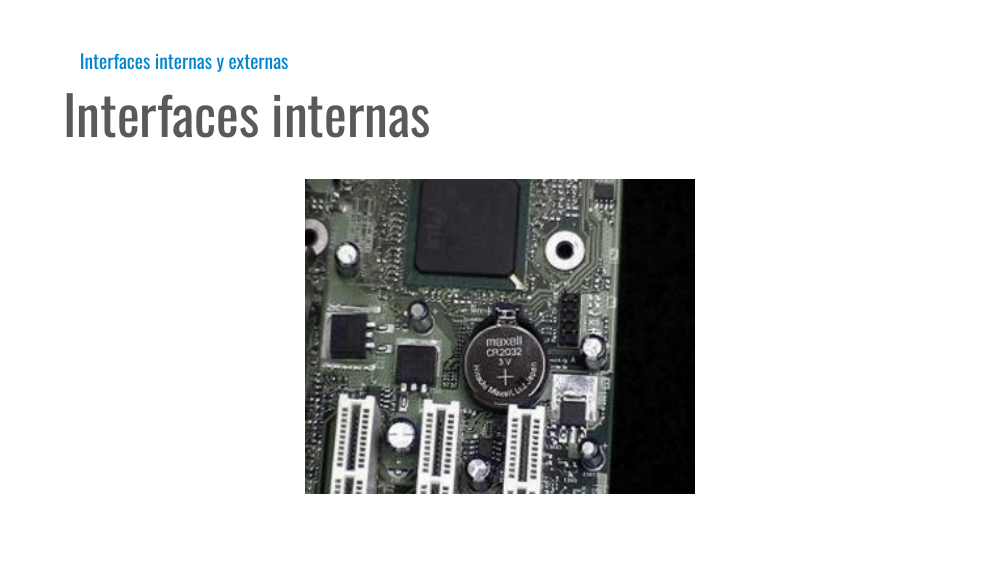

 y externas

---

## Interfaces internas

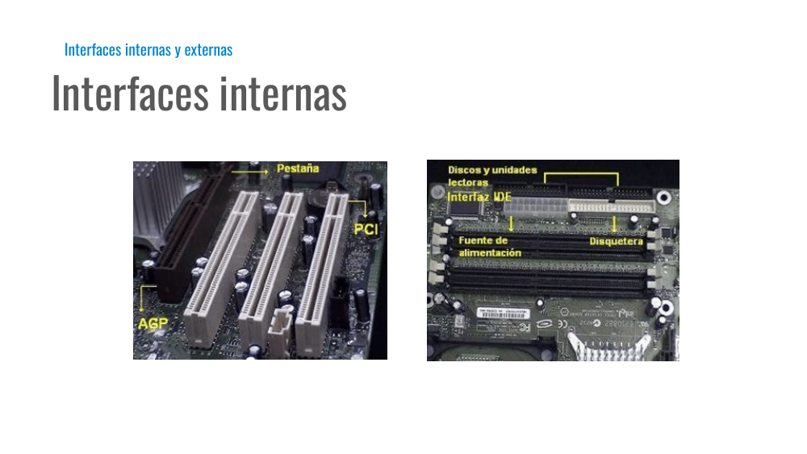

 y externas

---

## Interfaces internas

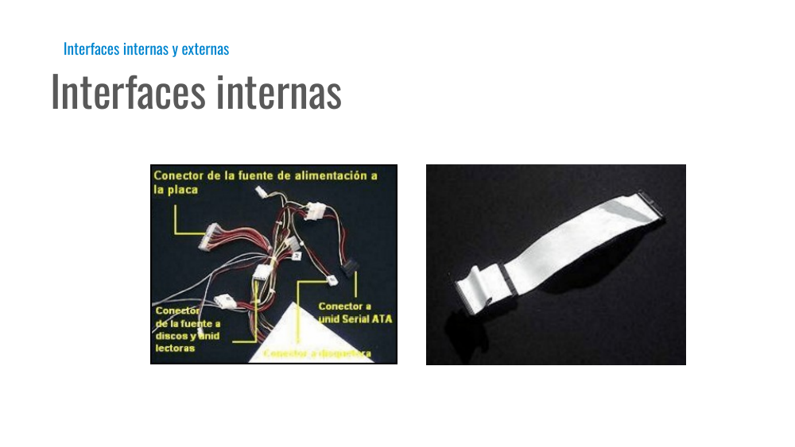

 y externas

---

## Interfaces internas

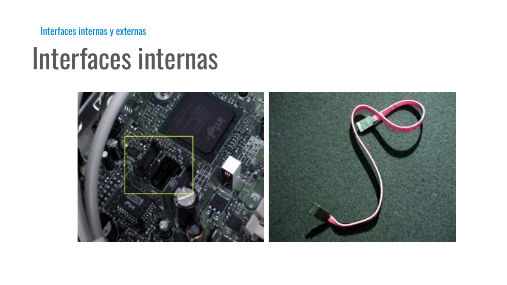

 y externas

---

## Interfaces internas

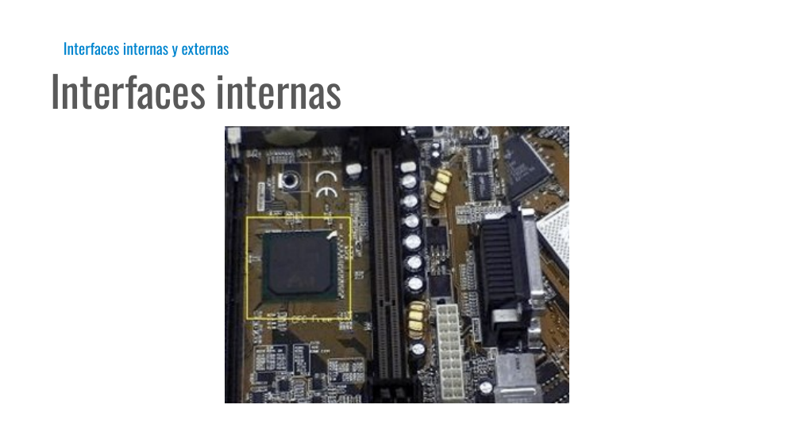

 y externas

---

## Interfaces externas

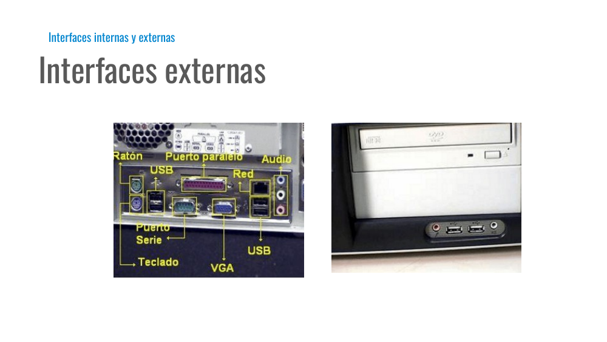

- Interfaces internas y externas

---

## Diapositiva 38

---

## Diapositiva 39

---
