# Tema 19 y 20

Presentación de **Tecnología y Estructura de Ordenadores (TEO / IYA001)** — Universidad Europea del Atlántico.

Archivo original: [Tema 19 y 20.pdf](Tema%2019%20y%2020.pdf)

Total de diapositivas: 43

---

## Loyda Leticia Alas Castaneda

- loyda.alas@uneatlantico.es

---

## Tecnología y Estructura de Ordenadores

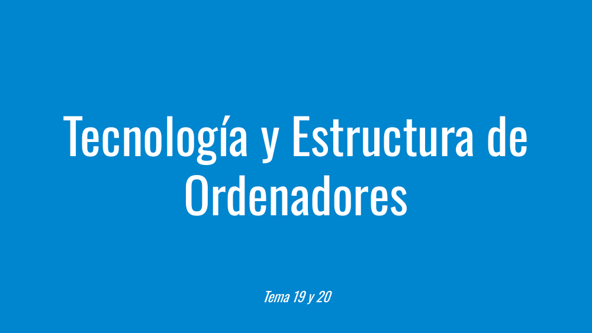

- Tema 19 y 20

---

## Tipos de sistemas de cómputo

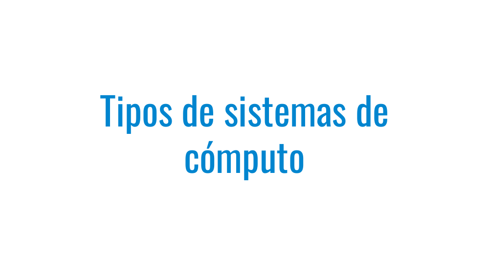

---

## Introducción

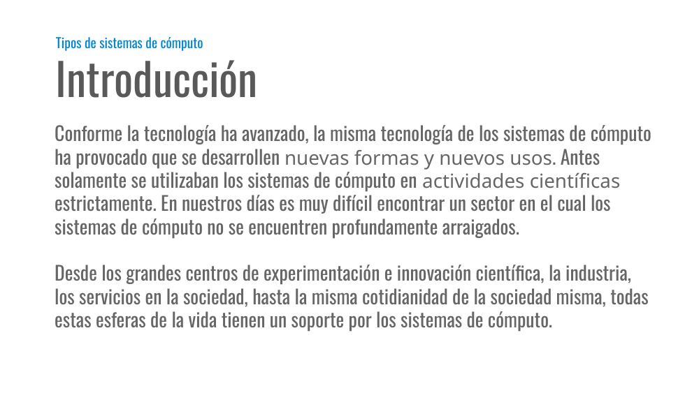

- Tipos de sistemas de cómputo

- Conforme la tecnología ha avanzado, la misma tecnología de los sistemas de cómputo ha provocado que se desarrollen nuevas formas y nuevos usos. Antes solamente se utilizaban los sistemas de cómputo en actividades científicas estrictamente. En nuestros días es muy difícil encontrar un sector en el cual los sistemas de cómputo no se encuentren profundamente arraigados.
- Desde los grandes centros de experimentación e innovación científica, la industria, los servicios en la sociedad, hasta la misma cotidianidad de la sociedad misma, todas estas esferas de la vida tienen un soporte por los sistemas de cómputo.

---

## Clasificación de los sistemas de cómputo

- Tipos de sistemas de cómputo

- Clasificación por la especificidad de uso
- • Propósito general
- • Propósito específico

---

## Clasificación de los sistemas de cómputo

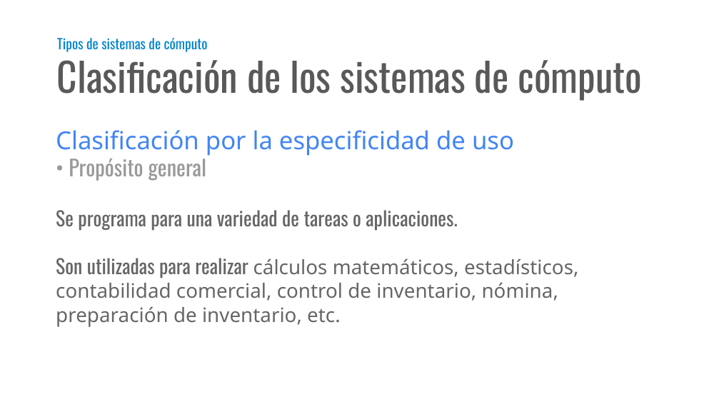

- Tipos de sistemas de cómputo

- Clasificación por la especificidad de uso
- • Propósito general
- Se programa para una variedad de tareas o aplicaciones.
- Son utilizadas para realizar cálculos matemáticos, estadísticos, contabilidad comercial, control de inventario, nómina, preparación de inventario, etc.

---

## Clasificación de los sistemas de cómputo

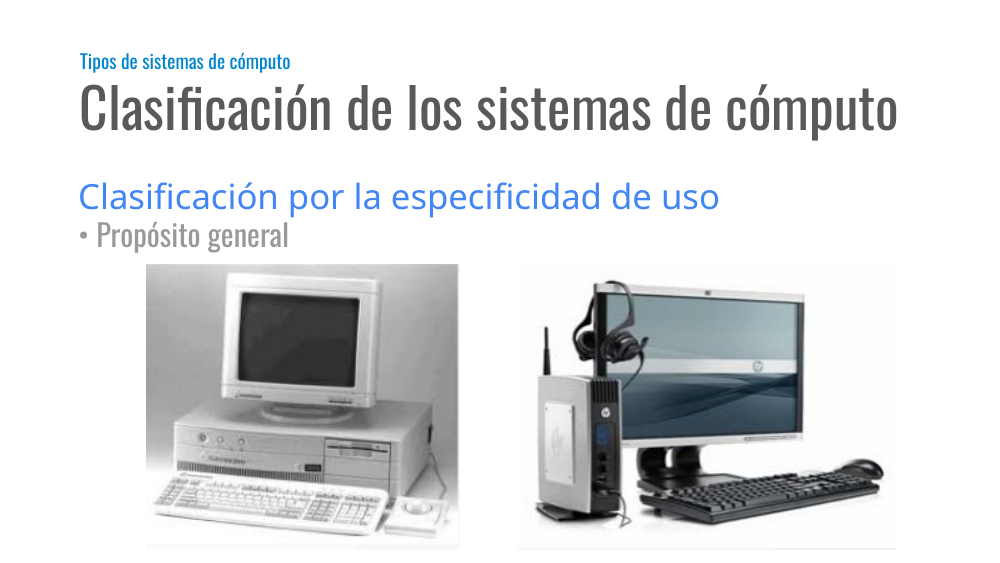

- Tipos de sistemas de cómputo

- Clasificación por la especificidad de uso
- • Propósito general

---

## Clasificación de los sistemas de cómputo

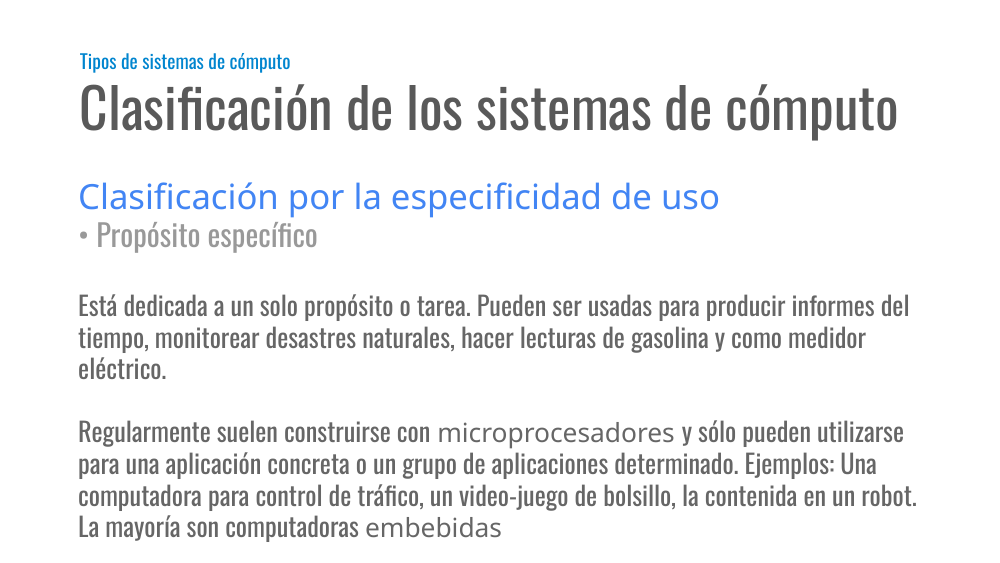

- Tipos de sistemas de cómputo

- Clasificación por la especificidad de uso
- • Propósito específico
- Está dedicada a un solo propósito o tarea. Pueden ser usadas para producir informes del tiempo, monitorear desastres naturales, hacer lecturas de gasolina y como medidor eléctrico.
- Regularmente suelen construirse con microprocesadores y sólo pueden utilizarse para una aplicación concreta o un grupo de aplicaciones determinado. Ejemplos: Una computadora para control de tráfico, un video‐juego de bolsillo, la contenida en un robot. La mayoría son computadoras embebidas

---

## Clasificación de los sistemas de cómputo

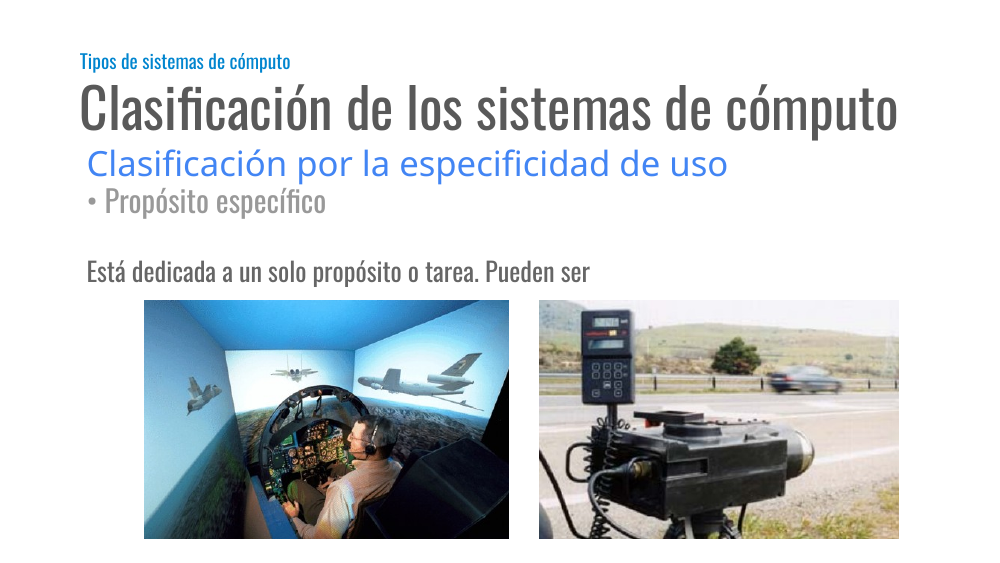

- Tipos de sistemas de cómputo

- Clasificación por la especificidad de uso
- • Propósito específico
- Está dedicada a un solo propósito o tarea. Pueden ser

---

## Clasificación de los sistemas de cómputo

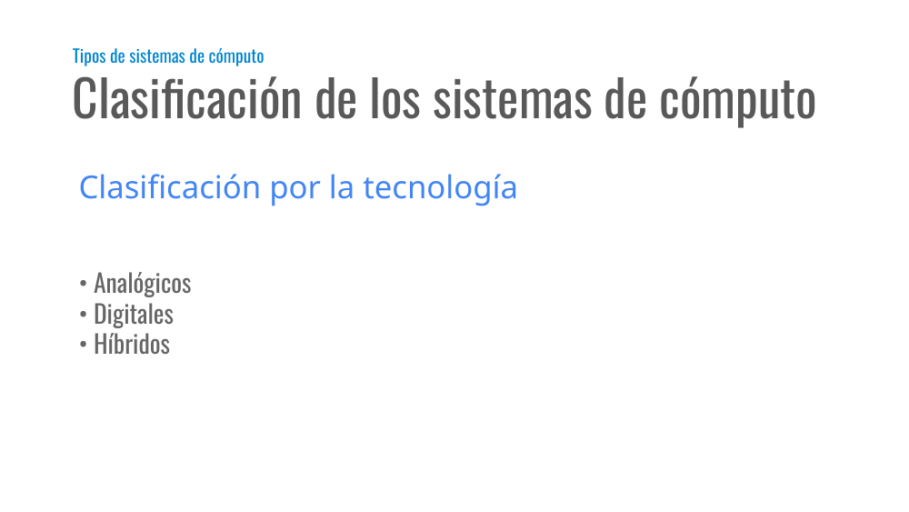

- Tipos de sistemas de cómputo

- Clasificación por la tecnología
- • Analógicos
- • Digitales
- • Híbridos

---

## Clasificación de los sistemas de cómputo

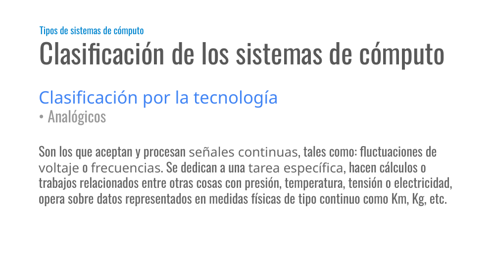

- Tipos de sistemas de cómputo

- Clasificación por la tecnología
- • Analógicos
- Son los que aceptan y procesan señales continuas, tales como: fluctuaciones de voltaje o frecuencias. Se dedican a una tarea específica, hacen cálculos o trabajos relacionados entre otras cosas con presión, temperatura, tensión o electricidad, opera sobre datos representados en medidas físicas de tipo continuo como Km, Kg, etc.

---

## Clasificación de los sistemas de cómputo

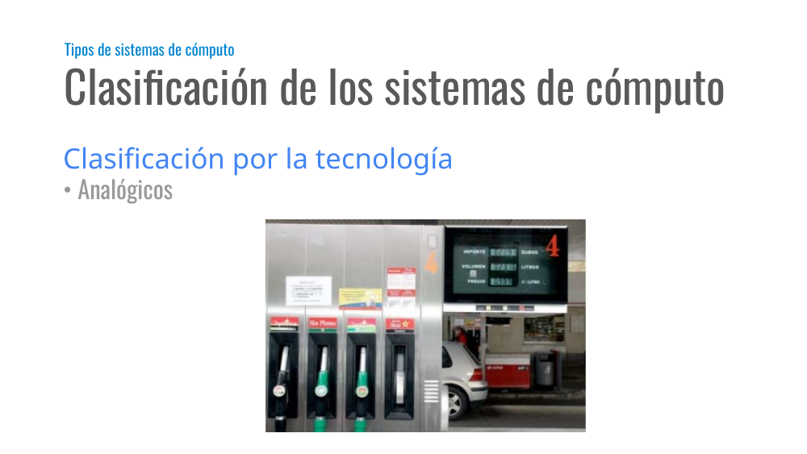

- Tipos de sistemas de cómputo

- Clasificación por la tecnología
- • Analógicos

---

## Clasificación de los sistemas de cómputo

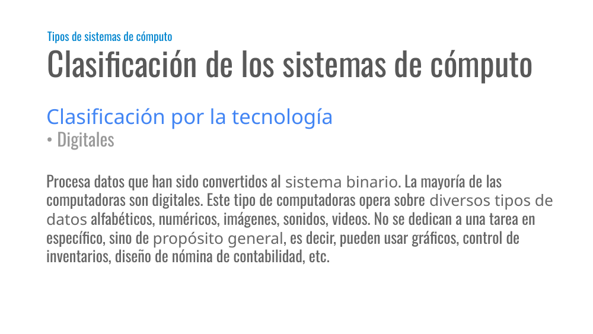

- Tipos de sistemas de cómputo

- Clasificación por la tecnología
- • Digitales
- Procesa datos que han sido convertidos al sistema binario. La mayoría de las computadoras son digitales. Este tipo de computadoras opera sobre diversos tipos de datos alfabéticos, numéricos, imágenes, sonidos, videos. No se dedican a una tarea en específico, sino de propósito general, es decir, pueden usar gráficos, control de inventarios, diseño de nómina de contabilidad, etc.

---

## Clasificación de los sistemas de cómputo

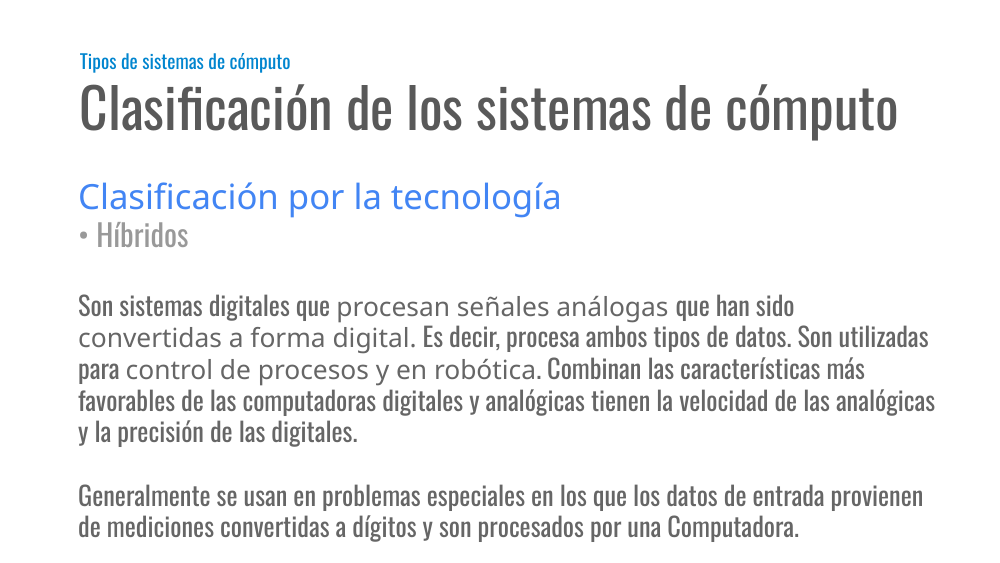

- Tipos de sistemas de cómputo

- Clasificación por la tecnología
- • Híbridos
- Son sistemas digitales que procesan señales análogas que han sido convertidas a forma digital. Es decir, procesa ambos tipos de datos. Son utilizadas para control de procesos y en robótica. Combinan las características más favorables de las computadoras digitales y analógicas tienen la velocidad de las analógicas y la precisión de las digitales.
- Generalmente se usan en problemas especiales en los que los datos de entrada provienen de mediciones convertidas a dígitos y son procesados por una Computadora.

---

## Clasificación de los sistemas de cómputo

- Tipos de sistemas de cómputo

- Clasificación por la tecnología
- • Híbridos

---

## Clasificación de los sistemas de cómputo

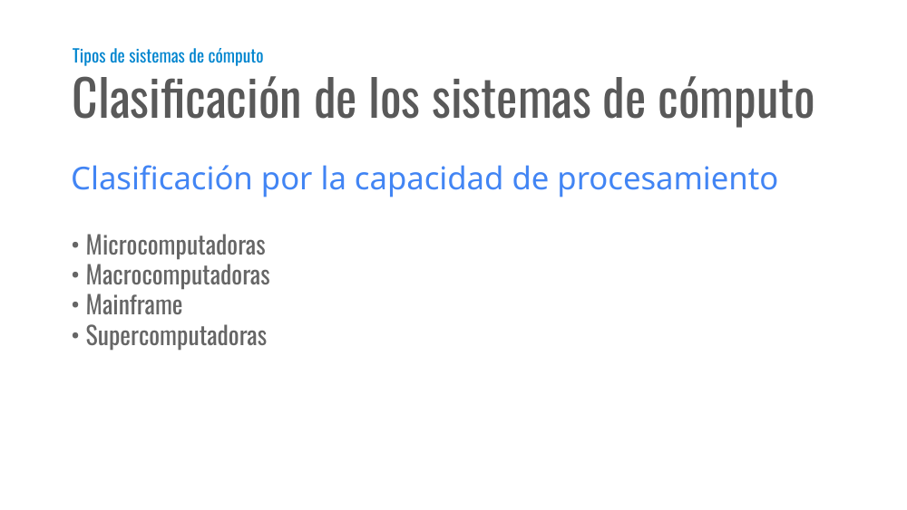

- Tipos de sistemas de cómputo

- Clasificación por la capacidad de procesamiento
- • Microcomputadoras
- • Macrocomputadoras
- • Mainframe
- • Supercomputadoras

---

## Clasificación de los sistemas de cómputo

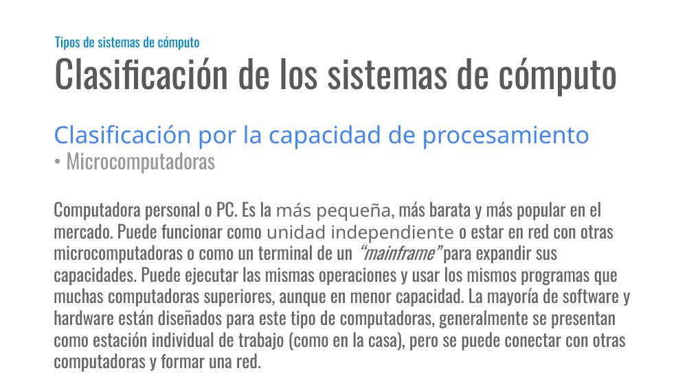

- Tipos de sistemas de cómputo

- Clasificación por la capacidad de procesamiento
- • Microcomputadoras
- Computadora personal o PC. Es la más pequeña, más barata y más popular en el mercado. Puede funcionar como unidad independiente o estar en red con otras microcomputadoras o como un terminal de un “mainframe” para expandir sus capacidades. Puede ejecutar las mismas operaciones y usar los mismos programas que muchas computadoras superiores, aunque en menor capacidad. La mayoría de software y hardware están diseñados para este tipo de computadoras, generalmente se presentan como estación individual de trabajo (como en la casa), pero se puede conectar con otras computadoras y formar una red.

---

## Clasificación de los sistemas de cómputo

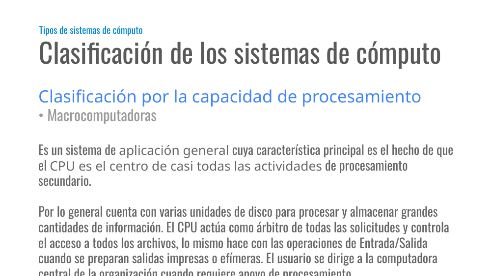

- Tipos de sistemas de cómputo

- Clasificación por la capacidad de procesamiento
- • Macrocomputadoras
- Es un sistema de aplicación general cuya característica principal es el hecho de que el CPU es el centro de casi todas las actividades de procesamiento secundario.
- Por lo general cuenta con varias unidades de disco para procesar y almacenar grandes cantidades de información. El CPU actúa como árbitro de todas las solicitudes y controla el acceso a todos los archivos, lo mismo hace con las operaciones de Entrada/Salida cuando se preparan salidas impresas o efímeras. El usuario se dirige a la computadora central de la organización cuando requiere apoyo de procesamiento.

---

## Clasificación de los sistemas de cómputo

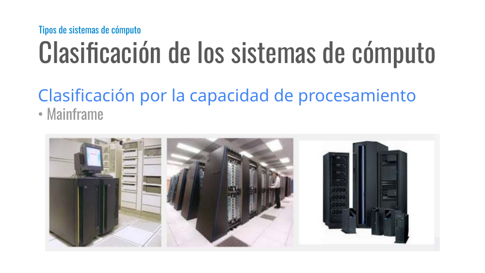

- Tipos de sistemas de cómputo

- Clasificación por la capacidad de procesamiento
- • Mainframe

---

## Clasificación de los sistemas de cómputo

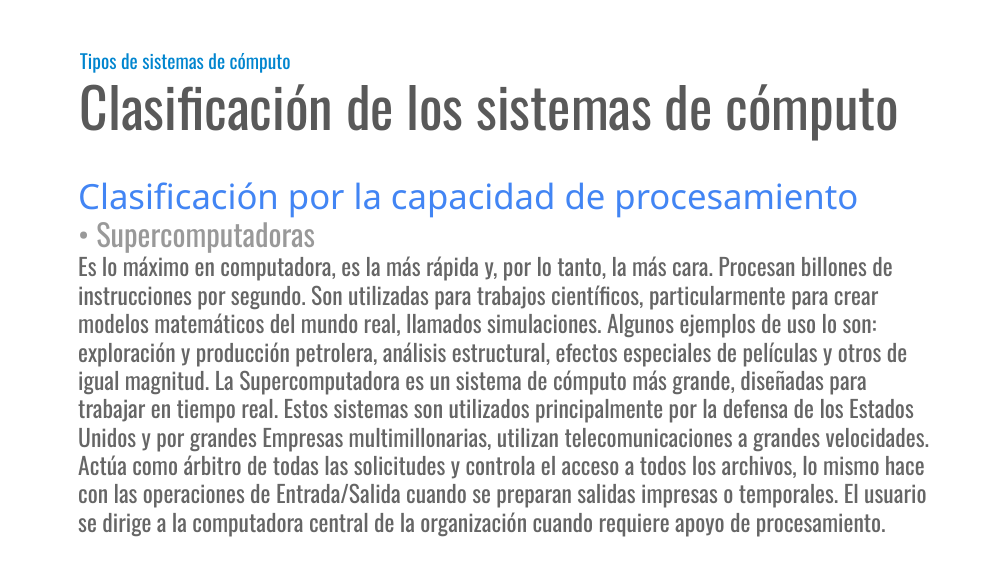

- Tipos de sistemas de cómputo

- Clasificación por la capacidad de procesamiento
- • Supercomputadoras
- Es lo máximo en computadora, es la más rápida y, por lo tanto, la más cara. Procesan billones de instrucciones por segundo. Son utilizadas para trabajos científicos, particularmente para crear modelos matemáticos del mundo real, llamados simulaciones. Algunos ejemplos de uso lo son: exploración y producción petrolera, análisis estructural, efectos especiales de películas y otros de igual magnitud. La Supercomputadora es un sistema de cómputo más grande, diseñadas para trabajar en tiempo real. Estos sistemas son utilizados principalmente por la defensa de los Estados Unidos y por grandes Empresas multimillonarias, utilizan telecomunicaciones a grandes velocidades. Actúa como árbitro de todas las solicitudes y controla el acceso a todos los archivos, lo mismo hace con las operaciones de Entrada/Salida cuando se preparan salidas impresas o temporales. El usuario se dirige a la computadora central de la organización cuando requiere apoyo de procesamiento.

---

## Clasificación de los sistemas de cómputo

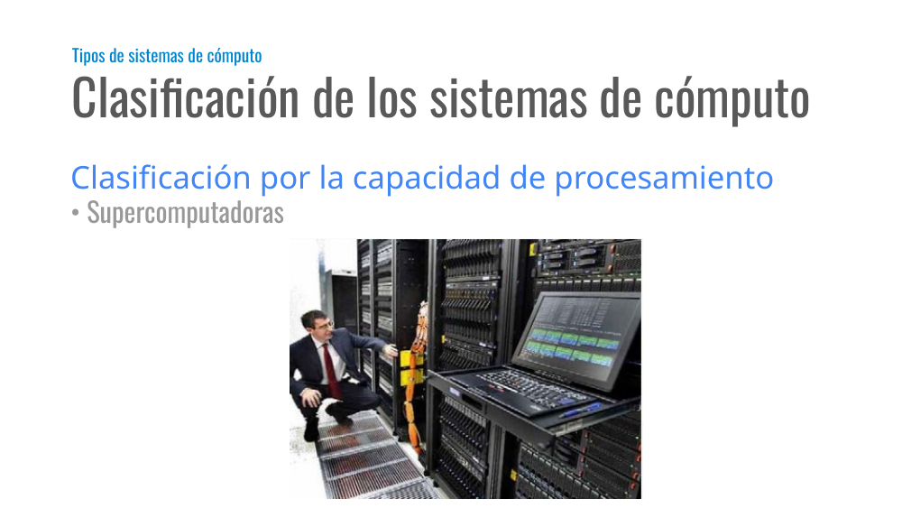

- Tipos de sistemas de cómputo

- Clasificación por la capacidad de procesamiento
- • Supercomputadoras

---

## Clasificación de los sistemas de cómputo

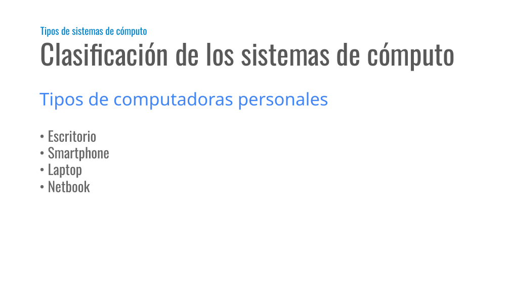

- Tipos de sistemas de cómputo

- Tipos de computadoras personales
- • Escritorio
- • Smartphone
- • Laptop
- • Netbook

---

## Diapositiva 23

---

## Diapositiva 24

---

## Parámetros técnicos de componentes comerciales

---

## Clasificación de los sistemas de cómputo

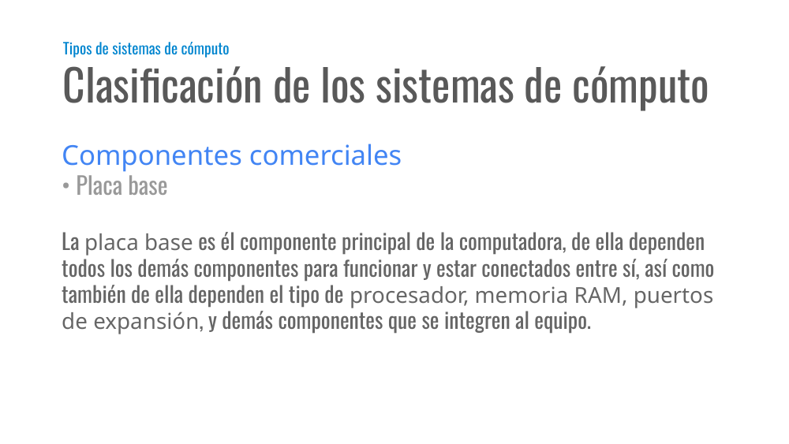

- Tipos de sistemas de cómputo

- Componentes comerciales
- • Placa base
- La placa base es él componente principal de la computadora, de ella dependen todos los demás componentes para funcionar y estar conectados entre sí, así como también de ella dependen el tipo de procesador, memoria RAM, puertos de expansión, y demás componentes que se integren al equipo.

---

## Clasificación de los sistemas de cómputo

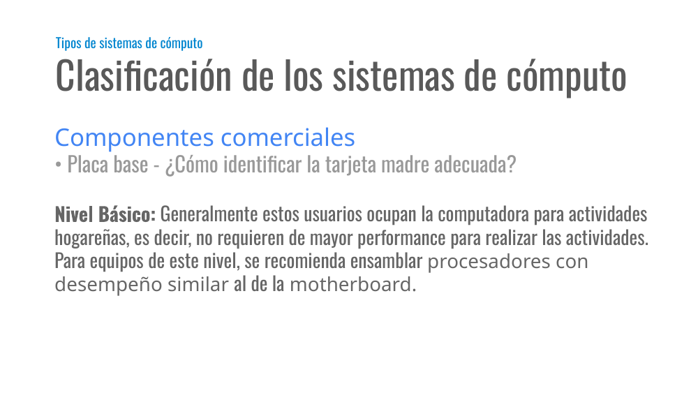

- Tipos de sistemas de cómputo

- Componentes comerciales
- • Placa base - ¿Cómo identificar la tarjeta madre adecuada?
- Nivel Básico: Generalmente estos usuarios ocupan la computadora para actividades hogareñas, es decir, no requieren de mayor performance para realizar las actividades. Para equipos de este nivel, se recomienda ensamblar procesadores con desempeño similar al de la motherboard.

---

## Clasificación de los sistemas de cómputo

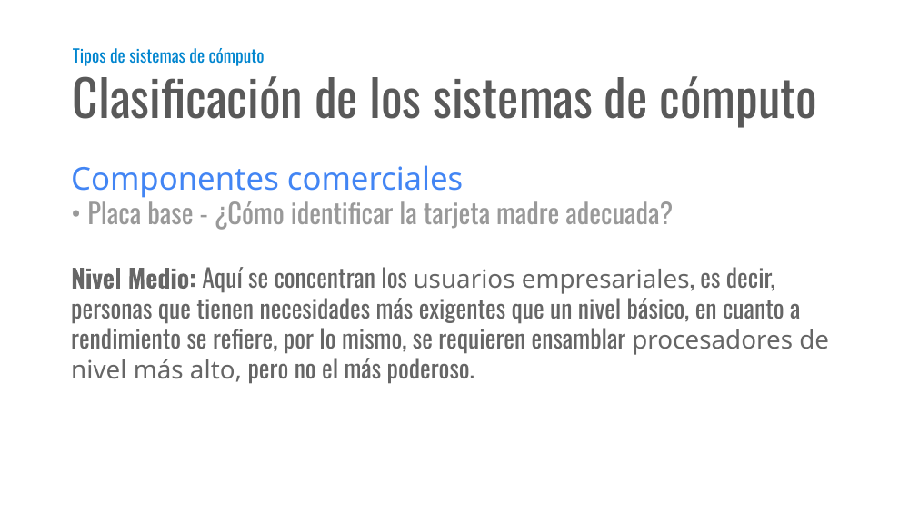

- Tipos de sistemas de cómputo

- Componentes comerciales
- • Placa base - ¿Cómo identificar la tarjeta madre adecuada?
- Nivel Medio: Aquí se concentran los usuarios empresariales, es decir, personas que tienen necesidades más exigentes que un nivel básico, en cuanto a rendimiento se refiere, por lo mismo, se requieren ensamblar procesadores de nivel más alto, pero no el más poderoso.

---

## Clasificación de los sistemas de cómputo

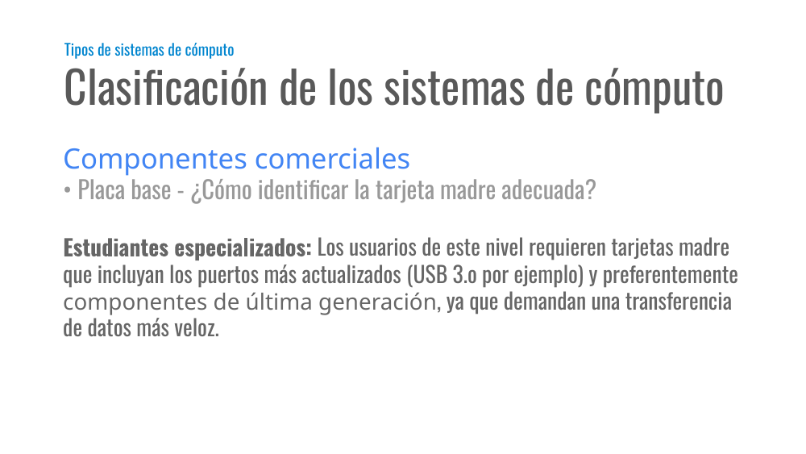

- Tipos de sistemas de cómputo

- Componentes comerciales
- • Placa base - ¿Cómo identificar la tarjeta madre adecuada?
- Estudiantes especializados: Los usuarios de este nivel requieren tarjetas madre que incluyan los puertos más actualizados (USB 3.o por ejemplo) y preferentemente componentes de última generación, ya que demandan una transferencia de datos más veloz.

---

## Clasificación de los sistemas de cómputo

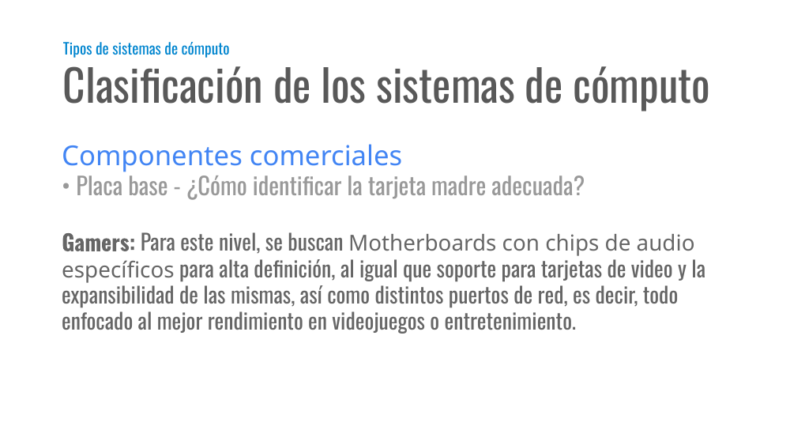

- Tipos de sistemas de cómputo

- Componentes comerciales
- • Placa base - ¿Cómo identificar la tarjeta madre adecuada?
- Gamers: Para este nivel, se buscan Motherboards con chips de audio específicos para alta definición, al igual que soporte para tarjetas de video y la expansibilidad de las mismas, así como distintos puertos de red, es decir, todo enfocado al mejor rendimiento en videojuegos o entretenimiento.

---

## Clasificación de los sistemas de cómputo

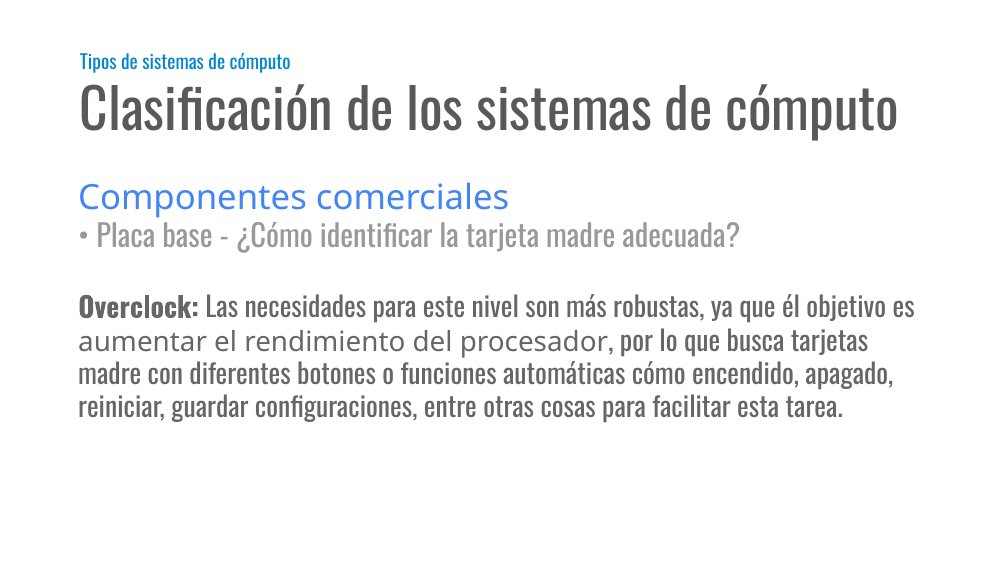

- Tipos de sistemas de cómputo

- Componentes comerciales
- • Placa base - ¿Cómo identificar la tarjeta madre adecuada?
- Overclock: Las necesidades para este nivel son más robustas, ya que él objetivo es aumentar el rendimiento del procesador, por lo que busca tarjetas madre con diferentes botones o funciones automáticas cómo encendido, apagado, reiniciar, guardar configuraciones, entre otras cosas para facilitar esta tarea.

---

## Clasificación de los sistemas de cómputo

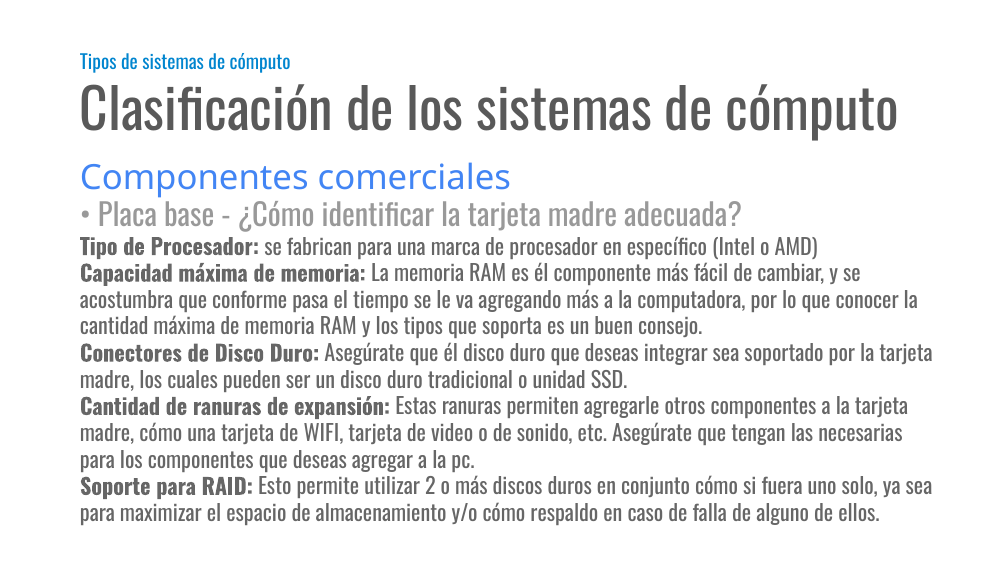

- Tipos de sistemas de cómputo

- Componentes comerciales
- • Placa base - ¿Cómo identificar la tarjeta madre adecuada?
- Tipo de Procesador: se fabrican para una marca de procesador en específico (Intel o AMD)
- Capacidad máxima de memoria: La memoria RAM es él componente más fácil de cambiar, y se acostumbra que conforme pasa el tiempo se le va agregando más a la computadora, por lo que conocer la cantidad máxima de memoria RAM y los tipos que soporta es un buen consejo.
- Conectores de Disco Duro: Asegúrate que él disco duro que deseas integrar sea soportado por la tarjeta madre, los cuales pueden ser un disco duro tradicional o unidad SSD.
- Cantidad de ranuras de expansión: Estas ranuras permiten agregarle otros componentes a la tarjeta madre, cómo una tarjeta de WIFI, tarjeta de video o de sonido, etc. Asegúrate que tengan las necesarias para los componentes que deseas agregar a la pc.
- Soporte para RAID: Esto permite utilizar 2 o más discos duros en conjunto cómo si fuera uno solo, ya sea para maximizar el espacio de almacenamiento y/o cómo respaldo en caso de falla de alguno de ellos.

---

## Clasificación de los sistemas de cómputo

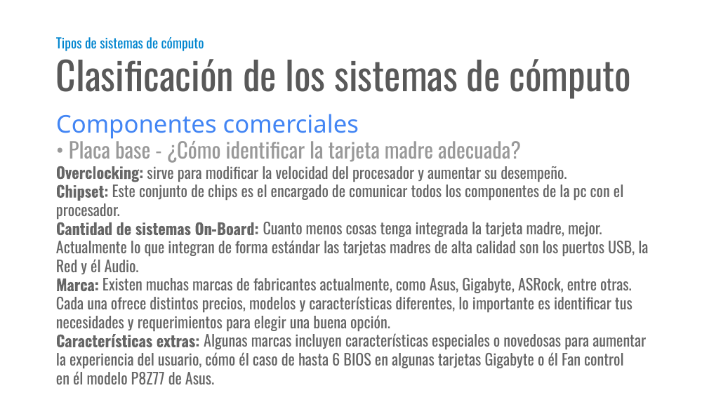

- Tipos de sistemas de cómputo

- Componentes comerciales
- • Placa base - ¿Cómo identificar la tarjeta madre adecuada?
- Overclocking: sirve para modificar la velocidad del procesador y aumentar su desempeño.
- Chipset: Este conjunto de chips es el encargado de comunicar todos los componentes de la pc con el procesador.
- Cantidad de sistemas On‐Board: Cuanto menos cosas tenga integrada la tarjeta madre, mejor. Actualmente lo que integran de forma estándar las tarjetas madres de alta calidad son los puertos USB, la Red y él Audio.
- Marca: Existen muchas marcas de fabricantes actualmente, como Asus, Gigabyte, ASRock, entre otras. Cada una ofrece distintos precios, modelos y características diferentes, lo importante es identificar tus
- necesidades y requerimientos para elegir una buena opción.
- Características extras: Algunas marcas incluyen características especiales o novedosas para aumentar
- la experiencia del usuario, cómo él caso de hasta 6 BIOS en algunas tarjetas Gigabyte o él Fan control
- en él modelo P8Z77 de Asus.

---

## Clasificación de los sistemas de cómputo

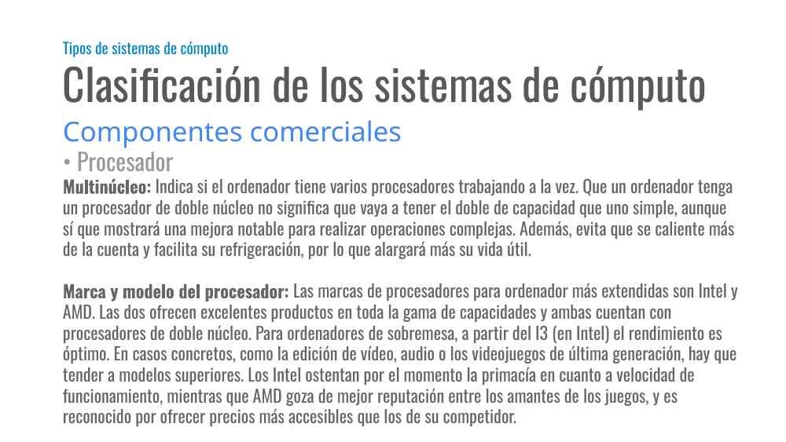

- Tipos de sistemas de cómputo

- Componentes comerciales
- • Procesador
- Multinúcleo: Indica si el ordenador tiene varios procesadores trabajando a la vez. Que un ordenador tenga un procesador de doble núcleo no significa que vaya a tener el doble de capacidad que uno simple, aunque sí que mostrará una mejora notable para realizar operaciones complejas. Además, evita que se caliente más de la cuenta y facilita su refrigeración, por lo que alargará más su vida útil.
- Marca y modelo del procesador: Las marcas de procesadores para ordenador más extendidas son Intel y AMD. Las dos ofrecen excelentes productos en toda la gama de capacidades y ambas cuentan con procesadores de doble núcleo. Para ordenadores de sobremesa, a partir del I3 (en Intel) el rendimiento es óptimo. En casos concretos, como la edición de vídeo, audio o los videojuegos de última generación, hay que tender a modelos superiores. Los Intel ostentan por el momento la primacía en cuanto a velocidad de funcionamiento, mientras que AMD goza de mejor reputación entre los amantes de los juegos, y es reconocido por ofrecer precios más accesibles que los de su competidor.

---

## Clasificación de los sistemas de cómputo

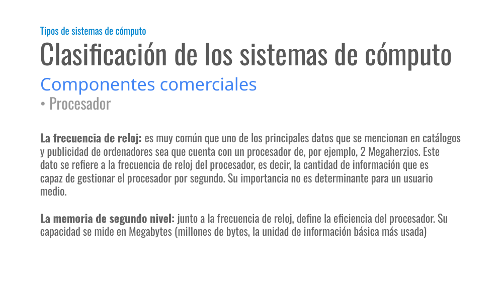

- Tipos de sistemas de cómputo

- Componentes comerciales
- • Procesador
- La frecuencia de reloj: es muy común que uno de los principales datos que se mencionan en catálogos
- y publicidad de ordenadores sea que cuenta con un procesador de, por ejemplo, 2 Megaherzios. Este
- dato se refiere a la frecuencia de reloj del procesador, es decir, la cantidad de información que es
- capaz de gestionar el procesador por segundo. Su importancia no es determinante para un usuario
- medio.
- La memoria de segundo nivel: junto a la frecuencia de reloj, define la eficiencia del procesador. Su
- capacidad se mide en Megabytes (millones de bytes, la unidad de información básica más usada)

---

## Clasificación de los sistemas de cómputo

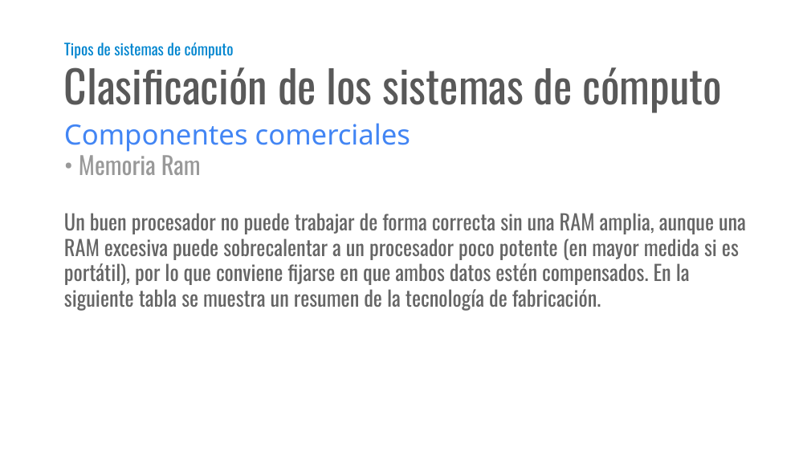

- Tipos de sistemas de cómputo

- Componentes comerciales
- • Memoria Ram
- Un buen procesador no puede trabajar de forma correcta sin una RAM amplia, aunque una RAM excesiva puede sobrecalentar a un procesador poco potente (en mayor medida si es portátil), por lo que conviene fijarse en que ambos datos estén compensados. En la siguiente tabla se muestra un resumen de la tecnología de fabricación.

---

## Clasificación de los sistemas de cómputo

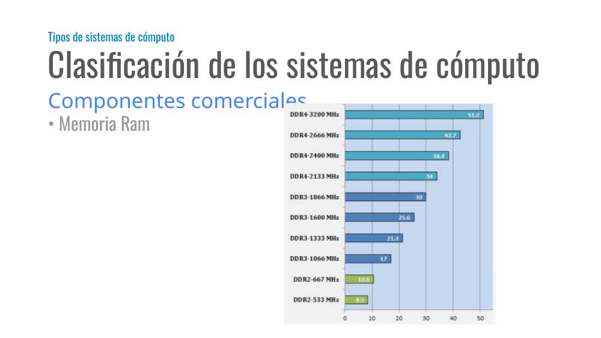

- Tipos de sistemas de cómputo

- Componentes comerciales
- • Memoria Ram

---

## Clasificación de los sistemas de cómputo

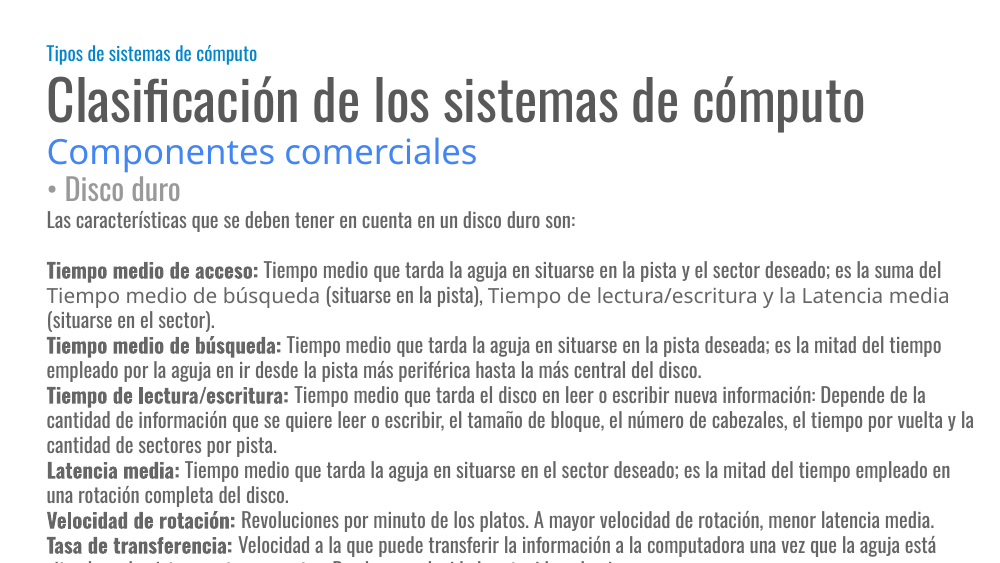

- Tipos de sistemas de cómputo

- Componentes comerciales
- • Disco duro
- Las características que se deben tener en cuenta en un disco duro son:
- Tiempo medio de acceso: Tiempo medio que tarda la aguja en situarse en la pista y el sector deseado; es la suma del Tiempo medio de búsqueda (situarse en la pista), Tiempo de lectura/escritura y la Latencia media (situarse en el sector).
- Tiempo medio de búsqueda: Tiempo medio que tarda la aguja en situarse en la pista deseada; es la mitad del tiempo empleado por la aguja en ir desde la pista más periférica hasta la más central del disco.
- Tiempo de lectura/escritura: Tiempo medio que tarda el disco en leer o escribir nueva información: Depende de la cantidad de información que se quiere leer o escribir, el tamaño de bloque, el número de cabezales, el tiempo por vuelta y la cantidad de sectores por pista.
- Latencia media: Tiempo medio que tarda la aguja en situarse en el sector deseado; es la mitad del tiempo empleado en una rotación completa del disco.
- Velocidad de rotación: Revoluciones por minuto de los platos. A mayor velocidad de rotación, menor latencia media.
- Tasa de transferencia: Velocidad a la que puede transferir la información a la computadora una vez que la aguja está situada en la pista y sector correctos. Puede ser velocidad sostenida o de pico.

---

## Clasificación de los sistemas de cómputo

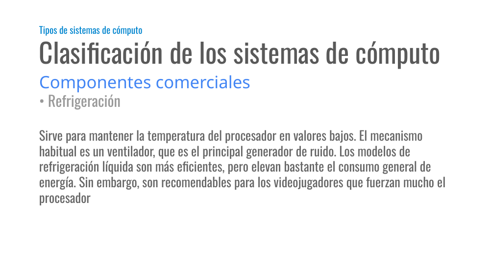

- Tipos de sistemas de cómputo

- Componentes comerciales
- • Refrigeración
- Sirve para mantener la temperatura del procesador en valores bajos. El mecanismo habitual es un ventilador, que es el principal generador de ruido. Los modelos de refrigeración líquida son más eficientes, pero elevan bastante el consumo general de energía. Sin embargo, son recomendables para los videojugadores que fuerzan mucho el procesador

---

## Clasificación de los sistemas de cómputo

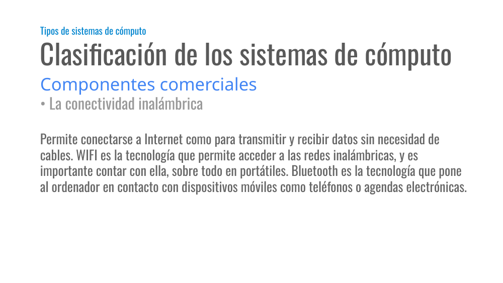

- Tipos de sistemas de cómputo

- Componentes comerciales
- • La conectividad inalámbrica
- Permite conectarse a Internet como para transmitir y recibir datos sin necesidad de cables. WIFI es la tecnología que permite acceder a las redes inalámbricas, y es importante contar con ella, sobre todo en portátiles. Bluetooth es la tecnología que pone al ordenador en contacto con dispositivos móviles como teléfonos o agendas electrónicas.

---

## Clasificación de los sistemas de cómputo

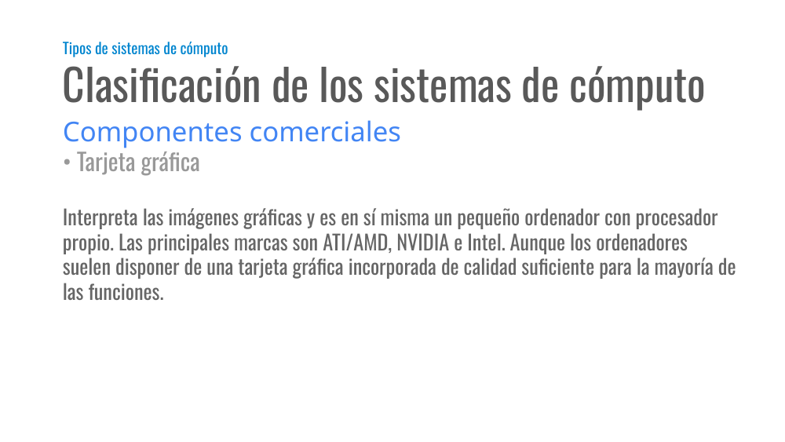

- Tipos de sistemas de cómputo

- Componentes comerciales
- • Tarjeta gráfica
- Interpreta las imágenes gráficas y es en sí misma un pequeño ordenador con procesador propio. Las principales marcas son ATI/AMD, NVIDIA e Intel. Aunque los ordenadores suelen disponer de una tarjeta gráfica incorporada de calidad suficiente para la mayoría de las funciones.

---

## Clasificación de los sistemas de cómputo

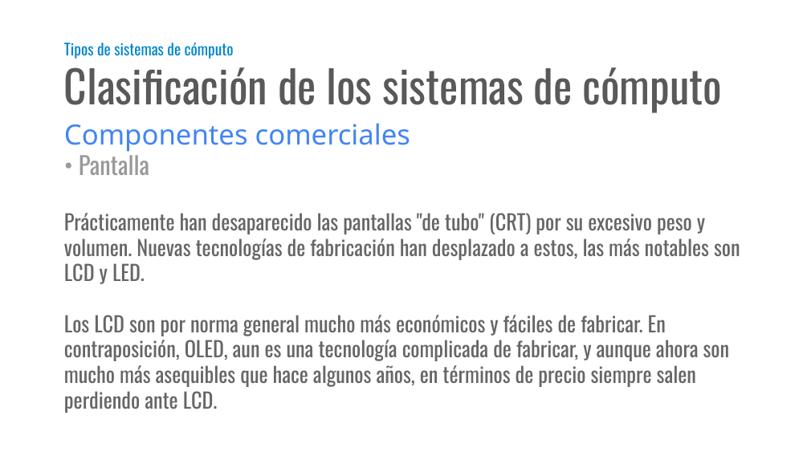

- Tipos de sistemas de cómputo

- Componentes comerciales
- • Pantalla
- Prácticamente han desaparecido las pantallas "de tubo" (CRT) por su excesivo peso y volumen. Nuevas tecnologías de fabricación han desplazado a estos, las más notables son LCD y LED.
- Los LCD son por norma general mucho más económicos y fáciles de fabricar. En contraposición, OLED, aun es una tecnología complicada de fabricar, y aunque ahora son mucho más asequibles que hace algunos años, en términos de precio siempre salen perdiendo ante LCD.

---

## Diapositiva 43

---
