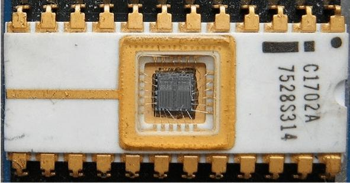
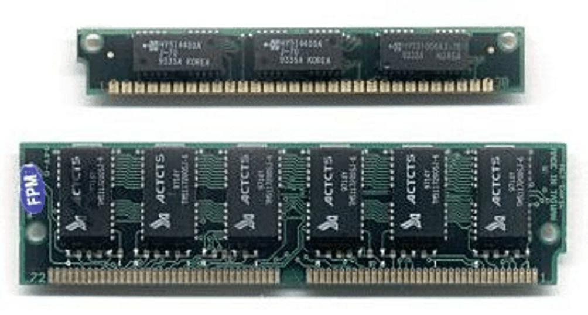
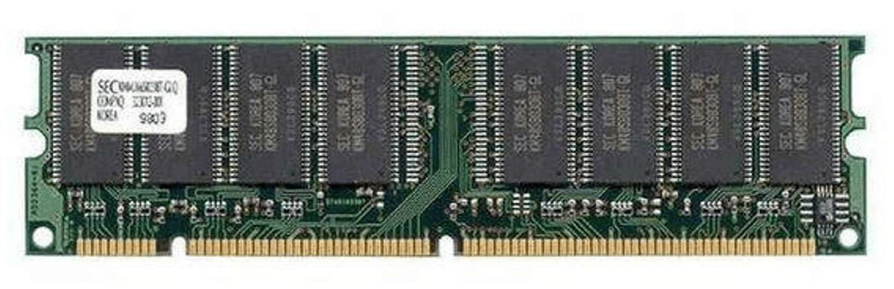
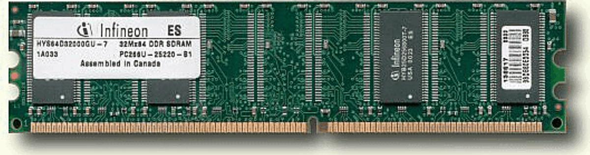
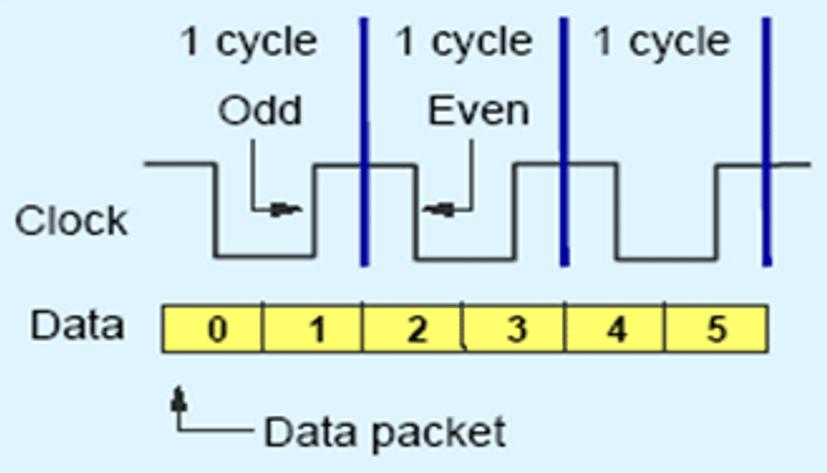
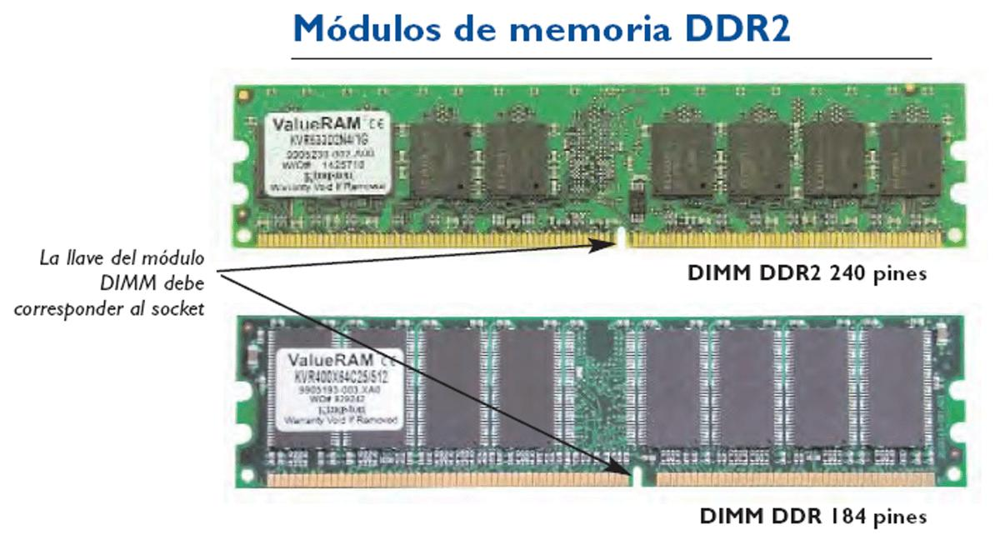
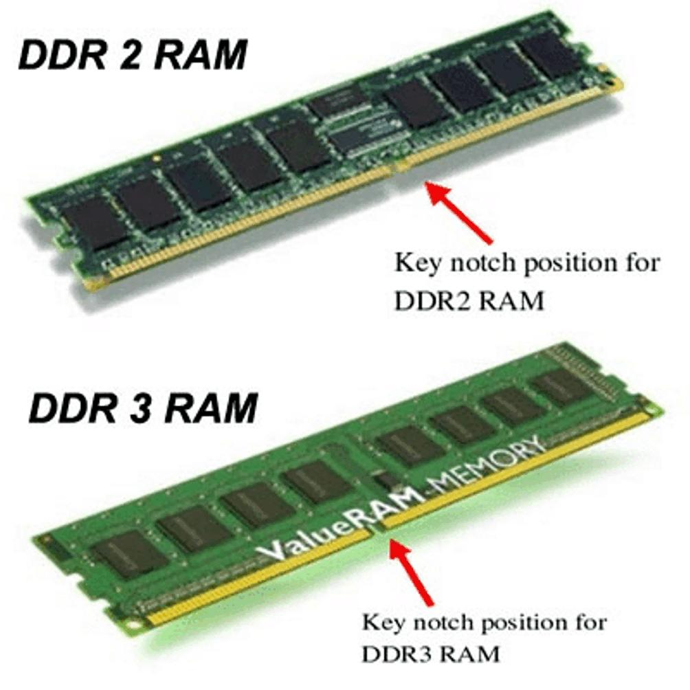
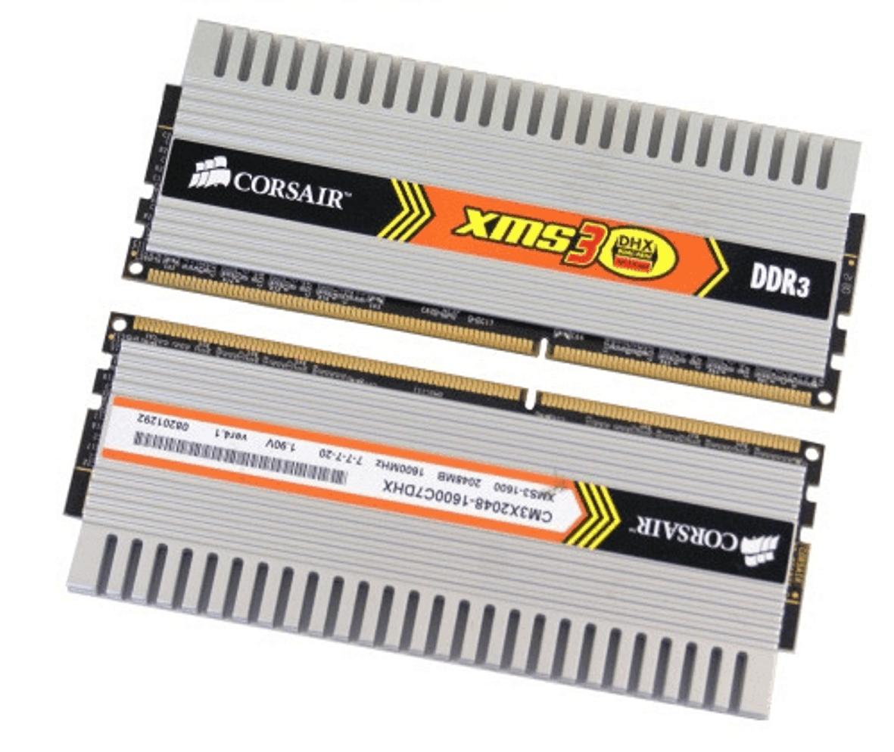
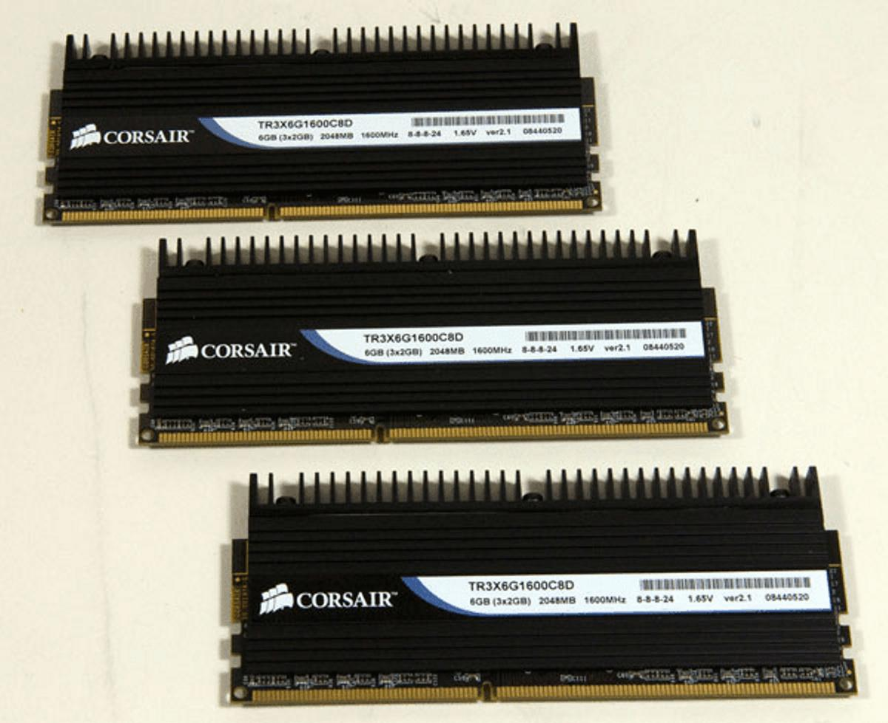

# 10. Tipos de memorias

**Presentación relacionada:** [Tema 8, 9 y 10](../Tema%208%2C%209%20y%2010/README.md)

## Objetivo

- Caracterizar los tipos de memorias presentes en un computador.

## 10.1. Introducción

Las memorias tienen como objeto el almacenamiento de datos. Han sido ampliamente utilizadas en los sistemas de computadores y tienen múltiples funciones dentro de estos. Las diferentes actividades de un computador implican el uso de algún tipo de memoria, bien sea para el arranque del sistema, para cargar el sistema operativo y para permitir la interacción del procesador con los diferentes programas que utilizan los usuarios.

Según la forma en que almacenan los datos, las memorias se clasifican en “solo lectura” (ROM), “de acceso aleatorio” (RAM) y “operativa o ultrarrápida” (Caché).

## 10.2. Memoria de solo lectura: rom

Este tipo de memoria es de solo lectura, de ahí su clasificación según sus siglas en inglés: Read Only Memory. Por sus características de fabricación son un tipo de memoria no volátil, por lo que no pierden los datos almacenados cuando la memoria se queda sin alimentación eléctrica. Se debe destacar, que en estas memorias no se pueden escribir datos libremente, solo si se hace por fabricantes o diseñadores de sistemas. Un ejemplo de este tipo de memoria en los computadores es el BIOS.

Las memorias ROM han evolucionado y se han clasificado según la tecnología con las cuales se han implementado: 1.

PROM: Memorias programables de solo lectura. Estas memorias podían ser programadas a través de equipos que los fabricantes de estas suministraban a los usuarios. Tenían una gran desventaja, y es que solo se podían grabar una vez, lo que implicaba que si el dato o programa que se le escribía no era correcto, esa memoria quedaba inutilizable, lo que encarecía el desarrollo de sistemas.

2.

EPROM: Memorias borrables y programables de solo lectura. Con la aparición de este tipo de memoria los costos de los diseños de sistemas disminuyeron considerablemente. Al tener una memoria que podía ser borrada, cuando un dato o programa no era correcto, se podía hacer una corrección sin perder la memoria ya grabada. Para borrar estas memorias, se hacía necesario una luz ultravioleta. Nótese en la figura 10.1, que la memoria EPROM que se muestra contiene una celda fotovoltaica, que al recibir la radiación ultravioleta, permitía el borrado de la misma.

**Figura 10.1.** Memoria EPROM.

3.

EEPROM: Memorias borrables por mecanismos eléctricos y programables. Estas memorias evolucionaron directamente de las EPROM. Podían ser grabadas y borradas mediante mecanismos eléctricos, regularmente suministrados por los fabricantes que se comunicaban con las PC a través de los puertos series y paralelos de los computadores. Al igual que sus antecesoras EPROM, permitían que los diseños con memorias fueran factibles en costos, al no tener que desechar memorias por errores o pruebas de los mismos. 4.

Flash EEPROM: Memorias borrables por mecanismos eléctricos y programables mediante tecnología Flash. Esta tecnología fue creada por Toshiba en 1980 y a finales de los años 90 tomó gran popularidad al diseñarse con la posibilidad de comunicarse mediante puerto USB. En sus inicios sus tamaños eran de pocos Megabytes de capacidad y en la actualidad sobrepasan los 64 Gb de almacenamiento. En el caso del BIOS de los computadores modernos, esta tecnología ha permitido que los mismos sean actualizables, es decir, reprogramables, para así mejorar el funcionamiento de las motherboards.

## 10.3. Memoria de acceso aleatorio: ram

El nombre abreviado de este tipo de memoria viene del inglés Random Access Memory, es decir, Memoria de Acceso Aleatorio. En estas se cargan los datos con los que trabajará el procesador: sistema operativo y programas que utilicen los usuarios. Son volátiles, lo que implica que en ausencia de alimentación eléctrica pierden los datos almacenados, a diferencia de las ROM. Por sus características de fabricación deben ser “refrescadas” frecuentemente, es decir, los datos contenidos deben ser actualizados. Se han diseñado bajo tres estándares: SIMM, DIMM y DDR.

En realidad SIMM y DIMM son tipos de encapsulado. Para referirse técnicamente a la forma en que funciona la RAM deberían distinguirse SRAM (RAM estática) y DRAM (RAM Dinámica). La primera es costosa y muy rápida, se emplea en memorias caché y se construye con biestables. La segunda es la de más amplio uso en módulos RAM y es la que debe refrescarse porque se basa en principios capacitivos para el almacenamiento de carga eléctrica. Cada celda es mucho más pequeña y por tanto barata de construir.

### 10.3.1. Simm

El nombre de SIMM viene del inglés: “Single In-line Memory Module”, lo que español significa “Único módulo de memoria en línea”. Fueron de las primeras que utilizaron los computadores y existieron con 30 ó 72 contactos. Las de 30 contactos, permiten leer y escribir 8 bits (1 byte) en paralelo y las de 72 contactos, permiten acceder a 32 bits (4 bytes) en paralelo. Aunque los contactos de esta memoria eran por ambas caras, la conexión era solo a través de una. Las computadoras actuales no usan este tipo de memorias. Nótese que el caso de la de 72 contactos, se le insertó una ranura para que sirviera de guía a la conectarla.

**Figura 10.2.** Memorias SIMM de 30 y 72 contactos.

Las memorias SIMM de 30 contactos, fueron conocidas como Memorias SIMM DRAM, nombre proveniente de Dinamic RAM, es decir, RAM Dinámica. Esta es la más lenta de todas las RAM y surgieron en 1995. Usada en los computadores con procesadores Intel 386, con una velocidad entre 70 y 80 ns.

Por su parte, las memorias SIMM de 72 contactos fueron conocidas como SIMM FPM, de Fast Page Memory, que es en español significa Memoria de Paginado Rápido. Surgieron en 1996 y evolucionaron de las DRAM. Eran un poco más rápidas de las DRAM, 60 y 70 ns de velocidad.

Físicamente aparece como SIMM de 30 (Intel 386, 486) y 72 contactos (Intel 486 D y primeros Pentium).

### 10.3.2. Dimm

El término DIMM viene del inglés “Dual In-line Memory Module”, que al español se traduce como “Módulo de Memoria en línea doble”. Están dotadas de 168 contactos (84 por cara), los cuales no están unidos entre sí, y forman contactos separados. Proporcionan por tanto, un acceso paralelo a 64 bits de memoria. Miden 13 cm. Dentro de la categoría DIMM, se pueden encontrar múltiples variantes, todas asociadas a alguna tecnología, las cuales fueron evolucionando hasta llegar a las memorias actuales. A pesar de la evolución, siguen midiendo 13 cm.

A las DIMM iniciales, se les dotó de 2 ranuras, similar a las SIMM, para facilitar su inserción en la motherboard, evitando errores de conexión. Esto puede claramente observarse en la siguiente figura.

**Figura 10.3.** Memorias DIMM.

Las RAM fueron evolucionando acorde con el desarrollo de las tecnologías de computadores. En el caso de las DIMM, una de las tecnologías conocidas fue la EDO desarrollada en 1997. EDO proviene de Extended Data Out, es decir, Salida de Datos Extendidos. La memoria RAM tipo DIMM EDO, evolucionó de la Fast Page (SIMM). Permitió introducir nuevos datos mientras los anteriores estaban saliendo, con velocidades de 50 ns. Se instala en SIMM de 72 contactos, y en DIMM de 168. (Pentium, Pentium Pro, y los primeros Pentium II).

Entre 1998 y 1999 surge otro tipo de memoria DIMM, la SDRAM (Synchronous DRAM). Fue capaz de funcionar a 100 MHz, y fue utilizada por los procesadores AMD K6-2 y los Pentium II a 350 MHz o más. Fue una tecnología que utilizó el reloj del sistema para sincronizar la entrada y la salida de señales, sin tiempos de espera. Ahorra tiempo al ejecutar los comandos y al transmitir los datos, aumentando de esta manera el rendimiento total de la PC. Permite que la CPU acceda a los datos a una velocidad un 25% superior a la EDO, alcanzando velocidades de 10 ns.

Entre los años 2001 y 2001 surge la Rambus DRAM (RDRAM). Ofrecían un diseño de interface chip a chip de sistema que permite un paso de datos hasta 10 veces más rápido que la DRAM estándar, a través de un bus simplificado. Es de 64 bits y puede producir ráfagas de 2 ns y puede alcanzar tasas de transferencia de 533 MHz, con picos de 1,6 GB/s.

A partir del año 2003 se insertaron en el mercado las memorias DIMM DDR (Double Data Rate), cuyo significado en español es “Doble Tasa de Transferencia de Datos”. Como este tipo de memorias son las utilizadas en la actualidad, se les dedicará un acápite.

Para finalizar este punto relacionado con las DIMM, se debe destacar que como parte del desarrollo de estas, se implementaron algunas técnicas como el chequeo de paridad y la corrección de errores. Las memorias con paridad, se distinguen porque tienen un número impar de chips. El chip que hace el número par, no es de memoria, sino que es el chip de paridad, que se utiliza para comprobar el flujo de datos y eliminar los errores que se pueden producir. Las memorias con corrección de errores (Memorias ECC) pueden ser de cualquier tipo. Detectan errores de datos y los corrige. Usada en servidores.

### 10.3.3. Ddr

Las memorias DDR han evolucionado en 3 generaciones: DDR (o DDR1), DDR2 y DDR3. Se parecen a las antiguas DIMM, pero tienen solo una ranura en lugar de dos. No son compatibles con los DIMM anteriores. Tienen 184 pines y envían datos 2 veces por cada señal de reloj. Lo anterior significa que duplican la velocidad de operación respecto a la tecnología DIMM sin aumentar la frecuencia del reloj.

**Figura 10.4.** Memoria DDR.

En la figura 10.4 se puede observar una memoria DDR1. Estas siguen midiendo 13 cm. Debajo, en la figura 10.5, se observa como transfieren datos en cada ciclo de reloj.

**Figura 10.5.** Envío de datos por cada ciclo de reloj.

En la tabla siguiente, se pueden observar algunas características técnicas de las memorias DDR.

Se hacen notar los nombres comerciales, la velocidad de trabajo y el ancho de banda de operación.

**Tabla 10.1.** : Datos técnicos de DDR.

Marketing Naming convention Speed grades Speed Single channel Dual channel name bandwidth bandwidth DDR200 PC1600 PC200 200 MHz (100 Mhz x 2) 1.6 GB/s 3.2 GB/s DDR266 PC2100 PC266 266 MHz (133 Mhz x 2) 2.1 GB/s 4.2 GB/s DDR333 PC2700 PC333 333 MHz (166 Mhz x 2) 2.7 GB/s 5.4 GB/s DDR400 PC3200 PC400 400 MHz (200 Mhz x 2) 3.2 GB/s 6.4 GB/s Poco tiempo después de las aparición de las DDR, surgieron las DDR2. Las memorias DDR y DDR2 no son compatibles entre sí. Existen diferencias en el voltaje, de 2.5 bajó a 1.8 V, la cantidad de pines y las señales. Las DDR2 tienen 240 pines y son capaces de realizar 4 transferencias por ciclo. Tienen un menor consumo de energía que DDR y desempeño térmico mejorado. La ranura que guía la inserción de la memoria en la motherboard, en las DDR2 no está en la misma posición que en las DDR1.

**Figura 10.6.** Memorias DDR y DDR2.

A continuación una tabla con algunas características de las memorias DDR2. Nótese que el ancho de banda de trabajo y las velocidades de operación se han incrementado notablemente respecto a DDR1.

**Tabla 10.2.** : Datos técnicos de DDR2.

Clasificación Ancho de banda del Ancho de banda de Velocidad de Clasificación del chip de sistema DDR2 de memoria del módulo memoria módulo doble canal 400 MHz DDR2-400 PC2-3200 3.2 GB/s 6.4 GB/s 533 MHz DDR2-533 PC2-4300 4.3 GB/s 8.6 GB/s 667 MHz DDR2-667 PC2-5300 5.3 GB/s 10.6 GB/s Las DDR2 evolucionaron y dieron lugar a las DDR3. Estas, tienen al igual que la DDR2 240 pines; sin embargo, los DIMM son físicamente incompatibles, pues la ranura está en una posición diferente. Este tipo de memorias, son las que permiten la interacción con procesadores multinúcleos.

Poseen un mayor ancho de banda debido a que puede trabajar con mayores tasas de señal de reloj. El voltaje bajó de 1.8 a 1.5 V, lo cual reduce el consumo eléctrico en un 40%, así como la disipación del calor. Pueden transferir datos a una tasa de reloj efectiva de 800-2000 MHz, comparado con el rango del DDR2 de 533-800 MHz. Se pueden diseñar módulos de hasta 16 GB.

**Figura 10.7.** Memorias DDR2 y DDR3.

En la tabla siguiente se pueden encontrar algunos datos técnicos de las memorias DDR3. Las velocidades de trabajo son muy altas, respecto a DDR1 y DDR2.

**Tabla 10.3.** : Datos técnicos de DDR3.

Velocidad del capacidad de Tiempo entre transferidos transferencia Nombre del por segundo reloj de E/S Velocidad Nombre Máxima estándar del reloj señales módulo Datos DDR3-800 100 MHz 10 ns 400 MHz 800 MBs PC3-6400 6.40 GB/s DDR3-1066 133 MHz 7.5 ns 533 MHz 1.066 MBs PC3-8500 8.53 GB/s DDR3-1333 166 MHz 6 ns 667 MHz 1.333 MBs PC3-10600 10.67 GB/s DDR3-1600 200 MHz 5 ns 800 MHz 1.600 MBs PC3-12800 12.80 GB/s DDR3-2000 250 MHz 4 ns 1000 MHz 2.000 MBs PC3-15000 15.00 GB/s Cada generación DDR-SDRAM, está construida para un rango de frecuencias de reloj diferente y a la vez aprovecha la ley de Moore en la que se enuncia la duplicación de la cantidad de elementos integrados por unidad de superficie.

Este es el motivo por el que en cada generación DDR aumentan la capacidad y la velocidad.

El incremento de la velocidad, el trabajo a altas frecuencias de intercambio de datos, así como el gran cúmulo de tareas a las que se someten estas memorias, debido a su conexión en entornos computadores con procesadores de varios núcleos hace que las memorias DDR3 disipen más calor y que por tanto, requieran disipadores.

**Figura 10.8.** Memorias DDR3. Disipación de alto nivel sin ensanchar los módulos o sin aumentar

demasiado sus dimensiones.

### 10.3.4. Tecnologías dual channel y triple channel

Las Tecnologías Dual y Triple Channel permiten mejorar el rendimiento de los computadores debido a que el acceso a las memorias se hace como si todas las memorias en su conjunto fueran una sola, pero de mayor ancho del bus de datos. Lo anterior facilita un mayor intercambio de datos por cada ciclo de reloj del sistema.

La Tecnología Dual Channel permite el incremento del rendimiento debido al acceso simultáneo a dos módulos de memoria, haciéndolo a bloques de 128 bits, en lugar de los 64 bits tradicionales desde el inicio de la era Pentium en 1993.

Se consigue esta implementación mediante un segundo controlador de memoria en el puente norte (northbridge) del chipset o conjunto de chips. Las mejoras de rendimiento son perceptibles cuando se trabaja con motherboards con video incluido (on board), ya que éstas, al no contar con memoria propia, usan la RAM o memoria principal del sistema y, por medio del doble canal, pueden acceder a un módulo mientras el sistema accede al otro.

Para que la PC funcione en Dual Channel, se deben tener dos módulos de memoria de la misma capacidad, velocidad, frecuencia, tipo (DDR, DDR2 o DDR3) y de ser posible del mismo fabricante en los zócalos correspondientes de la placa base, y el chipset debe soportar dicha tecnología.

Conocer si una motherboard soporta esta tecnología es muy fácil, regularmente trae los slots para las memorias de colores diferentes.

Algunas placas base también usan colores diferentes para marcar las ranuras de memoria en las que pueden utilizarse módulos de tecnologías diferentes. Para evitar confusiones siempre se debe consultar el manual de usuario.

La Tecnología Triple Channel basa su funcionamiento igual que la Dual Channel, solo que en este caso se utilizan tres memorias.

**Figura 10.9.** Memorias DDR3 Con disipación, para tecnología Triple Channel.

### 10.3.5. Memoria caché

La última de las memorias que se presentan en este tópico son las Memorias Caché. Tienen un uso muy importante de los computadores, pues guardan los datos más recientemente usados por la memoria principal (RAM). Cada vez que el procesador accede a la RAM, en la caché se guardan las direcciones de los datos utilizados, lo cual facilitará en futuros accesos una forma rápida de acceder a estos datos. Es decir, el procesador no tendrá que buscar el dato requerido en la RAM, al tener almacenada en la caché la dirección, puede acceder al dato con mayor rapidez.

Las memorias caché son conocidas como ultra rápida, pues son 5 o 6 veces más rápidas que las RAM. Se utiliza de puente entre el procesador y la memoria RAM y se empezaron a implantar en la época del Intel 386.

Tienen como desventajas su tamaño reducido, en el orden de los megabytes. Tienen un alto precio y no se pueden incrementar en la PC.

## 10.4. Conclusiones

En este material fueron presentados los tipos de memorias que se pueden encontrar en un computador. Se detallaron las memorias tipo SIMM y DIMM y se detallaron las tecnologías desarrolladas en cada caso. Se profundizó en las memorias DDR por ser las que usan los computadores actuales, mostrándose parámetros técnicos de estas, tales como ando de banda y velocidad de trabajo. De igual forma se mostraron las memorias caché, así como las tecnologías de doble y triple canal.
