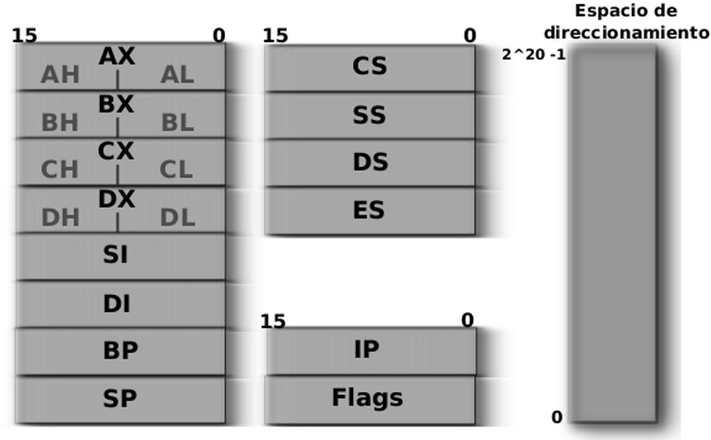
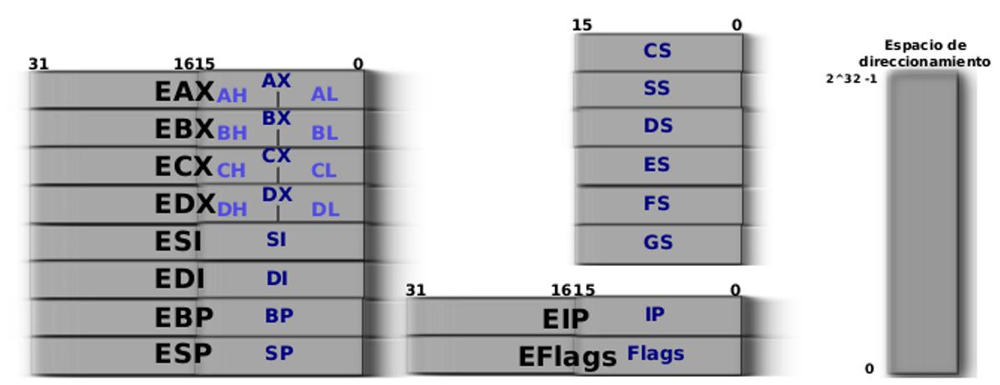
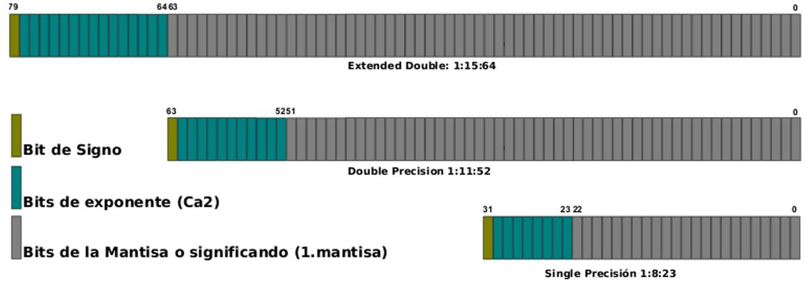
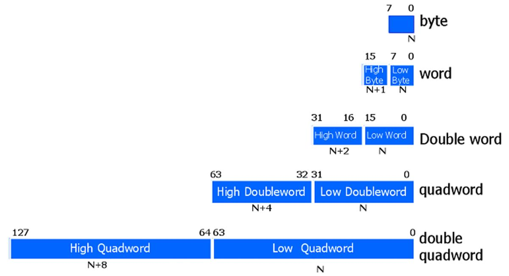
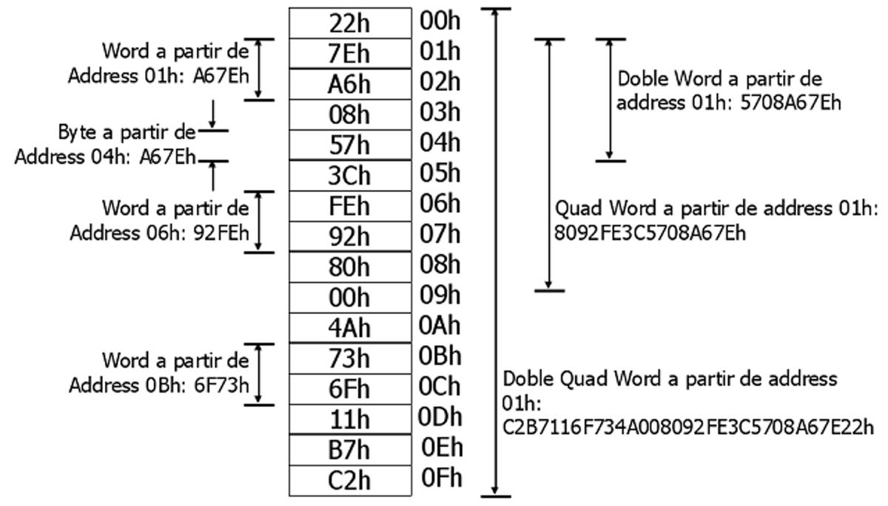
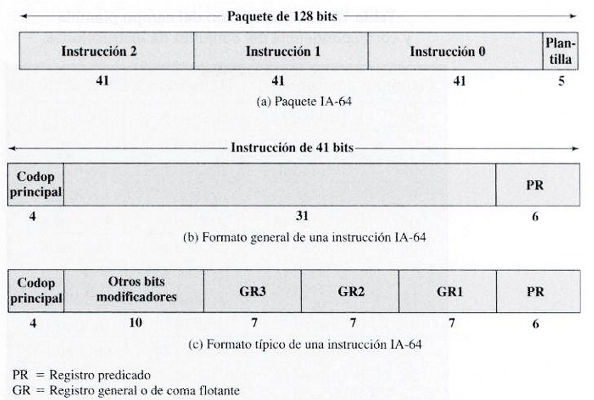
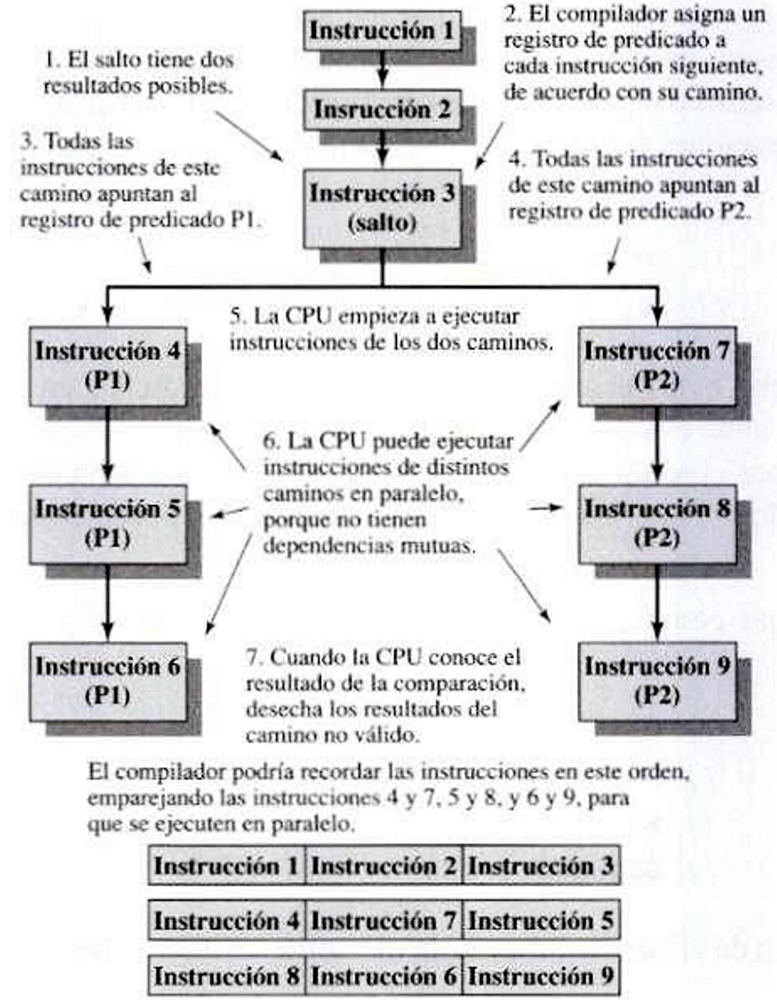

# 11. Arquitecturas IA-32 e IA-64

**Presentación relacionada:** [Tema 11 y 12](../Tema%2011%20y%2012/README.md)

## Objetivo

- Caracterizar las arquitecturas Intel IA32 e IA64.

## 11.1. Introducción

El primer procesador de 32bit de Intel fue el 80386, lanzado en 1984, y con él la arquitectura IA32. Fue un hito importante en la industria ya que permitió la introducción masiva de procesadores de gama alta (en aquel entonces) en la industria y el comercio. No obstante, el aprovechamiento verdadero de las nuevas características demoró algunos años.

A fines de los años 90 Intel comienza una sociedad con Hewlett Packard que derivar en una nueva arquitectura llamada IA-64 que engendró los procesadores de 64 bits Itanium e Itanium2.

Adoptaron la estrategia de hacer el código de máquina incompatible con IA-32, por eso la acogida fue mucho menos importante de lo esperado. En cambio AMD, que hasta ese momento se había apoyado de licencias de Intel para hacer versiones propias y compatibles de los mismos procesadores IA-32 apostó por realizar extensiones al set de instrucciones de IA-32 para 64 bits y la llamó x86-64 y más tarde AMD64. Esto fue un éxito rotundo pues lograron compatibilidad binaria entre las arquitecturas, prácticamente sin sacrificar rendimiento. Intel debió incorporar a sus propios procesadores funciones desarrolladas por AMD, denominando a la arquitectura modificada Intel64.

## 11.2. Características de ia-32

Los procesadores IA-32 tienen tres modos de operación, cada uno define y activa capacidades específicas y modos de codificación de instrucciones diferentes:

Modo Real En este modo el procesador implementa el entorno de operación del 8086, con algunas extensiones: puede pasar por software al Modo Protegido o al Modo Mantenimiento del Sistema, puede utilizar registros de 32 bits, puede reconfigurar la ubicación del vector de interrupciones, ya que a pesar de que el 8086 no lo tenía, ahora existe y es accesible desde modo Real el registro IDTR fundamental para las interrupciones. Para honrar su compromiso de compatibilidad ascendente, todos los procesadores IA-32 e Intel64 arrancan en este Modo de Trabajo, pero solo pueden acceder al primer megabyte de la memoria.

La figura 11.1 muestra los registros básicos accesibles en Modo Real, así como el tamaño del espacio de direcciones.

**Figura 11.1.** Registros y espacio de direcciones en Modo Real.

Modo Protegido Este es el modo por excelencia de los procesadores de esta familia inaugurado por el procesador 80286. En este modo se soporta la multitarea y se despliega un espacio de direccionamiento de hasta 4Gbytes, extensible virtualmente a 64Gbytes. A partir del procesador 80386 se lleva el modelo arquitectural a 32 bits y se introduce un sub-modo al que puede ponerse a una determinada tarea, denominado Virtual-8086 que permite que un programa diseñado para ejecutarse en un procesador 8086, pueda ejecutarse como una tarea en Modo Protegido. Esto fue muy útil para flexibilizar la migración de aplicaciones, pero ya no es utilizado (aunque se soporta) pues las limitaciones de memoria.

**Figura 11.2.** Registros y espacio de direcciones en Modo Real.

Modo Mantenimiento del Sistema Este modo fue introducido a partir de los modelos 386SL y 486SL para realizar funciones específicas para la plataforma de hardware en la cual funciona el procesador, sobre todo para ahorro de energía y seguridad; estos procesadores fueron los primeros diseñados para notebooks.

Al ingresar a este modo el procesador resguarda en forma automática el contexto completo de la tarea o programa interrumpido, y pasa a ejecutar código en un espacio de direcciones separado.

Una vez efectuadas las operaciones necesarias y cuando debe salir de este modo el procesador reasume la tarea o programa interrumpida independientemente.

Los modos de trabajo de los procesadores constituyen un mecanismo de seguridad para protección del código en ejecución. Por este motivo es raro encontrar procesadores con un solo modo disponible.

Todos los procesadores IA-32 incluyen una unidad de cálculo con punto flotante que agiliza este tipo de operaciones y extiende el set de instrucciones para tal propósito. Se soportan valores de hasta 80 bits lo que equivale a doble precisión extendida. Las Unidades de Punto Flotante de Intel (FPU, por las siglas en inglés) tienen 8 registros numerados R0 hasta R7. La figura 11.3 muestra sus formatos y distribución:

**Figura 11.3.** Formato de los diferentes tipos de precisión de las FPU Intel.

Disponer de registros de varios byte impone definir un criterio para almacenar valores de ese tamaño. Sucede que un valor mayor de un byte puede escribirse en memoria de varias maneras dependiendo de si se escribe primero la parte alta o la parte baja. Todos los sistemas Intel utilizan el formato Little-endian, que significa que en la memoria o medio de almacenamiento, se escribe primero la parte baja. De este modo el valor 0xcafe, se escribe en dos byte, el primero 0xfe y el último 0xca. Igualmente, si se desea almacenar el valor 0xceb011a, los cuatro bytes quedarán ordenados como: 0xa0, 0x11, 0xb0, 0xce.

Es posible además, manejar distintos formatos de números enteros. La figura 11.4. Ilustra los cinco tipos principales, aunque también es posible definir valores constantes enteros de 48bit (fword) y 80bit (tword).

**Figura 11.4.** Formatos de los diferentes tamaños de números enteros manejados en

IA-32 e IA-64 y sus nombres.

La figura 11.5 ofrece un resumen del formato numérico y su escritura en memoria en formato Little-endian.

**Figura 11.5.** Ejemplos de los formatos y su escritura en formato Little-endian.

### 11.2.1. Funcionamiento

Manejo de la memoria Todo acceso a memoria se realiza mediante una dirección. En los procesadores Intel, esta dirección se conforma a partir de un par que depende del modo de trabajo.

- Modo Real. Utiliza el par segmento:desplazamiento. El segmento lo define un registro de uso
específico denominado registro de segmento, puede ser CS, DS, CS, ES, FS o GS y su valor especifica un área de memoria de hasta 64K de tamaño. Para el desplazamiento en cambio, se puede utilizar cualquier registro de propósito general.

- Modo Protegido. Utiliza el par selector:desplazamiento. En este modo el direccionamiento es
más complejo. El selector también es un registro de segmento, pero esta vez su contenido apunta a una entrada en una tabla de valores de 64bit denominados descriptores de segmento. En estos se codifica la manera de acceder a la memoria y entre los valores que contiene se encuentran la dirección inicial del segmento y su tamaño. De este modo desplazamiento también es un registro de uso general e indica la posición dentro del segmento descrito en el selector. La tabla de descriptores globales se apunta con un registro de propósito específico llamado GDTR.

El 386 también introdujo una nueva forma de gestión de memoria: la paginación. Esta es la forma de manejo de memoria más flexible y versátil hasta el momento pues facilita enormemente la implementación de memoria virtual. Con la paginación el procesador separa explícitamente el espacio de direcciones de un programa de las direcciones válidas para la memoria instalada. Esto significa por ejemplo que el programa puede utilizar las direcciones de 3G a 4G aunque en el sistema solo haya instalados 258M de RAM ¡o 32M!

Para ello se trata a la memoria y al espacio de direcciones de un programa como un arreglo lineal de segmentos de tamaño y posición fijos denominados páginas. Es posible traducir las direcciones lógicas (las del programa) a las físicas (las de la RAM) mediante una tabla de páginas. Cada vez que un proceso emite un acceso a la memoria, el CPU consulta la tabla de páginas y encuentra la dirección física verdadera que debe leer o escribir. Cambiando páginas entre la memoria y el disco duro por ejemplo, se puede ejecutar un programa de cualquier tamaño, basta con cargar la página adecuada en la memoria antes de continuar. Si otro programa necesita espacio, se puede guardar temporalmente en disco alguna otra que no se esté utilizando.

En realidad la memoria es un gran arreglo lineal de bytes. Todos los mecanismos de acceso a la misma están contemplados para proteger áreas lógicas que debe respetar el programa que se ejecuta en cada momento.

En los procesadores IA-32 las páginas tienen un tamaño fijo de 4K y la tabla de páginas está dividida en dos niveles. Uno llamado directorio de páginas en el que cada entrada apunta a una tabla de páginas que puede cubrir un espacio de 4M. Un registro de control llamado CR3, almacena la dirección del directorio de páginas. La paginación se activa o desactiva por medio de otro registro de control: CR0.

Ejecución de código Además de las instrucciones básicas para asignación de valores, aritmética, manejo de registros y direcciones, se puede hacer uso de una pila (stack) que maneja el procesador. Esta pila es un área de memoria contigua, referenciada mediante el valor del registro SS (Stack Segment) del procesador. El tamaño de este segmento en el modo IA-32, puede llegar hasta 4 Gbytes. El segmento se recorre mediante un registro de propósito general, denominado puntero de pila (stack pointer), y que en estos procesadores según el modo de trabajo es el registro SP, ESP, o RSP (16, 32, o 64 bits respectivamente).

Para guardar un dato en la pila, se puede utilizar la instrucción PUSH, y para retirarlo, la instrucción POP. Cada vez que ejecuta PUSH, el procesador primero decrementa el puntero de pila (SP, ESP, o RSP) y luego escribe el dato en la dirección indicada por el puntero dentro del segmento apuntado por SS. POP funciona a la inversa, el procesador lee el dato en la dirección que indica el puntero de pila, y luego lo incrementa. El incremento o decremento está en correspondencia con la cantidad de datos leídos o escritos. Las instrucciones PUSH y POP no pueden utilizarse con registros de 8bit.

La pila se utiliza para:

- Guardar parámetros y la dirección de retorno cuando se llama a un método (subrutina) con
la instrucción CALL.

- Guardar el estado de las banderas la dirección de retorno y posiblemente algún código de
error durante la ocurrencia de una interrupción.

- Preservar el valor de algún registro por un periodo breve de tiempo dentro de un segmento
de código.

Con la evolución de los procesadores IA-32 se han creado instrucciones especializadas en determinadas operaciones sobre conjuntos grandes de valores. El primer grupo de estas vio la luz con el procesador Pentium MMX, que incluyó instrucciones para extensiones multimedia (MMX instructions) Básicamente eran instrucciones que manipulaban los registros de la unidad de punto flotante (R0 al R7) como números enteros de 80bit, mediante los nombres MM0-MM7. Estas instrucciones fueron las precursoras de Intel para de las llamadas instrucciones SIMD, que son las siglas de Single Instruction Multiple Data. Significa que una misma acción puede hacerse sobre varios bytes a la vez, lo que es muy útil y eficiente en el tratamiento digital de vídeo y sonido. Con el tiempo las instrucciones SIMD de Intel han evolucionado mediante extensiones SSE (Siglas de Streaming SIMD Extensions) que cada vez utilizan registros de mayor tamaño e incorporan operaciones más complejas.

Interrupciones Las interrupciones también funcionan dependiendo del modo de trabajo. A pesar de ello, el procesador jamás distingue entre interrupciones internas o externas. Todas las versiones de Intel pueden manejar hasta 256 interrupciones y corresponde al programador decidir cuáles serán para interrupciones externas. Las primeras 32 siempre están reservadas para Intel, para las llamadas excepciones. En la documentación se explica su manejo. Se destacan:

Interrupción Función (Excepción) División por cero Código de instrucción no válido Error de protección general Fallo de página Error en instrucción SIMD 0 6 13 14 19 El procesador identifica las interrupciones en el bus de datos con un número (entre cero y 255) y con ese valor calcula una dirección dónde espera encontrar el código que debe ejecutarse para atender el evento.

Con la introducción del Pentium, Intel dispuso un controlador avanzado de interrupciones (APIC) que puede manejar interrupciones virtuales y desde entonces pueden manejarse hasta 65536 interrupciones por núcleo en la práctica.

En el Modo Real, el procesador siempre asume que las direcciones para las rutinas de atención a interrupción están escritas a partir de la dirección cero. Como cada dirección requiere dos valores (segmento:desplazamiento) cada entrada será de 4bytes, por lo que para calcular la dirección de la subrutina para la interrupción n simplemente calcula n*4.

En el modo protegido las interrupciones funcionan diferente. De debe crear una tabla llamada tabla de descriptores de interrupción (IDT, por sus siglas en inglés) en la que se escriben descriptores de 64bit con un formato más complejo que en el modo real. De todos modos, dentro de los valores que se encuentran el descriptor están: el selector que indica el segmento de memoria dónde está escrito el código para la interrupción y el desplazamiento o la dirección dónde se ubica la primera instrucción. La tabla de descriptores de interrupción está apuntada por el registro IDTR y cada vez que ocurre una interrupción el CPU la consulta para calcular la dirección del código a ejecutar. Como cada descriptor es de 8byte, la dirección del descriptor para la interrupción n se calcula haciendo n*8 + IDTR.

## 11.3. Características de ia-64

La motivación detrás de IA-64 era explotar el paralelismo y deshacerse del lastre de la compatibilidad hacia atrás. La compatibilidad hacia atrás es lo que permite ejecutar código viejo en sistemas nuevos. Irónicamente esta es una de las cosas en las que Intel se destacó y también una de las ventajas de sus sistemas. Quizás el cambio más importante fue diseñar IA-64 como una arquitectura RISC. De todos modos IA-64 no es totalmente incompatible con IA-32, puede emularlo pero con una reducción notable en el rendimiento respecto a un procesador con ejecución nativa.

Resulta de todos modos interesante porque supone un avance tecnológico que no ha tenido éxito no por ser defectuoso o erróneo, sino porque supone un cambio demasiado grande en el software.

Los sistemas Intel y compatibles dominan1 el mercado por lo que en el mejor de los casos habría que recompilar, probar y luego redistribuir todo el software a nivel mundial. 1. El mercado y aplicaciones de computadores de uso general y altas prestaciones está dominado por Intel y AMD, pero recientemente se ha producido una explosión de dispositivos móviles que hacen interesante pensar en el futuro cercano.

### 11.3.1. Funcionamiento

IA-64 se basaba en el concepto de unidades de ejecución, un concepto más o menos cercano al multinúcleo, pero en este caso cada unidad estaba especializada en un tipo concreto de instrucción. Se definen cuatro tipos de unidades de ejecución:

- Unidad 1: para instrucciones aritméticas con enteros, de desplazamiento y suma, lógicas,
de comparación, y multimedia con enteros.

- Unidad M: cargas y almacenamientos entre registros y memoria; y algunas operaciones de
la ALU con enteros.

- Unidad B: instrucciones de salto.
- Unidad F: instrucciones de coma flotante.
Esto permite ejecutar instrucciones diferentes de manera paralela, sobre todo si se le suma que IA-64 implementa un número considerablemente mayor de registros, que permiten agilizar la ejecución al limitar la cantidad de accesos a memoria.

La arquitectura IA-64 define un paquete de 128 bits que contiene tres instrucciones llamadas sílabas, y un campo plantilla (figura 11.6a). El procesador puede captar uno o más paquetes de instrucciones a la vez; y cada captación de paquete contiene tres instrucciones. El campo plantilla contiene información que indica qué instrucciones se pueden ejecutar en paralelo.

**Figura 11.6.** Formato de instrucciones para IA-64.

La interpretación de este campo no se limita a un único paquete. Por el contrario, el procesador puede examinar varios paquetes para determinar qué instrucciones pueden ejecutarse en paralelo. Por ejemplo, el flujo de instrucciones puede ser de tal tipo que permita la ejecución en par alelo de ocho instrucciones. El compilador reordena las instrucciones de manera que las ocho abarquen paquetes contiguos, y ajusta los bits de la plantilla de forma que el procesador sepa que las ocho instrucciones son independientes.

Cada instrucción tiene un formato de longitud fija de 41 bits (figura 11.6b). Esta longitud es algo mayor que la tradicional de 32 bits de las máquinas RISC, aunque es mucho más corta que algunas instrucciones de IA-32. Hay dos factores que conducen a estos bits añadidos. En primer lugar, la arquitectura IA-64 utiliza más registros que una máquina RISC típica: 128 para enteros y 128 para coma flotante. En segundo lugar, para implementar lo que se denomina ejecución con predicados. Que es una técnica que permite al procesador determinar qué instrucciones pueden ejecutarse en paralelo. En este método, el compilador elimina saltos del programa usando ejecución condicional. Un ejemplo típico de un lenguaje de alto nivel es la estructura if-then-else.

Un compilador clásico inserta un salto condicional en el punto del if de esta construcción. Si la condición tiene cierto resultado lógico, el salto no se produce y se ejecuta el siguiente bloque de instrucciones que representa el camino del then.

Al final de este camino hay un salto incondicional que evita el siguiente bloque, que representa el camino del else. Si la condición tiene el resultado lógico contrario, se produce el salto, que evita el bloque de instrucciones del then, y la ejecución prosigue por el bloque de instrucciones del else.

Los dos flujos de instrucciones se juntan tras el final del bloque del else.

Un compilador de IA-64 sin embargo hace lo siguiente: 1.

En el punto del programa del if, inserta una instrucción de comparación que crea dos predicados. Si la comparación es verdadera, el primer predicado se ajusta a verdadero y el segundo a falso; si la comparación es falsa, el primer predicado se ajusta a falso y el segundo a verdadero. 2.

Añade a cada instrucción del camino del then una referencia a un registro de predicado que contiene el valor del primer predicado, y añade a cada instrucción del camino del else una referencia a un registro de predicado que contiene el valor del segundo predicado. 3.

El procesador ejecuta instrucciones de los dos caminos. Cuando el resultado de la comparación se conoce, el procesador desecha los resultados de un camino y entrega los resultados del otro camino. Esto permite al procesador introducir instrucciones de ambos caminos en el cauce de instrucciones sin esperar a que termine la operación de comparación.

La figura 11.7 ilustra el proceso, que evita los saltos imprescindibles de otra manera apoyándose en el paralelismo.

Otra innovación importante de la arquitectura IA-64 es la especulación en el control, también conocida como carga especulativa. Permite al procesador cargar datos desde memoria antes de que el programa los necesite, para evitar retrasos por el acceso a memoria. Además, el procesador aplaza el informe de excepciones hasta que sea necesario comunicar la excepción. Se usa el término alzar (hoist) para hacer referencia al movimiento de una instrucción de carga a un punto anterior en el flujo de instrucciones.

**Figura 11.7.** Ejecución con predicados.

La carga especulativa permite cargar un dato ante de ser utilizado, lo que agiliza enormemente las transacciones y acceso a memoria, sobre todo para permitir la ejecución con predicados, en las que se necesita un valor útil en los registros de predicado. La carga especulativa funciona de la siguiente manera.

Una instrucción de carga especulativa ejecuta la captación desde memoria y lleva a cabo la detección de excepciones. Pero no lanza la excepción (no llama a la rutina de interrupción que maneja la excepción). Esta instrucción se alza a un punto anterior del programa que sea adecuado.

Una instrucción de comprobación permanece en el lugar de la carga original y lanza las excepciones. Esta instrucción puede asociarse a un predicado de forma que solo se ejecute si el predicado es verdadero.

Si ld.s detecta una excepción, ajusta un bit de recuerdo asociado con el registro destino, conocido como el bit NaT (Not a Thing, por sus siglas en inglés). Si la instrucción correspondiente se ejecuta, y el bit NaT está a uno, la instrucción salta a una rutina de servicio de excepción.

### 11.3.2. Organización del procesador

IA-64 dispone de un gran número de registros, estos se pueden clasificar como sigue:

- Registros generales: 128 registros de uso general de 64 bits. Asociado a cada registro hay
un bit NaT usado para rastrear las excepciones especulativas aplazadas, tal como se explicó antes. A los registros r0 hasta r31 se les conoce como registros estáticos; una referencia de un programa a cualquiera de ellos se interpreta literalmente. Los registros r32 hasta r127 pueden usarse como registros virtuales y el hardware puede realizar renombramiento dinámico.

- Registros de coma flotante: 128 registros de 82 bits para números en coma flotante. Este
tamaño es suficiente para manejar números en el formato doble extendido de IEEE 754. Los registros fr0 hasta fr31 son estáticos, y los registros fr32 hasta fr127 también son virtuales.

- Registros de predicado: 64 registros de 1 bit usados como predicados. El registro pr0
siempre vale uno para habilitar instrucciones no asociadas a predicados. Los registros pr0 hasta pr15 son estáticos, y los registros pr0 hasta pr63 son virtuales.

- Registros de salto: ocho registros de 64 bits usados para saltos.
- Puntero de instrucciones (Instruction Pointer, IP): guarda la dirección del paquete de la
instrucción IA-64 que se ejecuta actualmente, de igual modo que en IA-32.

- Indicador de marco actual (Current frame marker, CFM): guarda información de estado
relacionada con la pila de registros generales en curso.

- Máscara de usuario: un conjunto de valores de un solo bit usado para excepciones de
alineación, monitores de prestaciones y para monitorizar el uso de los registros de coma flotante.

- Registros de datos del monitor de prestaciones: usados como apoyo al hardware de
monitorización de prestaciones.

- Identificadores del procesador: describen características del procesador.
- Registros de aplicación: conjuntamente con los del indicador del marco actual, permiten
configurar lo que se conoce como pila de registros, que facilitan la implementación de la multitarea y el guardado de contextos en los sistemas operativos.

<!-- tabla detectada en PDF p.153 -->

| Interrupción | Función(Excepción) |
| --- | --- |
| 0 6 13 14 19 | Divisiónporcero Códigodeinstrucciónnoválido Errordeproteccióngeneral Fallodepágina ErroreninstrucciónSIMD |

## 11.4. Conclusiones

La evolución de los sistemas de cómputo no siempre la dictan los avances tecnológicos. Un buen ejemplo es el intento de introducción de IA-64 de Intel. Aunque la tecnología es buena y constituye una mejora importante, no triunfó frente a las extensiones de IA-32, debido sobre todo a la falta de una estrategia de migración y al hecho real que supone un cambio de esa magnitud.
