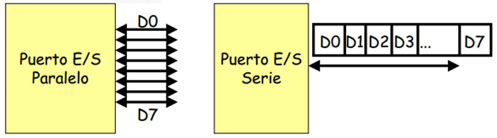
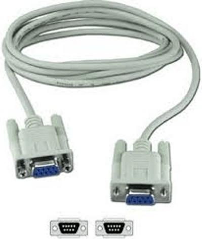
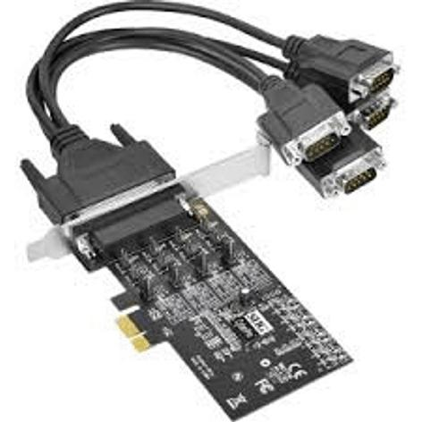
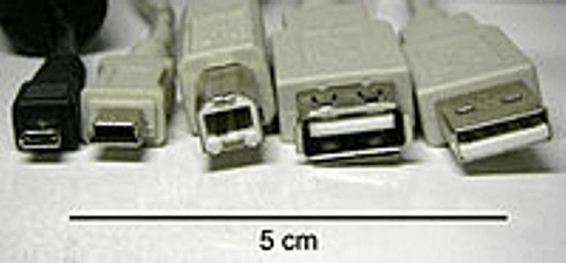
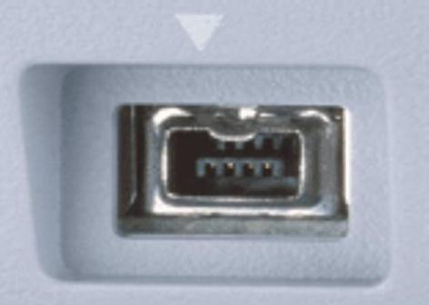
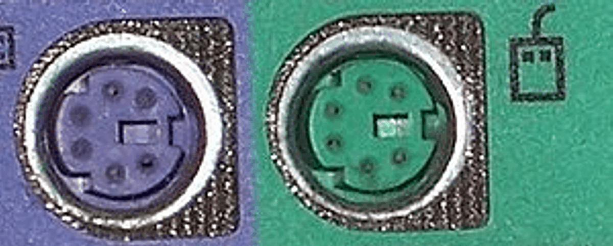
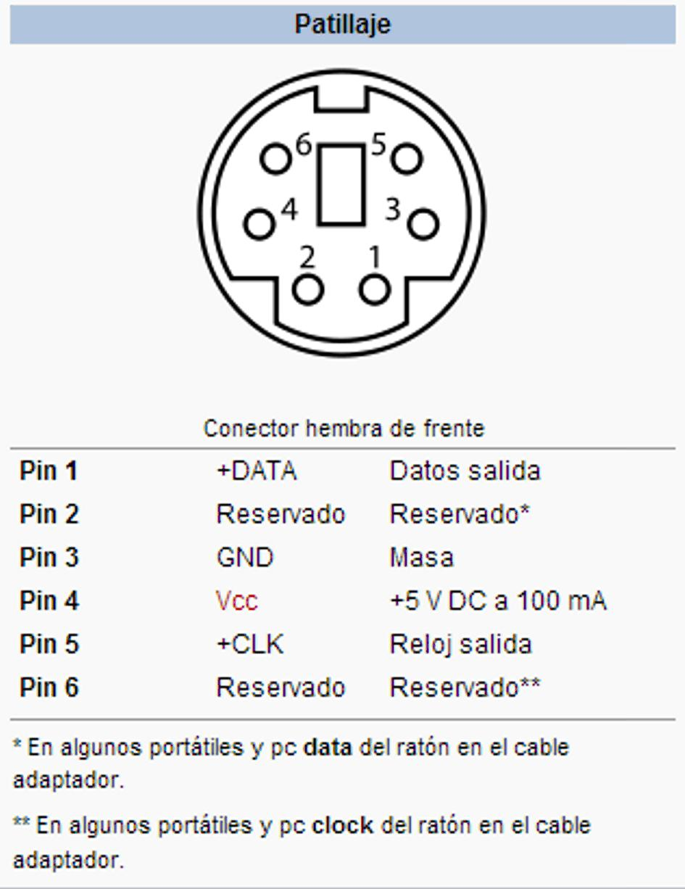
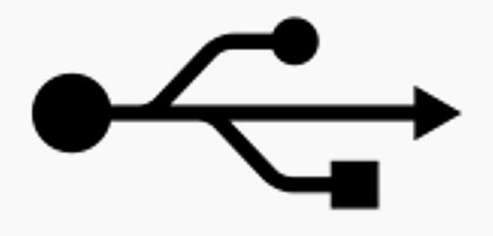
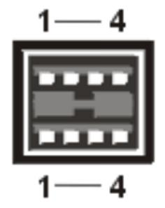
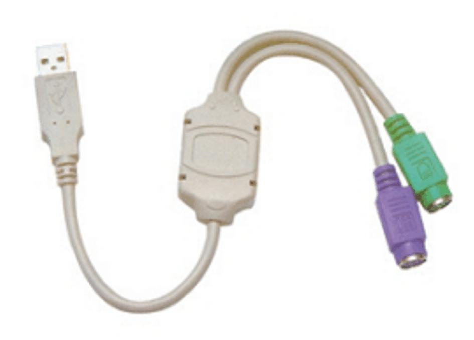

# 16. Buses serie USB y PS/2

**Presentación relacionada:** [Tema 15, 16, 17 y 18](../Tema%2015%2C%2016%2C%2017%20y%2018/README.md)

## Objetivo

- Caracterizar los Buses serie USB y PS/2.

## 16.1. Introducción

Un bus comunica diferentes elementos propios del sistema informático, externos (periféricos) o entre sistemas informáticos diferentes. A diferencia del puerto, el bus es capaz de realizar la comunicación entre varios elementos utilizando el mismo conjunto de pistas o cables. Los buses también se pueden clasificar en buses serie o paralelo según su habilidad para transferir la información bit a bit o en grupos de bits. En esta conferencia se hará un estudio de las principales características de los buses serie y se caracterizará el uso de dos de sus principales exponentes:

USB y PS/2.

## 16.2. Buses serie

Una clasificación evidente de puertos y buses es su modo de funcionamiento: paralelo o serie.

- Paralelo: una línea por bit del dato y todos simultáneos.
- Serie: todos los datos a través de la misma línea y multiplexados en el tiempo.
En la transmisión en serie se transmite bit a bit (de manera secuencial), a modo de un flujo de datos. Entre las ventajas más evidentes de este tipo de transmisión se puede mencionar el hecho de que se necesita un menor cableado respecto a la paralela (muy importante al aumentar la distancia) y además se simplifica el control de la transmisión. Esto es debido a que en las transmisiones en paralelo si un dato no llega correctamente en uno de sus canales, se necesita enviar todos los datos de sus canales simultáneamente. Esto se evita en el uso de las transmisiones serie. Aunque tiene ventajas evidentes respecto a los buses paralelos, un puerto serie debe funcionar a una velocidad mayor que el bus o puerto paralelo equivalente que logra la misma velocidad efectiva.

Tradicionalmente se utilizó la tecnología serie para dispositivos lentos (como teclados y ratones) o bien para aquellas ocasiones en las que la distancia a cubrir es significativa. Sin embargo, los nuevos desarrollos en las tecnologías serie han conseguido un aumento espectacular de las velocidades de transmisión manteniendo muchas de sus ventajas iniciales. Estos nuevos buses serie en muchas ocasiones reemplazan a los antiguos buses paralelo.

Buses y puertos serie Algunos de los puertos series más usados se muestran en la siguiente tabla.

RS-232 RS-422 USB

Firewire

### 16.2.1. Ps/2

En 1987 IBM comercializó el Personal System 2 como evolución del tradicional PC. Estos equipos contaban con un nuevo conector para el teclado y el ratón, al conector (que aún se utiliza) se le acabó llamando PS/2. Los ordenadores suelen contar con dos puertos diferenciados, uno para el teclado y otro para el ratón (se suele utilizar el color verde y violeta para diferenciarlos). Muchos de los adelantos presentados fueron inmediatamente adoptados por el mercado del PC, siendo este conector uno de los primeros.

**Figura 16.1.** Conectores PS/2 coloreados: violeta para teclado, verde para ratón.

En este conector, la comunicación en ambos casos es serial (bidireccional en el caso del teclado), y controlada por microcontroladores situados en la placa madre. No han sido diseñados para ser intercambiados en caliente, y el hecho de que al hacerlo no suela ocurrir nada es más debido a que los microcontroladores modernos son mucho más resistentes a cortocircuitos en sus líneas de entrada/salida. En la figura 16.2 se describe la arquitectura del conector hembra presente en las PCs.

**Figura 16.2.** Patillaje del conector hembra de un PS/2.

### 16.2.2. Usb

El Universal Serial Bus (USB) (bus universal en serie BUS) es un estándar industrial desarrollado a mediados de los años 1990 que define los cables, conectores y protocolos usados en un bus para conectar, comunicar y proveer de alimentación eléctrica entre ordenadores y periféricos y dispositivos electrónicos.

USB fue diseñado para estandarizar la conexión de periféricos, como mouse, teclados, memorias USB, joysticks, escáneres, cámaras digitales, teléfonos móviles, reproductores multimedia, impresoras, dispositivos multifuncionales, sistemas de adquisición de datos, módems, tarjetas de red, tarjetas de sonido, tarjetas sintonizadoras de televisión y grabadora de DVD externa, discos duros externos y disquetera externas. Su éxito ha sido total, habiendo desplazado a conectores como el puerto serie, puerto paralelo, puerto de juegos, Apple Desktop Bus o PS/2 a mercadosnicho o a la consideración de dispositivos obsoletos a eliminar de los modernos ordenadores, pues muchos de ellos pueden sustituirse por dispositivos USB que implementen esos conectores.

Su concepción estuvo basado en un paradigma totalmente nuevo que permitiría el uso de un solo tipo de conector para todos los periféricos, permitiendo conectar varios dispositivos periféricos al mismo conector. Incluía un método para facilitar los conflictos por recursos. Además proveía la llamada conexión en caliente, pero lo más importante de todo esto era su detección y configuración automática de los periféricos. Esto le ahorraba mucho tiempo al usuario, y le proveía una capa de transparencia de uso que hizo que prácticamente se adueñara del mercado. Hoy en día se encuentra integrado en casi todos los equipos electrónicos que tienen E/S de datos, desde simples tarjetas de adquisición de datos hasta impresoras, computadoras, equipos de audio, celulares, etc.

**Tabla 16.1.** : Asignaciones de patas del conector USB.

Patas Señal E/S Definición 1 Vcc N/A Voltaje de suministro 2 DATA I Entrada de datos 3 +DATA O Salida de datos 4 GND N/A Tierra de señal Los dispositivos USB se clasifican en cuatro tipos según su velocidad de transferencia de datos:

- Baja velocidad (1.0): tasa de transferencia de hasta 1,5 Mbit/s (188 kB/s). Utilizado en su
mayor parte por dispositivos de interfaz humana (Human Interface Device, en inglés) como los teclados, los ratones (mouse), las cámaras web, etc.

- Velocidad completa (1.1): tasa de transferencia de hasta 12 Mbit/s (1,5 MB/s) según este
estándar, pero se dice en fuentes independientes que habría que realizar nuevamente las mediciones. Ésta fue la más rápida antes de la especificación USB 2.0. Estos dispositivos dividen el ancho de banda de la conexión USB entre ellos, basados en un algoritmo de impedancias LIFO (Last In First Out).

- Alta velocidad (2.0): tasa de transferencia de hasta 480 Mbit/s (60 MB/s) pero con una tasa
real práctica máxima de 280 Mbit/s (35 MB/s). El cable USB 2.0 dispone de cuatro líneas, un par para datos, y otro par de alimentación. Casi todos los dispositivos fabricados en la actualidad trabajan a esta velocidad.

- Superalta velocidad (3.0): tiene una tasa de transferencia de hasta 4,8 Gbit/s (600 MB/s).
La velocidad del bus es diez veces más rápida que la del USB 2.0, debido a que han incluido 5 contactos adicionales, desechando el conector de fibra óptica propuesto inicialmente, y será compatible con los estándares anteriores. En octubre de 2009 la compañía taiwanesa ASUS lanzó la primera placa base que incluía puertos USB 3.0, tras ella muchas otras le han seguido y actualmente se ve cada vez más en placas base y portátiles nuevos, conviviendo junto con el USB 2.0. En las siguientes tablas se muestran algunos detalles interesantes respecto a las velocidades de transferencias que soportan cada uno de estos.

Transfer. (por seg.) Aparición USB 3.0 600 MB/s 2010 USB 2.0 60 MB/s 2000 USB 1.0 1.5 MB/s y 187 KB/s 1996 Song/Pic 256 Flash USB Flash SD-Movie USB Flash HD-Movie 4MB 256 MB 1 GB 6 GB 16 GB 25 GB USB 1.0 5.3 sec 5.7 min 22 min 2.2 hr 5.9 hr 9.3 hr USB 2.0 0.1 sec 8.5 sec 33 sec 3.3 min 8.9 min 13.9 min USB 3.0 0.01 sec 0.8 sec 3.3 sec 20 sec 53.3 sec 70 sec

#### 16.2.2.1. Usb 3.0

A diferencia del USB 2.0, esta nueva tecnología (USB 3.0 Super Speed), es casi diez veces más rápida, ya que transfiere datos a 600 MB/s. También, en la tabla anterior se puede notar que cuenta con soporte para dispositivos HD externos, lo que aumenta su rendimiento.

La principal característica es la multiplicación por 10 de la velocidad de transferencia, que pasa de los 480 Mbit/s a los 4,8 Gbit/s (600 MB/s).

Otra de las características de este puerto es su “regla de inteligencia”: los dispositivos que se enchufan y después de un rato quedan en desuso, pasan inmediatamente a un estado de bajo consumo.

### 16.2.3. Comparación usb con ps/2

Aunque resulta evidente que USB es superior a PS/2, a continuación se muestra una gráfica que demuestra que tanto es mejor que el otro. USB soporta hasta 127 dispositivos mientras PS/2 es un bus dedicado, es decir sólo permite el uso de un dispositivo. Note además las velocidades de transferencias de datos de la versión USB 1.1 (Actualmente esta velocidad es muy superior en su versión 3.0) en comparación con la PS/2.

**Tabla 16.2.** : Comparación entre USB y PS/2.

USB (v 1.1) Interfaz PS/2 N° de dispositivos soportados Hasta 127 1 Máxima tasa de transferencia 12 Mbit/s 40 Kbit/s Máx tensión/corriente 5 V @ 500 mA 5 V @ 100 mA

USB (v 1.1) Interfaz PS/2 Conexión “en caliente” Sí No Documentación Bien documentado en http:// Out-of-Print (IBM Tech Reference) www.usb.org Es posible que en un futuro no tan lejano la interfaz PS/2 sea sustituida definitivamente. Sin embargo, la mayoría de las placas que se venden hoy en día para equipos de sobremesa incluyen la interfaz PS/2 para teclado y ratón. En el caso de los portátiles también es frecuente encontrar esta interfaz. Muchos teclados y ratones ofrecen los dos tipos de conector, ya que existen adaptadores que transforman un puerto USB en un par de conectores PS/2.

**Figura 16.3.** Conversor de puerto USB a PS/2.

<!-- tabla detectada en PDF p.221 -->

| Patas | Señal | E/S | Definición |
| --- | --- | --- | --- |
| 1 | Vcc | N/A | Voltajedesuministro |
| 2 | DATA | I | Entradadedatos |
| 3 | +DATA | O | Salidadedatos |
| 4 | GND | N/A | Tierradeseñal |

<!-- tabla detectada en PDF p.222 -->

|  | Transfer (porseg) . . | Aparición |
| --- | --- | --- |
| USB30 . | 600MB/s | 2010 |
| USB20 . | 60MB/s | 2000 |
| USB10 . | 15MB/sy187KB/s . | 1996 |

<!-- tabla detectada en PDF p.222 -->

|  | Song/Pic | 256Flash | USBFlash | SD -Movie | USBFlash | HD -Movie |
| --- | --- | --- | --- | --- | --- | --- |
|  | 4MB | 256MB | 1GB | 6GB | 16GB | 25GB |
| USB10 . | 53sec . | 57min . | 22min | 22hr . | 59hr . | 93hr . |
| USB20 . | 01sec . | 85sec . | 33sec | 33min . | 89min . | 139min . |
| USB30 . | 001sec . | 08sec . | 33sec . | 20sec | 533sec . | 70sec |

<!-- tabla detectada en PDF p.222 -->

|  | USB(v11) . | InterfazPS/2 |
| --- | --- | --- |
| N°dedispositivossoportados | Hasta127 | 1 |
| Máximatasadetransferencia | 12Mbit/s | 40Kbit/s |
| Máxtensión/corriente | 5V@500mA | 5V@100mA |

<!-- tabla detectada en PDF p.223 -->

|  | USB(v11) . | InterfazPS/2 |
| --- | --- | --- |
| Conexión“encaliente” | Sí | No |
| Documentación | Biendocumentadoenhttp:// wwwusborg . . | Out -of -Print(IBMTech Reference) |

## 16.3. Conclusiones

En esta clase se dieron a conocer dos de los más importantes buses de los computadores modernos: el USB y el PS2. Estos buses han permitido la conexión de dispositivos como el mouse y el teclado, aunque en el caso del USB, la diversidad de dispositivos es muy grande.

Los puertos PS2 en los computadores actuales están desapareciendo y en su lugar se está imponiendo el USB. Casi todos los periféricos, tanto de la rama de las tecnologías como los de la industria del ocio se comunican a través del PC esta vía. Incide en esto mucho, la elevada velocidad de intercambio de datos y la facilidad de conexión de los dispositivos.

# Resumen

