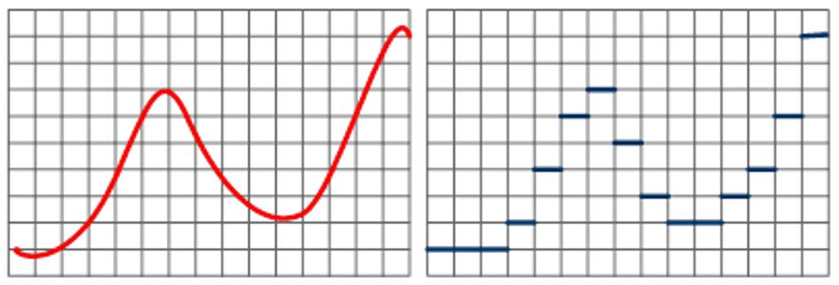
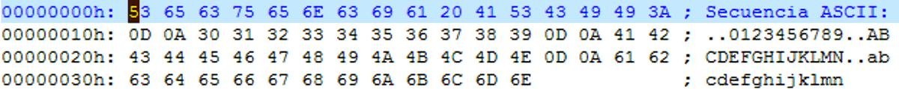

# 4. Representación digital de la información

**Presentación relacionada:** [Tema 4 - 1era Parte](../Tema%204%20-%201era%20Parte/README.md) · [Tema 4 - 2da Parte](../Tema%204%20-%202da%20Parte/README.md)

## Objetivos

- Caracterizar los tipos de representación digital de la información.
- Comparar la representación de la información mediante señales analógicas y digitales.

## 4.1. Introducción

Aunque los sistemas digitales están diseñados para el exclusivo procesamiento de la información, esta debe codificarse de una manera entendible para los sistemas de cómputo. De modo que nunca le utilizan directamente. En este capítulo se abordarán los fundamentos de la representación digital de la información así como los formatos más utilizados en los sistemas modernos.

Este conocimiento es indispensable para el aprovechamiento de los temas siguientes; pero además importante para el desarrollo de aplicaciones, la investigación científica y los sistemas de comunicaciones.

## 4.2. Señales y tipos de señales

Una señal es una representación matemática de la variación de algún parámetro, generalmente en el tiempo: el sonido, la temperatura, la luz, la velocidad, la masa… El mundo real se percibe como continuo, lo que significa que cada parámetro que pueda medirse, arrojará infinitos valores en un lapso de tiempo cualquiera. Los sistemas digitales por otro lado, son discretos; significando que los valores de los parámetros que puedan medirse tendrán un número finito de valores en un lapso de tiempo cualquiera.

**Figura 4.1.** Diferencia entre una señal analógica (izquierda) y discreta.

Pueden identificarse por tanto, dos tipos de señales: continuas y discretas. Y los sistemas que pueden operar con cada una de ellas se denominan analógicos y digitales correspondientemente.

El nombre analógico se origina en el hecho que este tipo de sistemas funciona como analogía de los verdaderos parámetros físicos que miden o manejan. El término digital proviene de dígito, e implica una manipulación numérica más que física; es decir una traducción.

Para que un sistema digital sea capaz de interactuar con el mundo real debe traducir las variables continuas o hacer uso de una traducción previa. Un termómetro digital es un buen ejemplo del primer caso; el segundo caso lo puede ilustrar muy bien un reproductor de CDs. Esta traducción se denomina conversión Análogo/Digital y simplificadamente consiste en calcular periódicamente la amplitud del parámetro medido y asignar un código a dicha amplitud; la secuencia de códigos obtenida código es la señal digital.

Las señales digitales, por ser discretas tienen varias ventajas respecto a las analógicas: 1.

Son exactamente reproductibles. Significa que pueden copiarse tantas veces como se necesite sin que se deterioren, pues en cada copia la señal se construye de nuevo. 2.

Alta inmunidad a los fenómenos físicos. Las señales analógicas son proclives a sufrir distorsión por interferencia y ruido, pero las digitales son prácticamente inmunes a dichos fenómenos.

También tienen desventajas: 1.

Existe una pérdida inherente de la información original. 2.

Requieren equipamiento complejo para su utilización y almacenamiento. 3.

No es posible digitalizar señales de muy alta frecuencia.

Alguna vez durante el desarrollo de la electrónica y la computación, la conversión A/D resultó costosa por lo limitado del espacio de almacenamiento. En el presente ya se hace difícil encontrar sistemas digitales que no sean capaces de realizar su propia conversión: cámaras, teléfonos, relojes…

El proceso de digitalización culmina cuando se obtiene la secuencia de valores numéricos que representa la señal digital. Estos valores deben estar listos para ser almacenados o utilizados en un sistema digital y el soporte para representar dichos dígitos debe ser físico.

El modo más difundido es utilizar combinaciones de valores específicos de voltaje para representar los dígitos, de manera similar a como se combinan los dígitos en su representación gráfica decimal. Pero como los circuitos no son inteligentes y suelen ser caros o se debe optimizar espacio, el sistema que se utiliza para representar los dígitos es el binario.

## 4.3. Recordando los sistemas de numeración

Los sistemas de numeración son metodologías para representar valores numéricos y operaciones sobre estos. En el mundo se ha adoptado el sistema decimal como estándar de facto en la enseñanza aunque quedan remanentes del sistema de numeración romano y se sabe que los egipcios utilizaban un sistema sexagesimal y los mayas otro vigesimal.

> La primera computadora electrónica, ENIAC, utilizaba circuitos que “comprendían” el sistema de numeración decimal, aunque muchas de sus predecesoras electromecánicas funcionaban en binario.

Los nombres están dados por la cantidad de dígitos del sistema:

| Sistema | Dígitos |
| --- | --- |
| Binario | 2 |
| Decimal | 10 |
| Vigesimal | 20 |
| Sexagesimal | 60 |

Estos sistemas de numeración se denominan posicionales, ya que el valor de un dígito está dado por la posición que ocupa en la representación. Por esto sabemos que 1(uno) es menor que 10(diez) y que un número de 20 cifras es mayor que otro de 10.

### 4.3.1. Sistema binario

El binario es el sistema de numeración posicional más simple que puede utilizarse, solo utiliza dos dígitos que por convención se han definido como 0 y 1. Dos dígitos significan dos estados en un circuito eléctrico lo que lo hace ideal para ser utilizado en sistemas digitales.

La manera en la que se escriben valores numéricos en binario no se diferencia demasiado del decimal, como pudiera parecer a primera vista. Por ejemplo el número 126 en decimal, representa el valor: 126 = 1*102 + 2*101 + 6*100 En binario no es posible escribir 126 pero sí: 1111110 = 1*26 + 1*25 + 1*24 + 1*23 + 1*22 + 1*21 + 0*20 De modo que una secuencia de 0 y 1 adecuadamente ubicados pueden representar cualquier valor numérico. Es notable que en la medida que el sistema tiene menos dígitos se requiere mayor cantidad de cifras para representar un mismo valor. En los dos ejemplos anteriores se ha representado el valor 126; en decimal se necesitan 3 dígitos y 7 en binario.

En las implementaciones de los sistemas digitales modernos, se ha adoptado el nombre de bit para la mínima unidad de información que puede construirse; y por herencia histórica se ha adoptado el byte como unidad de almacenamiento, de tal modo que 1byte = 8bit. Lo que significa que con 1byte pueden manejarse 256 valores numéricos en el rango de 0 hasta 255.

Para valores numéricos mayores es necesario combinar bytes y así se obtienen valores de:

| Bits | Denominación | Cantidad de valores |
| --- | --- | --- |
| 8 | Byte | 256 |
| 16 | Word | 65 536 |
| 32 | Double Word | 4 294 967 296 |
| 64 | Quad Word | 18 446 744 073 709 551 616 |

Los valores de la derecha se llaman menos significativos, porque codifican las menores potencias de dos. Por el contrario, los de la izquierda son los más significativos. Existen por tanto en un byte los bits más significativos (a la izquierda) y los menos significativos (a la derecha).

De igual manera cuando un valor numérico se representa con más de un byte, se definen los bytes más significativos y los menos significativos.

Las operaciones aritméticas en binario se rigen por las mismas leyes de acarreo, solo que se debe tener en cuenta que solo hay dos dígitos, de modo que si una suma arroja el valor 2, ocurre acarreo. Por ejemplo: 00101010101 + 11101011101 100010110010

Solo se ha de tener en cuenta que:

| Suma | Resta | Multiplicación | División |
| --- | --- | --- | --- |
| $0+0=0$ | $0-0=0$ | $0 \times 0=0$ | $0/1=0$ |
| $0+1=1$ | $0-1=-1$ (genera acarreo) | $0 \times 1=0$ | $1/1=1$ |
| $1+0=1$ | $1-0=1$ | $1 \times 0=0$ |  |
| $1+1=10$ (genera acarreo) | $1-1=0$ | $1 \times 1=1$ |  |

La convención más difundida para la representación de valores binarios es añadir el sufijo b al final de la secuencia numérica: 1010101011b. Los ceros a la izquierda se desprecian siempre.

### 4.3.2. Sistema hexadecimal

El sistema binario funciona muy bien para las máquinas, pero es tedioso para las personas, y propenso a errores en la medida en que aumenta la cantidad de cifras. Además, necesita más espacio para representar valores que el decimal.

El sistema hexadecimal se creó como alternativa para la visualización e impresión de información numérica digital. Como dispone de 16 dígitos su formato es más compacto que el decimal. Eso no es todo, cada dígito hexadecimal representa exactamente 4bits (24=16) de modo que en una representación hexadecimal también se indica indirectamente el valor de cada bit. Los dígitos hexadecimales son:

| Decimal | Binario | Hexadecimal |
| --- | --- | --- |
| 0 | 0000 | 0 |
| 1 | 0001 | 1 |
| 2 | 0010 | 2 |
| 3 | 0011 | 3 |
| 4 | 0100 | 4 |
| 5 | 0101 | 5 |
| 6 | 0110 | 6 |
| 7 | 0111 | 7 |
| 8 | 1000 | 8 |
| 9 | 1001 | 9 |
| 10 | 1010 | A |
| 11 | 1011 | B |
| 12 | 1100 | C |
| 13 | 1101 | D |
| 14 | 1110 | E |
| 15 | 1111 | F |

Mientras que para calcular el valor de una representación binaria en decimal (y viceversa) se necesita sumar potencias de dos, en hexadecimal la traducción es casi inmediata, lo que resulta útil no solo para las personas, sino para agilizar el funcionamiento de los programas que manipular datos binarios.

Por ejemplo el número binario de 20 bits: 11001010110101011110 requiere, para convertirlo en decimal sumar potencias como 524288 y 262144. Pero para el hexadecimal, basta con hacer: 1100 1010 1101 0101 1110 C A D 6 E Sin embargo, las operaciones matemáticas son mucho más complejas peor esto no es un problema ya que el sistema hexadecimal está diseñado explícitamente para representar en formato compacto bloques extensos de información almacenada en bytes.

Existen dos convenciones para la representación de números hexadecimales. La más antigua es incluir el sufijo h al final de la cadena de dígitos: cad6eh. Los lenguajes de programación de alto nivel utilizan el prefijo 0x: 0xcad6e.

## 4.4. Representación de números enteros y reales

Por definición, el sistema de numeración binario codifica valores enteros positivos, pero puede utilizarse para codificar valores negativos y números reales. Para ello se destinan determinadas posiciones de bit con funciones específicas.

Para representar números con signo en binario se utiliza el bit más significativo (extremo izquierdo). Si el bit está en cero, se asume que el valor representado por el resto es positivo; negativo en caso contrario.

| Representación binaria | Valor |
| --- | --- |
| `0xxxxxxx` | $+xxxxxxx$ |
| `1xxxxxxx` | $-xxxxxxx$ |
 De este modo el valor -10 podría ser: 10001010b. El problema con este proceder es que para hacer operaciones matemáticas habría que comprobar el signo antes y si alguno es negativo habrá que utilizar la resta en vez de la suma lo que se complica si el valor absoluto del negativo es mayor que el positivo.

Una secuencia binaria puede ser lo mismo un texto, una imagen o valores numéricos de una hoja de cálculo. En realidad, los sistemas cómputo jamás comprenden el significado de los valores que manejan. El programa y su creador son los que explotan la utilidad de las representaciones numéricas.

Un circuito que lleve a cabo esas operaciones puede realizarse, pero sería complejo y sobre todo costoso en términos de tiempo, en lugar de ellos se aplica un truco matemático llamado complemento a n. para el caso del sistema binario sería complemento a 2 y consiste en cambiar la representación natural en binario del valor por su opuesto, lo que significa que si se suman y el bit más significativo está activo, es equivalente a una resta. Lo realmente inteligente es haber logrado que la misma operación de suma o resta sea válida tanto para números con o sin signo.

Por ejemplo, sean los valores 20 y 130 en decimal. Su suma es 150, en binario se tendría: 10100b + 10000010b = 10010110b. Si se utilizara el signo como se explicó antes, los valores binarios estarían indicando: 20 + (-2) = -22 lo que resulta claramente incorrecto. Sin embargo, adoptando el complemento a dos, se tendría que el valor natural 130 (10000010b) está codificando al valor con signo 27 - 2 = -126.

De este modo 20 - 126 = -106. El -106 en complemento a dos sería 27 - 106 = 22 con el bit más significativo activo: 10010110b demostrando que si se interpretan los números como complemento a dos, las operaciones de suma y resta son intercambiables. De ese modo, el bit de signo es una bandera que indica cómo interpretar el valor numérico en caso que se pretenda utilizar valores negativos.

Representar números reales es un poco más complejo, sobre todo porque es un intento de representar un conjunto infinito. En realidad no es posible representar todos los valores reales, solo una pequeña parte de estos peor suficientes para aplicaciones prácticas.

La manera más simple de hacer tal representación es incluir potencias negativas de dos: 1 0 0 1 0 , 0 1 0 1 0 24 23 22 2 20 2-1 2-2 2-3 2-4 2-5 Que representaría el valor 18, 3125. Esta nomenclatura se denomina de coma fija porque una vez que se definen los lugares después de la coma ya no pueden cambiarse. El inconveniente de este método es que está restringido a un conjunto predefinido de valores. Si en el caso anterior se quisieran utilizar valores que representen una millonésima sería imposible pues el valor más pequeño es 2-5.

Para resolver este problema se utiliza la coma flotante. La idea es representar los valores enteros en notación científica de la manera: n=mantisa*baseexponente La mantisa en es un valor real con coma fija que se normaliza de tal modo que no tiene parte entera y su valor siempre resulta: 0.5 < |mantisa| < 1 El bit más significativo de un número en coma flotante es el signo de la mantisa. La base siempre es un entero positivo predefinido que no se representa en el valor binario, usualmente es 2; y el exponente es un número entero que se representa en una notación conocida como exceso n para evitar tener que gastar un bit en signo.

Los campos se ubican de la siguiente manera:

S E F Dónde S es el bit de signo, E es el exponente y F codifica la parte fraccionaria de la mantisa.

La precisión con la que se representa un valor real dependerá de la cantidad de bits utilizados en cada campo. Se definen:

| Bits | Precisión |
| --- | --- |
| 16 | Media |
| 32 | Simple |
| 64 | Doble |
| 80 | Doble extendida |

La cantidad de bits y el formato de cada representación de coma flotante está normada internacionalmente, para garantizar que los sistemas sean compatibles, mediante la norma IEEE 754.

## 4.5. Tipos de código digital

El texto es la información más básica que puede generarse en un sistema de cómputo de propósito general. Uno de los códigos más conocidos y utilizados es probablemente el código ASCII, siglas de American Estandar Code for Information Interchange. Ideado para la transmisión de texto y señales de control de teletipo, se adoptó rápidamente por los primeros sistemas de cómputo. En su versión original cada carácter se codificaba con 7bit. Se creó luego el código ASCII extendido de 8bits con el que se codificaron el doble de símbolos. Este código es la manera más simple de almacenar textos.

Cuando se crea un fichero de texto simple, cada símbolo escrito en este se traduce al código ASCII es este código es lo que se almacena. De modo que cualquier programa que lo soporte pueda leerlo o modificarlo. La figura 4.2 muestra un pequeño fichero de texto y su contenido verdadero en formato hexadecimal.

**Figura 4.2.** La representación de caracteres en un fichero de texto simples es en realidad una

decodificación ASCII.

Se puede comprobar que lo que habitualmente se lee como números 0, 1, 2… se almacenan como valores de 1byte 30h, 31h, 32h… Es interesante que algunos valores del código como 0xD y 0xA no son imprimibles, esto se debe a que son símbolos de control, en este caso la combinación de los dos representa un cambio de línea. Hay otros símbolos para acciones como tabulación, cambio de página, etc… El código ASCII es una buena manera de comparar lo que consideran información las personas (el contenido del texto) con lo que se necesita para codificar esa representación.

Con la globalización de las tecnologías de la información, ASCII quedó corto en cuanto a capacidad de representar caracteres distintos a los latinos. Por ejemplo el chino y el japonés tiene miles de jeroglíficos. Así mismo lenguajes como el ruso y el griego tienen caracteres que los distinguen y ASCII no es suficiente.

En base a este problema se crearon varios formatos, desdichadamente poco o nada compatibles entre sí, pero que en esencia se basan en incrementar el número de bits para codificar símbolos:

Normado bajo ISO 8859. Incorpora codificación universal para casi todos los idiomas y símbolos matemáticos. Aunque usa 31bit para codificar cada símbolo, es compatible con el ASCII original de 7bit.

| Codificación | Descripción |
| --- | --- |
| Unicode | Normado bajo ISO 8859. Incorpora codificación universal para casi todos los idiomas y símbolos matemáticos. Aunque usa 31 bit para codificar cada símbolo, es compatible con el ASCII original de 7 bit. |
| UTF-32 | Incompatible con ASCII, utiliza 32 bit por símbolo. |
| UTF-8 | Compatible con ASCII, emplea una cantidad variable de bytes que depende del grupo de símbolos que se codifiquen. |

La información digital puede codificar datos binarios, en vez de texto. Es decir que los valores leídos a nivel de bit sean los que interesan. Este es caso de las imágenes, los vídeos y del tráfico en una red de computadoras. A modo de generalización, cada tipo de código o codificación requiere un formato que consta al menos de un encabezado que describe o indica cómo deben utilizarse el resto de los datos.

Hay un tercer tipo de código digital, de mucha importancia: los códigos detectores y correctores de errores. Sobre todo en las transmisiones de datos, pueden ocurrir errores en el funcionamiento de los circuitos o del canal de comunicación. Los códigos de paridad y los de redundancia cíclica se utilizan para detectar esta situación y hacer que el sistema de alguna manera corrija el problema.

## 4.6. Conclusiones

Los sistemas digitales traducen las señales continuas a discretas mediante el uso de una conversión análogo/digital. La ventaja de utilizar señales digitales radica en la manipulación individual de los valores que la conforman y su facilidad y fiabilidad en la réplica.

La mínima unidad de información es el bit, que en los sistemas actuales se manejan en grupos de a ocho y se les denomina byte. Los sistemas de cómputo se basan en el sistema de numeración binario por su simpleza. Mediante el uso del complemento a dos se logra agilizar las operaciones de suma y resta con signo sobre valores binarios. El signo siempre se ubica en el bit más significativo.

Los valores reales requieren un formato más complejo que el de los enteros con signo, destacándose las variantes de coma fija y coma flotante, esta última la más extendida y flexible; se basa en la notación científica.

Una vez que se dispone de un sistema digital, es posible codificar la misma información de diferente modo, según las necesidades. En la práctica esto acarrea incompatibilidades que pueden menguarse de alguna manera utilizando estándares internacionales.
