# 6. Diseño y síntesis de circuitos lógicos combinacionales

**Presentación relacionada:** [Tema 6](../Tema%206/README.md) · [Tema 6 - TEO - Ejercicios](../Tema%206%20-%20TEO%20-%20Ejercicios/README.md)

## Objetivos

- Obtener funciones lógicas simplificadas a partir del método de los Mapas de Karnaugh.
- Diseñar circuitos lógicos a partir de funciones de conmutación.

## 6.1. Introducción

Como se vio en la clase anterior, las formas canónicas son la representación más completa de una tabla de la verdad y están formadas por términos que contienen todas las variables de la función.

Además se estudió, que una TV puede estar representada por expresiones que son equivalentes y que tienen menos términos y/o variables por términos que las formas canónicas.

Para diseñar circuitos lógicos las ecuaciones utilizadas generalmente no son las formas canónicas, sino una expresión simplificada. Para simplificar la función se pueden utilizar varios métodos, en particular el que se mostrará en esta clase, el Método de los Mapas de Karnaugh.

## 6.2. Simplificación de funciones

El Mapa de Karnaugh permite la simplificación de funciones lógicas de forma efectiva. Es una forma de representar la tabla de la verdad de tal manera que la disposición de las combinaciones de valores es particularmente útil en cuanto a la simplificación de funciones.

Cada mapa de una función de n-variables posee $2^n$ áreas, representando las $2^n$ combinaciones posibles de las variables. Los mapas de Karnaugh se basan en uno de los teoremas del álgebra de conmutación.

Los mapas de Karnaugh son representaciones alternativas de tablas de la verdad para circuitos complejos. Su principal ventaja es que posibilitan obtener el diseño óptimo, esto es: con menor cantidad posible de componentes.

El análisis lógico basado en mapas de Karnaugh es parte del abc en el diseño de circuitos lógicos binarios.

Teorema Si en una función representada en forma canónica existe un grupo de variables que son constantes en todos los términos y el resto de las variables aparecen en todas sus posibles combinaciones, entonces las variables constantes determinan la función.

XY + XY = X (X + Y) (X + Y) = X Generalización de teorema anterior Si n es el número total de variables de una expresión, m de estas se presentan en todas las posibles combinaciones posibles y las restantes n-m no cambian, m variables son redundantes y las n-m definen la expresión.

Ejemplo: f (a,b,c) = a b c + a b c + a b c + a b c = a 0 0 0 1 1 0 1 1 En la expresión b y c cambian en todos los términos y aparecen en todas sus posibles combinaciones (2 variables, 22=4 combinaciones) y a es constante en todos los términos.

Las áreas en el mapa se organizan de forma tal que entre un área y otra sólo cambie una variable, y se denominan áreas adyacentes. Para un mapa de Karnaugh de tres variables se considera como una superficie cilíndrica en que los lados izquierdos y derechos o de arriba hacia abajo en dependencia de cómo se dibuje el mapa, están unidos. Para el diagrama de cuatro variables se considera como un toroide: los lados izquierdo y derecho están unidos y análogamente el superior y el inferior.

 Mapa de 3 variables f (w,x,y):

Note el cambio de las áreas que contienen las combinaciones 10 y 11, ya que las combinaciones 01 y 10 no son adyacentes porque cambian las 2 variables. Se escoge 1 variable para las filas y dos para las columnas, se aconseja hacerlo según el orden de las variables en la función.

Otra forma de representar:  Mapa de 4 variables f (w, x, y, z):

Note el cambio de las áreas que contienen las combinaciones 10 y 11, ya que las combinaciones 01 y 10 no son adyacentes porque cambian las 2 variables. Se escogen 2 variables para las filas y dos para las columnas, se aconseja hacerlo según el orden de las variables en la función.

Aunque pueda parecer confuso, la secuencia de valores utilizados en los mapas de Karnaugh se denomina Código de Gray y consiste en que cada valor se diferencie de los adyacentes en solo un bit. Con esto no es difícil calcular cualquier cantidad de valores consecutivos.

### 6.2.1. Simplificación de funciones mediante los mapas de karnaugh

EJEMPLO 1 Simplificar la siguiente función.

$$F(w, x, y, z) = \sum m(1,3,4,5,9,11,12,13,14,15)$$ Solución: Se tiene la función en forma de suma de productos y se corresponde el PE con el área en el mapa. Se ubican 1 en las áreas correspondientes a los PE que forman la función, al resto de las áreas les corresponden 0, pero no es necesario ponerlas.

Consideraciones sobre los grupos. 1. Los grupos se forman con # de áreas potencia de 2, es decir 1, 2, 4, 8 y 16. 2. Se deben obtener la menor cantidad de grupos con la mayor cantidad de áreas en cada uno. 3. En cada grupo debe haber al menos un 1 no contenido en otro grupo. 4. Se aplica el teorema 6 a las áreas de cada grupo y las variables que representan al grupo son las que permanecen constantes en todas las áreas. 5. El 0 es variable negada y el 1 variable sin negar.

Note que en las áreas del grupo 2 (recuadro rojo) la combinación 11 de las variables wx está presente en todas las áreas, por lo tanto el resultado del grupo es: W X Resultado por cada grupo:

F (W,X,Y,Z,) = XY + WX + XZ Note la reducción de la expresión, de 10 términos de 4 variables c/u pasamos a 3 términos de 2 variables.

### 6.2.2. Combinaciones opcionales

1.

En la simplificación de una función de conmutación puede ayudar la presencia de combinaciones opcionales. 2.

Las combinaciones de variables llamadas opcionales son aquellas que tienen lugar en cualquiera de estos dos casos: Aquellas que nunca pueden ocurrir. Aquellas que aunque pueden ocurrir, no importa si la función vale 0 ó 1.

Un ejemplo de ello, es la codificación en binario de los dígitos decimales. Para codificar los 10 dígitos decimales en binario se utilizan 4 dígitos binarios, pero con 4 dígitos se obtienen 16 combinaciones por lo que las combinaciones del 1010 al 1111 son opcionales. En la TV para estas combinaciones se les da valor  y convenientemente se convierten en 1 ó 0.

Utilizar estas combinaciones en los Mapas de Karnaugh es beneficioso ya que permiten que los grupos sean más grandes y que por tanto queden menos variables.

EJEMPLO 2 Simplificar la siguiente función:

F (a,b,c,d) =  (0,5,8,9,12,14) +  (1,2,3,4,10,13) m 

Solución: En este caso se aplican las mismas reglas del caso anterior pero a las opcionales se les pone . No puede haber un grupo formado sólo por opcionales.

F (a,b,c,d) = c + ad Note que:

- Los opcionales ayudan a hacer los grupos más grandes y por tanto se obtienen
términos más pequeños.

- Los opcionales 2 y 3 no se utilizan como unos y no se agrupan.
Aunque los mapas de Karnaugh permiten obtener el diseño óptimo, corresponde al diseñador utilizarlo adecuadamente o decidir cómo utilizarlo.

## 6.3. Síntesis de circuitos uniterminales y multiterminales

Los circuitos uniterminales son circuitos combinacionales que tienen una o varias entradas, pero una sola salida.

Para diseñar un circuito combinacional uniterminal, hay que tener en cuenta los siguientes pasos. 1.

Obtener la Tabla de Verdad a partir de la descripción del problema. 2.

Obtener la Forma Disyuntiva Normal (FDN) o Forma Conjuntiva Normal (FCN).

3.

Simplificar las funciones. 4.

Diseñar el circuito.

EJEMPLO 3 Dada la siguiente TV, sintetizar el circuito utilizando compuertas NAND de 2 entradas.

Note que en la tabla sólo hay 7 combinaciones, la que falta es opcional. La función sería: f(a,b,c) =  (0,5,6) +  (7) = a b c + a b c + a b c m  Simplificando la función: f(a,b,c) = a b c + a b + a c Note que el área 0 no se agrupa y por lo tanto, no tiene simplificación.

Para diseñar el circuito se debe utilizar compuertas NAND de 2 entradas. Se puede notar que el primer término de 3 variables, para esto se utilizará dos variables en un NAND y la salida de este con la otra variable en otra NAND. Pasa lo mismo con la función total que es de 3 términos; es decir, la función puede reescribirse de la siguiente manera: f(a,b,c) = ((a b) c) + ((a b) + (a c)) Existen dos métodos para realizar el diseño del circuito:

- El primero es a partir del teorema de D' Morgan. Se puede convertir la expresión anterior en
una expresión que se adapte al diseño con compuertas NAND.

- El otro método, es más sencillo pero largo. Se debe diseñar el circuito con compuertas
básicas, para luego sustituir cada compuerta con su equivalente universal.

El circuito formado con compuertas NAND de 2 entradas sería el siguiente:

Hasta el momento los circuitos que se han diseñado sólo han tenido una sola salida, sin embargo, es muy común encontrar circuitos que cuentan con varias salidas. Estos circuitos son bastante utilizados en el mundo de los sistemas digitales como por ejemplo al tener que convertir de un código a otro (conversión BCD a binaria), o si se quiere codificar los 10 símbolos de los números natural mediante el código BCD, etc.

Los circuitos multiterminales o redes multiterminales son circuitos combinacionales que tienen varias salidas.

Los circuitos multiterminales pueden ser:

- Conversores de código.
- Codificadores.
- Decodificadores.
Se estudiará en esta clase solo los conversores de código, que son circuitos multiterminales que convierte de un código presente en las entradas a otro código en la salida.

Es importante señalar que para el diseño de estos circuitos se utilizan los mismos pasos que para el diseño de los circuitos uniterminales ya vistos con anterioridad, la diferencia radica en que se tendrán que obtener las funciones canónicas de cada una de las salidas y por ende simplificar cada una de ellas para su diseño.

EJEMPLO 4 Diseñar el conversor de código mostrado en la tabla. Recordar y tener en cuenta que el número decimal corresponde el número binario de las entradas no siempre tiene que estar en orden. | # | $a$ | $b$ | $c$ | $F_1$ | $F_2$ | $F_3$ |
| --- | --- | --- | --- | --- | --- | --- |
| 4 | 1 | 0 | 0 | 0 | 1 | 0 |
| 6 | 1 | 1 | 0 | 0 | 0 | 0 |
| 7 | 1 | 1 | 1 | 0 | 0 | 1 |
| 1 | 0 | 0 | 1 | 1 | 1 | 1 |
| 3 | 0 | 1 | 1 | 1 | 1 | 0 |
| 0 | 0 | 0 | 0 | 1 | 0 | 1 |

Pasos a seguir:

- Obtener cada función y simplificarlas por separado, utilizando los Mapas de Karnaugh.

$$F_1 = \sum m(0,1,3) + \sum \Phi(2,5)$$

$$F_2 = \sum m(1,3,4) + \sum \Phi(2,5)$$

$$F_3 = \sum m(0,1,7) + \sum \Phi(2,5)$$ ón teniendo en cuenta si hay términos repetidos.
a\bc a\bc a\bc       $$F_1 = a$$

$$F_2 = \overline{a}c + ab$$

$$F_3 = \overline{a}\overline{b} + ac$$ El diseño del circuito conversor de código empleando compuertas básicas sería:

## 6.4. Conclusiones

En la clase de hoy se estudió una forma de simplificar funciones lógicas para obtener expresiones más sencillas mediante los mapas de Karnaugh, siendo estas expresiones las ideales para realizar un diseño más simple que si se utilizan las formas canónicas.

Además se realizó la síntesis y diseño de los circuitos uniterminales y multiterminales a partir de la tabla de la verdad, en los cuales se emplearon diferentes tipos de compuertas.

# Resumen

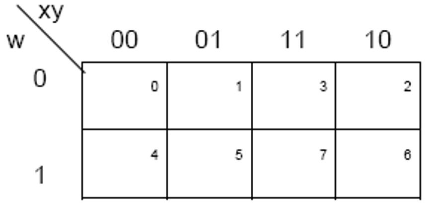

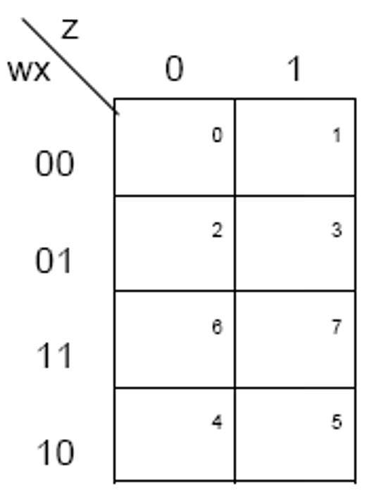

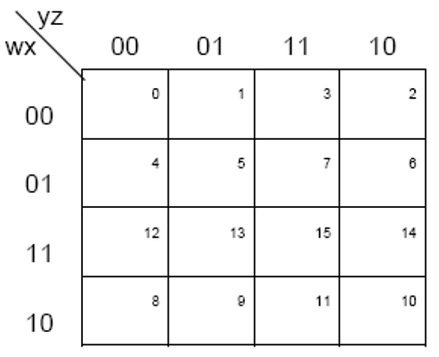

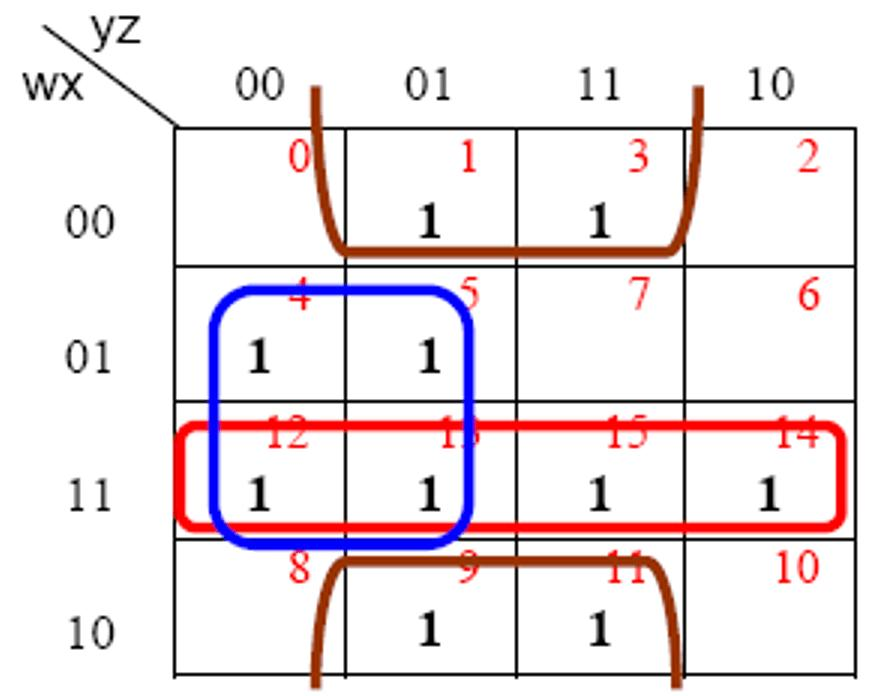

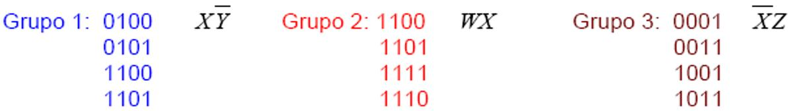

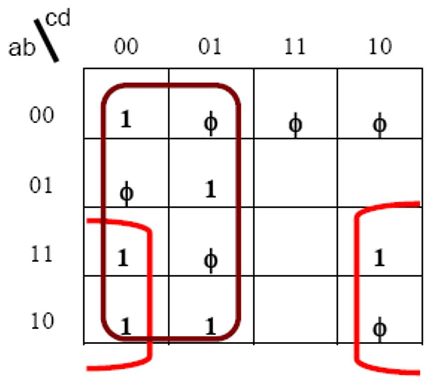

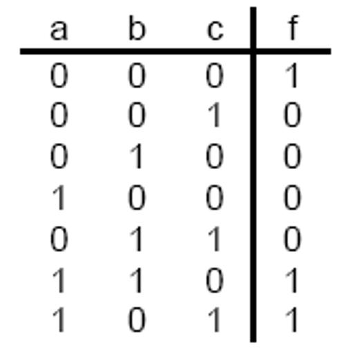

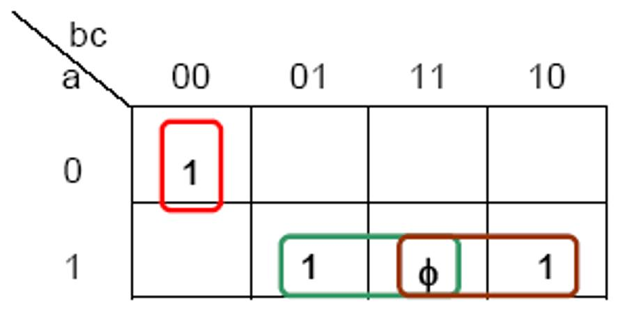

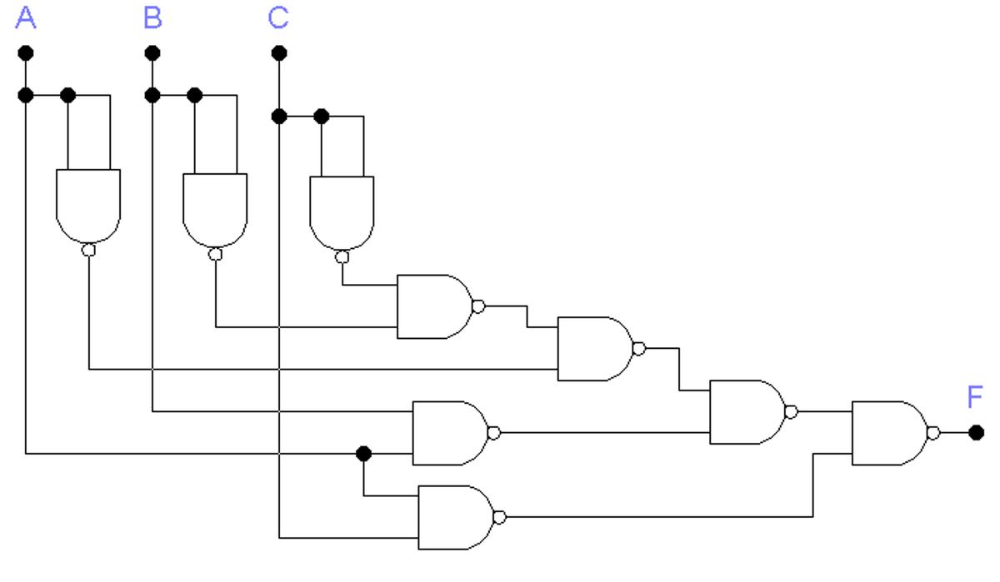

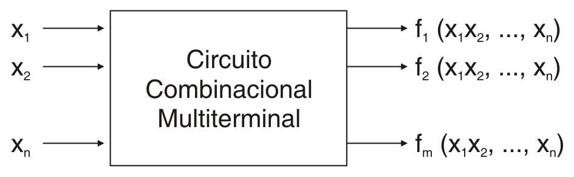

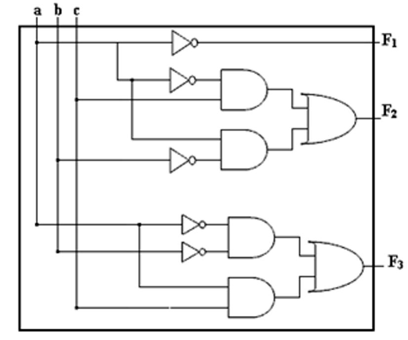
