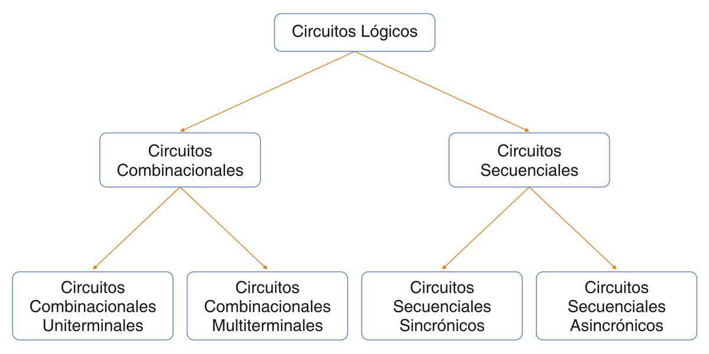
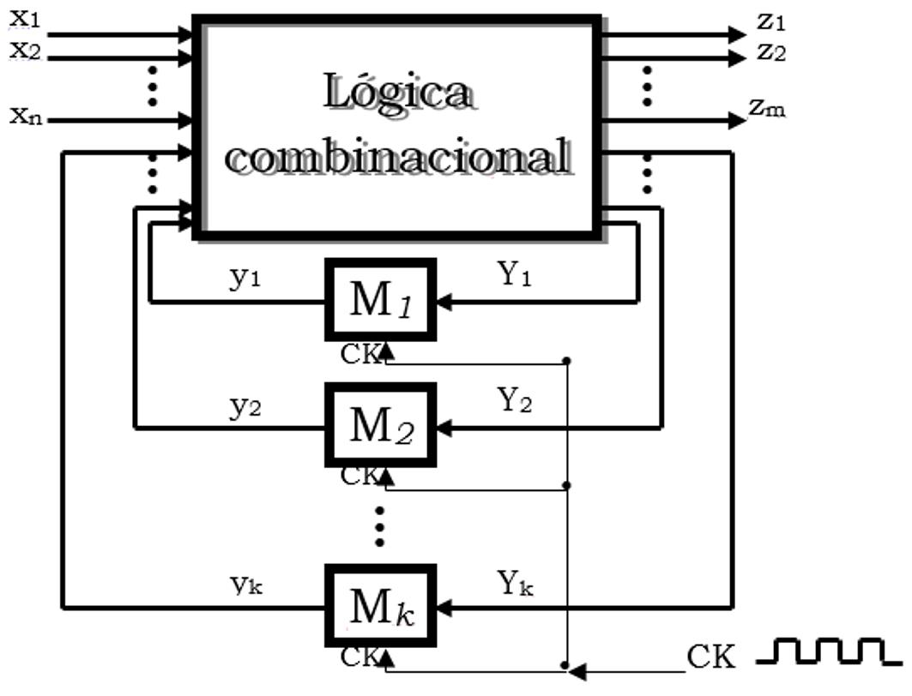
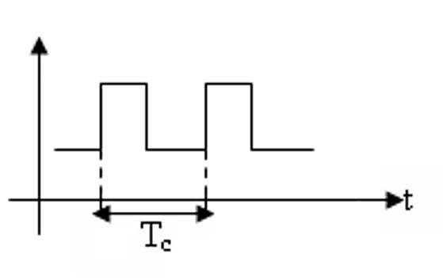
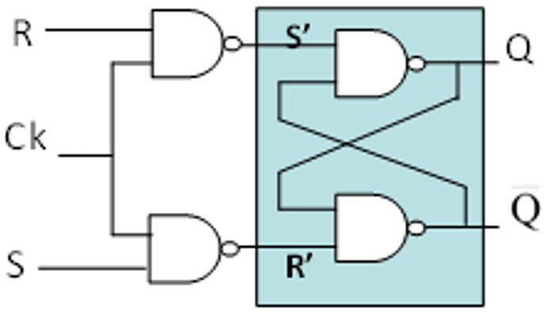
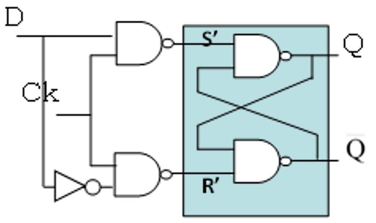
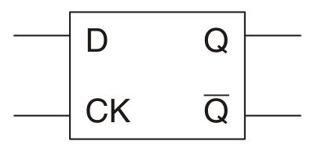
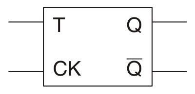
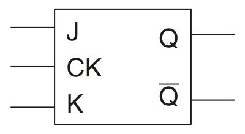
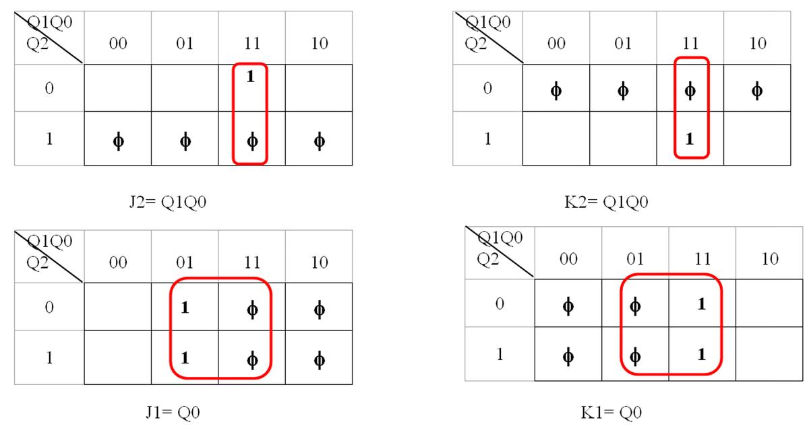
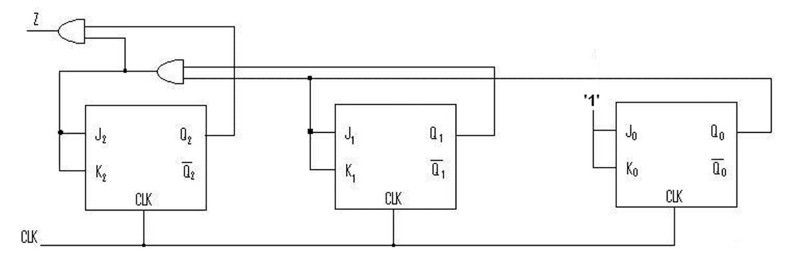

# 7. Circuitos Secuenciales Sincrónicos (CSS)

**Presentación relacionada:** [Tema 7](../Tema%207/README.md) · [Tema 7 - Ejercicios](../Tema%207%20-%20Ejercicios/README.md)

## Objetivo

- Describir las estructuras, características y funcionamiento de los biestables RS, D, T y JK y su
uso en el diseño de contadores sincrónicos.

## 7.1. Introducción

En clases anteriores se conoció que los circuitos lógicos se dividen en 2 grupos, los combinacionales y los secuenciales, como se puede apreciar en el siguiente esquema.

- Circuitos combinacionales: el valor de la salida depende del estado de las entradas, es decir
de la combinación de las entradas.

- Circuitos secuenciales: el valor de la salida depende del estado de las entradas y del estado
anterior de la propia salida, es decir de la secuencia por la que haya pasado la salida.

En la conferencia de hoy comenzará el estudio del otro grupo de circuitos lógicos, los circuitos secuenciales, y específicamente los circuitos secuenciales sincrónicos.

## 7.2. Circuitos secuenciales sincrónicos

Son aquellos CSS en los que las salidas sólo cambian en instantes de tiempo gobernados por pulsos de otro circuito que recibe el nombre de reloj. Ejemplos de CSS: Contadores, registros, detectores de secuencias.

Diagrama general de un CSS:

Para que el valor de salida en un instante t influya en el valor de t+1 es necesario guardar o memorizar esta información.

De ahí la necesidad de incorporar elementos de almacenamiento binarios llamados biestables.

Los circuitos combinacionales se rigen por las leyes ya revisadas anteriormente.

Las entradas de este circuito son de dos tipos: las entradas externas (X) y las entradas internas (y) que provienen de los elementos de almacenamiento (el estado anterior de la salida). También tiene dos tipos de salidas: las externas y las internas que son las entradas de los elementos de memoria.

Señal del Reloj El elemento que sincroniza la operación del circuito se le llama reloj (CK).Es una señal eléctrica periódica formada por pulsos. Cuando se activa la entrada de reloj de los biestables la información presente en las entradas de los biestables es almacenada.

Forma de Ondas Tc: Período de reloj Existe una frecuencia Máx de reloj, la cual depende del tipo de CSS.

## 7.3. Biestables

Los Biestables son circuitos secuenciales sincrónicos que almacenan información binaria. Sus salidas pueden encontrarse en uno de los estados estables (1 ó 0 lógico), razón por la cual pueden almacenar un bit de información. Típicamente presentan 2 ó más entradas, así como 2 salidas complementadas Q y Q.

Las señales de reloj para los sistemas digitales se obtienen de cristales de cuarzo debidamente cortados y armados. Este material tiene la propiedad de emitir impulsos eléctricos si se le deforma. Debidamente tratado, un cristal de cuarzo puede generar pulsos de gran precisión en el orden de los MHz (Millones de veces por segundo).

Tipos de biestables: se conocen por el nombre que se le da a sus entradas. 1.

RS 2.

D 3.

T 4.

JK

### 7.3.1. Biestable rs (reset-set)

Se construye con compuertas NAND o NOR con o sin reloj. Por ser RS el biestable más sencillo se tomará como referencia para establecer las ideas básicas para la compresión del funcionamiento de otros biestables. El biestable RS posee 2 entradas R y S que llaman RESET y SET respectivamente.

Biestable RS con reloj Se analizará la influencia del reloj en el funcionamiento del circuito.

Si CK=0 S' y R'= 11 es un RS sin CK, mantiene el estado.

Si CK=1. La salida depende de R y S.

CK=1 Reloj activo.

CK=1 RS =00 S' R'=11 Mantiene el estado.

Ck=1 RS =11 S' R'=00 Prohibido.

Tabla Característica Ck R S Qn+1 0 x x Qn 1 0 0 Qn 1 0 1 0 1 1 0 1 1 1 1 --

### 7.3.2. Biestable d

Almacenador por excelencia ya que no cambia la información. Es un biestable basado en el RS, resolviendo el problema del estado prohibido de este. Se unen las entradas a través de un negador y queda el circuito tal y como se muestra debajo.

La tabla característica de un biestable es lo mismo que su tabla de la verdad y la tabla de excitación permite conocer a partir del valor del estado actual de la salida (Qn) y del posible valor del estado siguiente de ella, el valor que tomará la entrada. Esto último es muy útil a la hora de diseñar contadores, como se expondrá más adelante.

Tabla Característica Tabla Excitación Ck D Qn+1 Qn Qn+1 D 0 x Qn 0 0 0 1 0 0 0 1 1 1 1 1 1 0 0 1 1 1 Representación gráfica de un biestable D:

### 7.3.3. Biestable t (trigger)

Compara bit a bit el estado inicial con el estado final, si son iguales pone un cero, sino pone un 1.

Tabla Característica Tabla Excitación T Qn+1 Qn Qn+1 T 0 Qn 0 0 0 1 Qn 0 1 1 1 0 1 1 1 0 Representación gráfica de un biestable T:

### 7.3.4. Biestable jk

Este tipo de biestable es el más utilizado y se fabrica con más variedad. Se utiliza para aplicaciones generales de circuitos digitales, y es muy versátil. Resuelven el problema de la indeterminación de los biestables de dos entradas, como el RS.

Tabla Característica Tabla Excitación J K Qn+1 0 0 0  0 0 Qn 0 1 1  0 1 0 1 0  1 1 0 1 1 1  0 1 1 Qn 0 0 0  Representación gráfica de un biestable JK:

Por razones históricas, la bibliografía en inglés denomina flip-flops a los biestables.

## 7.4. Contadores

Los contadores son circuitos secuenciales que tienen una amplia aplicación en la técnica digital, y por ende en el mundo de los computadores. Entre sus aplicaciones pueden citarse, su utilización como divisores de frecuencia, como contadores de programas en sistemas con microprocesadores, en sistemas de comunicación y como controladores en el diseño de relojes y otras máquinas de estado.

La estructura interna de un contador está formada por una cadena de biestables y la lógica combinacional necesaria para controlar su funcionamiento.

Comercialmente hay una gran variedad de contadores disponibles. Entre ellos pueden citarse los contadores sincrónicos binarios 74x161, 74x163 y 74x169 así como los contadores sincrónicos decimales 74x160 y 74x162.

Definiciones básicas  Contador: circuito secuencial que almacena la información del número de pulsos de reloj que han sido aplicados a su entrada y regresa a su estado inicial. Generalmente brinda un pulso de salida por cada n pulsos de entrada.  Base de un contador: cantidad de estados diferentes del contador.

Ej. Contadores base 4: 0, 1, 2, 3  0 0, 2, 4, 6  0 4 estados diferentes y vuelve a su estado inicial. 5, 9, 12, 13  5  Clasificación de los contadores: 1. Forma de trabajo: sincrónicos y asincrónicos. 2. Forma de conteo: ascendente, descendente y ascendente - descendente. 3. Base de conteo: $2^n$ y  $2^n$.

Para diseñar un contador, se utilizará un ejemplo por lo interactivo que resulta. Deben tenerse en cuenta los conocimientos adquiridos con anterioridad, tales como el uso de la tabla de la verdad, diseño de circuitos multiterminales y álgebra de Boole.

EJEMPLO Diseñe un contador base 8 ascendente con estado inicial 0 y que dé un pulso en 1 cuando llegue al final de conteo. Utilice biestables JK.

El contador debe ser capaz de contar a partir del 0, 8 estados, por ejemplo del 0 al 7 y producir un pulso de salida Z = 1 cada 8 pulsos de entrada. Después del conteo de 7 el próximo pulso de entrada debe regresar al contador a su estado inicial, o sea, al conteo de cero.

El conteo será 0, 1, 2, 3, 4, 5, 6, 7 regresa al 0.

Método de diseño de contadores 1.

Asignación de estados y determinar el número de biestables.

La asignación de estado se realiza por el código binario de los estados por donde pasa el contador y la cantidad de biestables se determina por los bits necesarios para el mayor estado. 0 000 1 001 2 010 y así sucesivamente, el mayor estado es el 7 (111) lo que implica que se necesitan 3 biestables. 2.

Tabla de Transición.

Expresa las transiciones en cada biestable para formar las combinaciones de cada estado.

Se conforma indicando el estado en que está el contador y el estado siguiente deseado.

Estado Actual Estado Siguiente y2 y1 y0 Y2 Y1 Y0 Z 0 0 0 0 0 1 0 0 0 1 0 1 0 0 0 1 0 0 1 1 0 0 1 1 1 0 0 0 1 0 0 1 0 1 0 1 0 1 1 1 0 0 1 1 0 1 1 1 0 1 1 1 0 0 0 1

3.

Tabla de excitación.

Indica cómo deben excitarse las entradas para provocar las transiciones deseadas en las salidas. Se obtiene partir de la tabla de transición del circuito y de la tabla de excitación del biestable.

Para llenar la tabla de excitación, al biestable 2 le corresponde un cambio del Estado Actual (y2) = (Qn) al Estado Siguiente (Y2) = (Qn+1), con esos valores se va a la tabla de excitación del biestable y se toman los valores de J y K para esa combinación de Qn y Qn+1.

A los otros biestable le corresponden las otras columnas.

Tabla de excitación del Biestable JK y Y Qn Qn+1 J K 0 0 0  0 1 1  1 0  1 1 1  0 - y2 y Y2 = 00 en la TE del biestable para la combinación 00 JK toman valor 0. - y0 y Y0 = 01 en la TE del biestable para la combinación 01 JK toman valor 1.

Y así sucesivamente para cada combinación de entrada se ponen los valores de las entradas para cada biestable. La tabla completa quedaría de la siguiente manera.

Q2 Q1 Q0 J2 K2 J1 K1 J0 K0 0 0 0 0  0  1  0 0 1 0  1   1 0 1 0 0   0 1  0 1 1 1   1  1 1 0 0  0 0  1  1 0 1  0 1   1 1 1 0  0  0 1  1 1 1  1  1  1 4.

Simplificar las funciones por el Método de los Mapas Karnaugh.

Los resultados obtenidos son los siguientes: - J0 = K0 = 1 - J1 = K1 = Q0 - J2 = K2 = Q1Q0 - Z = Q2Q1Q0 Note que en este caso J=K=T, funciona como un biestable T: - T0= 1 - T1=Q0 - Tn= Q0Q1…Qn-1 - Z= Q0Q1…Qn-1Qn 5.

Diseñar el circuito. - Para diseñar el contador primeramente se representan los 3 biestables que se determinaron en el paso 1 (para este caso tipo JK). - Como el circuito es sincrónico, todas las señales de reloj se conectan a un generador de pulsos (señal de reloj). - Luego se representan en el circuito, las ecuaciones encontradas para J y K.

Puesto que es posible modificar a voluntad los estados de los biestables conectados en circuito, estos se emplean para construir memorias especiales llamadas registros. Los registros son fundamentales para el funcionamiento de los sistemas de cómputo modernos. Baste decir que todas las operaciones posibles requieren el uso de los registros como intermediarios para almacenamiento temporal o cálculo.

## 7.5. Conclusiones

En la clase de hoy se comenzó el estudio de los CSS, viendo la definición de circuitos sincrónicos, los diferentes tipos de biestables que existen, así como su tabla característica y su tabla de excitación. Además se vio una de las aplicaciones de los CCS, los contadores, se conocieron sus aplicaciones prácticas y método de diseño.

# Resumen

