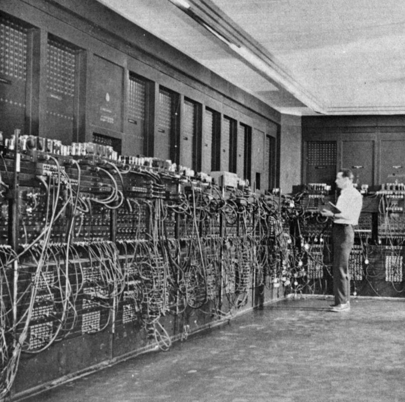
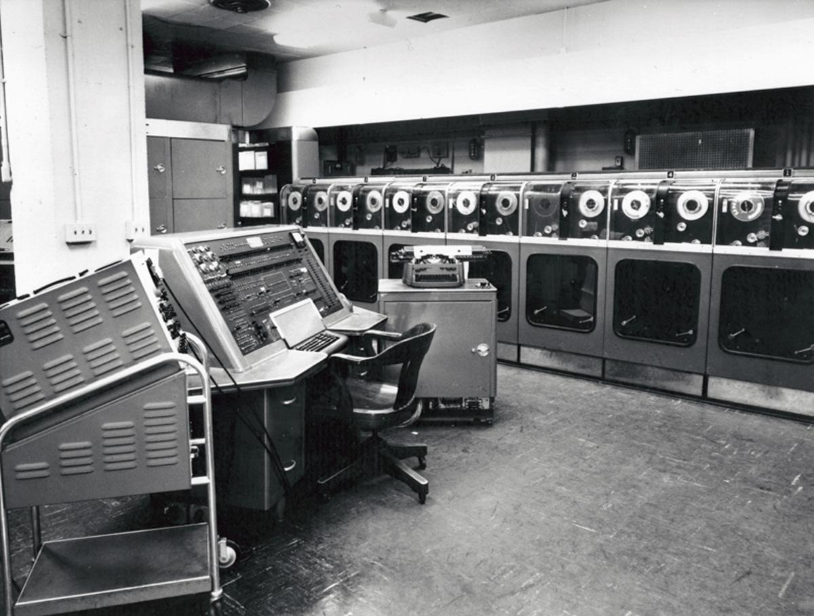
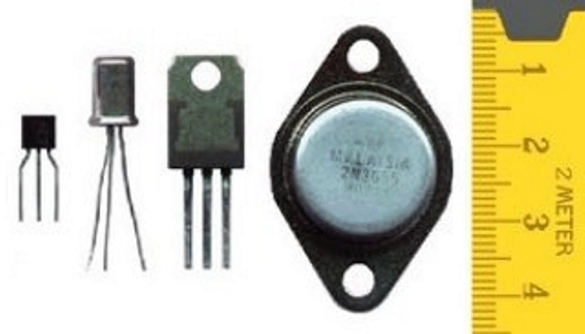
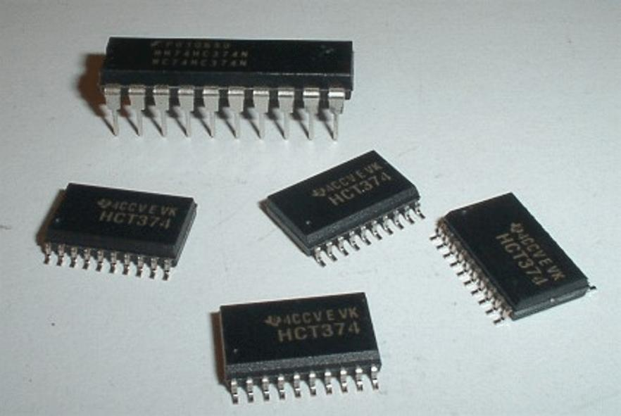

# 1. Evolución y características de los sistemas de cómputo

**Presentación relacionada:** [Tema 1 y 2](../Tema%2001%20y%2002/README.md)

## Objetivo

- Describir la evolución y características de los sistemas de cómputo.

## 1.1. Introducción

Un computador es un sistema complejo, capaz de realizar múltiples tareas. Desde sus inicios, han sido desarrollados de forma rápida e incesante, lo que ha permitido que en la actualidad se tengan dispositivos con elevadas capacidades de trabajo. A pesar de la evolución, las tareas que realizan los computadores, básicamente pueden ser resumidas en: procesamiento de datos, almacenamiento de datos, transferencia de datos y control de las operaciones mencionadas.

> Todavía es común utilizar los términos ordenador, computador y computadora para referirse a laptops, PCs de escritorio y servidores. En realidad cualquier dispositivo que sea capaz de ejecutar un programa es una computadora: teléfonos móviles, calculadoras científicas, televisores digitales y hasta un enrutador wifi.
>
> Téngase en cuenta que la más modesta de las tabletas modernas tiene más poder de cálculo que las computadoras que se utilizaron en las misiones Apollo.

Por su importancia, este curso empieza con una breve historia de los computadores. Además de caracterizar los antecesores de los computadores actuales, servirá para proporcionar una visión general de la estructura y funcionamiento de un sistema de cómputo.

## 1.2. ENIAC: el primer computador electrónico

El primer computador electrónico de propósito general del mundo, fue conocido como ENIAC (del inglés Electronic Numerical Integrator and Computer). Fue diseñado y construido bajo la supervisión de John Mauchly y John Presper Eckert en la Universidad de Pennsylvania.

El proyecto fue una respuesta a las necesidades del Laboratorio de Investigación de Balística (del inglés BRL) del ejército de los Estados Unidos durante la Segunda Guerra Mundial. El BRL era una agencia responsable del desarrollo de tablas de tiro y de trayectoria para nuevas armas y tenía dificultades para elaborarlas con exactitud y en poco tiempo.

La ENIAC fue el primer computador sin componentes mecánicos en sus circuitos.

Antes de ENIAC se habían creado varios ordenadores como los Z1 y Z3 de Conrad Zuse en Alemania y la famosa Bomba con la que se descifraron los códigos del ejército alemán.

Estas computadoras se denominaban electromecánicas porque sus circuitos funcionaban con relés (interruptores automáticos) lo que limitaba su velocidad y escalaba su consumo eléctrico; también eran bastante ruidosas.

Mauchly, fue un catedrático de Ingeniería Eléctrica de la Universidad de Pennsylvania, y Eckert, uno de sus alumnos de licenciatura. Para la construcción del computador, propusieron utilizar tubos de vacío y recibieron aceptación por el ejército en 1943.

La máquina que construyeron era enorme, pesaba treinta toneladas, ocupaba 15 000 pies cuadrados y contenía más de 18 000 tubos de vacío. Cuando funcionaba consumía 140 Kilowatios de potencia y era capaz de efectuar 5 000 sumas por segundo.

El ENIAC era una máquina decimal y no binaria. Es decir, los números estaban representados en forma decimal y la aritmética se realizaba también en el sistema decimal. Su memoria consistía en veinte “acumuladores”, cada uno capaz de contener un número decimal de diez dígitos. Cada dígito estaba representado por un anillo de diez tubos de vacío. En un momento dado, solo uno de los tubos de vacío estaba en “estado ON”, representando uno de los diez dígitos. Uno de sus mayores inconvenientes era que tenía que ser programado manualmente mediante conmutadores y conectando y desconectando cables.

Con un costo cercano al medio millón de dólares, el ENIAC se terminó en 1946, demasiado tarde para ser utilizado durante la guerra. Por tanto, su primera misión fue realizar una serie de cálculos complejos que se usaron para ayudar a determinar la viabilidad de la bomba de hidrógeno. El uso del ENIAC para una función distinta para la que fue construido demostró su naturaleza de propósito general. Así, 1946 marcó el comienzo de la nueva era de los computadores electrónicos.

El ENIAC siguió funcionando bajo la dirección del BRL hasta 1955, cuando fue desmontado.

**Figura 1.1.** El ENIAC.

## 1.3. Primera generación de computadores comerciales: el tubo de vacío

La primera generación de computadores electrónicos comerciales estuvo comprendida entre los años 1946 y 1958. El componente principal utilizado en la fabricación de estas, fue el tubo de vacío. El primer producto de esta generación fue ya mencionado ENIAC, sin embargo, la primera computadora comercial fue el UNIVAC I (Universal Automatic Computer), diseñada al igual que el ENIAC por Eckert y Mauchly.

En 1947 Eckert y Mauchly formaron la Eckert - Mauchly Computer Corporation para fabricar computadores con fines comerciales. Su primera máquina de éxito fue el UNIVAC I, que fue empleada por la oficina del censo de los Estados Unidos para sus cálculos en 1950. Este computador, estaba diseñado, tanto para aplicaciones científicas como comerciales. Podía realizar operaciones algebraicas con matrices, problemas de estadística, reparto de primas para las compañías de seguros de vida y problemas logísticos.

Posteriormente la Eckert - Mauchly Computer Corporation formó parte de la división UNIVAC de la Sperry - Rand Corporation, otra de las pioneras de la reciente industria de computadores. Sperry - Rand Corporation siguió construyendo una serie de máquinas sucesoras de la UNIVAC I.

El UNIVAC II, que tenía una capacidad de memoria mayor y más aplicaciones que el UNIVAC I, salió al mercado al final de los cincuenta e ilustra varias tendencias que han permanecido como características de la industria de computadores. Primera, los avances en la tecnología permiten a las compañías seguir construyendo computadores más grandes y más potentes. Segunda, cada compañía intenta hacer sus nuevas máquinas superiores y compatibles con las anteriores. Esto significa que los programas escritos para las viejas máquinas pueden ejecutarse en las nuevas máquinas. Esta estrategia se adopta para retener la base de clientes; es decir, que cuando un cliente decide comprar una máquina nueva, probablemente la comprará a la misma compañía para evitar perder su inversión en programas.

Los primeros ordenadores se programaban soldando y conectando literalmente.

Varios operadores hacían las conexiones eléctricas que representaban el programa a ejecutar. El resultado eran números y cifras que debían ser decodificados por otros operadores para entregarlos al programador original. Las combinaciones posibles de estas soldaduras, conexiones y códigos se denominaron lenguaje o código máquina. Todas las computadoras modernas tienen su propio lenguaje de máquina que por suerte necesita utilizarse muy poco gracias a herramientas llamadas compiladores.

En este período otra compañía se convirtió en el principal fabricante de equipos de procesamiento con tarjetas perforadas: IBM. En 1953 sacó su primer computador con programas almacenados electrónicamente, el 701, que fue diseñado principalmente para aplicaciones científicas. En 1955, presentó los productos 702, que tenían varias características hardware que lo hacían adecuado para aplicaciones de gestión. Estos fueron los primeros de una larga serie de computadores 700/7000 que situaron a IBM como el principal fabricante de computadores, con gran dominio del mercado.

**Figura 1.2.** El UNIVAC 1.

## 1.4. Segunda generación: los transistores

La segunda generación de computadores electrónicos comenzó con la introducción del transistor y fue el primer cambio importante en el diseño de estos dispositivos. El transistor es un componente más pequeño que los tubos de vacío, por lo que utiliza menos espacio en la placa de montaje de componentes (placa de circuitos impresos) y por tanto abarata costos de fabricación, además de ser barato de por sí su fabricación y precio de venta. Al ser un componente integrado es más fiable, opera a mayor velocidad, consume menos energía y por tanto disipa menos calor.

Mientras que un tubo de vacío requiere cables, placas de metal, una cápsula de cristal y vacío, el transistor es un dispositivo de estado sólido, hecho con silicio.

Resulta tan importante la creación del transistor porque se comenzó a explotar los materiales semiconductores. Además de reducir el espacio en el circuito, el calor producido y la complejidad de los componentes, los transistores posibilitaron la miniaturización que devino en reducción de costos y consumo eléctrico.

El transistor fue inventado en los Laboratorios Bell en 1947 y en los años cincuenta provocó una revolución electrónica. Sin embargo, los computadores completamente transistorizados no estuvieron disponibles comercialmente hasta el final de los cincuenta. IBM no fue la primera compañía que lanzó esta nueva tecnología. La compañía NCR, y con más éxito RCA, fueron los primeros en sacar pequeñas máquinas de transistores. IBM los siguió pronto con la serie 7000.

**Figura 1.3.** Transistores.

En la segunda generación hubo otros cambios sustanciales. Se introdujeron unidades lógicas y aritméticas y unidades de control más complejas, el uso de lenguajes de programación de alto nivel y se proporcionó un software del sistema con el computador. En esta generación la velocidad de procesamiento aumentó respecto a la anterior, aumentó la capacidad de memoria y el tamaño del computador disminuyó.

## 1.5. Tercera generación: los circuitos integrados

Durante los años cincuenta y principios de los sesenta, los equipos electrónicos estaban compuestos en su mayoría por transistores, resistencias, capacidades, entre otros. A éstos se les llamaba componentes discretos y se fabricaban separadamente, encapsulados de forma individual y soldados o cableados juntos en tarjetas de circuitos en forma de panel, que eran instalados en los computadores. Cuando un dispositivo necesitaba un transistor, había que soldarlo, haciendo que el proceso desde la fabricación del transistor, hasta el panel de circuitos era caro y engorroso.

Un circuito grande requiere innumerables soldaduras y es propenso a calentarse y ser afectado por la humedad y la suciedad. Los circuitos integrados son esos rectángulos de colores oscuros con decenas y cientos de conectores metálicos.

Dentro de estos encapsulados plásticos se coloca un circuito compuesto por miles o millones de componentes, todos ellos basados en el mismo principio que el primer transistor. La reducción de los componentes también hace posible muy altas velocidades de operación. En un microprocesador moderno, un solo transistor puede realizar varios cambios de estado antes de que rayo de luz recorra una distancia equivalente al tamaño del encapsulado.

Estos hechos fueron el comienzo del surgimiento de problemas en la industria de computadores.

Los primeros computadores de la segunda generación contenían alrededor de 10000 transistores. Esta cantidad creció a cientos de miles, haciendo cada vez más difícil la fabricación de máquinas nuevas y más potentes.

En 1958 ocurrió algo que revolucionó la electrónica: la invención del circuito integrado, dando inicio así a la era de la microelectrónica y a la tercera generación de computadores.

**Figura 1.4.** Circuitos integrados.

Para el diseño de circuitos integrados, se partió del hecho de que componentes como transistores, resistencias y conductores podían ser fabricados a partir de un semiconductor como el silicio. La solución consistió en fabricar todos los componentes de un circuito en un material de silicio. Se pueden construir cientos e incluso miles de transistores al mismo tiempo en un mismo material de silicio e integrar varios tipos de circuitos en uno solo. La integración de varios circuitos permitió disminuir la cantidad de conexiones dentro del computador, elevando la fiabilidad y bajando costos.

Así, los circuitos integrados comenzaron a reemplazar a los transistores en los computadores por sus atractivas características: muy bajo consumo eléctrico, compactos, bajo costo, confiables y con elevadas velocidades de operación.

Dentro de los computadores que se diseñaron sobre la base de circuitos integrados, se encuentra la familia del IBM Sistema/360 y el PDP-8 de DEC. Ambos marcaron hitos en su generación por sus revolucionarios diseños.

El Sistema/360 fue la primera familia de computadores de la historia que se planeó y abarcaba un amplio rango de prestaciones y precios. Los distintos modelos eran compatibles en el sentido de que un programa escrito para un modelo, tenía que ser capaz de ser ejecutado por otro de la serie, con la única diferencia del tiempo de ejecución. Este concepto de familia de computadores compatibles fue a la vez novedoso, arriesgado y extremadamente exitoso.

Las principales características de la familia Sistema/360 fueron:

- Conjunto de instrucciones similar o idéntico: en muchos casos, se encuentran exactamente el mismo conjunto de instrucciones de máquina en todos los miembros de la familia. Así, un programa que se ejecuta en una máquina, se podrá ejecutar en cualquier otra. En algunos casos el computador más bajo de la familia tiene un conjunto de instrucciones que es un subconjunto del computador más alto de la familia. Esto quiere decir que los programas se pueden mover hacia arriba pero no hacia abajo.
- Sistemas operativos similares o idénticos: el mismo sistema operativo básico está disponible para todos los miembros de la familia. En algunos casos, se añaden características complementarias a los miembros más altos.
- Velocidad creciente: la velocidad de ejecución de las instrucciones se incrementa conforme se sube desde los miembros más bajos a los más altos de la familia.
- Número creciente de puertos de E/S: conforme se va desde lo más bajo a los más alto de la familia.
- Tamaño de memoria creciente: conforme se va de lo más bajo a lo más alto de la familia.
- Coste creciente: conforme se va de lo más bajo a lo más alto de la familia.

Los miembros bajos de la familia de los que se hace alusión más arriba son los de menores prestaciones y los más altos son los de mejores características de trabajo. Nótese que muchas de estas características han perdurado hasta la actualidad en las diferentes familias de computadores de la mayoría de los fabricantes de la industria. Por tal razón se considera que la familia que de los computadores Sistema/360 es un referente en la historia de los computadores.

Una consecuencia importante del uso de los circuitos integrados fue la estandarización. Como se encapsulan determinadas funcionalidades en un solo componente, varios fabricantes pueden dotar a sus sistemas de iguales prestaciones y por tanto ser compatibles entre sí.

Esto resultó así no solo para los ordenadores y sus arquitecturas, también para los dispositivos de entrada/salida que se requieren en su manejo.

En el mismo año que IBM lanzó su primer Sistema/360 tuvo lugar otro lanzamiento trascendental: el PDP-8 de DEC. En aquella época, cuando la mayoría de los computadores requerían una habitación con aire acondicionado, el PDP-8 (llamado por la industria minicomputador) era lo suficientemente pequeño para ser colocado en sobre una mesa de laboratorio o sobre otro equipo. No podía hacer todo lo que hacían los grandes computadores, pero era lo suficientemente barato para que cada técnico de laboratorio tuviera uno.

El PDP-8 fue un éxito inmediato y logró posicionar a DEC en posiciones cimeras dentro del mercado. Esta máquina y los otros miembros de la familia PDP-8 que la siguieron lograron un estatus de producción antes reservado a los computadores IBM, con alrededor de 50 000 máquinas vendidas en los siguientes doce años.

En contraste con la arquitectura de conmutador central usada por IBM en sus sistemas 700/7000 y 360, los últimos modelos del PDP-8 usaban una estructura que ahora es prácticamente universal para minicomputadores y microcomputadores: la estructura de bus. Esta característica también hace que el PDP-8 sea otro referente en la historia de los computadores.

## 1.6. Últimas generaciones

Más allá de la tercera generación hay menos acuerdo general en la definición de las generaciones de computadores. En la tabla 1.1 se sugieren las que serían la cuarta y la quinta generación, basadas en los avances de la tecnología de los circuitos integrados (CI). Con la introducción de la integración a gran escala (LSI, Large - Scale Integration), podía haber más de 1 000 componentes en un circuito integrado. Con la integración a muy gran escala (VLSI, Verv - Large Scale Integration), se lograron más de 10 000 componentes por integrado y en la actualidad pueden contener más de 100 000.

**Tabla 1.1.** Generaciones de Computadores.

| Generación | Fechas aproximadas | Tecnología | Velocidad típica (operaciones/segundo) |
| --- | --- | --- | --- |
| 1 | 1950 – 1958 | Tubos de vacío | 40 000 |
| 2 | 1958 – 1964 | Transistores | 200 000 |
| 3 | 1965 – 1971 | CI de pequeña y media integración | 1 000 000 |
| 4 | 1972 – 1977 | CI de gran integración (LSI) | 10 000 000 |
| 5 | 1978 – 1991 | CI de alta integración (VLSI) | 100 000 000 |
| 6 | 1991 – | CI de ultra alta integración (ULSI) | 1 000 000 000 |

Con el gran avance de la tecnología, la rápida introducción de nuevos productos, la importancia del software y las comunicaciones, así como del hardware, la clasificación en generaciones se vuelve cada vez menos clara y menos significativa. Sin embargo, la introducción de dos componentes ha sido lo más destacado de este período: la memoria semiconductora y el microprocesador.

### 1.6.1. Memoria semiconductora

En los años cincuenta y sesenta, la mayoría de las memorias de los computadores se hacían con pequeños anillos de material ferromagnético, cada uno de un dieciseisavo de pulgada de diámetro. Estos anillos de ferrita se insertaban en mallas de finos cables enlazados en pequeños marcos dentro del computador.

Se magnetizaba en un sentido el anillo (llamado núcleo) y representaba un uno, magnetizado en el otro sentido, representaba un cero. Esta memoria era rápida, tardaba tan poco como una milésima de segundo en leer un bit almacenado en memoria. Pero era cara, voluminosa y usaba lectura destructiva: el simple hecho de leer un núcleo borraba los datos almacenados en él. Era, por consiguiente, necesario hacer circuitos que recuperaran el dato tan pronto como se extraía.

Para resolver el problema anterior, en 1970, Fairchild produjo la primera memoria semiconductora con relativa capacidad. Este circuito integrado, del tamaño de un núcleo de ferrita, podía tener 256 bits de memoria. Era no destructiva y mucho más barata. Tardaba solamente setenta mil millonésimas de segundo en leer un bit. Sin embargo, el coste por bit era mayor que el de un núcleo de ferrita.

En 1974 el precio por bit de memoria semiconductora cayó por debajo del precio por bit de memoria de núcleo. Siguiendo esto, ha habido una continua disminución del precio de la memoria acompañado de un correspondiente aumento de su densidad. Esto ha llevado, en pocos años, a hacer máquinas más pequeñas y más rápidas con el mismo tamaño de memoria que máquinas más grandes y más caras.

A partir de 1970 la memoria semiconductora ha tenido varias generaciones: 1K, 4K, 16K, 64K, 256K, 1M, 4M, 16M, 64M, 256M, 1G y ahora varios gigabytes en un solo circuito integrado. Cada generación ha proporcionado cuatro veces más densidad de almacenamiento que la generación previa, junto con un menor coste por bit y una mayor velocidad de acceso.

El término bit procede de la contracción binary digit o dígito binario. Todas las computadoras modernas son binarias, significando que son máquinas numéricas basadas en este sistema de numeración. El bit es por tanto la unidad de información y el símbolo básico que solo puede tener dos estados. Estos estados corresponden a niveles de voltaje diferentes, pero por simpleza se les denomina estado cero(0) y estado uno(1). De ahí la expresión “las computadoras solo entienden ceros y unos”.

### 1.6.2. Microprocesador

El primer microprocesador fue desarrollado por INTEL en 1971, el 4004. Fue el primer circuito integrado que contenía todos los componentes de la CPU en un sola cápsula. El 4004 podía sumar dos números de cuatro bits y multiplicar solo con sumas sucesivas.

El siguiente paso importante en la evolución de los microprocesadores fue la introducción en 1972 del INTEL 8008. Este fue el primer microprocesador de ocho bits y era casi dos veces más complejo que el 4004.

En 1974 INTEL introdujo el microprocesador 8080. Este fue el primer microprocesador de uso general. Mientras que el 4004 y el 8008 habían sido diseñados para aplicaciones específicas, el 8080 fue diseñado para ser la CPU de un microcomputador de propósito general. Al igual que el 8008, el 8080 es un microprocesador de ocho bits. El 8080, sin embargo, es más rápido, tiene un conjunto de instrucciones más avanzado y tiene una capacidad de direccionamiento mayor.

Sobre la misma época empezaron a desarrollarse los microprocesadores de 16 bits. Sin embargo, hasta el final de los setenta no aparecieron estos potentes microprocesadores de propósito general. Uno de estos fue el 8086 de INTEL. El siguiente paso en esta tendencia ocurrió en 1981, cuando los Laboratorios Bell y Hewlett - Packard desarrollaron microprocesadores de 32 bits.

INTEL introdujo su primer microprocesador de 32 bits, el 80386, en 1985.

A continuación se hará énfasis en dos familias de procesadores que han tenido un papel muy importante en la industria de los computadores: INTEL y PowerPC. El Pentium representa el resultado de décadas de esfuerzo de diseño en computadores de repertorio complejo de instrucciones (CISC). PowerPC por su parte, es uno de los sistemas basados en el repertorio reducido de instrucciones (RISC) más potentes y mejor diseñados de la industria.

#### 1.6.2.1. Intel

Intel ha sido el número uno de los fabricantes de microprocesadores durante décadas, posición que ha mantenido por la calidad de sus productos. A continuación se presenta un resumen de las características de sus principales productos:

- 8080: procesador de ocho bits, con datos de memoria de ocho bits. Se uso en el primer computador personal, el Altair.
- 8086: tenía una caché de instrucción, o cola, que precaptaba algunas instrucciones antes de ser ejecutadas. Una variante de este procesador, el 8088, se utilizó en el primer computador personal de IBM, asegurando el éxito de Intel.
- 80286: esta ampliación del 8086 permitía direccionar una memoria de 16 MB en lugar de solo 1 MB.
- 80386: primer procesador de INTEL que admitió multitarea, significando esto que podría ejecutar varios programas a la vez.
- 80486: introduce el uso de tecnología de caché mucho más sofisticada y potente e instrucciones de segmentación. Incluyó un coprocesador matemático, liberando a la CPU de las operaciones matemáticas complejas.
- Pentium: introdujo el uso de técnicas superescalares que permiten que varias instrucciones se ejecuten en paralelo.
- Pentium Pro: continuó la tendencia iniciada con el Pentium hacia la organización superescalar, con el uso del renombrado de registros, predicción de ramificaciones, análisis del flujo de datos y ejecución especulativa.
- Pentium II: incorporó la tecnología INTEL MMX, que se diseñó específicamente para procesar de forma eficiente datos de vídeo, audio y gráficos.
- Pentium III: incorpora instrucciones adicionales en coma flotante para procesar software de gráficos 3D.
- Pentium 4: incluye coma flotante adicional y otras mejoras multimedia.
- Itanium: procesador con una organización de 64 bits con arquitectura IA-64, que se estudiará con más detalles posteriormente.
- Itanium II: esta actualización del Itanium, original incluye una serie de mejoras en el hardware para aumentar la velocidad.
- Procesadores de las serie Core: procesadores multinúcleos, arquitectura de 64 bits y memoria caché de varios niveles.

#### 1.6.2.2. PowerPC

En 1975, el proyecto minicomputador 801 de IBM fue el primero en muchos de los conceptos de arquitectura usados en sistemas con repertorio reducido de instrucciones (RISC). Era un prototipo que intentaba demostrar nuevos conceptos de diseño su éxito permitió a IBM desarrollar una estación de trabajo RISC comercial, el RT PC.

El RT PC, introducido en 1986, no tuvo mucho éxito. En 1990, IBM produjo un tercer sistema que incorporaba mejoras respecto al 801 y al RT PC nombrado RISC System/6000. Era una máquina superescalar RISC comercializada como una estación de trabajo de altas prestaciones, poco después de su introducción, IBM comenzó a llamarla arquitectura POWER.

Como siguiente paso, IBM se alió con Motorola, que había desarrollado las series 68000 de microprocesadores, y Apple, que usaba el chip de Motorola en sus computadores Macintosh. El resultado es una serie de máquinas que implementan la arquitectura PowerPC. Esta arquitectura se deriva de la arquitectura Power, a la cual se le hizo una implementación más eficiente eliminando algunas instrucciones. La arquitectura PowerPC resultante es un sistema RISC superescalar. Los miembros que hasta ahora se han presentado se resumen a continuación:

- 601: es una máquina de 32 bits.
- 603: pensado para computadores de aplicación final de sobremesa y portátiles. Es también una máquina de 32 bits, comparable en prestaciones con el 601, pero con coste más bajo e implementación más eficiente.
- 604: pensado para computadores de aplicación final de sobremesa y portátiles. También es una máquina de 32 bits, pero utiliza técnicas de diseño superescalares, mucho más avanzadas para lograr mayores prestaciones.
- 620: pensado para servidores de aplicación final. Primer miembro de la familia PowerPC que implementa una arquitectura completa de 64 bits, incluyendo registros y buses de datos de 64 bits.
- 740/750: también conocido como procesador G3. Integra dos niveles de caché en el procesador principal, ofreciendo mejoras significativas en las prestaciones sobre otras máquinas comparables con organización de caché fuera del chip.
- G4: incrementa el paralelismo y la velocidad interna del procesador.
- G5: introduce mejoras adicionales en el paralelismo, en la velocidad interna y constituye una organización de 64 bits.

#### 1.6.2.3. ARM

Casi el 99% de los dispositivos móviles actuales están basados en tecnologías desarrolladas por ARM. Estas con las siglas en inglés de Advanced RISC Machines Ltd. Es una compañía inglesa fundada en 1990 por Apple Computer, Acorn Computer Group y VLSI Technology. Dedicada al desarrollo de procesadores RISC, software y tecnologías relacionadas. Actualmente cubre casi el 85 % del mercado mundial de procesadores RISC.

Lo interesante es que ARM no fabrica los procesadores, solo los diseña y licencia sus diseños a los verdaderos fabricantes como Atmel, Cirrus Logic, Intel, Samsung, HP, IBM, Sony, etc.

Existen varias generaciones de procesadores ARM. Todas ellas diseñadas para ser utilizadas como unidad de control en sistemas embebidos denominados SOC (System on Chip) que consisten fundamentalmente en un contenedor de circuitos integrados que cubren prácticamente todas las funciones de un sistema de cómputo de propósito específico: reproductores multimedia, sistemas GPS, impresoras, fotocopiadoras.

Los sistemas RISC de ARM se caracterizan por el bajo consumo y el manejo inteligente de la programación. Las instrucciones que estos procesadores ejecutan siempre tienen un tamaño fijo y por tanto las demoras de ejecución son calculables. Por este motivo también se les emplea en tarjetas gráficas y hardware de tiempo real.

El modelo de negocios de ARM es el resultado de la evolución en la industria electrónica y su integración con la informática.

Los diseños de ARM se denominan Propiedad Intelectual y consisten a grandes rasgos en código fuente que describe la manera en que se deben construirse y conectarse los componentes integrados.

Los lenguajes utilizados para este propósito se denominan lenguajes de descripción del hardware. Uno de los lenguajes más conocidos y utilizados en este rubro es VHDL.

#### 1.6.2.4. Puntos claves de la evolución de los computadores

La evolución de los computadores se ha caracterizado por un incremento de la velocidad del procesador, una disminución del tamaño de los componentes, un aumento del tamaño de memoria, y un aumento de la capacidad de E/S y de la velocidad.

Otro factor responsable del gran aumento de la velocidad del procesador es la disminución del tamaño de los componentes del microprocesador: esto reduce la distancia entre componentes, y por tanto, aumenta la velocidad. Sin embargo, la verdadera ganancia en velocidad en los últimos años se debe a la organización del procesador, incluyendo un uso amplio de la segmentación del cauce, de las técnicas de ejecución paralela y del uso de técnicas de ejecución especulativa, que conducen a la ejecución tentativa de instrucciones futuras que se puedan necesitar. Todas estas técnicas se diseñan para mantener al procesador ocupado el mayor tiempo posible.

Otro asunto crítico en el diseño de computadores es hacer un balance de las prestaciones de los distintos elementos, de forma que esta ganancia en prestaciones en un área no perjudique a otras áreas. En particular, la velocidad del procesador ha aumentado más rápidamente que el tiempo de acceso a memoria. Se han usado distintas técnicas para compensar este desacoplo, incluyendo memorias caché, caminos de datos más anchos de la memoria al procesador y más circuitos de memoria inteligentes.

Finalmente se tienen, cada año, computadores más rápidos y con muy buenas prestaciones técnicas que hacen que los usuarios puedan desarrollar sus tareas con un uso racional del tiempo.

## 1.7. Conclusiones

En este material se ha mostrado una breve reseña de la evolución de los computadores y sus principales características. En este recorrido por la historia se presentaron las generaciones de computadores que han existido, así como los componentes fundamentales que han marcado el desarrollo de cada generación.

Un acápite fue dedicado a INTEL, el primero en fabricar un procesador y que en la actualidad mantiene el liderato mundial en el desarrollo y producción de estos componentes. Se habló también del Power PC, procesador de arquitectura RISC que también fue muy popular.

<!-- navegación -->

---

[Índice](README.md) | [Siguiente: Capítulo 2 →](Cap%C3%ADtulo%2002%20-%20Arquitectura%20y%20organizaci%C3%B3n%20de%20los%20sistemas%20de%20c%C3%B3mputo%20modernos.md)
