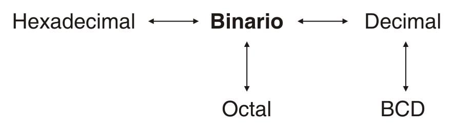

# 3. Sistemas de numeración

**Presentación relacionada:** [Tema 3](../Tema%2003/README.md) · [Tema 3 · Ejercicios](../Tema%2003/Ejercicios/README.md)

## Objetivos

- Conocer los sistemas de numeración.
- Realizar conversiones entre sistemas de numeración.

## 3.1. Sistema numérico binario

Los computadores digitales hacen un uso extenso del sistema de numeración binario. Este sistema es útil porque sólo utiliza dos dígitos, 1 y 0. Los dígitos binarios se emplean para representar los dos niveles de voltaje usados en los computadores, ALTO o BAJO. En la mayoría de los sistemas digitales el nivel de voltaje alto está representado por el 1, mientras que el nivel de voltaje bajo o cero volts lo está por el 0. El 1 representa el estado de ENCENDIDO de un interruptor, de una luz o de un transistor, mientras que el estado APAGADO está representado por un 0. Por otra parte, antes de manipular con una computadora digital un número decimal como el 32, es necesario convertirlo primero en binario, y representarlo mediante unos y ceros.

El sistema con el que las personas están más familiarizadas es el sistema decimal, ya que es el que utilizan cotidianamente. Por tanto, primero se examinarán las características de este sistema de numeración para luego compararlas con las del sistema binario. En el sistema decimal se trabaja con diez dígitos diferentes, del cero al nueve. Estos dígitos hacen que el sistema decimal sea un sistema de base 10. En el sistema binario se trabaja con dos dígitos distintos, 0 y 1, con lo que este sistema es un sistema de base dos.

Es tan común utilizar el sistema decimal que resulta difícil comprender la sencillez del sistema binario porque asociamos los símbolos al valor numérico que representan.

Los sistemas de numeración son algoritmos para representar valores numéricos mediante símbolos. Los mayas utilizaban un sistema de numeración vigesimal (veinte símbolos) y los egipcios uno sexagesimal (60 símbolos).

Para contar en el sistema decimal se comienza en la primera columna o lugar decimal con un 0, y se prosigue hasta 9. Una vez que el primer lugar está “lleno”, se pone un cero en dicha columna y se suma uno a la siguiente (a la izquierda). Después del 9 sigue el 10. Con esto la primera columna puede volver a “llenarse”. Después del 10 viene 11, 12, 13, etc. Cuando la primera columna se llena otra vez, se vuelve a hacer cero y se suma uno a la siguiente columna de la izquierda. Después del 19 sigue el 20. Cuando las dos columnas están llenas, se ponen ambas en cero y se suma uno a la siguiente columna de la izquierda. Después del 99 sigue el 100.

Para contar en binario se comienza en la primera columna, o posición binaria. Con 0 y se cuenta hasta 1. La primera columna se llena y se hace entonces cero, sumando uno a la siguiente columna de la izquierda. Después del 0 habrá un 1, es decir 10. Con esto, la primera columna puede volverse a llenar otra vez. Después del 10 sigue el 11. Las dos columnas están llenas. Se hacen cero ambas y se suma uno a la siguiente posición binaria a la izquierda. Después del 11 sigue el 100. Ahora la primera columna puede volverse a llenar otra vez. Después del 100 siguen 101, 110, 111, 1000, 1001, 1010, 1011, 1100, 1101 y así sucesivamente. Entonces para contar en binario se tiene:

```
0     - Primera columna.
1     - La primera columna está llena.
10    - Se pone un cero y se suma uno a la segunda columna.
11    - Las dos primeras columnas están llenas.
100   - Se ponen ceros y se suma uno a la tercera columna.
101
110
111   - Las tres primeras columnas están llenas.
1000  - Se ponen ceros y se suma uno a la cuarta columna.
1001
….
1111  - Las cuatro primeras columnas están llenas.
10000 - Se ponen ceros y se suma uno a la quinta columna.
```

La palabra bit es una contracción de las palabras en inglés binary digit (dígito binario). Cada posición de un número binario se conoce como bit. El número binario 10110 es un número de cinco bits. El primer lugar del extremo derecho recibe el nombre de bit menos significativo (o LSB por sus siglas en inglés), mientras que el lugar que está en el extremo izquierdo se conoce como bit más significativo (MSB por sus siglas en inglés).

Con el uso de tres bits se puede contar en binario hasta 111, o 7. Si se incluye el 000, entonces se tienen ocho combinaciones diferentes. En general, con N bits se puede contar hasta $2^n - 1$, para un total de $2^n$ números distintos.

EJEMPLO: ¿Hasta qué número puede contarse empleando un número binario de cuatro bits?

Solución: con N = 4, se puede contar hasta $2^4 - 1 = 15$. Es decir, hasta el número 15.

### 3.1.1. Conversión de binario a decimal

En el sistema decimal, la primera posición a la izquierda del punto decimal se conoce como posición de las unidades. Cada columna a la izquierda aumenta por un factor de diez (sistema de base diez). Por tanto, al moverse hacia la izquierda, los valores decimales pueden expresarse en términos de la base diez como $10^0$, $10^1$, $10^2$, $10^3$ y así sucesivamente. Con esto, el número decimal 3954 tiene el significado siguiente:

$$3954 = (3 \times 10^3) + (9 \times 10^2) + (5 \times 10^1) + (4 \times 10^0) = 3000 + 900 + 50 + 4$$

En el sistema binario la primera posición a la izquierda del punto binario, también es la posición de las unidades. El valor asociado con cada columna se incrementa hacia la izquierda por un factor de dos (sistema de base dos). Al moverse hacia la izquierda a partir del punto binario, los valores asociados con las columnas son 1, 2, 4, 8, 16, 32, 64, 128, 256, 512, 1024 y así sucesivamente.

Estos valores pueden representarse en términos de la base dos como $2^0$, $2^1$, $2^2$, $2^3$, $2^4$, $2^5$, $2^6$, $2^7$, $2^8$, $2^9$, $2^{10}$, etc. Con esto, el número binario 10110 tiene el significado siguiente:

$$10110_2 = (1 \times 2^4) + (0 \times 2^3) + (1 \times 2^2) + (1 \times 2^1) + (0 \times 2^0) = 16 + 0 + 4 + 2 + 0 = 22_{10}$$

El número binario 10110 es lo mismo que el número decimal 22. A menudo se hace la distinción entre un número binario y uno decimal escribiendo la base como subíndice. Es así como: $10110_2 = 22_{10}$

Para convertir un número binario en uno decimal, se hace la lista con los valores de cada posición, y luego se suman los que corresponden a las posiciones donde hay un 1.

EJEMPLO:

Convierta 1000111, en un número decimal.

Solución:

Lista de valores asociados con cada posición:

| 1 | 0 | 0 | 0 | 1 | 1 | 1 |
| --- | --- | --- | --- | --- | --- | --- |
| 2<sup>6</sup> | 2<sup>5</sup> | 2<sup>4</sup> | 2<sup>3</sup> | 2<sup>2</sup> | 2<sup>1</sup> | 2<sup>0</sup> |
| 64 | 32 | 16 | 8 | 4 | 2 | 1 |

Total de los valores que están representados por unos.

64 + 4 + 2 +1 = 71

$1000111_2 = 71_{10}$

### 3.1.2. Conversión de decimal a binario

Existen varios métodos para convertir números decimales en binario. A continuación se presenta uno muy sencillo, rápido y efectivo.

El número decimal se divide repetidamente entre 2, ignorando los residuos, hasta que se tiene un cociente igual a cero. Después se emplean éstos para obtener la respuesta. Por ejemplo, para convertir 10110, en un número binario:

```
101/2 = 50 residuo 1. Se toma este valor (1) con bit menos significativo (LSB)
50/2 = 25 residuo 0
25/2 = 12 residuo 1
12/2 = 6 residuo 0
6/2 = 3 residuo 0
3/2 = 1residuo 1
1/2 = 0 residuo 1. Se toma (1) este valor como bit más significativo (MSB).
```

Para determinar la respuesta, los residuos se leen de abajo hacia arriba. Por tanto, el número 101 decimal es el 1100101 binario.

EJEMPLO:

Convierta 291<sub>10</sub> en un número binario.

Solución:

```
291/2 = 145 residuo 1 (LSB)
145/2 = 72 residuo 1
72/2 = 36 residuo 0
36/2 = 18 residuo 0
18/2 = 9 residuo 0
9/2 = 4 residuo 1
4/2 = 2 residuo 0
2/2 = 1residuo 0
1/2 = 0 residuo 1 (MSB)
```

Por tanto, $291_{10} = 100100011_2$

## 3.2. Sistema numérico octal

El octal es un sistema numérico de base ocho. En él existen ocho dígitos diferentes, desde cero hasta siete. Para contar en octal, se inicia en la primera columna a la izquierda del punto octal y se cuenta desde cero hasta siete. Cuando la primera columna se llena, se pone un cero en ella y se suma uno a la siguiente columna de la izquierda. Después del 7 sigue el 10. Ahora vuelve a llenarse la primera columna. Después del 10 siguen 11, 12, 13, 14, 15, 16, 17. La primera columna está llena una vez más, así que vuelve a ponerse un cero en ella y se suma uno en la siguiente columna de la izquierda. Los números que siguen al 17 son 20, 21, 22 y así sucesivamente. Cuando las dos primeras columnas están llenas, se ponen ceros en ambas y se suma uno a la siguiente columna de la izquierda. Después del 77 siguen 100, 101, 102, etc.

Después del 757 siguen 760, 761, 762 y así sucesivamente.

EJEMPLO:

Cuente en octal desde 666, hasta 710.

Solución:

```
666
667 - La primera columna está llena.
670 - Se pone un cero y se suma uno a la segunda columna.
671
672
673
674
675
676
677 - Las dos primeras columnas están llenas.
700 - Se ponen ceros y se suma uno a la tercera columna.
701
702
703
704
705
706
707 - La primera columna está llena otra vez.
710 - Se pone un cero y se suma uno a la segunda columna.
```

En el sistema octal, la primera posición a la izquierda después del punto octal es la de las unidades. Cada columna a la izquierda aumenta por un factor de ocho (sistema de base ocho). Por tanto, al ir de izquierda a derecha a partir del punto octal, los valores asociados con las columnas son 1, 8, 64, 512, 4096, etc. Éstos pueden expresarse en términos de la base 8, como $8^0$, $8^1$, $8^2$, $8^3$, $8^4$ y así sucesivamente. El número octal 6405, tiene el significado siguiente:

$$6405_8 = (6 \times 8^3) + (4 \times 8^2) + (0 \times 8^1) + (5 \times 8^0) = 3072 + 256 + 0 + 5 = 3333_{10}$$

La distinción entre un número octal y uno decimal se hace escribiendo la base como un subíndice.

Por tanto, se hace notar que: $6405_8 = 3333_{10}$

Si se comparan los números decimal, binario y octal se tiene que:

| Decimal | Binario | Octal |
| --- | --- | --- |
| 0 | 000 | 0 |
| 1 | 001 | 1 |
| 2 | 010 | 2 |
| 3 | 011 | 3 |
| 4 | 100 | 4 |
| 5 | 101 | 5 |
| 6 | 110 | 6 |
| 7 | 111 | 7 |
| 8 | 1000 | 10 |
| 9 | 1001 | 11 |
| 10 | 1010 | 12 |
| 11 | 1011 | 13 |
| 12 | 1100 | 14 |

Nótese que tres bits binarios corresponden de manera perfecta a un digito octal. Esto es, se requieren exactamente tres bits para contar desde cero hasta siete.

### 3.2.1. Conversión de binario a octal

El hecho de que tres bits binarios representen ocho dígitos octales distintos, proporciona un método sencillo para convertir de binario a octal. Para ello se inicia en el punto binario y, con dirección a la izquierda, se forman grupos de tres. En caso de que sea necesario, se añaden ceros a la izquierda en el grupo más significativo hasta completar tres bits. Después se emplean los factores de ponderación 4, 2 y 1 para hacer la conversión de cada grupo en el correspondiente dígito octal.

EJEMPLO:

Convierta 10111101<sub>2</sub>, en un número octal.

Solución:

| 010 | 111 | 101 |
| --- | --- | --- |
| 2 | 7 | 5 |

Nótese que el grupo más significativo sólo tenía dos bits. Es por esto que se añadió en él un cero para completar tres bits. Por tanto, $10111101_2 = 275_8$

La representación de un número binario de ocho bits puede hacerse con tres dígitos octales, los cuales son mucho más fáciles de manejar.

EJEMPLO:

Transforme 10101010, en un número octal.

Solución:

El número 10101010 binario es el 252 octal.

### 3.2.2. Conversión de octal a binario

La conversión de octal a binario es igual de fácil. Por cada dígito octal se escriben los tres dígitos binarios correspondientes. Por ejemplo, para convertir 3062, en un número binario:

| 3 | 0 | 6 | 2 |
| --- | --- | --- | --- |
| 011 | 000 | 110 | 010 |

Por tanto, $3062_8 = 011000110010_2$. Nótese que el 2 se escribe como 010, con la adición de un cero para completar los tres bits, y que el cero se escribe como 000 para mantener los tres lugares. La adición de ceros puede suprimirse en el dígito más significativo. Con esto, el 3 puede escribirse como 11 o 011.

EJEMPLO:

Convierta 377, en un número binario.

Solución:

| 3 | 7 | 7 |
| --- | --- | --- |
| 011 | 111 | 111 |

Por tanto, $377_8 = 11111111_2$

## 3.3. Sistema numérico hexadecimal

Otro modo de manejar números binarios es con el uso del sistema numérico hexadecimal. Este sistema es de base 16, lo que significa que para cada columna es posible escoger uno de entre 16 dígitos. Éstos son 0, 1, 2, 3, 4, 5, 6, 7, 8, 9, A, B, C, D, E y F. Para contar en el sistema hexadecimal se inicia en la primera columna a la izquierda del punto hexadecimal y se cuenta desde 0 hasta F.

Una vez que se llena la primera columna, se pone un cero en ella y se suma uno a la segunda columna. Después de 18, 19, 1A, 1B, 1C, 1D, 1E, 1F siguen 20, 21 y así sucesivamente. Después del 9FFF sigue el A000, etcétera.

EJEMPLO:

Cuente en el sistema numérico hexadecimal desde AE9 hasta B00.

Solución:

```
AE9 - La primera columna no está llena.
AEA - Se continúa con A hasta F.
AEB
AEC
AED
AEE
AEF - Ahora la primera columna está llena.
AF0 - Se pone un cero y se suma 1a la segunda columna.
AF1 - La primera columna está llena otra vez.
AF2
AF3
AF9
AFA
AFB
AFC
AFD
AFE
AFF - Las dos primeras columnas están llenas.
B00 - Se ponen ceros y se suma 1 a la tercera columna.
```

La primera columna a la izquierda del punto hexadecimal representa la posición de las unidades. Al ir hacia la izquierda, el valor de cada columna aumenta por un factor de 16; esto es, 1, 16, 256, 4096, 65536, 1048576 y así sucesivamente. El número hexadecimal A6F0 significa:

$$A6F0_{16} = (10 \times 16^3) + (6 \times 16^2) + (15 \times 16^1) + (0 \times 16^0) = 40960 + 1536 + 240 + 0 = 42736_{10}$$

Para distinguir un número hexadecimal de otro decimal, la base se escribe como subíndice. En este caso sería: $A6F0_{16} = 42736_{10}$

Al comparar los números decimal, binario y hexadecimal, se tiene:

| Decimal | Binario | Hexadecimal |
| --- | --- | --- |
| 0 | 0000 | 0 |
| 1 | 0001 | 1 |
| 2 | 0010 | 2 |
| 3 | 0011 | 3 |
| 4 | 0100 | 4 |
| 5 | 0101 | 5 |
| 6 | 0110 | 6 |
| 7 | 0111 | 7 |
| 8 | 1000 | 8 |
| 9 | 1001 | 9 |
| 10 | 1010 | A |
| 11 | 1011 | B |
| 12 | 1100 | C |
| 13 | 1101 | D |
| 14 | 1110 | E |
| 15 | 1111 | F |

### 3.3.1. Conversión de binario a hexadecimal

Nótese que cuatro bits binarios corresponden a un dígito hexadecimal. Esto es, se requieren exactamente cuatro bits para contar desde 0 hasta F. Para representar números binarios como números hexadecimales, se forman grupos de cuatro, comenzando en el punto binario y en dirección a la izquierda. A continuación se convierte cada grupo en el correspondiente dígito hexadecimal.

El sistema hexadecimal fue creado específicamente para máquinas binarias basadas en palabras múltiplos de 4bits. Cada dígito hexadecimal se representa con 4 bits, de ahí que sean 16 el total de símbolos.

El propósito de este sistema de numeración es abreviar las representaciones binarias, por lo que se usa intensivamente en la programación y depuración de bajo nivel.

EJEMPLO:

Convierta 10111001<sub>2</sub>, en un número hexadecimal.

Solución:

| 1011 | 1001 |
| --- | --- |
| B | 9 |

Es decir, el número $10111001_2 = B9_{16}$. Queda demostrado, que un número binario de ocho bits puede representarse adecuadamente con dos dígitos hexadecimales.

EJEMPLO:

Convierta 11 1100 0000 1110<sub>2</sub>, en un número hexadecimal.

Solución:

| 0011 | 1100 | 0000 | 1110 |
| --- | --- | --- | --- |
| 3 | C | 0 | E |

Es decir, el número binario 11110000001110 = 3C0E hexadecimal. Nótese que para facilitar la conversión se agregaron dos ceros delante del número binario.

### 3.3.2. Conversión de hexadecimal a binario

La conversión de hexadecimal a binario es igual de sencilla. Por cada dígito hexadecimal, se escriben los dígitos binarios correspondientes.

EJEMPLO:

Transforme C3A6<sub>16</sub>, en un número binario.

Solución:

Por tanto $C3A6_{16} = 1100001110100110_2$

Nótese que el 3 se escribe como 0011 con la finalidad de completar los cuatro bits requeridos, y que el 6 se escribe como 0110. Es necesario añadir los ceros que se requieran para poder trabajar con grupos de cuatro bits.

## 3.4. Sistema decimal codificado en binario (BCD)

Algunas máquinas binarias representan los números decimales en códigos distintos al binario puro. Uno de estos códigos es el Decimal Codificado en Binario (BCD por sus siglas en inglés). En BCD cada dígito decimal está representado por cuatro bits, de acuerdo con el sistema de ponderación 8, 4, 2, 1, según se ha visto hasta ahora.

EJEMPLO:

Convierta 3906<sub>10</sub> a BCD.

Solución:

| 3 | 9 | 0 | 6 |
| --- | --- | --- | --- |
| 0011 | 1001 | 0000 | 0110 |

El resultado de convertir 3906 decimal a BCD es 0011100100000110. Nótese que se añaden los ceros necesarios para asegurar que cada dígito se encuentre representado por cuatro bits.

### 3.4.1. Conversión de BCD a decimal

La conversión de BCD a decimal es igual de fácil. Para ello se comienza en el punto BCD y moviéndonos hacia la izquierda, se forman grupos de cuatro. Después se convierte cada grupo de cuatro bits en el correspondiente dígito decimal.

EJEMPLO:

Transforme 11010010011<sub>BCD</sub> en un número decimal.

Solución:

| 0110 | 1001 | 0011 |
| --- | --- | --- |
| 6 | 9 | 3 |

Queda demostrado que el número $11010010011_{\mathrm{BCD}} = 693_{10}$

Con cuatro bits es posible contar desde 0 hasta 15. Los seis números posteriores al 9 no son válidos en BCD, ya que no pueden convertirse en un solo dígito decimal. Por tanto, debe tenerse cuidado de no emplearlos en el sistema BCD. Por ejemplo, 1010 no es número legítimo en BCD, ya que 1010 no se convierte en un solo dígito decimal. A continuación una lista con los diez números BCD válidos y los seis que no lo son y por tanto, deben evitarse.

- Números BCD válidos: 0000, 0001, 0010, 0011, 0100, 0101, 0110, 0111, 1000 y 1001.
- Números BCD no válidos: 1010, 1011, 1100, 1101, 1110 y 1111.

## 3.5. Conclusiones

En la clase presentada se han mostrado los sistemas numéricos requeridos para el trabajo con un computador. El diagrama de flujo de la figura 3.1 resume las conversiones estudiadas hasta el momento. El estudiante está ahora en condiciones de hacer la conversión de uno de los sistemas numéricos a cualquier otro o a todos los demás. No existe una línea directa desde el octal hasta el BCD ya que no se presentó la forma de hacer la conversión directa. Para convertir de octal a BCD, primero se hace la conversión a binario, después a decimal y luego a BCD.



**Figura 3.1.** Diagrama de flujo para conversión entre sistemas numéricos.
