# 5. Lógica binaria y Álgebra de Boole. Circuitos lógicos

**Presentación relacionada:** [Tema 5](../Tema%2005/README.md) · [Tema 5 · Ejercicios](../Tema%2005/Ejercicios/README.md)

## Objetivos

- Describir en qué consiste la lógica binaria.
- Conocer los postulados del álgebra de Boole.
- Obtener funciones lógicas en sus formas canónicas a través del uso de la tabla de la verdad.

## 5.1. Introducción

Desde el siglo XVII en que Leibniz probó que todos los números se podían escribir con sólo dos dígitos, 1 y 0, dando así comienzo a la era binaria; se sentaron las bases para el surgimiento de las primeras máquinas de cálculo automático que fueron las antecesoras de las computadoras actuales. El desarrollo de las computadoras ha llevado a la utilización en su diseño de circuitos electrónicos complejos pero todos ellos están basados en los circuitos lógicos como unidad básica.

Los circuitos lógicos se dividen en: 1.

Circuitos combinacionales: el valor de la salida depende del estado de las entradas, es decir de la combinación de las entradas. Estos circuitos se dividen en circuitos combinacionales uniterminales (una salida) y circuitos combinacionales multiterminales (varias salidas). 2.

Circuitos secuenciales: el valor de la salida depende del estado de las entradas y del estado anterior de la propia salida, es decir de la secuencia por la que haya pasado la salida. Se dividen en circuitos secuenciales sincrónicos y circuitos secuenciales asincrónicos.

## 5.2. Definiciones

1.

Variable de conmutación: variable que solo puede tomar uno de dos valores posibles.

Verdadero o falso, 1 ó 0. 2.

Operaciones de conmutación:

- **OR:** la combinación OR de dos variables de conmutación resulta verdadera ó 1 cuando al menos una de ellas es verdadera ó 1.
- **AND:** la combinación AND de dos variables de conmutación resulta verdadera ó 1 cuando las dos variables son verdaderas ó 1. NOT: negado o complemento de una variable o función.

**Tablas de verdad — OR, AND y NOT**

| OR | | | AND | | | NOT | |
| --- | --- | --- | --- | --- | --- | --- | --- |
| $X$ | $Y$ | $X+Y$ | $X$ | $Y$ | $X \cdot Y$ | $X$ | $\overline{X}$ |
| 0 | 0 | 0 | 0 | 0 | 0 | 0 | 1 |
| 0 | 1 | 1 | 0 | 1 | 0 | 1 | 0 |
| 1 | 0 | 1 | 1 | 0 | 0 |  |  |
| 1 | 1 | 1 | 1 | 1 | 1 |  |  | Nota: La prioridad de las operaciones es NOT, AND, OR. Se utilizan paréntesis para cambiar la prioridad. 3.

Expresiones de conmutación: es la combinación de un número finito de variables de conmutación (X1, X2,…Xn) y constantes (0 y 1) por medio de operaciones de conmutación.

Ejemplo: X, Z + Y, Z + X, Z 4.

Función de conmutación: una función de conmutación f (X1, X2, …Xn) es una correspondencia que asocia un elemento “0” ó “1” con cada una de las posibles combinaciones de las variables X1, X2,…Xn. Esta correspondencia se evidencia mediante la tabla de la verdad (TV) de la función.

Ejemplo: $$T(X, Y, Z) = XZ + \overline{X}Z + Y\overline{Z}$$ es una función de conmutación.

Su tabla de la verdad es:

| $X$ | $Y$ | $Z$ | $T$ |
| --- | --- | --- | --- |
| 0 | 0 | 0 | 1 |
| 0 | 0 | 1 | 1 |
| 0 | 1 | 0 | 0 |
| 0 | 1 | 1 | 1 |
| 1 | 0 | 0 | 1 |
| 1 | 0 | 1 | 0 |
| 1 | 1 | 0 | 1 |
| 1 | 1 | 1 | 0 |

Ejemplo de evaluación: $$T(0,0,0)=1$$

La TV define o representa a una sola función de conmutación, pero esta función puede escribirse con diferentes expresiones equivalentes entre sí.

¿Cuántas combinaciones existen?

Hay 3 variables, cada una puede tomar 2 valores, por tanto: $2^3 = 8$ combinaciones. 5.

Expresiones equivalentes: son aquellas que toman igual valor para las mismas combinaciones de entrada. Las expresiones equivalentes tienen las mismas Tablas de la Verdad.

## 5.3. Compuertas lógicas

Las compuertas lógicas son los circuitos combinacionales más sencillos. Constituyen los elementos fundamentales para que puedan realizarse las operaciones lógicas en los sistemas de cómputo.

Cualquier sistema de cómputo moderno, simple o complejo está constituido por compuertas lógicas. El uso adecuado de estos componentes es lo que hace que un sistema de cómputo aparente ser “inteligente”. 1.

Compuertas Básicas.

Cada operación de conmutación se corresponde con una compuerta lógica.

Compuerta OR Compuerta AND Compuerta NOT o inversor La tabla de la verdad (TV) de cada compuerta es igual a la de la operación que representa.

**Tablas de verdad — OR, AND y NOT**

| OR | | | AND | | | NOT | |
| --- | --- | --- | --- | --- | --- | --- | --- |
| $X$ | $Y$ | $X+Y$ | $X$ | $Y$ | $X \cdot Y$ | $X$ | $\overline{X}$ |
| 0 | 0 | 0 | 0 | 0 | 0 | 0 | 1 |
| 0 | 1 | 1 | 0 | 1 | 0 | 1 | 0 |
| 1 | 0 | 1 | 1 | 0 | 0 |  |  |
| 1 | 1 | 1 | 1 | 1 | 1 |  |  | 2.

Compuertas Universales.

Se considera que una función es universal cuando es posible representar cualquier función lógica solamente con funciones de su tipo. Las funciones que cumplen con la condición anterior son las funciones NOR y NAND. Las Tablas de Verdad (TV) de estas compuertas son:

**Tablas de verdad — NOR y NAND**

| NOR | | | NAND | | |
| --- | --- | --- | --- | --- | --- |
| $X$ | $Y$ | $\overline{(X+Y)}$ | $X$ | $Y$ | $\overline{(X \cdot Y)}$ |
| 0 | 0 | 1 | 0 | 0 | 1 |
| 0 | 1 | 0 | 0 | 1 | 1 |
| 1 | 0 | 0 | 1 | 0 | 1 |
| 1 | 1 | 0 | 1 | 1 | 0 | La representación gráfica de estas funciones (compuertas lógicas) es:

Compuerta NOR: (OR y NOT) Compuerta NAND: (AND y NOT) 3.

Compuertas Especiales.

XOR: La función or exclusiva es considerada como una compuerta especial pues realiza más de una operación (suma, multiplicación y negación), sin embargo no es una compuerta universal pues con ella no se puede representar cualquier función.

**XOR (OR exclusiva)**

$$f(X, Y) = X \oplus Y = \overline{X}Y + X\overline{Y} = (X + Y)(\overline{X} + \overline{Y})$$

Se representa como: $f = X \oplus Y$

| $X$ | $Y$ | $X \oplus Y$ |
| --- | --- | --- |
| 0 | 0 | 0 |
| 0 | 1 | 1 |
| 1 | 0 | 1 |
| 1 | 1 | 0 | La representación gráfica de esta función es:

### 5.3.1. Equivalencias entre compuertas

1.

A partir de NAND obtener las compuertas básicas:

Compuerta NOT con NAND Hacer un AND con NAND Unir las entradas Negar la salida

Hacer un OR con NAND Negar las entradas 2.

A partir de NOR obtener las compuertas básicas:

Hacer NOT con NOR Hacer AND con NOR Unir las entradas Negar las entradas Hacer OR con NOR Negar la salida La conversión entre compuertas lógicas no es solo un ejercicio académico. Es la vía para simplificar diseños reales. El estudio de las configuraciones equivalentes es vital para optimizar rendimientos y costos de producción.

## 5.4. Formas canónicas

Se llama término canónico de una función lógica a todo producto o suma en el cual aparecen todas las variables (ó sus complementos) de esa función. A los términos productos se les llama productos canónicos (minterms) y a los términos suma se les llama, sumas canónicas (maxterms).

Cuando una función se expresa como suma de productos canónicos ó como productos de sumas canónicas se dice que se encuentra en su forma canónica.

Las formas canónicas son la forma más completa de representar una función. Con el siguiente ejemplo veremos las formas canónicas de representar una función.

Dada la siguiente TV, obtener las formas canónicas:

| $X$ | $Y$ | $Z$ | $f$ |
| --- | --- | --- | --- |
| 0 | 0 | 0 | 0 |
| 0 | 0 | 1 | 0 |
| 0 | 1 | 0 | 1 |
| 0 | 1 | 1 | 0 |
| 1 | 0 | 0 | 1 |
| 1 | 0 | 1 | 0 |
| 1 | 1 | 0 | 0 |
| 1 | 1 | 1 | 1 | Las funciones de conmutación, a partir de la TV se pueden obtener por dos vías:

- Forma Disyuntiva Normal.
- Forma Conjuntiva Normal.

### 5.4.1. Forma disyuntiva normal

Se basa en la operación OR de los términos o combinaciones que hacen 1 la función. Los términos o combinaciones lo componen el AND de las variables.

X = 1  X X = 0  X F1 =  (X,Y,Z) = XYZ + XYZ + XYZ A cada término de esta función se le conoce como producto estándar (PE), que es básicamente la operación AND de las variables de la función complementadas o no. De aquí se deriva, como conclusión, que la Forma canónica de suma de productos o Forma disyuntiva normal (FDN) es la unión mediante OR de los PE para los cuales la función vale 1.

#### 5.4.1.1. Notación mi (forma abreviada)

La notación mi simboliza de forma abreviada los mintérminos de una función. i: número decimal que es equivalente al número binario que se obtiene al sustituir X por 1 y X por 0.

| Mintérmino | Entrada binaria asociada | Notación $m_i$ |
| --- | --- | --- |
| $\overline{X_1}\overline{X_2}\overline{X_3}$ | 000 | $m_0$ |
| $\overline{X_1}\overline{X_2}X_3$ | 001 | $m_1$ |
| $\overline{X_1}X_2\overline{X_3}$ | 010 | $m_2$ |
| $\overline{X_1}X_2X_3$ | 011 | $m_3$ |
| $X_1\overline{X_2}\overline{X_3}$ | 100 | $m_4$ |
| $X_1\overline{X_2}X_3$ | 101 | $m_5$ |
| $X_1X_2\overline{X_3}$ | 110 | $m_6$ |
| $X_1X_2X_3$ | 111 | $m_7$ | Ejemplo: $$F_1 = f(X,Y,Z) = m_2 + m_4 + m_7 = \sum m(2,4,7)$$

### 5.4.2. Forma conjuntiva normal

Se basa en la operación AND de los términos o combinaciones que hacen 0 la función. Los términos o combinaciones lo componen el OR de las variables. De aquí se deriva el término Suma estándar (SE), que es el OR de todas las variables de la función complementadas o no. Es decir, para representar la función se unen en AND las SE para las cuales la función vale 0.

Por tanto, la Forma canónica de productos de suma o Forma conjuntiva normal (FCN) es la unión mediante AND de las SE para los cuales la función vale 0.

A partir de la TV sustituir X por 0 y X por 1 para cada SE.

F2 =  (X,Y,Z) = (X+Y+Z) * (X+Y+Z) * (X+Y+Z) *(X+Y+Z) * (X+T+Z)

#### 5.4.2.1. Notación Mi (forma abreviada)

La notación Mi simboliza de forma abreviada los maxtérminos de una función. i: número decimal que es equivalente al número binario que se obtiene al sustituir X por 0 y X por 1, como se muestra en la columna 3 de la tabla. i: Otra forma es sustituir a X por 1 y a X por 0 (esta forma no es muy utilizada), por lo que los términos se intercambiarían como se muestra en la columna 4 de la siguiente tabla. Esto es simplemente un problema de notación.

Maxtérmino Entrada binaria asociada Notación Mi Notación Mi X1 + X2 + X3 0 0 0 M0 M7 X1 + X2 + X3 0 0 1 M1 M6 X1 + X2 + X3 0 1 0 M2 M5 X1 + X2 + X3 0 1 1 M3 M4 X1 + X2 + X3 1 0 0 M4 M3 X1 + X2 + X3 1 0 1 M5 M2 X1 + X2 + X3 1 1 0 M6 M1 X1 + X2 + X3 1 1 1 M7 M0 EJEMPLO Para F2 =  (X,Y,Z) = (X+Y+Z) * (X+Y+Z) * (X+Y+Z) * (X+Y+Z) * (X+Y+Z) F2 =  (X,Y,Z) = M0 M1 M3 M5 M6 = M(0, 1, 3, 5, 6) Y de la otra forma quedaría:

F2 =  (X,Y,Z) = M7 M6 M4 M2 M1 = M(1, 2, 4, 6, 7) De las dos formas está bien, lo que se debe especificar cuál es la referencia que se va a tomar.

Note que para en el caso de los maxtérminos se utiliza la M (mayúscula).

## 5.5. Algunos teoremas en el álgebra de boole

Como se ha visto una función lógica puede expresarse en diferentes formas boleanas.

Evidentemente las expresiones dadas por F1 y F2 son equivalentes, pero, ¿cómo unas de ellas puede deducirse de la otra? Para esta tarea de manipulaciones de expresiones conviene acudir a las siguientes equivalencias y teoremas. En este epígrafe las variables negadas se representan como (x').

Charles Boole estableció los principios de la lógica binaria mucho antes que existieran las computadoras electrónicas, en el siglo XVII. Fue el ingeniero norteamericano Claude E. Shannon quién demostró en 1935, como podía utilizarse para modelar circuitos lógicos. Estos principios y su aplicación en la electrónica constituyen la base de los diseños modernos.

### 5.5.1. Teoremas del álgebra de conmutación

T1: TEOREMA DE IDEMPOTENCIA (a) x + x = x (b) x · x = x T2: TEOREMA DE LOS ELEMENTOS DOMINANTES (a) x + 1 = 1 (b) x · 0 = 0 T3: LEY INVOLUTIVA (x')' = x T4: TEOREMA DE ABSORCIÓN (a) x + x · y = x (b) x · (x+y) = x T5: TEOREMA DEL CONSENSO (a) x + (x' · y) = x+y (b) x · (x'+y) = x · y T6: TEOREMA ASOCIATIVO (a) x+(y+z)= (x+y)+z (b) x · (y · z) = (x · y) · z T7: LEYES DE MORGAN (a) (x+y)' = x' · y' (b) (x · y)' = x' + y

Ley de Morgan generalizada (a) (x+y+z+...)' = x' · y' · z' · ... (b) (x · y · z · ....)' = x' + y' + z' + ...

## 5.6. Conclusiones

En la clase de hoy se estudiaron las principales definiciones del álgebra de conmutación y además se representaron funciones de conmutación (funciones lógicas) en sus formas canónicas, lo cual servirá de base a la hora de diseñar circuitos lógicos, que es uno de los principales objetivos de este tema.

# Resumen

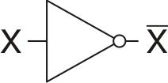

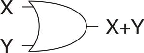

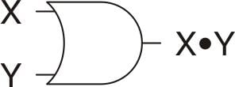

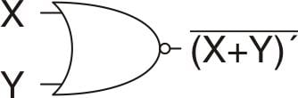

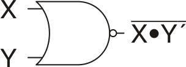

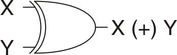

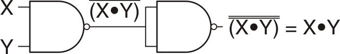

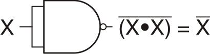

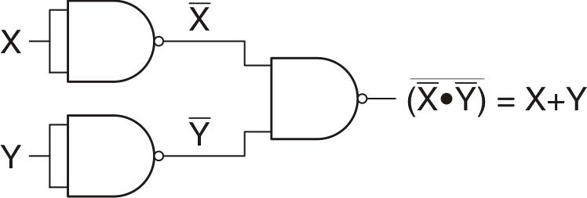

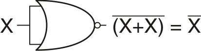

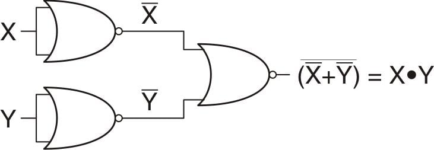

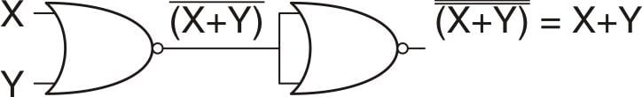
