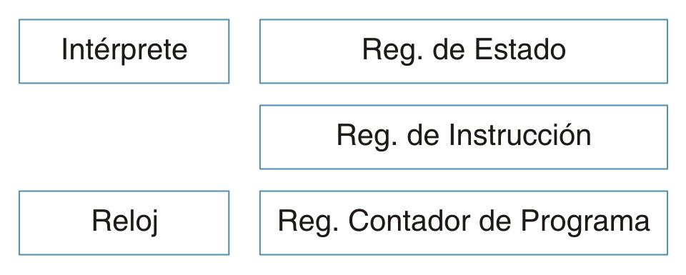
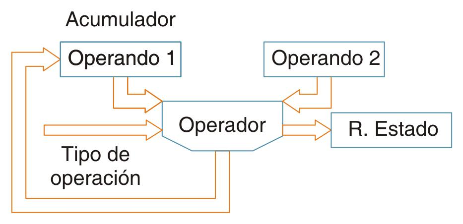
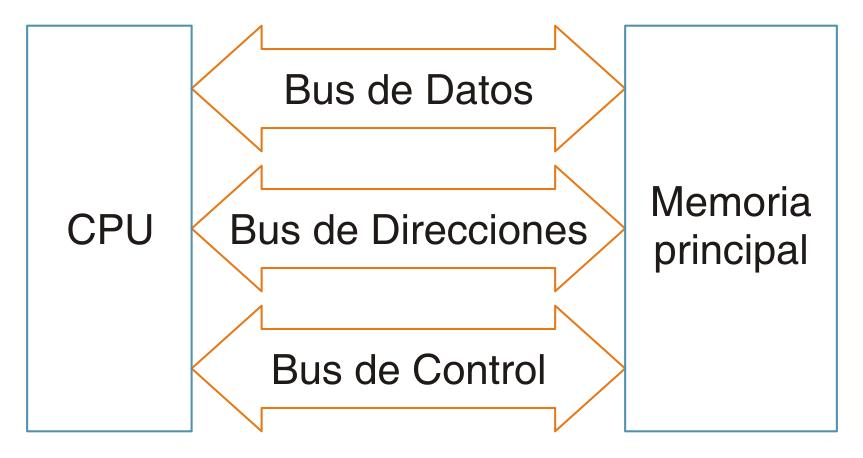

# 8. Interacción entre procesador y memoria

**Presentación relacionada:** [Tema 8, 9 y 10](../Tema%2008%2C%2009%20y%2010/README.md)

## Objetivo

- Describir la interacción entre procesador y memoria teniendo en cuenta las características de los buses de datos y direcciones en la arquitectura Von Neumann.

## 8.1. Introducción

El microprocesador es uno de los logros más importantes del siglo XX desde su invención en la década del 70. Hace unas décadas atrás tal afirmación habría parecido absurda. Pero con el paso del tiempo, el microprocesador se acerca más al centro de nuestras vidas. Su presencia ha comenzado a cambiar la forma en que percibimos el mundo e incluso a nosotros mismos. Cada vez se hace más difícil pasar por alto el microprocesador como otro simple producto en una larga línea de innovaciones tecnológicas.

> En los microprocesadores se duplica la cantidad de componentes cada 18 meses aproximadamente. Esto lo predijo el cofundador de Intel Gordon Moore y se denomina Ley de Moore.

No existe otra invención en la historia que haya avanzado tan aprisa por todo el mundo o haya llegado tan profundamente a tantos aspectos de la existencia humana. Hoy existen millones de microchips de algún tipo en uso. Nadie puede dudar que el microprocesador no sólo esté transformando los productos que usamos, sino también nuestra forma de vivir. Los Microprocesadores se utilizan en:

- Industria: en equipos automatizados controlados por microprocesador por ejemplo en un UPS de alta capacidad.
- Informática: se utilizan en las computadoras personales o servidores.
- Consumo Doméstico: televisores de plasma, LED o LCD, consolas de juego, etc.
- Comercio y Banca: cajeros automáticos, sistemas contraincendios, circuito cerrado de TV.
- Telecomunicaciones: equipos de emisión de señal controlada por microprocesadores.
- Medición y Cálculo: en osciloscopios, calculadoras.

Por su parte la memoria de un computador es una de sus elementos fundamentales para el buen funcionamiento de esta. Ha adquirido un papel protagónico en el funcionamiento de la misma, pues es tan importante saber las características del microprocesador como la cantidad de memoria que posee. Es allí donde el microprocesador de la PC almacena los datos y códigos de los programas. Es también un canal de comunicación entre el procesador y los periféricos. Por otra parte la estrecha relación que existe entre la velocidad de procesamiento del CPU y la velocidad de respuesta de la memoria puede afectar el comportamiento de la computadora, siendo uno de los principales rasgos determinísticos del rendimiento de esta. Si el cerebro de un computador es el procesador, se puede pensar en la memoria como las neuronas.

## 8.2. Microprocesador

El Microprocesador físicamente es un circuito integrado o chip, formado por millones de transistores construidos sobre una oblea de silicio. Suelen tener forma cuadrada o rectangular y van colocados sobre un elemento de la placa base denominado zócalo. Entre sus funciones está la de decodificar y ejecutar las instrucciones de los programas cargados en memoria principal y coordinar y controlar el resto de componentes que forman el ordenador y aquellos periféricos conectados a éste.

Desde el punto de vista lógico, singular y funcional, el microprocesador está compuesto básicamente por: varios registros, buses de comunicación, una unidad de control, una unidad aritmético lógica, y dependiendo del procesador, puede contener una unidad en coma flotante.

El microprocesador ejecuta instrucciones almacenadas como números binarios organizados secuencialmente en la memoria principal. La ejecución de las instrucciones se puede realizar en varias fases:

1. PreFetch: pre lectura de la instrucción desde la memoria principal.
2. Fetch: envío de la instrucción al decodificador.
3. Decodificación de la instrucción, es decir, determinar qué instrucción es y qué se debe hacer.
4. Lectura de operandos (si los hay).
5. Ejecución, lanzamiento de las máquinas de estado que llevan a cabo el procesamiento.
6. Escritura de los resultados en la memoria principal o en los registros.

Cada una de estas fases se realiza en uno o varios ciclos de CPU (ciclos de reloj), dependiendo de la estructura del procesador, y concretamente de su grado de segmentación. La duración de estos ciclos viene determinada por la frecuencia de reloj y nunca podrá ser inferior al tiempo requerido para realizar la tarea individual (realizada en un solo ciclo) de mayor coste temporal.

En los sistemas modernos no solo se explota la alta velocidad de funcionamiento de los circuitos para acelerar la ejecución de código, también se aprovecha la capacidad de multitarea a través del manejo de varios núcleos de ejecución concurrente.

Al microprocesador también se le conoce como Unidad Central de Procesamiento (CPU), pues constituye el cerebro de un computador digital, pues realiza todas las operaciones aritméticas y lógicas sobre los datos y además controla todos los procesos que se desarrollan en esta. Por ejemplo, para que se ejecute una instrucción, ésta debe estar en el interior de la CPU, concretamente en la Unidad de Control (UC) y si hay que realizar cálculos, interviene la Unidad Aritmética Lógica (ALU). A continuación, una descripción de cómo funciona cada una de ellas.

### 8.2.1. Unidad de control (UC)

Para realizar su tarea la UC necesita conocer, por un lado, la instrucción y, por otro, una serie de informaciones adicionales que deberá tener en cuenta para coordinar, de forma correcta, la ejecución de la instrucción. El resultado de la interpretación de dichas informaciones son una serie de órdenes a los diferentes elementos de la computadora.

La UC no emite todas las órdenes a la vez, sino siguiendo una determinada secuencia. Para ello utiliza un elemento que le va indicando el instante en que debe ejecutar una determinada fase de la instrucción. A este elemento se le denomina Reloj, y se dice que sincroniza las acciones de la UC; cuanto más rápido marque el tiempo, más rápida será la ejecución de la instrucción. Sin embargo, hay un límite, ya que, si marca excesivamente rápido, es posible que no puedan cumplir adecuadamente las órdenes de los diferentes elementos, por lo que se producirán errores. Este reloj es el mismo con el que se trabajó en los contenidos relacionados con Circuitos Secuenciales Sincrónicos.

En la figura 8.1 se puede observar el conjunto de señales que utiliza la UC y las que genera. Como informaciones adicionales a las instrucciones podemos ver los impulsos de reloj y los indicadores de estado.

Los indicadores de estado son una serie de bits que se modifican según resultados de las operaciones anteriores guardando una memoria histórica de los acontecimientos precedentes para que, en función de dichos acontecimientos, pueda la UC tomar decisiones.

La unidad de control está formada, básicamente por un elemento que interpreta las instrucciones y varios elementos de memoria denominados registros. Uno de estos registros almacena la instrucción mientras el intérprete está traduciendo su significado, por lo que se denomina Registro de Instrucción (RI). El resto de las instrucciones permanecen en la memoria, esperando que les toque su turno de ejecución.

La memoria caché es un tipo especial de memoria, mucho más rápida que la RAM convencional, que se utiliza para almacenar los valores e instrucciones de la RAM que podrían utilizarse con frecuencia y de este modo evitar el acceso a la RAM. En los sistemas modernos este acceso puede ser cientos de veces más lento que el acceso al caché local (dentro del propio procesador).

La UC por otra parte deberá conocer cuál es la dirección de la próxima instrucción, para poder ir a buscarla una vez que finaliza la ejecución de la instrucción en curso; dirección que guarda el registro llamado Contador de Programa (CP). Los indicadores de estado están agrupados en un registro denominado Registro de Estado (RE).

**Figura 8.1.** Elementos básicos de la Unidad de Control.

### 8.2.2. Unidad aritmética lógica (ALU)

La unidad Aritmético - Lógica (ALU, por sus siglas en inglés) es la encargada de realizar los cálculos. Los datos sobre los que se realizan las operaciones se denominan operandos. Al elemento encargado de ejecutar las operaciones se le denomina operador, y está formado por una serie de circuitos electrónicos que son capaces de sumar dos números binarios o hacer las operaciones lógicas elementales: disyunción, conjunción y negación. Incluso, algunos operadores son también capaces de multiplicar, dividir y realizar otras operaciones más complejas.

Para que el operador realice la operación, los operandos se llevan a la ALU y se guardan en unos registros denominados registros de trabajo. El resultado de la operación se guarda también en un registro antes de ser llevado a la memoria o a la Unidad de Entradas y Salidas. Frecuentemente se utiliza un mismo registro para guardar uno de los operandos y, también, el resultado, denominado registro Acumulador.

El operador, además de calcular el valor de la operación, modifica el registro de estado según el resultado de la operación. Así, si el resultado es un valor negativo, se modifica un bit de dicho registro, llamado bit negativo o bit N, poniéndose a 1; por el contrario, el bit N permanecerá en estado 0 mientras el contenido del acumulador no sea negativo. De igual forma indicara la ALU a la UC si el resultado ha sido cero, o si ha producido algún acarreo, etc.

**Figura 8.2.** Unidad Aritmética Lógica.

## 8.3. Interacción del microprocesador con la memoria

La memoria en un computador digital, es un elemento muy importante para el funcionamiento del mismo. Es donde se almacenan temporalmente las instrucciones y los datos necesarios para la ejecución de los programas, los se pierden cuando se apaga el computador. Los tipos de memoria presentes en los sistemas computadores serán estudiados más delante. La memoria de la que se hace alusión en este material, es la Memoria de Acceso Aleatorio (RAM, por sus siglas en inglés) que no es más que la memoria principal de los sistemas computadores.

Cuando la CPU necesita leer o escribir en una determinada posición de memoria, enviara la dirección, en paralelo, a la memoria por un conjunto de conductores eléctricos al que se denomina bus de direcciones, ya que se utiliza exclusivamente para enviar direcciones. Así mismo, los datos leídos o los que se quieren escribir se trasladan mediante un conjunto de conductores eléctricos denominado bus de datos. Las órdenes de la CPU a la Memoria Principal (MP) y las respuestas de la MP a la CPU son enviadas por un tercer conjunto de conductores llamado bus de control.

**Figura 8.3.** Conexión de la CPU con la Memoria Principal.

### 8.3.1. Buses

Un bus es un camino de comunicación entre dos o más dispositivos. Una característica clave de un bus es que se trata de un medio de transmisión compartido. Al bus se conectan varios dispositivos, y cualquier señal transmitida por uno de esos dispositivos está disponible para que los otros dispositivos conectados al bus puedan acceder a ella. Si dos dispositivos transmiten durante el mismo periodo de tiempo, sus señales pueden solaparse y distorsionarse. Consiguientemente, solo un dispositivo puede transmitir con éxito en un momento dado.

Usualmente, un bus está constituido por varios caminos de comunicación, o líneas. Cada línea es capaz de transmitir señales binarias representadas por 1 y por 0. En un intervalo de tiempo, se puede transmitir una secuencia de dígitos binarios a través de una única línea. Se pueden utilizar varias líneas del bus para transmitir dígitos binarios simultáneamente (en paralelo). Por ejemplo, un dato de 8 bits puede transmitirse mediante ocho líneas del bus.

Los computadores poseen diferentes tipos de buses que proporcionan comunicación entre sus componentes a distintos niveles dentro de la jerarquía del sistema. El bus que conecta los componentes principales del computador (procesador, memoria, E/S) se denomina bus del sistema (system bus).

Las estructuras de interconexión más comunes dentro de un computador están basadas en el uso de uno o más buses del sistema. El bus de sistema está constituido, básicamente por líneas dedicadas agrupadas en tres grupos funcionales: líneas de datos, de direcciones y de control.

Además, pueden existir líneas de alimentación para suministrar energía a los módulos conectados al bus.

> Todos los componentes de un sistema de cómputo se construyen teniendo en cuenta su comunicación con el procesador. Para ello las interfaces o conectores internos de que dispone, deben ser compatibles con los tres tipos de buses: datos, dirección y control.

Las líneas de datos proporcionan un camino para transmitir datos entre los módulos del sistema. El conjunto constituido por estas líneas se denomina bus de datos. El bus de datos puede incluir entre 32 y cientos de líneas, cuyo número se conoce como anchura del bus de datos. Puesto que cada línea solo puede transportar un bit cada vez, el número de líneas determina cuántos bits se pueden transferir al mismo tiempo. La anchura del bus es un factor clave a la hora de determinar las prestaciones del conjunto del sistema. Por ejemplo, si el bus de datos tiene una anchura de ocho bits, y las instrucciones son de 16 bits, entonces el procesador debe acceder al módulo de memoria dos veces por cada ciclo de instrucción.

Las líneas de dirección se utilizan para designar la fuente o el destino del dato situado en el bus de datos. Por ejemplo, si el procesador desea leer una palabra (8, 16 o 32 bits) de datos de la memoria, sitúa la dirección de la palabra deseada en las líneas de direcciones. Claramente, la anchura del bus de direcciones determina la máxima capacidad de memoria posible en el sistema. Además, las líneas de direcciones generalmente se utilizan también para direccionar los puertos de E/S. Usualmente, los bits de orden más alto se utilizan para seleccionar una posición de memoria o un puerto de E/S dentro de un módulo. Por ejemplo, en un bus de 8 bits, la dirección 01111111 e inferiores harían referencia a posiciones dentro de un módulo de memoria (el módulo 0) con 128 palabras de memoria, y las direcciones 10000000 y superiores designarían dispositivos conectados a un módulo de E/S (módulo 1).

Las líneas de control se utilizan para controlar el acceso y el uso de las líneas de datos y de direcciones. Puesto que las líneas de datos y de direcciones son compartidas por todos los componentes, debe existir una forma de controlar su uso. Las señales de control transmiten tanto órdenes como información de temporización entre los módulos del sistema. Las señales de temporización indican la validez de los datos y las direcciones. Las señales de órdenes especifican las operaciones a realizar. Algunas líneas de control típicas son:

- Escritura en memoria (Memory write): hace que el dato del bus se escriba en la posición direccionada.
- Lectura de memoria (Memory read): hace que el dato de la posición direccionada se sitúe en bus.
- Escritura de E/S (I/O write): hace que el dato del bus se transfiera a través del puerto de E/S direccionado.
- Lectura de E/S (I/O read): hace que el dato del puerto de E/S direccionado se sitúe en el bus.
- Transferencia reconocida (Transfer ACK): indica que el dato se ha aceptado o se ha situado en el bus.
- Petición de bus (Bus request): indica que un módulo necesita disponer del control del bus.
- Cesión de bus (Bus grant): indica que se cede el control del bus a un módulo que lo había solicitado.
- Petición de interrupción (Interrupt request): indica si hay una interrupción pendiente.
- Interrupción reconocida (Interrupt ACK): señala que la interrupción pendiente se ha aceptado.
- Reloj (clock): se utiliza para sincronizar las operaciones.
- Inicio (reset): pone los módulos conectados en su estado inicial.

El funcionamiento del bus se describe a continuación. Si un módulo desea enviar un dato a otro debe hacer dos cosas: (1) obtener el uso del bus y (2) transferir el dato a través del bus. Si un módulo desea pedir un dato a otro módulo, debe (1) obtener el uso del bus y (2) transferir la petición al otro módulo mediante las líneas de control y dirección apropiadas. Después debe esperar a que el segundo módulo envíe el dato.

## 8.4. Registros

Los registros del procesador se emplean para controlar instrucciones en ejecución, manejar direccionamiento de memoria y proporcionar capacidad aritmética. Los registros son espacios físicos dentro del microprocesador con capacidad de 4 bits hasta 64 bits dependiendo del microprocesador que se emplee.

Tienen varias clasificaciones, según sus usos: registros generales, de segmento, de estado, de control, de depuración y prueba, de tabla de descriptores, entre otros. A continuación una breve descripción de los más utilizados.

Los procesadores de tipo RISC se caracterizan por disponer de muchos más registros que los de tipo CISC. Por ejemplo un procesador Intel típico provee alrededor de 16 registros de propósito general, mientras que el un procesador SPARC puede tener más de 80.

### 8.4.1. Registros de propósitos generales de Intel

- EAX: Acumulador, es el más utilizado, soporta cualquier operación, pero es imprescindible en las operaciones con puertos, divisiones y multiplicaciones, en los primeros microprocesadores no podía ser utilizado para direccionar memoria.
- EBX: Registro base, ya que en los modelos anteriores su uso fundamental era como puntero.
- ECX: Contador, su función fundamental es soportar las operaciones con ciclos, al igual que EAX, en los modelos anteriores no podía ser usado como puntero.
- EDX: De datos, es un segundo acumulador, apoya a EAX en las operaciones con puertos, multiplicaciones y divisiones, tampoco podía ser usado como puntero.
- ESP: Puntero al stack, como su nombre lo indica, es el encargado de apuntar a la primera posición libre en el stack, como curiosidad se debe decir, que en el 8086 este registro apuntaba al último ocupado, a partir de aquí se puede saber si la máquina posee un 8086 o un microprocesador superior
- EBP: Puntero auxiliar al stack, este registro está preparado para el trabajo con el stack, usado fundamentalmente en el proceso de sacar del stack parámetros de procedimientos; aunque puede ser usado como puntero si se siguen determinadas convenciones.
- EDI: Índice destino, usado principalmente como puntero, imprescindible en las instrucciones de cadena. Por defecto Trabaja con el ES.
- ESI: Índice fuente, usado principalmente como puntero, imprescindible en las instrucciones de cadena. Por defecto Trabaja con el DS.

### 8.4.2. Registros de segmento

Siguen siendo de 16 bits, al igual que en sus antecesores; su función es servir de puntero al comienzo de los segmentos.

- CS: Puntero al inicio del segmento de código; (Segmento de Instrucciones).
- SS: Puntero al inicio del segmento de stack. (Segmento de Pila ó Stack).
- DS: Puntero al inicio del segmento de datos. (Datos de los programas).
- ES: Puntero al inicio de otro Segmento de Datos, extra.
- FS: Con la misma Función del ES.
- GS: Con la misma Función del ES.

### 8.4.3. Registros de estado y control

- EIP: Puntero de Instrucciones, apunta a la próxima instrucción a ejecutar.
- EFlags: Banderas que informan el estado en que queda el micro después de ejecutar una instrucción.

## 8.5. Conclusiones

En esta conferencia se trató la interacción entre el procesador de un computador y la memoria principal. Para un mejor entendimiento se detallaron los componentes que forman al procesador, así como sus funciones y como intervienen en el procesamiento y comunicación de los datos. Se hizo énfasis en el funcionamiento de la ALU, la UC, los buses y registros, por ser los que siempre intervienen en el intercambio de datos e instrucciones, entre el procesador y la memoria.

<!-- navegación -->

---

[← Anterior: Capítulo 7](Cap%C3%ADtulo%2007%20-%20Circuitos%20Secuenciales%20Sincr%C3%B3nicos%20%28CSS%29.md) | [Índice](README.md) | [Siguiente: Capítulo 9 →](Cap%C3%ADtulo%2009%20-%20Ejecuci%C3%B3n%20de%20c%C3%B3digo.md)
