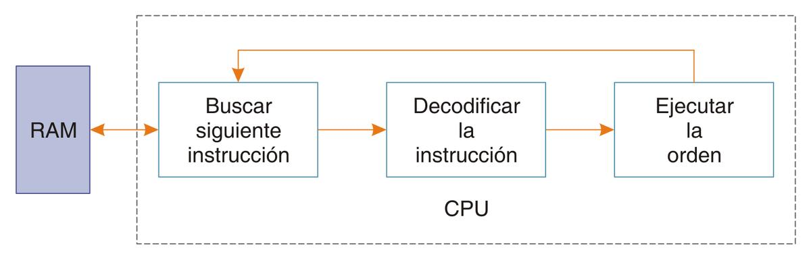
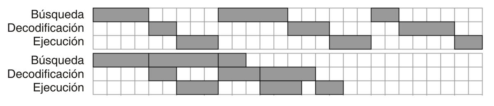
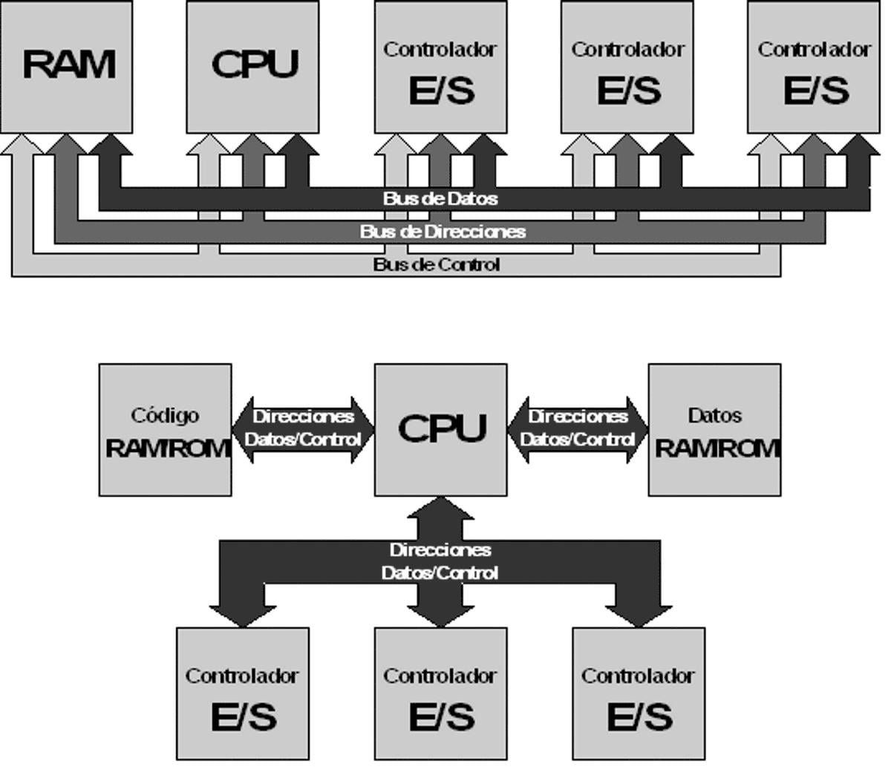
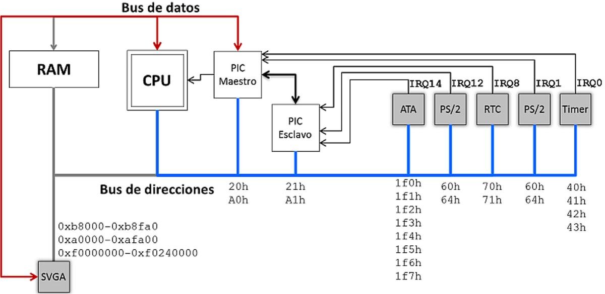
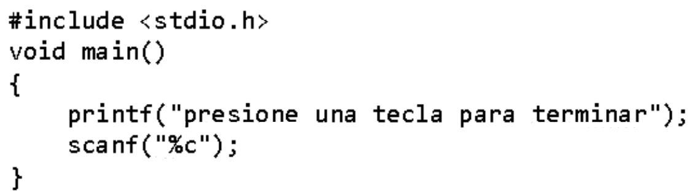
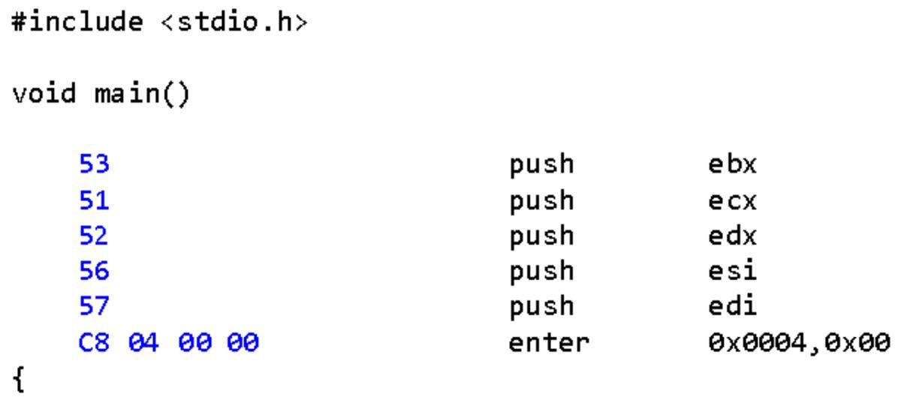
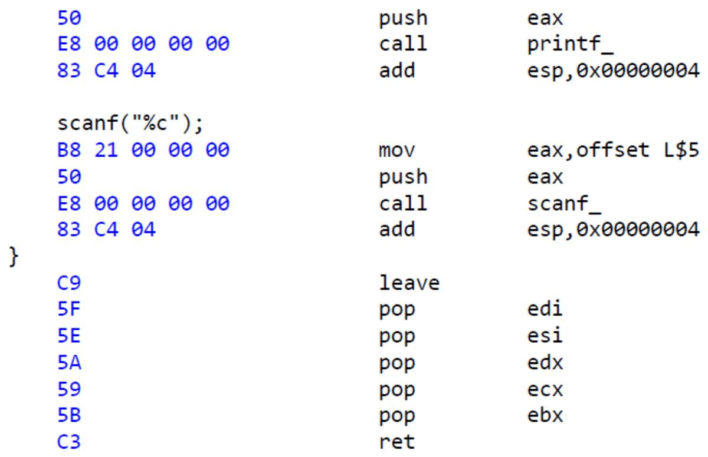

# 9. Ejecución de código

**Presentación relacionada:** [Tema 8, 9 y 10](../Tema%2008%2C%2009%20y%2010/README.md)

## Objetivos

- Caracterizar el ciclo de instrucción de un procesador.
- Identificar los componentes del sistema relacionados con la ejecución de código.

## 9.1. Introducción

El funcionamiento de todo sistema de cómputo se basa en ejecutar un programa codificado en memoria. El programa es en realidad una secuencia de valores numéricos que el procesador interpreta como instrucciones y datos. El procesador mismo es el encargado de buscar, interpretar y actuar según indiquen estas instrucciones.

En su forma básica, el ciclo de instrucción no ha cambiado desde que se creó la ENIAC.

En su forma más simple, el proceso de ejecución tiene tres etapas: la búsqueda (captación) de la siguiente instrucción en la secuencia. La decodificación, para determinar la acción a ejecutar y si fuera necesario buscar parámetros; finalmente la verdadera ejecución, luego de la cual se puede considerar cumplida la orden del programa. La culminación de estos tres pasos se denomina ciclo de instrucción. Por tanto, la ejecución de un programa cualquiera consiste en la repetición del proceso de captación, decodificación y ejecución de cada instrucción, o la repetición ininterrumpida de ciclos de instrucción.

**Figura 9.1.** Ciclo de instrucción simplificado.

Cada una de estas etapas necesita de varios ciclos del reloj del CPU para funcionar, por lo que no se deben confundir los términos ciclo de instrucción y ciclo de CPU. Originalmente, la etapa de búsqueda funcionaba después de cada ciclo de instrucción, pero los procesadores modernos están diseñados para evitar el tiempo ocioso y acelerar la ejecución del programa. Esto se logra incluyendo un desvío al final de cada etapa de modo que se ejecute a sí misma si no hay que esperar por otra. El efecto es que se puede comenzar un nuevo ciclo de instrucción antes que haya terminado el anterior, por eso se le denomina tubería (pipeline, en inglés). En la figura 9.2 se comparan las ejecuciones de tres ciclos de instrucción en ambas variantes: con y sin tuberías.

Aunque el ciclo de cada instrucción se mantiene más o menos constante, la demora total puede ser notablemente mayor.

**Figura 9.2.** La ventaja del pipeline radica en reutilizar los circuitos de una etapa antes que el ciclo de

instrucción haya concluido. En la figura se ilustra que la demora de tres ciclos de instrucción aleatorios sin pipeline (arriba) es mayor que con pipeline (debajo).

En la práctica, cada etapa puede incluir un número arbitrario de pasos que también se ejecutan en modo entubado, con lo que la eficiencia teórica puede aumentarse al lograrse mayores promedios de ejecución de instrucciones por ciclo.

## 9.2. Ciclos de búsqueda y decodificación

Cada uno de los pasos mencionados antes, se lleva a cabo en una parte específica del procesador. Para el paso de búsqueda, los procesadores disponen de un conjunto de componentes que actúan como enlace con la RAM. Aunque existe un registro especial para depositar la última instrucción y que sea utilizadas por las demás etapas, muchos procesadores implementan par esta etapa una memoria caché. Este tipo de memoria es muy útil cuando la velocidad del CPU es mayor que la de la memoria o la conexión con la memoria. Esta memoria caché almacena no solo la siguiente instrucción sino varias más adelante, incluidos los datos que podrían utilizar.

En estas condiciones, la etapa se divide en dos: búsqueda y prebúsqueda (fetch y prefecth en inglés). La prebúsqueda se encarga de leer y guardar en caché las instrucciones y datos que probablemente deban utilizarse y la búsqueda funciona como se explicó, intermediando con la decodificación. Una vez que la instrucción en proceso se almacena en el registro de instrucción, la etapa de decodificación analiza su contenido valiéndose de un formato propio de cada procesador. La habilidad para leer más que lo necesario posibilita analizar el flujo del programa y predecir estadísticamente la próxima instrucción a ejecutar; de esa manera, puede mantenerse la tubería llena. Sin embargo, cuando la ejecución especulativa (que es como se denomina) falla, se deben deshacer todos los estados de la tubería para comenzar de nuevo. Por este motivo una tubería de muchos pasos es ineficiente.

El funcionamiento de la decodificación es totalmente dependiente del tipo de procesador. Se pueden resaltar sin embargo, dos variantes:

- Instrucciones de longitud fija. Son comunes en procesadores RISC (Reduced Instruction Set
Computer, en inglés) son procesadores diseñados para ejecutar instrucciones con ciclos de instrucción breves, lo que se traduce en que cada etapa debe ser ágil y en lo que a la decodificación respecta, la mejor manera de lograrlo es interpretando un solo valor por instrucción. En este caso, las instrucciones se codifican con valores numéricos de tamaño fijo y la etapa de decodificación funciona como un switch/case sobre los valores o sobre un determinado grupos de bits del valor.

- Instrucciones de longitud variable. Son comunes en procesadores CISC (Complex Instruction
Set Computer, en inglés) son procesadores capaces de ejecutar instrucciones que requieran ciclos de instrucción largos. En este caso la decodificación debe ser capaz de analizar más de un valor y se torna compleja. Por eso en estos tipos de sistema se optimiza mucho el entubamiento y el acceso a memoria caché. Acá es crítico el diseño óptimo de una tubería: muy corta limita el rendimiento por falta de información; muy larga limita el rendimiento por exceso.

## 9.3. Etapa de ejecución

Esta es la etapa más compleja, tomando en cuenta que le corresponde manejar casi todos los circuitos del procesador: registros, unidades de control de potencia, acceso a los buses, gestión de interrupciones. A continuación se explicarán las funciones más comunes y afines a todos los procesadores en la etapa de ejecución.

### 9.3.1. Registros

Los registros son circuitos que pueden considerarse como memorias especiales. No solo almacenan información, su contenido y las operaciones sobre ellos actúan sobre el estado del procesador dando lugar a la culminación del ciclo de instrucción. Los registros son la interfaz entre el hardware del procesador y el código del programa y esto se cumple para todos los procesadores.

Existen por tanto registros con diferentes funciones, que dependerán del tipo de procesador. Se pueden destacar sin embargo tres tipos bien definidos:

- Registros de propósito general. Son registros que pueden utilizarse para cualquier tipo de
operación lógica y aritmética o simplemente para almacenar valores directos o leídos de la memoria. Un programa en ejecución necesitará utilizar estos registros casi todo el tiempo y son tan relevantes que el tamaño o la cantidad de bits que puedan contender define parte de la 'Arquitectura' del procesador:

Procesador Arquitectura Tamaño de los registros de uso general 8bit 16bit 32bit 64bit 8bit 16bit 32bit 64bit Z80 80286 80386 Corei7

- Registro de propósito específico. Estos registros son muy diversos y dependen del tipo de
procesador. Se puede considerar son embargo que fungen como apoyo a las operaciones de los registros de propósito general y monitorean el estado de la ejecución de código. Esto significa que se utilizan con menor frecuencia en un programa pero son igual de importantes. Un registro especial es el llamado registro de banderas (Flag register, en inglés). Cada bit de este registro indica una condición temporal relacionada con la ejecución de la última instrucción: acarreos, paridad, resultado nulo, resultado negativo… La cantidad de banderas depende del tipo de procesador pero las funciones siempre se relacionan con la ejecución del programa o el estado inmediato del procesador. Un registro muy importante de propósito específico es el puntero de instrucción, cuya función es contener la dirección de la instrucción que se procesa.

- Registros de control. La cantidad y función de estos registros depende completamente del
tipo de procesador. Su propósito es actuar como configuración del funcionamiento del procesador o de sus componentes. Pueden establecer la manera en que se maneja la memoria, el formato con que se interpreten las instrucciones, restringir el uso de determinados circuitos. En algunos procesadores se puede configurar el consumo de potencia y la velocidad de funcionamiento.

### 9.3.2. Buses del sistema

Para que un sistema de cómputo sea utilizable, el procesador debe actuar sobre hardware cuyas características lo hagan operable por personas. Este hardware está a su vez dividido en dos partes. Una que es la interfaz visible y/o manipulable: teclas, superficies, píxeles, ranuras, palancas… Otra que traduce las acciones en órdenes al procesador y viceversa. Esta última, llamada como controladores de dispositivo. es la que está conectada al procesador por medio de lo que se conoce como bus del sistema.

El bus del sistema es el conjunto de conductores eléctricos que permiten la comunicación entre todos los componentes del sistema de cómputo y a su vez se divide en tres partes.

**Figura 9.3.** Diferencias entre las arquitecturas de Von Neumann (arriba) y Harvard (debajo).

- Bus de datos. Son las líneas eléctricas que portan en todo momento datos y órdenes para y
desde cada componente.

- Bus de direcciones. En estas líneas se escriben códigos mediante los que se identifica cada
componente. Los controladores se construyen para reconocer determinados valores en el bus de direcciones y responder adecuadamente a las órdenes o datos en el bus de datos.

En el caso de la memoria el bus de direcciones se utiliza para apuntar a cada byte. Para distinguir entre direcciones a memoria y a controladores de entrada/salida, la literatura identifica las direcciones de los dispositivos como puertos de entrada/salida.

- Bus de control. Con este grupo de líneas, el procesador organiza y sincroniza el trabajo de
todos los controladores. Selecciona si las direcciones en el bus de direcciones van dirigidas a la memoria o a los controladores; indica a la memoria si lo que se solicita es una lectura o una escritura. Hace posible también deshabilitar temporalmente algún controlador e incluso permitir que un controlador interrumpa la ejecución del programa actual si fuera necesario.

La manera más extendida del uso de los buses se denomina arquitectura Von Neumann y se caracteriza porque los tres buses enlazan cada controlador y la memoria con el procesador. Esta estructura es simple y barata de construir, pero tiene el problema de generar cuellos de botella en la ejecución debido a que no es posible el uso simultáneo de la memoria para ejecutar código y leer o escribir datos. La arquitectura Harvard en cambio utiliza memorias diferentes para datos e instrucciones con lo que se supera el problema mencionado por a mayor costo. La figura 9.3 ilustra las diferencias.

La arquitectura de Harvard se usa intensivamente en la estructura interna de los procesadores y sistemas embebidos, dónde se necesita optimizar el uso de cada componente y el costo de multiplicar los buses es mínimo.

### 9.3.3. Manejo de los controladores de entrada/salida

El procesador puede acceder a los dispositivos externos de varias maneras, la más evidente es a través de los puertos de entrada/salida. El programa solicita mediante la instrucción adecuada la lectura o escritura de comandos y/o datos en un controlador y el procesador escribe los valores adecuados en los buses.

Aunque este método es universal y técnicamente claro, resulta tedioso implementarlo con algunos dispositivos. Sucede que los controladores se implementan para responder o detectar determinados valores del bus de direcciones (sus puertos de entrada/salida) y los comandos y datos los almacenan en registros propios para funcionar de acuerdo a la solicitud. Si el dispositivo maneja mucha información, como por ejemplo el hardware de vídeo o de red, habrá que indicarle mediante sus registros la acción que desea realizarse y los parámetros lo que equivaldría a dibujar bit a bit en la pantalla o enviar trama a trama la información en la red. Afortunadamente hay dos alternativas para el manejo de algunos dispositivos de entrada/salida.

- Entrada/salida mapeada en memoria. Esta consiste en detectar segmentos de direcciones
en las solicitudes a memoria para redirigirlas a los registros de los dispositivos de entrada/ salida y utilizar los valores del bus de datos como parámetros. De este modo, una instrucción que indique la lectura o escritura a memoria en el rango de direcciones utilizado, tendrá el efecto de que todos los datos escritos serán traducidos como datos o incluso órdenes para un determinado dispositivo de entrada/salida. A pesar que se pierden estas direcciones en memoria mientras el dispositivo esté activo, facilita en gran medida la programación.

- Interrupciones. Las interrupciones son un mecanismo avanzado para el manejo de los
controladores de entrada/salida. Todos los demás métodos son síncronos, lo que significa que se accede al controlador durante la ejecución de una instrucción o durante un ciclo de instrucción. Esto no es problema para la salida de información, pero si se utilizara este método para leer datos hay que sincronizar la ejecución del programa con el funcionamiento del controlador, es decir habrá que esperar a que esté listo el dato.

Ningún dispositivo de entrada/salida es tan rápido como el CPU, ni siquiera la memoria. Esta espera significa entonces que el procesador no puede ejecutar más código hasta que no esté listo el dato esperado, traduciéndose en una baja eficiencia. La situación empeora si se tiene en cuenta la necesidad de utilizar diferentes dispositivos simultáneamente, como en un cliente de chat o en un juego de vídeo.

**Figura 9.4.** Configuración del hardware para E/S en la arquitectura del PC.

Las interrupciones con la solución a este problema. Permiten que los controladores soliciten ellos mismos la atención del procesador solo cuando tengan listos los datos. La manera en la que se implementan varía de sistema en sistema, pero el principio es siempre el mismo. Existe un componente llamado controlador de interrupciones cuya función es intermediar entre los controladores y el procesador. Los controladores se conectan a este mediante líneas independientes del bus de control. Con estas líneas, cada dispositivo indica al controlador de interrupciones la solicitud de interrupción (interrupt request, en inglés o IRQ abreviado). El controlador establece un código para cada línea y por un pin especial del CPU le comunica la solicitud mientras en el bus de datos está el código. Con el aviso del pin, el procesador interrumpe el programa y con el código leído en el bus de datos decide qué hacer.

El mecanismo de interrupciones es lo que hace posible que un sistema de un solo procesador ejecute tareas que parecen simultáneas. De hecho se pueden considerar como tal en un número razonable de casos prácticos.

En la figura 9.4 se ilustra un diagrama de configuración del hardware de un sistema PC en el que están presentes las tres formas de manejar la entrada/salida. Se indican los puertos de cada componente (a la derecha); las direcciones del mapeo de memoria (en este caso para el controlador de viseo, a la izquierda) y la manera en que los controladores de entrada/salida están conectados mediante las líneas IRQ a los controladores de interrupciones.

## 9.4. Ejecución de un programa

Con un ejemplo concreto, se examinará el funcionamiento de todo el sistema durante la ejecución de código. Se analizará la ejecución de un sencillo programa:

Lo primero es que el programa escrito de esta manera no es entendible por ningún procesador real, debe compilarse, que significa traducir, por lo general al código máquina. A continuación se muestra el código compilado:

Se han marcado en azul las instrucciones en lenguaje máquina y el código de la derecha son sus equivalentes en lenguaje ensamblador. El código del programa que se ejecutará son los valores hexadecimales de la izquierda y por tanto serán los valores que deben escribirse en la memoria.

Por razones históricas, las herramientas que traducen lenguajes de programación se denominan compiladores. Los compiladores traducen lenguajes entendibles por los humanos (alto nivel de abstracción) a lenguajes entendibles por el procesador (lenguaje de máquina o de bajo nivel de abstracción). El proceso inverso se denomina descompilación. Cada familia de procesadores está diseñada para “entender” nativamente su propio lenguaje de máquina.

Cuando se ordena ejecutar un programa, el registro apuntador de instrucciones del CPU se inicializa en la dirección de la primera instrucción. La etapa de búsqueda del procesador escribe esta dirección en el bus de direcciones y mediante el bus de control le indica a la memoria que desea hacer una lectura.

Como el procesador no puede saber el tamaño de la instrucción (si es una máquina CISC, como en este caso) la memoria le facilita unos cuántos byte más que pueden o no ser instrucciones, a veces son argumentos, a veces datos… Este grupo de bytes es analizado entonces por la etapa de decodificación, que determina la función de cada byte. El funcionamiento de esta etapa puede estar condicionado por algún registro de control. Una vez que se determina el código, la etapa de ejecución hace su tarea. Mientras tanto, las demás etapas siguen funcionando si el procesador dispone de entubamiento. Algunas de las instrucciones indican al CPU que escriba algún dato en la memoria. Este tipo de instrucciones requiere parámetros, como la dirección de la escritura y el nuevo valor, otras modifican algún registro, otras solicitan un cambio en la secuencia de ejecución, etc.

El algún momento de la ejecución, el conjunto de código solicita el manejo del hardware de video para mostrar el texto. En este caso puede hacerse uso del mapeo de entrada/salida en memoria.

Significa que aunque el procesador escribe aparentemente en alguna dirección de memoria, el hardware de vídeo intercepta las direcciones y obtiene del bus de datos el parámetro de visualización, en este caso cada carácter. Para representar el texto hará falta entonces un ciclo que en cada iteración hace: 1.

El procesador lee de la RAM, en una dirección específica, los caracteres del texto y los almacena en cada iteración en un registro de propósito general. La dirección se indica en el bus de direcciones y en el bus de datos se lee el caracter. 2.

El procesador escribe en una dirección específica cada carácter leído. La dirección se indica en el bus de direcciones y el código del carácter en el bus de datos. 3.

El hardware de vídeo detecta una dirección conocida por él como su espacio de entrada/ salida mapeado en memoria e intercepta el dato en el bus de datos. 4.

Con los parámetros obtenidos, se dibuja un carácter en la pantalla.

El ciclo continúa hasta que se escribe todo el texto. La ejecución prosigue con la espera de un dato externo, en este caso el uso de alguna tecla. Como este dato requiere el uso del teclado que es muy lento comparado con el CPU, este deja el programa suspendido y continúa la ejecución de otro.

En algún momento el usuario utilizará el teclado y el controlador correspondiente indicará una interrupción al procesador. El controlador de entrada salida escribirá un código en el bus de datos que le indica al procesador la ejecución de un código (que puede ser o no parte del programa original) para manejar el teclado.

Dentro de este código de atención a la interrupción, que es como se llama, el procesador leerá el puerto de entrada/salida del teclado para saber que tecla fue utilizada y a continuación “recuerda” que hay un programa esperando por un evento del teclado. Este recordatorio lo hace gracias a que en memoria y como parte del manejo de las interrupciones se ubican en una lista la identificación de todos los programas que se detuvieron por espera de un evento. El dato obtenido del teclado es utilizado por el propio procesador para continuar la ejecución.

<!-- tabla detectada en PDF p.122 -->

| Procesador | Arquitectura | Tamañodelosregistrosdeusogeneral |
| --- | --- | --- |
| Z80 80286 80386 Corei7 | 8bit 16bit 32bit 64bit | 8bit 16bit 32bit 64bit |

## 9.5. Conclusiones

La ejecución de código es el propósito de todo sistema de cómputo. Para llevar a cabo esta tarea intervienen casi todos los componentes de una manera u otra. En la RAM se almacena el programa en forma de código máquina. Un conjunto de registros y componentes en el procesador permite leer dicho código, decodificarlo y finalmente ejecutarlo. Este proceso jamás se detiene, a menos que se corte el suministro eléctrico o se le ordene al procesador. Para agilizar la ejecución de instrucciones se implementa lo que se conoce como entubamiento, que consiste en segmentar la ejecución de instrucciones en etapas concatenadas pero que pueden utilizarse varias veces durante el ciclo de instrucción, pero con instrucciones diferentes.

El procesador dispone de registros de diferente propósito, que son la interfaz de los programas con los circuitos del procesador y su la configuración. Los registros y sus tamaños varían entre procesadores pero pueden clasificarse en tres categorías: de propósito general, de propósito específico y de control.

La comunicación del procesador con los controladores de entrada/salida se lleva a cabo por medio de los buses de dirección, datos y control. Dependiendo de la manera en que se conectan los componentes con estos buses se definen dos arquitecturas: Harvard y Von Neumann, esta última es la más utilizada en sistemas de cómputo mientras la primera se emplea dentro de los controladores y procesadores.

El manejo de la entrada salida tiene tres formas: directamente a través de los puertos, que son las direcciones de cada dispositivo. Mediante mapeo en memoria o a través de interrupciones. Las interrupciones solo funcionan para la lectura, pero optimizan la ejecución de código al permitir que el procesador continúe la ejecución de código.

# Resumen

