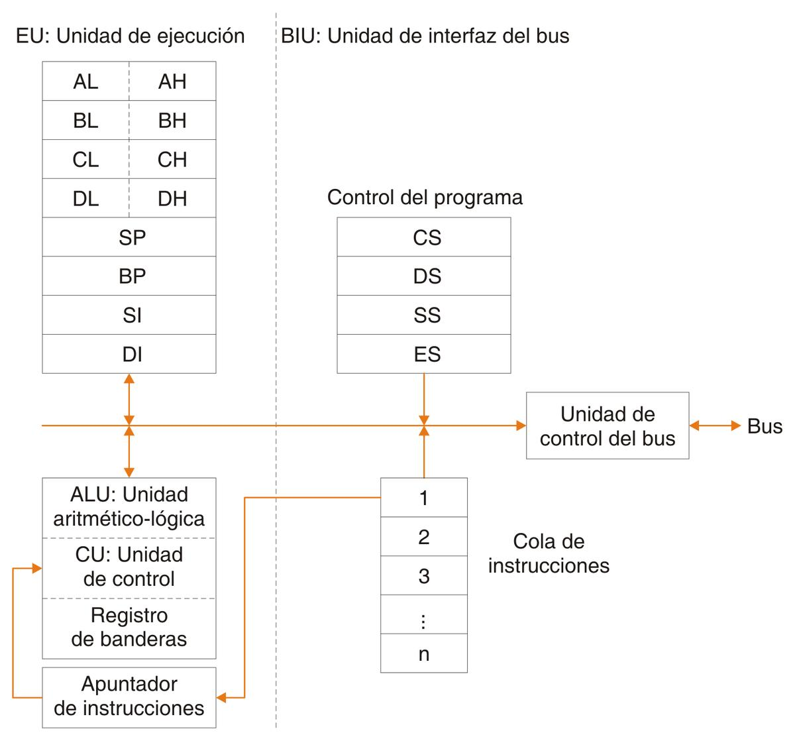
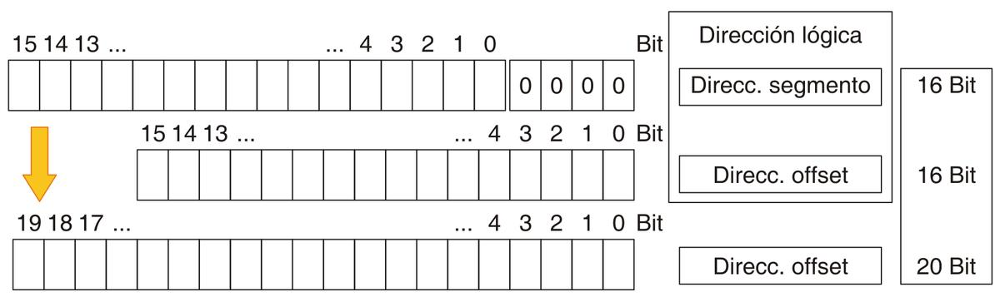
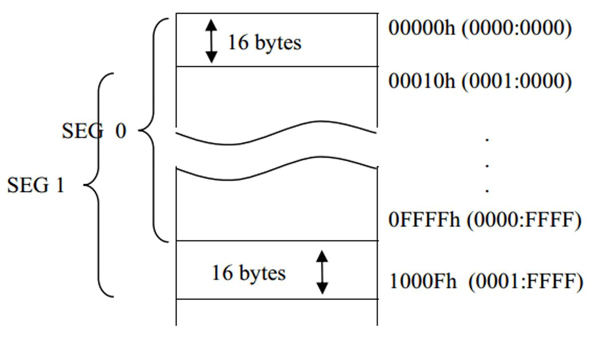
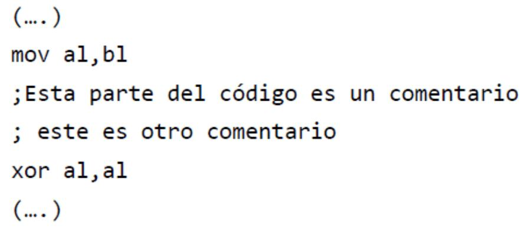

# 12. Set de instrucciones Intel

**Presentación relacionada:** [Tema 11 y 12](../Tema%2011%20y%2012/README.md)

## Objetivo

- Conocer el conjunto de instrucciones de los procesadores de Intel.

## 12.1. Introducción

En esta conferencia se hará una introducción al set de instrucciones de Intel. Se examinarán las operaciones básicas y sobre todo aquellas que tienen relación directa con las estructuras de los lenguajes de alto nivel.

## 12.2. Lenguaje ensamblador y lenguaje máquina

Como ya se vio, se denomina lenguaje máquina a los valores numéricos que la parte física de la computadora o hardware es capaz de interpretar. Cada procesador es capaz de utilizar este lenguaje como parte intrínseca de su construcción.

Utilizar este tipo de lenguaje por lo humanos es trabajoso y nada eficiente. Para lidiar con este problema, se ideó un lenguaje intermedio denominado lenguaje ensamblador, en el que se nombra cada operación y componente del procesador con un texto comprensible llamado nemotécnico.

Por ejemplo si un procesado tiene instrucciones para sumar y restar y estas se codifican en lenguaje máquina como 512 y 634 respectivamente, en lenguaje ensamblador podría escribirse: addition y substraction. Esto significa que el lenguaje ensamblador es todavía un lenguaje de bajo nivel ya que depende absolutamente del código máquina que traduce, aunque para su uso, efectivamente, se requiere un traductor o compilador.

Los lenguajes ensambladores se comenzaron a utilizar desde la primera generación de computadoras. Fueron el resultado de utilizar tablas de equivalencias en los manuales de las computadoras. En aquel entonces no había compiladores y los programas se escribían como seudocódigo basado en las operaciones de bajo nivel del sistema de cómputo (ensamblador). La traducción a código de máquina era un proceso completamente manual.

**Figura 12.1.** Arquitectura interna del 8086.

En 1978 Intel presentó el procesador 8086. Luego desarrolló el 8088 para ofrecer un diseño ligeramente más sencillo y mayor compatibilidad con los dispositivos de E/S en ese momento. El 8086 al igual que el 8088 poseen una arquitectura interna de 16 bits que permiten trabajar con operandos de 8 y 16 bits, así como una capacidad de direccionamiento de 20 bits que permite direccionar 1Mb en memoria principal, compartiendo además el mismo conjunto de 92 instrucciones. Como puede verse en la figura 1, el 8086 se divide en dos unidades lógicas: una de ejecución (EU) y una unidad de interfaz del bus (BIU). El papel de la EU es ejecutar instrucciones mientras la BIU es mandar los datos a la EU. La EU posee una unidad aritmético-lógica, una unidad de control y 10 registros. Permite ejecutar las instrucciones, realizando todas las operaciones aritméticas, lógicas y de control necesarias.

## 12.3. Registros

Los registros del procesador tienen como misión fundamental almacenar las posiciones de memoria que van a sufrir repetidas manipulaciones, ya que los accesos a memoria son más lentos que los accesos a registros. El 8086 posee 14 registros de 16 bits que se emplea para controlar la ejecución de instrucciones, direccionar la memoria y proporcionar capacidad aritmética y lógica.

Cada registro puede almacenar datos o direcciones de memoria. Los registros son direccionables por medio de un nombre, y por convención los bits de un registro se enumeran de izquierda a derecha.

BH=01011000 0 1 0 1 1 0 1 0 7 6 5 4 3 2 1 0 Ejemplo de registro de 8 bits (AL, AH, BL, BH, etc), los bits están enumerados de izquierda a derecha.

## 12.4. Clasificación de los registros

Los diferentes registros del 8086 se clasifican en:

1. Propósito general o de datos.
2. De segmento.
3. De Índice.
4. Banderas.

Los procesadores de Intel se caracterizan por el solapamiento de registros.

Significa que varios registros comparten el mismo circuito físico, lo que implica que en realidad hay muchos menos registros que los nombrados. Por ejemplo el registro RAX en un procesador Corei, tiene un tamaño de 64 bits. Pero este mismo registro puede ser utilizado en tamaños menores.

EAX : 32 bits AX : 16 bits

AL : 8bits AH : 8bits Habiendo por tanto cinco registros en el mismo circuito físico. La razón fundamental de este comportamiento es la política de Intel de mantener compatibilidad “hacia atrás”. Es decir, que el código antiguo funcione en máquinas modernas.

### 12.4.1. De propósito general

Se utilizan para cálculo y almacenamiento de propósito general. Los programas leen datos de memoria y los dejan en estos registros, ejecutan operaciones sobre ellos, y guardan los resultados en memoria. Hay cuatro registros de propósito general que, aparte de ser usados a voluntad por el programador, tienen fines específicos: 32 bits 16 bits 8 bits 8 bits Descripción EAX AX AH AL Este registro es el acumulador principal, implicado en gran parte de las operaciones de aritméticas y de E/S.

Recibe el nombre de registro base ya que es el único registro de propósito general que se usa como un índice en el direccionamiento indexado. Se suele utilizar para cálculos aritméticos.

EBX BX BH BL El CX es conocido como registro contador ya que puede contener un valor para controlar el número de veces que se repite una cierta operación.

ECX CX CH CL Se conoce como registro de datos.

Algunas operaciones de E/S requieren su uso, y las operaciones de multiplicación y división con cifras grandes suponen que el DX y el AX trabajan juntos.

EDX DX DH DL Estructura de un registro de propósito general 32 bits 16 bits 8 bits 8 bits EDX=#:DX DX=DH:DL # DX # DH DL Nota: nótese que DL es la parte baja de DX y DH la parte alta. Si por ejemplo DX contiene el valor 01FFh, 01h está contenido en DH y FFh en DL.

DX = 01FFh DH=01h: DL=FFh

El trabajo con registros requiere cierto cuidado, debido a que una mala manipulación puede afectar los registros de manera incorrecta. Si por ejemplo se incrementa DX en 1, el resultado es 0200h. 01FFh+01h = 0200h Mientras que si se incrementa solamente DL en 1 se obtiene como resultado 00h (FFh+01h), el valor de DH no se actualiza (01h), y por consiguiente si necesitamos el valor de DX se obtiene 0100h.

DX=0100h DH=01h DL=FFh+01h = 00h Esto es porque cuando se modifica una parte del registro la otra no se afecta, pero si se afecta el resultado del registro en general.

### 12.4.2. Registros de segmentos

Los registros de segmento son registros de 16 bits que constituyen la implementación física de la arquitectura segmentada de los procesadores INTEL. Antes de comprender para que se utilizan los registros de segmentos se debe explicar brevemente que se entiende por segmentación.

#### 12.4.2.1. Segmentos y direccionamiento

Para acceder a una dirección de memoria lo lógico seria colocar la dirección completa en un registro y acceder mediante este. Sin embargo los procesadores INTEL poseen 20 líneas en el bus de direcciones (20 bits), pero sus registros son de 16 bits, de forma que si se pone la dirección de memoria en uno de esos registros el límite de direccionamiento está dado por 216 (64KB) de 220 (1024 KB) posibles. Perdiéndose 4 bits de direccionamiento debido al tamaño de los registros.

La solución a esto consistió en usar dos registros de 16 bits, pero no dispuestos uno a continuación del otro, ya que se obtendría una dirección de 32 bits, sino que un registro especifica el bloque de memoria (segmento), mientras el otro definiría el desplazamiento (offset) dentro del bloque.

Para direccionar cualquier posición de memoria, el procesador combina la dirección del segmento que se encuentra en un registro de segmento con un valor de desplazamiento, para calcular la dirección real de 20 bits.

**Figura 12.2.** Ejemplo de direccionamiento utilizando segmento + desplazamiento.

Como se observa en la figura 12.2, lo primero que se hace es agregar 4 bits al 0 al valor que se encuentra en el registro de segmento, lo que equivale a multiplicar por 16 dicho valor. Por esta causa cualquier segmento empieza siempre en una dirección de memoria (de 20 bits) múltiplo de 16. La siguiente figura muestra la segmentación de la memoria.

Se puede comprobar que los diversos segmentos (0 y 1) tienen distintos pares segmento:desplazamiento que se apuntan a la misma dirección de memoria. Esto significa que distintos segmentos de memoria de hecho se solapan. A continuación se muestra un ejemplo para calcular la dirección física a partir de la dirección del segmento más la del desplazamiento.

EJEMPLO:

Dada la dirección del segmento 1234h y el desplazamiento 52h Dirección del segmento: 12340h Dirección del desplazamiento: + 52h Dirección real: 12392h Y dada la dirección 1235h y el desplazamiento 42h Dirección del segmento: 12350h Dirección del desplazamiento: + 42h Dirección real: 12392h Ahora, un programa puede tener uno o varios segmentos, los cuales pueden comenzar en casi cualquier lugar de la memoria, variar en tamaño y en el orden, pero de manera general se usa un segmento para código, uno para datos, y otro para pila. Para apuntar a estos segmentos es para lo que se usan los registros de segmentos.

Registro Descripción CS Registro Segmento de Código. Establece el área de memoria dónde está el programa durante su ejecución.

DS Registro Segmento de Datos. Especifica la zona donde los programas leen y escriben sus datos.

SS Registro Segmento de Pila. Permite la colocación en memoria de una pila, para almacenamiento temporal de direcciones y datos.

ES Registro Segmento Extra. Para acceder a un segmento distinto de los anteriores sin necesidad de modificar los otros registros de segmento.

### 12.4.3. Registros de índice

Los registros índices se utilizan fundamentalmente en operaciones con cadenas y para direccionamiento indexado aunque se pueden usar como registros de datos sin problemas para sumas y movimiento de datos.

Registro Descripción Registro SI Registro índice fuente requerido en algunas operaciones con cadenas de caracteres. Este registro está asociado con el registro DS.

Registro DI Registro índice destino requerido también en determinadas operaciones con cadenas de caracteres. Está asociado al registro DS o ES.

Hay un tipo especial de registro índice que se emplea para apuntar al código en ejecución, es el contador de programa o apuntador de instrucciones (ip). Este registro contiene siempre la dirección en memoria de la instrucción en ejecución. Para modificarlo se deben utilizar instrucciones específicas llamadas instrucciones de control de flujo de ejecución.

### 12.4.4. Registro de banderas, flags, o registro de estado (FL)

Este es un registro de 16 bits, pero se utilizan solamente 9 de ellos, indica en todo momento el estado de la máquina y el resultado del procesamiento. Casi todas las instrucciones aritméticas y de comparación utilizan este registro. 15 14 13 12 11 10 9 8 7 6 5 4 3 2 1 0 - - - - O D I T S Z - A - P - C Los bits 0, 2, 4, 6, 7 y 11 son indicadores de condición que reflejan los resultados de las operaciones del programa; los bits 8 al 10 son indicadores de control que, modificados por el programador, sirven para controlar ciertos modos de procesamiento, y el resto no se utilizan.

Bit Operación OF (11) Bit de Overflow o desbordamiento. Indica desbordamiento de un bit de orden alto (más a la izquierda), después de una operación aritmética.

DF(10) Bit de Dirección. Designa la dirección, creciente (0) o decreciente (1), en operaciones con cadenas de caracteres.

IF(9) Bit de Interrupción. Indica que una interrupción externa, como la entrada desde el teclado, sea procesada o ignorada.

TF(8) Bit de Trap o Desvío. Procesa o ignora la interrupción interna de trace (procesamiento paso a paso).

SF(7) Bit de Signo. Indica el valor del bit más significativo del registro después de una operación aritmética o de desplazamiento.

ZF(6) Bit Cero. Se pone a 1 si una operación produce 0 como resultado AF(4) Bit de Carry Auxiliar. Se pone a 1 si una operación aritmética produce un acarreo del bit 3 al 4. Se usa para aritmética especializada (ajuste BCD).

PF(2) Bit de Paridad. Se activa si el resultado de una operación tiene paridad par.

CF (0) Bit de Acarreo. Contiene el acarreo de una operación aritmética o de desplazamiento de bits.

## 12.5. Tipos de datos

Para el trabajo con la memoria y registros se definen unos tipos de datos, que varían la cantidad de bits dependiendo de su utilización. A continuación se muestran los diferentes tipos de datos.

Tipo Nombre cantidad bits Valor máximo DB byte 8 255 DW word 16 65 535 DD dword 32 4 294 967 295 DF farword DQ quadword DT ten

## 12.6. Introducción al ensamblador

### 12.6.1. Declaración de variables

La declaración de las variables en ensamblador no difiere mucho conceptualmente respecto a la programación el alto nivel, puesto que en ambos se definen el tipo de valor, el nombre y el valor almacenado en una variable. En ensamblador se sigue la siguiente nomenclatura. <NOMBRE> <TIPO> <VALOR> EJEMPLOS: edad DB 23 var DB 33,90,'A' var DB 'Ejemp','o',8 milisegundos DW 300 milisegundos DW 5124 var DD 65 536 var DD 100 000

### 12.6.2. Comentarios

Se pueden incluir comentarios en los programas desarrollados, estos sirven para describir la funcionalidad de una porción de código o brindar información adicional para el programador. La nomenclatura que se sigue es la siguiente. < ; > [COMENTARIO] EJEMPLO:

### 12.6.3. Declaración de etiquetas

Las etiquetas son direcciones físicas de la memoria, que para un mejor entendimiento para la programación se puede direccionar con un nombre. Este nombre, denominado etiqueta permite al programador tratar con más claridad el código, en la corrida sencillamente el compilador interpreta la etiqueta como una dirección más. Pueden ser anónimas o locales, las anónimas no requieren nombre, y se especifican con @@; las locales pueden contener cualquier combinación de letras y números, pero no caracteres extraños. <ETIQUETA> :

EJEMPLOS:

Iniciar: @@: ;etiqueta anónima .continuar ; etiqueta local

### 12.6.4. Instrucciones

Existe una amplia gama de instrucciones, para un mejor entendimiento se van a clasificar dependiendo de para que se usan. Las más utilizadas son: 3 Movimiento de datos 4 Aritméticas 5 Lógicas 6 Desplazamientos y rotaciones 7 Transferencias de control 8 Repetitivas Movimiento de Datos MOV destino, origen (destino=origen) MOVZX destino, origen (destino= 0000:origen) PUSH registro (pila.Push(registro)) POP registro (registro = pila.Pop()) XCHG registroA,registroB temporal= registroA registroA= registroB registroB= temporal Dirección física/lógica Dirección física MOV [segmento:desplazamiento],registro Ejemplo:

MOV [es:di],eax Dirección lógica MOV [dirección lógica],registro MOV [variable],eax Modos de Direccionamiento Registro (MOV AX,BX) Inmediato {MOV AX,0x10} Directo (MOV AX,[0x11])

Indirecto (MOV AX,[BX]) Base+índice (MOV [AX:DI],CX) Relativo por registros (MOV [AX+1],CL) Relativo base+índice (MOV [AX+DI+1],CL) Operaciones aritméticas INC oper (operador++) DEC oper ADD oper1,oper2 SUB oper1,oper2 CMP oper1,oper2 MUL oper DIV oper MUL bl (ax=al*bl) MUL BX (dx:ax=ax*bx) MUL ECX (edx:eax=eax*ecx) DIV bl (al=ax/bl ; ah = ax%bl) DIV bx (ax=dx:ax/bx ; dx=dx:ax%bx) DIV ecx (eax=edx:eax/ecx ; edx = edx:eax%ecx) Operaciones lógicas AND oper1,oper2 (oper1 = oper1 & oper2) TEST oper1,oper2 (oper1 & oper2) OR oper1,oper2 (oper1=oper1 | oper2) XOR oper1,oper2 (oper1=oper1 xor oper2) NOT oper (oper=!oper) Banderas CF(Carry Flag): Bandera de acarreo ZF (Zero Flag): Bandera de cero SF: Bandera de signo (negativo) IF(Interruption Flag): Bandera de interrupciones.

Transferencia de control Saltos incondicionales JMP [short/far] <etiqueta> Ejemplos:

JMP main JMP @b; salta a la etiqueta anónima anterior JMP @f; salta a la etiqueta anónima siguiente JMP SHORT .label Condicionales JXX [SHORT] <etiqueta> JA/JNBE: Salta si oper1>oper2 (CF=0 y ZF =0) JAE/JNB/JNC Salta si oper1>=oper2 (CF=0) JB/JNAE/JC Salta si oper1<oper2 (CF=1) JBE/JNA salta si oper1<=oper2 (CF=1 o ZF=1) JE/JZ: salta si oper1=oper2 (ZF=1) JNE/JNZ salta si oper1!=oper2 (ZF=0) JCXZ: salta si CX=0 JECXZ: salta si ECX=0 Hacer algunos ejemplos LOOP <etiqueta> Ejemplo:

Mov CX,10 ; 10 iteraciones inicio: ;esto es una etiqueta (….) loop inicio times <numero> <instruccion> Ejemplo: times 3 inc dx INC DX INC DX INC DX

Procedimiento <NOMBRE >: …. ; instrucciones RET Ejemplo: mov cx,10 CALL Sumatoria ; se invoca al procedimiento sumatoria mov [sumatoria],ax ; en ax esta contenido el resultado de la operación, se guarda en la posición en memoria sumatoria ……….

Sumatoria:

Sumar: add ax,cx loop sumar ; con cada iteración cx decrementa en uno (DEC CX) RET ; con esta instrucción termina el procedimiento ……….

Se puede consultar la bibliografía [1] y [2] para ver el resto de las instrucciones que se pueden utilizar.

## Resumen

<!-- tabla detectada en PDF p.165 -->

| 0 | 1 | 0 | 1 | 1 | 0 | 1 | 0 |
| --- | --- | --- | --- | --- | --- | --- | --- |
| 7 | 6 | 5 | 4 | 3 | 2 | 1 | 0 |

<!-- tabla detectada en PDF p.166 -->

| 32bits | 16bits | 8bits | 8bits | Descripción |
| --- | --- | --- | --- | --- |
| EAX | AX | AH | AL | Este registro es el acumulador principal implicado en , granpartedelasoperacionesdearitméticasydeE/S . |
| EBX | BX | BH | BL | Recibe el nombre de registro base ya que es el único registro de propósito general que se usa como un índice en el direccionamiento indexado Se suele . utilizarparacálculosaritméticos . |
| ECX | CX | CH | CL | El CX es conocido como registro contador ya que puede contener un valor para controlar el número de vecesqueserepiteunaciertaoperación . |
| EDX | DX | DH | DL | Se conoce como registro de datos Algunas . operaciones de E/S requieren su uso y las , operaciones de multiplicación y división con cifras grandessuponenqueelDXyelAXtrabajanjuntos . |

<!-- tabla detectada en PDF p.166 -->

| 32bits | 16bits | 8bits | 8bits |
| --- | --- | --- | --- |
| EDX =#:DX |  |  |  |
| DX =DH:DL | # | DX |  |
|  | # | DH | DL |

<!-- tabla detectada en PDF p.169 -->

| Registro | Descripción |
| --- | --- |
| CS | Registro Segmento de Código Establece el área de memoria dónde está el . programadurantesuejecución . |
| DS | Registro Segmento de Datos Especifica la zona donde los programas leen y . escribensusdatos . |
| SS | Registro Segmento de Pila Permite la colocación en memoria de una pila para . , almacenamientotemporaldedireccionesydatos . |
| ES | Registro Segmento Extra Para acceder a un segmento distinto de los anteriores sin . necesidaddemodificarlosotrosregistrosdesegmento . |

<!-- tabla detectada en PDF p.169 -->

| Direccióndelsegmento: | 12340h |
| --- | --- |
| Direccióndeldesplazamiento: | + 52h |
| Direcciónreal: | 12392h |

<!-- tabla detectada en PDF p.169 -->

| Direccióndelsegmento: | 12350h |
| --- | --- |
| Direccióndeldesplazamiento: | + 42h |
| Direcciónreal: | 12392h |

<!-- tabla detectada en PDF p.170 -->

| Registro | Descripción |
| --- | --- |
| RegistroSI | Registro índice fuente requerido en algunas operaciones con cadenas de caracteres EsteregistroestáasociadoconelregistroDS . . |
| RegistroDI | Registro índice destino requerido también en determinadas operaciones con cadenasdecaracteres EstáasociadoalregistroDSoES . . |

<!-- tabla detectada en PDF p.170 -->

| Bit | Operación |
| --- | --- |
| OF(11) | BitdeOverflowodesbordamiento Indicadesbordamientodeunbitdeordenalto(mása . laizquierda) despuésdeunaoperaciónaritmética , . |
| DF(10) | BitdeDirección Designaladirección creciente(0)odecreciente(1) enoperaciones . , , concadenasdecaracteres . |
| IF(9) | BitdeInterrupción Indicaqueunainterrupciónexterna comolaentradadesdeel . , teclado seaprocesadaoignorada , . |
| TF(8) | BitdeTrapoDesvío Procesaoignoralainterrupcióninternadetrace(procesamiento . pasoapaso) . |
| SF(7) | BitdeSigno Indicaelvalordelbitmássignificativodelregistrodespuésdeuna . operaciónaritméticaodedesplazamiento . |
| ZF(6) | BitCero Seponea1siunaoperaciónproduce0comoresultado . |
| AF(4) | BitdeCarryAuxiliar Seponea1siunaoperaciónaritméticaproduceunacarreodelbit . 3al4 Seusaparaaritméticaespecializada(ajusteBCD) . . |
| PF(2) | BitdeParidad Seactivasielresultadodeunaoperacióntieneparidadpar . . |
| CF(0) | BitdeAcarreo Contieneelacarreodeunaoperaciónaritméticaodedesplazamientode . bits . |

<!-- tabla detectada en PDF p.170 -->

| 15 | 14 | 13 | 12 | 11 | 10 | 9 | 8 | 7 | 6 | 5 | 4 | 3 | 2 | 1 | 0 |
| --- | --- | --- | --- | --- | --- | --- | --- | --- | --- | --- | --- | --- | --- | --- | --- |
| - | - | - | - | O | D | I | T | S | Z | - | A | - | P | - | C |

<!-- tabla detectada en PDF p.171 -->

| Tipo | Nombre | cantidadbits | Valormáximo |
| --- | --- | --- | --- |
| DB | byte | 8 | 255 |
| DW | word | 16 | 65535 |
| DD | dword | 32 | 4294967295 |
| DF | farword |  |  |
| DQ | quadword |  |  |
| DT | ten |  |  |

