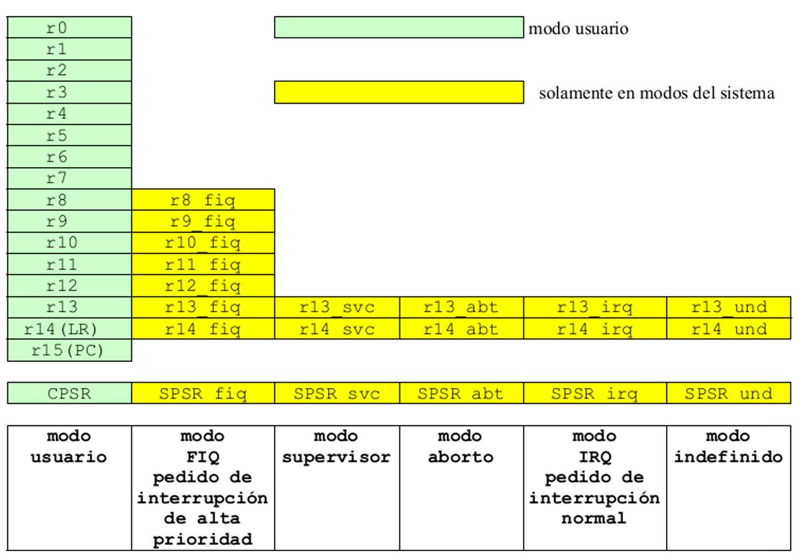
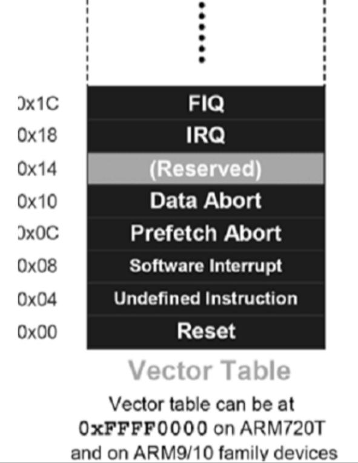

# 13. Arquitectura de procesadores RISC

**Presentación relacionada:** [Tema 13 y 14](../Tema%2013%20y%2014/README.md)

## Objetivo

- Caracterizar la arquitectura ARM.

## 13.1. Introducción

La arquitectura ARM se diseñó para permitir implementaciones de tamaño muy reducido y de alto rendimiento. La arquitectura simple permite dispositivos de muy bajo consumo de energía. ARM se caracteriza fundamentalmente por ser una computadora RISC, como lo indica su propio nombre: Advanced RISC Machine.

El concepto RISC se originó en los programas de investigación de procesadores de las universidades de Stanford y Berkeley, por 1980. Por aquella época se comenzó a investigar la simplificación de los procesadores y se les llamó CISC a los existentes. Los primeros procesadores RISC fueron RISC I y II de Berkeley, y MIPS de Stanford (Microprocessor without Interlocking Pipeline Stages).

El primer procesador ARM fue desarrollado, entre 1983 y 1985, por Acorn Computers Limited of Cambridge, Fue el primer microprocesador RISC para uso comercial. Las posteriores arquitecturas RISCs tuvieron diferencias significativas con este primer diseño. En 1990, ARM Limited se estableció como una compañía separada específicamente dedicada a la explotación de la tecnología ARM. El criterio de la empresa fue otorgar la licencia de esta tecnología a varios fabricantes de semiconductores en todo el mundo. Comenzó a establecerse como líder del mercado para aplicaciones embebidas de bajo consumo y costo.

De este modo el mérito tecnológico de ARM es doble, primero por la propia tecnología avanzada que permite diseños escalables y eficientes. Segundo porque ellos mismos no fabrican los procesadores, en vez de eso los diseñan y preservan lo que se llama propiedad intelectual, son algo así como una empresa de diseño a pedido de alta tecnología.

## 13.2. Arquitectura de ARM

La arquitectura ARM incorpora varias características, algunas únicas y otras muy optimizadas respecto al resto de arquitecturas:  Arquitectura de carga y almacenamiento (load-store). Las instrucciones que acceden a memoria están separadas de las instrucciones que procesan los datos, ya que en este último caso los datos necesariamente están en registros.  Instrucciones de longitud fija de 32 bits. Campos de instrucciones uniforme y de longitud fija, para simplificar la decodificación de las instrucciones.  Formatos de instrucción de 3 direcciones. Consta de “f” bits para el código de operación, “n” bits para especificar la dirección del primer operando, “n” bits para especificar la dirección del segundo operando y “n” bits para especificar la dirección del resultado (el destino).

El formato de esta instrucción en ensamblador, por ejemplo para la instrucción de sumar dos números es: add d, s1, s2 ;d := s1 + s2 f bits n bits n bits n bits function op 1 addr. op 2 addr. dest. addr.

**Figura 13.1.** Formato de instrucción de tres direcciones.

En el formato de 3 direcciones de ARM las direcciones se especifican por registros, que se han cargado previamente con el contenido de las direcciones de memoria correspondientes. En general, el término “arquitectura de 3 direcciones” se refiere a un conjunto de instrucciones donde los dos operandos fuente y el destino, se pueden identificar independientemente uno del otro, pero frecuentemente solo dentro de un restringido conjunto de valores posibles. Esta arquitectura no destructiva (el resultado de la operación no se escribe sobre alguno de los operandos) permite a los compilador es organizar las instrucciones de manera de optimizar el entubamiento de instrucciones.  Todas las instrucciones se ejecutan en un ciclo de reloj. El diseño de las instrucciones y la arquitectura del procesador son tan eficientes que un ciclo de instrucción es equivalente a un ciclo de máquina.  Modos de direccionamiento simples. El procesamiento de datos solo opera con contenidos de registros, no directamente en memoria.  Control sobre la unidad aritmética lógica en cada instrucción de procesamiento de datos.

Esto maximiza el uso de la ALU y a la vez que optimiza la ejecución de código porque disminuyen las etapas necesarias para ejecutar una instrucción.  Modos de direccionamiento con incremento y decremento automático de punteros. Para optimizar los lazos de los programas.

 Carga y almacenamiento de múltiples instrucciones, para maximizar el rendimiento de los datos. Ejecución condicional de todas las instrucciones, para maximizar el rendimiento de la ejecución.  Set de instrucciones ortogonal, regular o simétrico. En este tipo de set no hay restricciones en los registros usados en las instrucciones, son todos registros de propósitos generales, con muy pocas excepciones. Esto facilita las etapas de ejecución, el desarrollo de compiladores y la optimización de bajo nivel.  Arquitectura “Thumb”. Algunas variantes ARM tienen esta característica para aplicaciones que necesiten mejorar la densidad de código. Consiste en usar un set de instrucciones de 16 bits como una forma comprimida del set de instrucciones ARM de 32 bits.

### 13.2.1. Registros en ARM

ARM tiene 37 registros, 31 de ellos son registros de 32 bits de propósito general, los 6 restantes son registros de estado. Estos registros también son de 32 bits pero solo se utilizan 12 bits.

Los registros se ubican en bancos parcialmente superpuestos, con un banco diferente para cada modo del procesador. El conjunto de registros a los cuales el usuario tiene acceso está determinado por el modo de funcionamiento del procesador.

En cualquier momento se puede acceder por software a 16 registros, que van de r0 a r15, o sea que 16 registros son visibles. Los otros registros se usan para acelerar el proceso de excepción.

Todos los registros especificados en una instrucción ARM se pueden “direccionar” con cualquiera de los 16 registros visibles.

El registro r15 es el contador de programa o puntero de instrucción.

El registro r14 (LR, Link Register) además de usarse como registro de propósito general se usa para guardar la dirección de la siguiente instrucción cuando se lleva a cabo una instrucción de salto o una llamada a subrutina.

Otro registro visible para el usuario es el registro de estado del programa (CPSR, Current Program Status Register). En general, a los registros que guardan los estados del programa, se los llama, registros de estado del programa (PSR, Program Status Register). En total hay 6 de estos registros.

Los registros pueden cambiar su significado de acuerdo con el modo de funcionamiento del procesador.

## 13.3. Modos de funcionamiento de un procesador ARM

En ARM existen varios modos de funcionamiento, el cambio entre modos se puede hacer bajo control del software o puede ser causado por interrupciones externas. La mayoría de los programas de aplicaciones se ejecutan en modo usuario, es decir con bajos privilegios.

Mientras el procesador está en modo usuario, el programa que se está ejecutando no puede acceder a recursos protegidos del sistema o cambiar de modo. Esto permite escribir un sistema operativo adecuado para controlar el uso de los recursos del sistema.

Modo usuario, USR, User Mode Sin privilegios, bajo el cual corren la mayoría de las aplicaciones. Modo de ejecución normal de los programas. Los programadores a nivel de usuario deben tener en cuenta que solo pueden acceder a las funciones a nivel del sistema a través de llamadas del supervisor. Generalmente estas funciones incluyen cualquier acceso a los registros periféricos del hardware y operaciones frecuentes, tales como entrada y salida de caracteres. Los restantes modos son privilegiados y se llaman excepciones.

Modos “excepciones”  Modo supervisor, SVC Supervisor Mode, entra en este modo con el reset o cuando se ejecuta una interrupción de software, SWI, Software Interrupt . Modo protegido para sistema operativo. El mecanismo de protección asegura que el código del usuario no pueda obtener los privilegios del supervisor sin los controles apropiados a fin de asegurar que este código no intente operaciones ilegales.  Modo instrucción indefinida, UND, Undefined Mode, se usa este modo para manejar instrucciones indefinidas. Soporta emulación de software de coprocesadores de hardware.  Modo: interrupciones de alta prioridad, FIQ Fast Interrupt Request Mode, entra en este modo cuando aparece una interrupción de alta prioridad (fast). Soporta un proceso de transferencia de datos o canal de alta velocidad.  Modo: interrupciones de baja prioridad o normales, IRQ, Normal interrupt request Mode, entra en este modo cuando aparece una interrupción de baja prioridad (normal). Usado para manejar interrupciones de propósitos generales.  Modo aborto, ABT, Abort Mode, se usa para manejar violaciones de acceso a memoria.

Aborto por una fallo de memoria al leer una instrucción (instruction fetch memory fault) o al acceder a un dato (data abort)  Modo sistema, SYS, System Mode, modo privilegiado que usa los mismos registros que el modo usuario. Corre tareas privilegiadas del sistema operativo (arquitectura ARM versión 4 y superiores) Se entra en ellos cuando aparece una excepción específica. Tienen acceso a todos los recursos y pueden cambiar libremente de modo. Cada uno de ellos tiene registros adicionales para evitar que cuando ocurre una excepción se arruinen los registros del modo usuario.

Al modo sistema, presente solamente a partir de la arquitectura ARM 4, no se entra con cualquier excepción y participa de los mismos registros que el modo usuario. Sin embargo, es un modo privilegiado y, por lo tanto, no está sujeto a las restricciones del modo usuario.

Se entra en él para usar tareas del sistema operativo que necesitan acceder a recursos de éste, pero deseando evitar el uso de registros adicionales asociados con el modo de excepción. Así se evita que el estado de la tarea no se corrompa por la aparición de cualquier excepción.

Para cada modo está disponible un subconjunto concreto de registros, la figura 13.2 ilustra los conjuntos de cada modo:

**Figura 13.2.** Registros disponibles en cada modo de los procesadores con arquitectura ARM.

Todas las instrucciones en ARM incluyen condicionales, lo que significa que una sola operación sobre los registros puede hacer tres cosas, no necesariamente en ese orden, depende de la instrucción:

1. La propia operación (sumar, multiplicar, asignar…).
2. Una operación lógica sobre el mismo valor u otro registro, como se mencionó antes.
3. Una comparación.

## 13.4. Acceso a la memoria

El manejo de la memoria, al igual que Intel se hace en formato Little-endian. Por ser máquinas de 32bit, los sistemas ARM pueden acceder hasta 4Gbyte de RAM.

El manejo de valores de más de un byte también se clasifica como en el caso de Intel y compatibles.

Bits Tipo 8 16 32 Byte Word Double word ARM utiliza exclusivamente paginación para la gestión de memoria, la forma en que gestiona las páginas es muy similar a Intel: una paginación de dos niveles, con un directorio de páginas como entrada principal. Las páginas pueden ser de 4K y de 64K. Sin embargo, ARM puede manejar dos directorios simultáneamente, lo que resulta conveniente para un sistema operativo ya que se podría usar estáticamente uno de ellos mientras en otro se alternan los programas.

## 13.5. Gestión de interrupciones

ARM utiliza un esquema de manejo de interrupciones que recuerda la tabla de vectores de interrupción del Modo Real en Intel. Excepto para el reset, el modo en que se manejan las interrupciones y las excepciones es igual en todos los casos:

1. Se finaliza la ejecución de la instrucción en curso.
2. Se entra en el estado ARM. El modo de operación del procesador se cambia al modo apropiado de la excepción.
3. El estado actual del PC se guarda copiándolo en r14 y el CPSR en el SPSR (dependiendo del tipo de excepción que haya ocurrido).
4. Se inhabilitan las excepciones IRQ y si la fuente de la excepción era una FIQ también éstas se inhabilitan.
5. Se guarda la dirección de retorno en el registro link.
6. El registro PC se fuerza a un valor entre 0x00 y 0x1C que corresponde a una dirección de la tabla de vectores de interrupción. El valor particular depende del tipo de excepción.

La instrucción que está en la posición en la que se forzó al registro PC (la dirección del vector) usualmente contendrá un salto a una rutina de atención de la excepción.

Para retornar se recupera el valor del registro CPSR que se había guardado y luego se restaura el valor de PC para continuar la ejecución en el mismo punto de la interrupción.

Cuando se produce un reset:

1. Se activa el modo supervisor.
2. Se pasa al estado ARM.
3. Se inhabilitan las excepciones IRQ y FIQ.
4. Se carga en el PC la dirección del vector del reset, 0x00000000.

En ese estado, el procesador comienza todo desde cero. En la figura 13.3 se muestra la ubicación de los vectores de interrupción.

**Figura 13.3.** Ubicación y función de los vectores de interrupción en ARM.

<!-- tabla detectada en PDF p.180 -->

| fbits | nbits | nbits | nbits |
| --- | --- | --- | --- |
| function | op1addr . | op2addr . | dest addr . . |

<!-- tabla detectada en PDF p.184 -->

| Bits | Tipo |
| --- | --- |
| 8 | Byte |
| 16 | Word |
| 32 | Doubleword |

## 13.6. Conclusiones

Los procesadores ARM incluyen características que los hacen únicos en cuanto a la optimización del funcionamiento y ahorro de energía, como el empaquetado de direcciones, el set de instrucciones simplificado, la técnica carga y almacenamiento. Estas son características ideales para aplicaciones móviles.

ARM dispone de varios modos de trabajo, aunque se destacan dos: usuario y sistema. Esto permite una clara aplicación a la implementación de sistemas operativos, dónde es vital para la seguridad de código.

La relativa simpleza de la arquitectura facilita la escritura de código y el desarrollo de aplicaciones.

La mayoría de los registros ARM son de propósito general y están a disposición del usuario.
