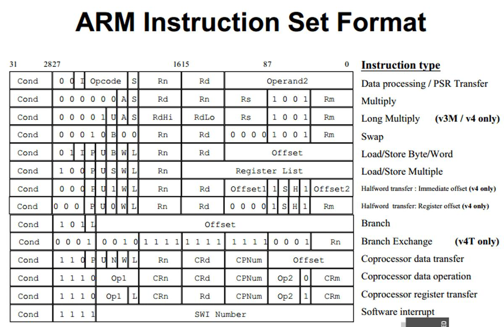
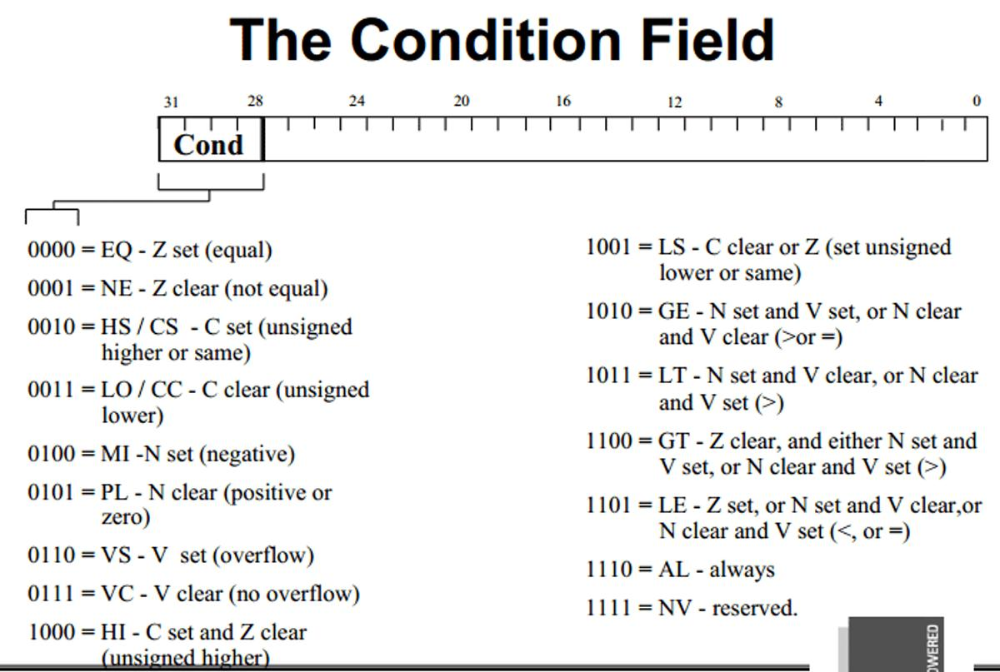
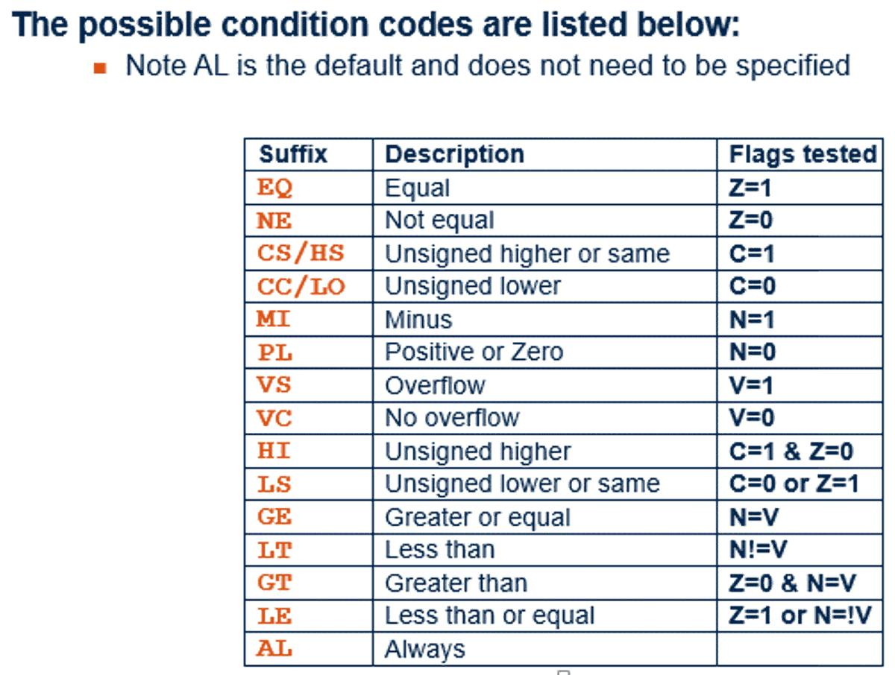
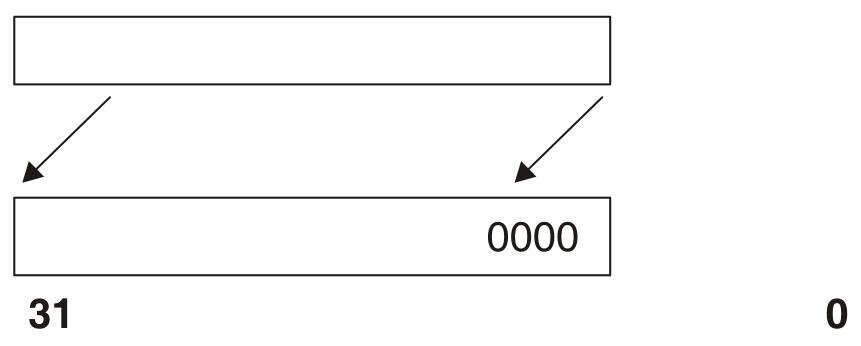
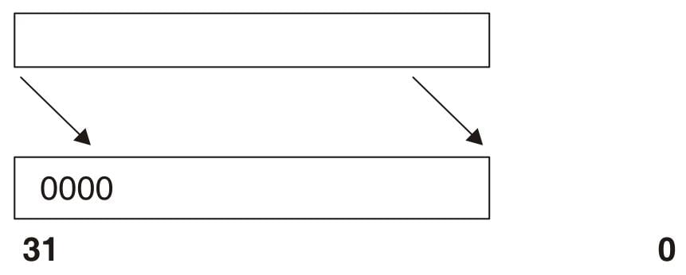
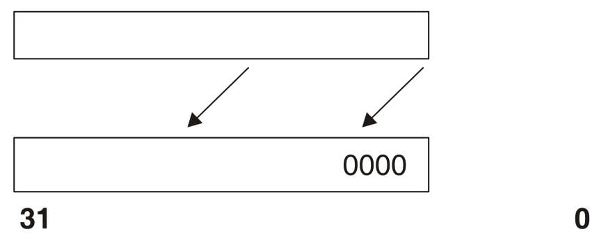
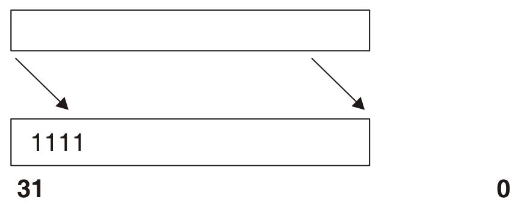
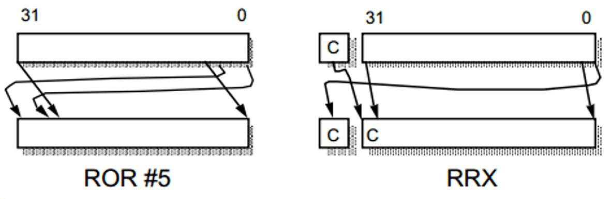
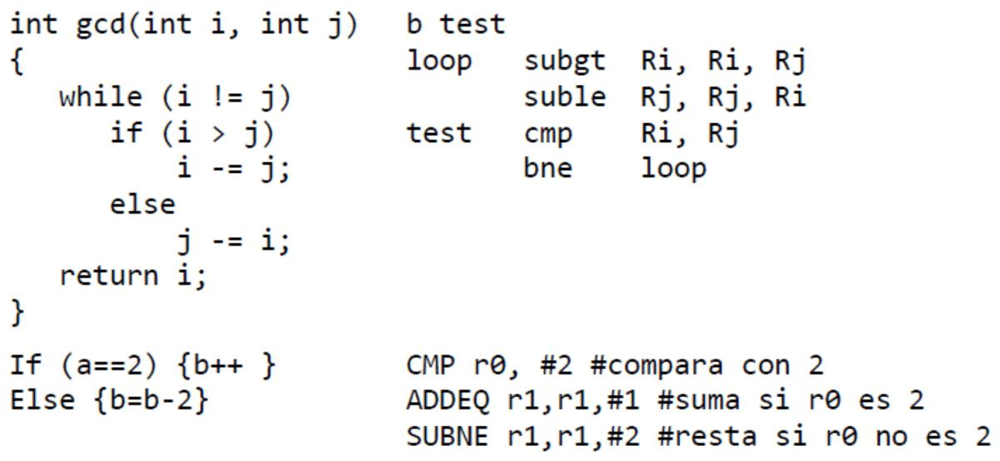

# 14. Set de instrucciones ARM

**Presentación relacionada:** [Tema 13 y 14](../Tema%2013%20y%2014/README.md)

## Objetivo

- Conocer el conjunto de instrucciones de los procesadores de ARM.

## 14.1. Introducción

Una de las principales ventajas de la arquitectura ARM sobre otras arquitecturas es el manejo eficiente que se le hace a las instrucciones hasta tal punto que todas demoran un ciclo de reloj. Su arquitectura está pensada para optimizar el código que se desee ejecutar, logrando una escalabilidad en el diseño debido a la flexibilidad que se puede lograr con el uso de las instrucciones y los registros. En esta conferencia se abordarán algunos temas referentes al set de instrucciones de los procesadores ARM.

## 14.2. Set de instrucciones de ARM

Para mantener el concepto tradicional de RISC, se estableció la ejecución de una orden en un tiempo, por lo general, de un ciclo. La característica más interesante es el uso de los 4 bits superiores como código de condición, haciendo que cualquier instrucción pueda ser condicional.

Este corte reduce el espacio para algunos desplazamientos en el acceso a la memoria, pero permite evitar perder ciclos de reloj en el pipeline al ejecutar pequeños trozos de código con ejecución condicional. En la figura 14.1 se muestra el formato del set de instrucciones de ARM, y en la figura 14.2 las diversas configuraciones que puede tomar el campo condición.



**Figura 14.1.** Formato del set de instrucciones de ARM. Note como los 4 bits más significativos son especificados como código de condición. Esto hace que todas las instrucciones ARM sean condicionales.



**Figura 14.2.** Diferentes configuraciones que puede tomar el campo CONDICION.



**Figura 14.3.** Configuraciones del campo CONDICION y las banderas que afecta.

Para ejecutar una instrucción condicionalmente, simplemente se le añade un sufijo con una condición.

Por ejemplo. La instrucción adicionar (**ADD**), toma la siguiente forma:

- **ADD** r0,r1,r2 (r0=r1+r2) la cual es equivalente a **ADDAL** r0,r1,r2; debido a que el sufijo **AL** se ejecuta siempre por defecto.

Para ejecutar la misma operación si la bandera Z está activa simplemente se le agrega el prefijo EQ al final.

- **ADDEQ** r0,r1,r2

#### Instrucciones de procesamiento de datos

ARM provee una cantidad bastante extensa de instrucciones, pero todas comparten el mismo formato. Estas contienen operaciones aritméticas, Comparaciones, operaciones lógicas, movimiento de datos entre registros. Pero su principal logro se considera que estas instrucciones sólo funcionan en registros, nunca en memoria. Esta es la razón por la cual todas sus instrucciones demoran un ciclo de reloj, y se logra un mejor aprovechamiento de los recursos del procesador con las inherentes ganancias de rapidez y a un muy bajo consumo respecto a los procesadores CISC.

#### Operaciones aritméticas

Las operaciones aritméticas que define ARM son:

- Suma binaria
- Resta binaria
- Resta binaria inversa

La sintaxis de las operaciones aritméticas es la siguiente:

```
<Operation>{<cond>} Rn, Operand2
```

Algunas de estas operaciones son:

- **ADD** (operand1 + operand2)
- **ADC** (operand1 + operand2 + carry); suma con acarreo
- **SUB** (operand1 - operand2)
- **SBC** (operand1 - operand2 + carry -1); resta con acarreo
- **RSB** (operand2 - operand1); resta binaria inversa
- **RSC** (operand2 - operand1 + carry - 1); resta binaria inversa con acarreo

Ejemplos:

- ADD r0, r1, r2
- SUBGT r3, r3, #1
  - RSB r0,r1,r2 &nbsp;&nbsp; ; r0=r2-r1 => resta binaria inversa
  - RSC r0,r1,r2 &nbsp;&nbsp; ; r0=r2-r1+C-1 => resta binaria inversa con acarreo
- RSBLES r4, r5, #5

#### Comparaciones

Las comparaciones tienen como efecto solamente actualizar las banderas de condición, por lo tanto no es necesario activar el bit S.

Su sintaxis es:

```
<Operation>{<cond>} Rn, Operand2
```

Las operaciones son:

- **CMP** (operando1 - operando2)
- **CMN** (operando1 + operando2)
- **TST** (operando1 AND operando2)
- **TEQ** (operando1 EOR operando2)

El resultado de estas operaciones no se escribe, solo se afectan las banderas de estado.

Algunas de estas operaciones son:

- **CMP** r0, r1; compara si el registro r0 > r1
- **TSTEQ** r2, r1; actualiza las banderas en función (r1 & r2)

#### Operaciones lógicas

Las instrucciones lógicas más utilizadas son:

- Producto lógico
- Suma lógica
- Suma exclusiva
- Borrado de un bit

La sintaxis es:

```
<Operation>{<cond>}{S} Rd, Rn, Operand2
```

Las operaciones son:

- **AND** (operand1 AND operand2)
- **EOR** (operand1 EOR operand2)
- **ORR** (operand1 OR operand2)
- **BIC** (operand1 AND NOT operand2 (ie bit clear]

Ejemplos:

```
AND r0,r1,r2     ; r0 = r1 AND r2        r0 = r1 & r2
ORR r0,r1,r2     ; r0 = r1 OR r2         r0 = r1 | r2
EOR r0,r1,r2     ; r0 = r1 XOR r2        r0= r1 ^ r2
BIC r0,r1,r2     ; r0 = r1 AND NOT r2    r2 = r1 & ¡r2 ;
```

#### Movimiento de datos

Sintaxis:

```
<Operation>{<cond>}{S} Rd, Operand2
```

Las operaciones son:

- MOV operand2
- MVN NOT operand2

Ejemplos:

```
MOV r0, r1       ; r1 = r2
MVN r0=r2        ; r0 = not r2       r0 = !r2
MOVS r2, #10
MVNEQ r1,#0
```

#### Instrucciones de multiplicación

El ARM básico provee dos instrucciones de multiplicación. La instrucción **MUL (Multiply)** y **MLA (Multiply Accumulate)**.

Sus respectivas sintaxis son:

- **MUL**{<cond>}{S} Rd, Rm, Rs; donde Rd = Rm \* Rs
- **MLA**{<cond>}{S} Rd, Rm, Rs, Rn; Rd = (Rm \* Rs) + Rn

Como se nota de las sintaxis anteriores la segunda es una extensión de la primera, teniendo ambas como única restricción que el miembro **Rd** es diferente a **Rs**.

#### Operandos inmediatos

En los ejemplos anteriores se han incluido el uso de los operandos inmediatos. Los operandos inmediatos son valores inmediatos con los cuales se realizan operaciones. Van precedidos por el caracter #.

Ejemplos:

- ADD r0,r1,#5; r0 = r1+5
- ADD r2,r2,#2; r2+=2
- AND r2,r3,#&FA; r2 = r3 & 0xFA; //En ensamblador del ARM '&' significa hexadecimal, equivale a 0x

#### Instrucciones de desplazamiento y rotación

No existen como tales, pero se pueden emplear para modificar un operando antes de realizar una de las operaciones anteriores.

Ejemplo:

- ADD r1,r2,r3 **LSL #3**

Este código es equivalente a ; r1 = r2 + r3 \* 8 ; r3 se desplaza a la izquierda 3 veces, lo que equivale a adicionar 3 ceros a la derecha; equivale a multiplicar por 2<sup>3</sup>.

A continuación se muestran las instrucciones de desplazamiento y rotación disponibles.

- **LSL**, *Logical Shift Left*, desplazamiento lógico a la izquierda, le añade los ceros a la derecha.
  - 000000**11** → 0000**11**00



- **LSR**, *Logical Shift Right*, desplazamiento lógico a la derecha, añade los ceros a la izquierda.



- **ASL**, *Arithmetic Shift Left*, desplazamiento aritmético a la izquierda, añade los ceros a la izquierda igual que el LSL.



- **ASR**, *Arithmetic Shift Right*, desplazamiento aritmético a la derecha, repite el signo en los bits de la izquierda.




- **ROR**, *Rotate Right*, rotación a la derecha, el bit que se pierde se realimenta.
- **RRX**, *Rotate Right Extenden*, Rotación a la derecha extendida a la bandera de acarreo.



**EJEMPLOS DE CÓDIGOS**

A continuación se muestran dos ejemplos de código en ARM y su equivalente en C.

El primero muestra un algoritmo basado en el famoso algoritmo de Euclides, para hallar el máximo común divisor de dos números. El segundo muestra una simple condicional. Nótese el uso implícito de las condicionales en el código ARM.



## 14.3. Conclusiones

En esta conferencia se ha hecho un breve resumen del set de instrucciones de ARM. Así como las principales instrucciones que se utilizan. Como se puede observar ARM provee una arquitectura flexible soportada por un set de instrucciones muy robusto y diseñado para un uso de alto rendimiento con bajas prestaciones. Los procesadores basados en esta arquitectura proporcionan la potencia necesaria para que los productos electrónicos puedan desempeñar las funciones para las que fueron ideados. En la arquitectura ARM, con diseños en los que se integran más de 30.000 transistores, está presente en un gran número de dispositivos electrónicos en manos o utilizados por usuarios particulares y profesionales, y a diario se venden más de 16 millones de productos basados en esta arquitectura.
