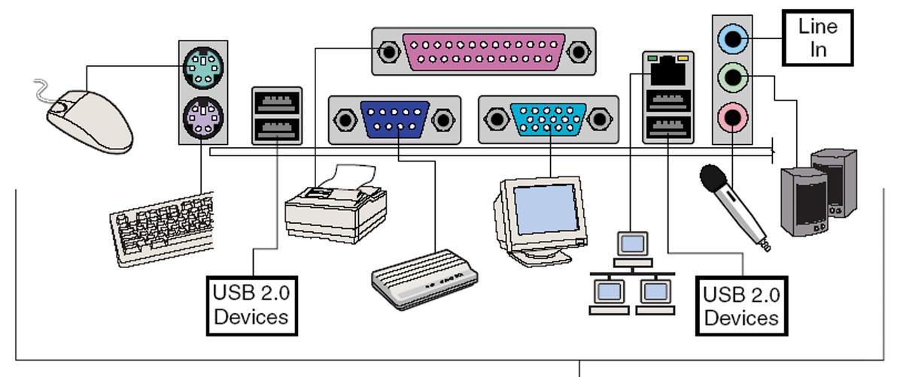
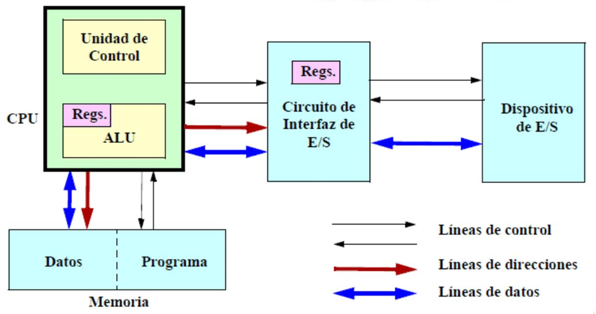
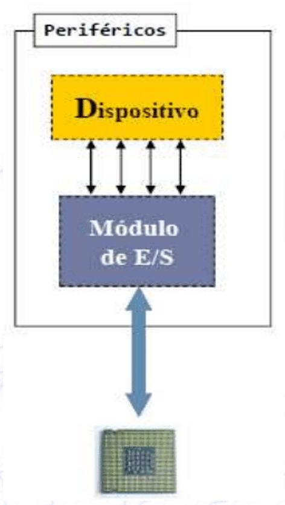
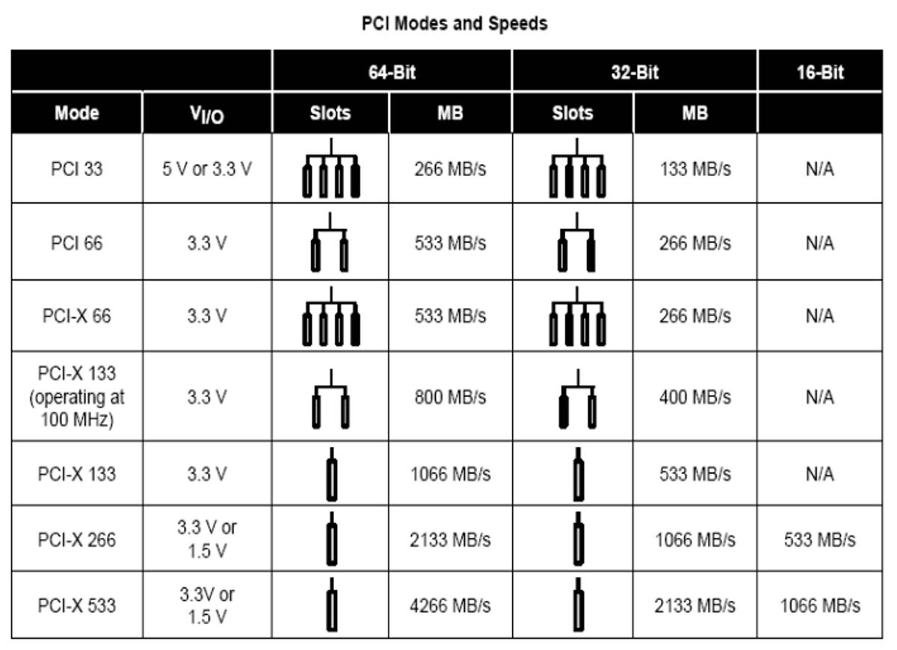
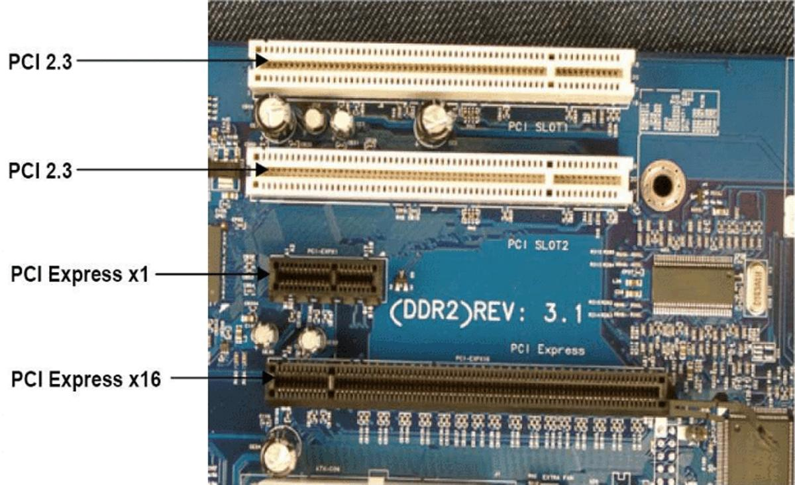
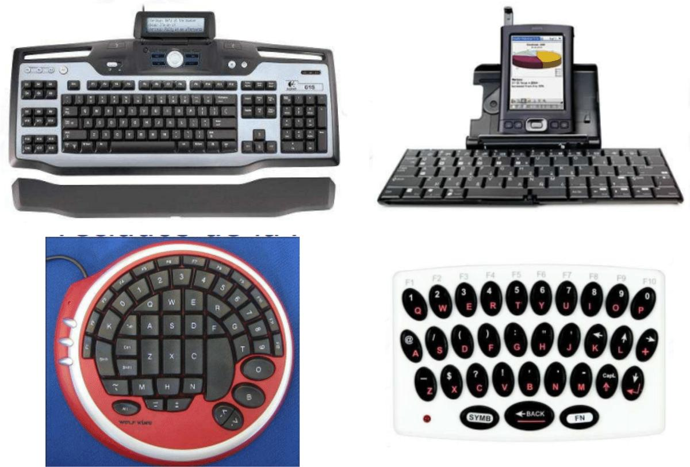
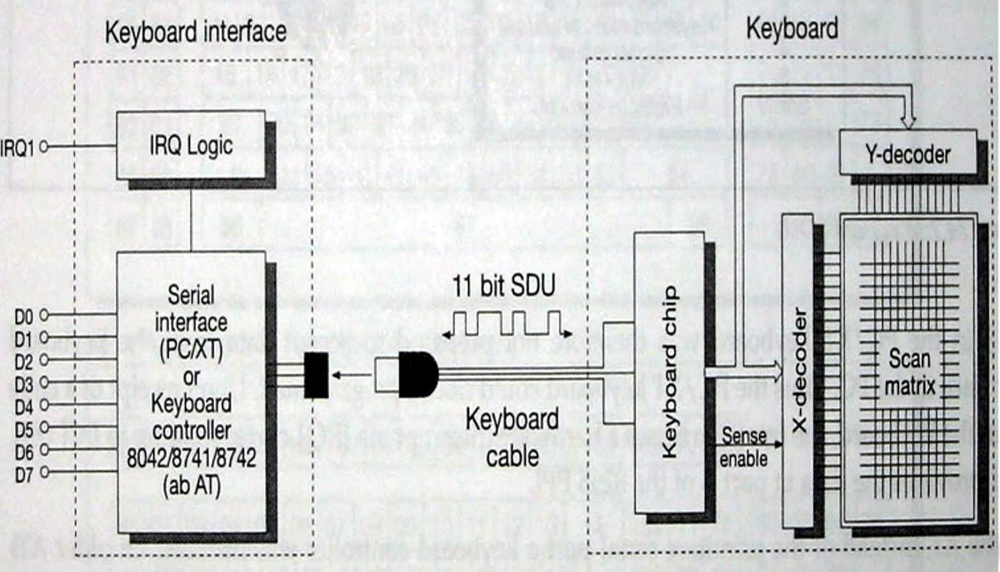
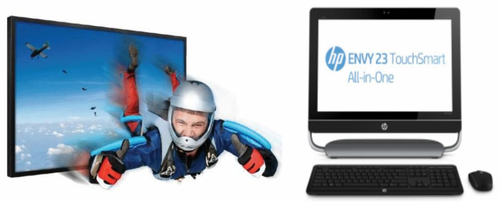
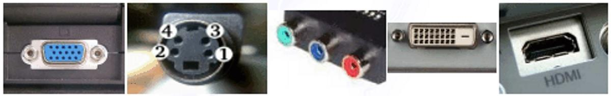
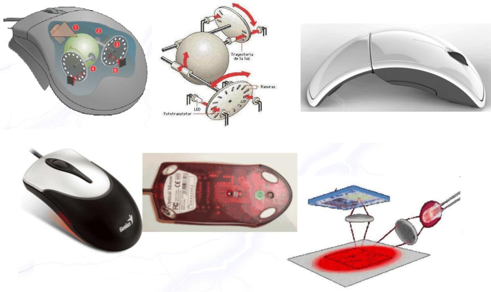

# 15. Hardware de entrada/salida y periféricos

**Presentación relacionada:** [Tema 15, 16, 17 y 18](../Tema%2015%2C%2016%2C%2017%20y%2018/README.md)

## Objetivo

- Conocer el funcionamiento de hardware de entrada/salida del computador y periféricos.

## 15.1. Introducción

Junto con el procesador y el conjunto de módulos de memoria, el tercer elemento clave de un computador es un conjunto de módulos de E/S, esto es lo que se conoce como arquitectura de E/ S.

La arquitectura de E/S del computador es su interfaz con el exterior. Esta arquitectura se diseña de manera que permita una forma sistemática de controlar las interacciones con el mundo exterior y proporcione al sistema operativo la información que necesita para gestionar eficazmente la actividad de E/S.

En esta arquitectura cada módulo se conecta al bus del sistema o a un conmutador central y controla uno o más dispositivos periféricos. Un módulo de E/S no es únicamente un conector mecánico que permite enchufar el dispositivo al bus del sistema; sino que además está dotado de cierta inteligencia, es decir, contiene la lógica necesaria para permitir la comunicación entre el periférico y el bus.

En los primeros días de las PC, se incluía muy poco soporte en la tarjeta madre para los dispositivos periféricos. Los controladores y adaptadores utilizados para manejar y conectarse en interfaz con otros dispositivos periféricos, como el monitor, el disco duro, el disco flexible, etcétera, tenían que ser agregados al sistema de circuitos de la tarjeta madre través de las tarjetas de expansión. Actualmente, gran parte del soporte para los periféricos está incorporado dentro de la tarjeta madre, pero en computadoras personales más antiguas agrupar un dispositivo periférico generalmente significa agregar una tarjeta de expansión. En esta clase se abordará algunos de los elementos esenciales acerca de la arquitectura de E/S así como de los principales periféricos de una computadora.

## 15.2. Arquitectura de E/S

La arquitectura de E/S permite la conexión con los dispositivos externos e internos del computador, de manera que la información pueda ser transferida desde y hasta ella. Los puertos de E/S de la PC son los terminales por los cuáles se conectan los diferentes dispositivos a la computadora. Estos componentes han variado a través de los años desarrollándose nuevos terminales que permiten el uso más eficiente del bus de datos, mientras que la concepción se ha mantenido casi inalterable. En la siguiente figura se muestran algunos dispositivos que se siguen utilizando.

**Figura 15.1.** Algunos de los dispositivos de E/S más utilizados.

**Figura 15.2.** Esquema de interconexión del CPU con los dispositivos de E/S.

En la anterior figura se muestra un esquema de cómo se conecta el CPU y los dispositivos de E/S a través de los circuitos de interfaz de E/S.

### 15.2.1. Características de los dispositivos de E/S

Los periféricos son los dispositivos externos que se conectan a una CPU a través de las unidades o módulos de E/S, y permite al procesador su interacción con el entorno o almacenar información.

Poseen características particulares que responden de forma muy general a las siguientes clasificaciones:

- Funcionalidad
- Estructura del hardware
- Modo de conexión al computador
- Modelo de programación

**Figura 15.3.** Estructura general de un periférico.

Como se nota del esquema general del periférico este agrupa dos elementos fundamentales: el dispositivo y el módulo de E/S.

Hay muchas maneras de caracterizar al hardware de Entrada/Salida; pero debido a su gran diversidad, ninguna es infalible. Por ejemplo no todos los dispositivos son puramente de entrada o de salida, ni todos se comunican de forma serie o son direccionables.

Así mismo, no todos los dispositivos de E/S tienen un componente mecánico. Por ejemplo el reloj de tiempo real y una tarjeta aceleradora de video.  El dispositivo es el hardware que interactúa con el entorno (mouse, webcam, teclado).  El módulo de E/S también denominado Controlador, es la interfaz de comunicación eléctrica entre el dispositivo y el procesador. Su función más importante es la de traducir ordenes entre el contexto de ejecución del CPU y el componente mecánico del dispositivo.

Un módulo de E/S es un procesador de propósito específico y debe contar con al menos 3 registros que permite la decodificación de órdenes provenientes del CPU, la actualización de la información de estado, control y temporización del dispositivo: Registro de control: este registro permite controlar el uso del periférico, es el encargado de mandar a escribir, leer, actualizar los registros necesarios para su funcionamiento, etc. Registro de estado: este registro guarda el estado desde la última orden permitiendo que se tenga siempre el estado en el cual se encuentra el dispositivo. Brinda además la información necesaria para establecer el orden de ejecución y el buen funcionamiento del dispositivo. Registro de datos: este registro controla el conjunto de datos intercambiados entre el CPU y el periférico.

En la práctica, por la naturaleza diversa y en ocasiones compleja de los periféricos y hardware externo, los controladores de E/S cuentan con cientos de registros que parametrizan su funcionamiento.

Los periféricos se encuentran en constante interacción con el CPU. Es por eso que es muy importante saber a cuál se le asignan los limitados recursos de este. Es por esto que existen varios mecanismos de E/S que permite al procesador utilizar un periférico. El primero de estos, llamado E/S por consulta o encuesta se basa en que la operación es controlada por la CPU, la cual primeramente comprueba los registros de estado para verificar si el dispositivo está listo para realizar la operación. Básicamente para saber si un dispositivo está listo se hace una consulta periódica comprobando sus registros de estado. Aunque es de las maneras la más sencilla de utilizar provoca que el CPU consulte periódicamente al dispositivo para saber si está listo, que provoca una sobrecarga del CPU así como uso innecesario del bus del sistema. El segundo de estos mecanismos es la E/S por interrupciones, en la cual, en vez del CPU preguntar si un periférico está listo o no, el periférico informa al CPU cuando se encuentra listo para utilizarse. Siendo más efectivo pues permite al dispositivo marcar el instante a partir del cual puede utilizarse. No utiliza innecesariamente el bus de sistema, y hace un uso más eficiente del CPU. Cuando varios dispositivos solicitan el uso del CPU, este busca cuál de estos dispositivos es más prioritario, asignándole sus recursos al dispositivo listo para usar que sea más importante para el funcionamiento del sistema. El otro tipo de E/S es por acceso directo a la memoria, en la cual el dispositivo accede directamente a la memoria, siendo muy superior el ritmo de transferencia al de los otros métodos.

Aun cuando se utilice un método u otro, los dispositivos tienen diferentes velocidades. Los más lentos son los del tipo ratón y teclado. Los medios son los del tipo impresora, escáner, y dentro de los más rápidos pueden encontrarse la red y los discos. En la siguiente tabla se muestran algunos de los dispositivos físicos con sus velocidades de transferencias que se mide en bits por segundo (bps).

**Tabla 15.1.** : Velocidades de algunos de los dispositivos más comunes.

Dispositivos típicos Velocidad de transferencia (bps) Gigabit Ethernet = 109 Gráficos < 6* 108 Disco duro < 108 Ethernet = 107 Disco óptico < 107 Escáner < 5* 106 Impresora láser < 2* 106 Módem < 105 Ratón < 2* 102 Teclado < 102 Los procesadores para mejorar el rendimiento de los datos producidos por los dispositivos implementan algunas soluciones. Algunas de estas son:

- Uso de caché y almacenamientos intermedios.
- Buses de interconexión de mayor velocidad con estructuras más complejas.
- Uso de configuraciones en modo multiprocesador que permiten equilibrar las altas demandas de la E/S.

Estos dispositivos para interactuar se conectan al computador a través de diferentes tipos de interfaces. Las interfaces proveen un mecanismo para utilizar gran variedad de periféricos con normas de funcionamiento diferentes, donde son capaces de utilizar dispositivos que funcionen a diferentes velocidades. Estas interfaces son o de uso único o multiuso.

Las de uso único controlan un solo dispositivo, como ejemplo de estos están el puerto serie y el puerto paralelo. Dentro de las multiusos están las que controlan más de un dispositivo, como es el caso del bus USB, el FireWire, el Bluetooth, entre otros.

### 15.2.2. Interfaces

Dentro de las interfaces más comunes se encuentran el Bus PCI, el AGP y el PCI Express.

PCI El bus PCI fue un desarrollo de Intel para sustituir al VESA. Teniendo como característica especial la configuración automática de las diferentes tarjetas mediante lo que se conoce como Plug and Play. Esto permite interconectar un dispositivo y empezar a utilizarlo de una manera casi totalmente transparente para el usuario. En la siguiente figura se muestran algunos modos PCI con sus velocidades.

**Figura 15.4.** Modos PCI y sus velocidades.

AGP AGP (Advanced Graphics Port) fue desarrollado e introducido en 1997 con el fin de obtener mayores velocidades con el controlador gráfico. La principal diferencia es que a pesar de clasificarse como un bus no comparte su uso con algún otro dispositivo siendo utilizado exclusivamente por el controlador gráfico. Se comunica directamente con el chipset consiguiendo velocidades más altas que su antecesor respecto al acceso a memoria y al procesador. Se desarrollaron variantes desde la AGPx2 hasta la AGPx16, que multiplicaban los 66 Mhz originales aunque fue finalmente sustituida por PCI Express.

PCI Express (PCI-e) El PCI-e duplicó en su primera aparición en 2003-2004 a la versión más robusta en aquel momento de PCI. Era escalable, comenzando por su velocidad de transferencia de 2.5 Gb/s y gradualmente reemplazo a casi todas las ranuras PCI que existían en ese momento, aunque PCI-e es mucho más rápido que PCI, este último aún persiste en las computadoras, aunque en menor escala. Como ventaja adicional permitía múltiples enlaces serie. A continuación se hace un estudio comparativo en cuanto a velocidades (tabla 15.2) e implementación en una motherboard (figura 15.5).

**Tabla 15.2.** : Tabla comparativa de velocidades entre PCI y PCI-e.

Form factor Half duplex bandwidth Use PCI 2.3 32-bit 1 Gb/s Common in desktop and notebooks PCI Express x1 1-bit 2.5 Gb/s Slots, Gb Ethernet PCI Express x4 4-bit 10 Gb/s 10 Gb Ethernet, links, slots PCI Express x8 8-bit 20 Gb/s Links PCI Express x16 16-bit 40 Gb/s Graphics Como se pueden identificar los diferentes tipos de conectores para PCI. Tamaños y colores.

**Figura 15.5.** Nótese en esta placa base las diferentes ranuras PCI y PCI-e.

## 15.3. Periféricos

Como se ha abordado anteriormente, un periférico agrupa a un dispositivo y su módulo de E/S.

Estos se clasifican atendiendo a sus características en varios tipos, pero una de las clasificaciones más usadas es el cuanto a su uso. Atendiendo a esta característica se pueden delimitar dos grupos, los periféricos que son de comunicación o almacenamiento:

- Comunicación: esta clasificación agrupa diversas subcategorías.

Hombre-Máquina: teclado o mouse (entrada), o monitor, impresora (salida). Máquina-Máquina: módem, etc. Medio Físico: sensores, actuadores, etc.

- Almacenamiento DVD, CDs, memorias USB, etc.

### 15.3.1. Periféricos de uso frecuente

A continuación se revisarán los periféricos de uso más frecuente en el entorno de escritorio y se describirán los detalles técnicos que los hacen estándar.

#### 15.3.1.1. Teclados

**Figura 15.6.** Diferentes tipos de teclados.

El teclado convencional es el principal dispositivo de entrada de datos en un computador, además de ser uno de los primeros dispositivos externos en utilizarse en los sistemas de cómputo.

Consiste en una matriz de contactos con un controlador que detecta las teclas pulsadas, incluso si se pulsan a la vez. Inicialmente los teclados se conectaban a través del puerto serie RS232, pero al aumentar la velocidad de estos dispositivos se hizo necesaria una nueva interfaz: PS/2, que a su vez fue luego sustituida por el puerto USB. En la tabla 15.3 se muestra las ventajas de USB ante PS/2.

**Tabla 15.3.** : Tabla comparativa de USB con PS/2.

USB (v 1.1) Interfaz PS/2 N° de dispositivos soportados Hasta 127 1 Máxima tasa de transferencia 12/Mbit/s 40 Kbit/s Máx tensión/corriente 5 V @ 500 mA 5 V @ 100 mA Conexión “en caliente” Sí No Documentación Bien documentado en http:/ Out-of-Print (IBM Tech Reference) www.usb.org

#### 15.3.1.2. Funcionamiento básico del teclado

- El chip del teclado chequea la matriz de contactos para comprobar cuando se pulsa o se suelta una tecla.
- Escribe el código a un buffer interno.
- Después se retransmite el código a la interfaz del PC.
- Con la recepción del código, la interfaz produce una interrupción. Cada tecla tiene asignado un código scan que es el que la interfaz transmite.

**Figura 15.7.** Principio de funcionamiento del teclado.

#### 15.3.1.3. Monitor

**Figura 15.8.** Diferentes tipos de monitores.

El monitor es el principal dispositivo de salida de datos. Los monitores presentan diferentes interfaces, llamadas tarjetas de video o tarjetas gráficas, que no son más que un circuito impreso para transformar las señales eléctricas procedentes del microprocesador de una computadora en información que puede ser representada a través del monitor. Estas pueden ser onboard, es decir, empotradas en la tarjeta madre, o externas. Las externas se conectan a través de los buses de expansión gráficos. Los monitores Normalmente van acompañados de una interfaz VGA.

**Figura 15.9.** De izquierda a derecha, diferentes conectores usados por los monitores: VGA, S-Video,

RGB, DVI, HDMI.

En la actualidad existen numerosas tecnologías de fabricación para pantallas.

- Pantallas CRT
- Pantallas de cristal líquido (LCD).
- Pantallas de Plasma (PDP).
- LED
- OLED

#### 15.3.1.4. Mouse

En el comienzo del desarrollo de las PC, el dispositivo más habitual era el teclado. Sin embargo a finales de los años ochenta entraba en escena otro dispositivo que se fue extendiendo cada vez más hasta formar parte de la configuración habitual de cualquier PC: el ratón o mouse. Aunque no fue hasta el desarrollo de la primera interfaz gráfica comercial que su uso se hizo extensivo y extremadamente popular ero ocurrió a comienzos de los años noventa.

El ratón o mouse es un dispositivo apuntador generalmente fabricado en plástico. Se utiliza con una de las manos del usuario y detecta su movimiento relativo en dos dimensiones (x-y) por la superficie plana en la que se apoya, reflejándose habitualmente a través de un puntero o flecha en el monitor. Atendiendo a su mecanismo se clasifican en: mecánicos, ópticos, láser y trackball.

Mientras que atendiendo a su conexión con la PC se clasifican en: cableado, inalámbrico, radio frecuencias, infrarrojos, bluetooth.

El funcionamiento del mouse es muy básico, tres bytes de datos se envían como paquete desde el mouse hacia la computadora cada vez que el usuario lo mueve. El primer byte contiene los datos en los botones del ratón, y la dirección y velocidad del ratón. El segundo y tercer bytes tienen el número de impulsos detectados para los movimientos de lado a lado (eje x) y de arriba abajo (eje y) del ratón desde que se envió el último paquete.

El primer byte del paquete de datos del ratón contiene:

- Dos bits que indican si se pulsó el botón derecho o el izquierdo del ratón (0 = no se pulsó, 1 = se pulsó).
- Dos bits para el ID del paquete (01).
- Dos bits para la direcci6n de los ejes X y Y (0 = negativo (hacia atrás/izquierda) y 1 = positivo (hacia delante / derecha)).
- Dos bits que indican que la velocidad del ratón a lo largo de los ejes X y Y fue más rápida que 255 impulsos en 0.025 segundos.

**Figura 15.10.** Diferentes tipos de mouse.

La introducción masiva de los dispositivos móviles ha generado muchas expectativas respecto a las interfaces táctiles. Es probable que en el futuro cercano sea esta la forma de interacción dominante, incluso para el teclado. Es interesante notar sin embargo como los principios se mantienen a pesar de los avances técnicos en introducción de información. Es de esperarse un avance importante esta área apoyado en la comprensión del texto hablado y lectura del pensamiento. Cuestiones en las que hay resultados prometedores. De cualquier modo el software desempeñará un rol protagónico.

<!-- tabla detectada en PDF p.205 -->

| Dispositivostípicos | Velocidaddetransferencia(bps) |
| --- | --- |
| GigabitEthernet | 109 = |
| Gráficos | <6*108 |
| Discoduro | <108 |
| Ethernet | 107 = |
| Discoóptico | <107 |
| Escáner | <5*106 |
| Impresoraláser | <2*106 |
| Módem | <105 |
| Ratón | <2*102 |
| Teclado | <102 |

<!-- tabla detectada en PDF p.207 -->

| Formfactor | Halfduplexbandwidth | Use |
| --- | --- | --- |
| PCI2332 bit . - | 1Gb/s | Commonindesktopandnotebooks |
| PCIExpressx11 -bit | 25Gb/s . | Slots GbEthernet , |
| PCIExpressx44 -bit | 10Gb/s | 10GbEthernet links slots , , |
| PCIExpressx88 -bit | 20Gb/s | Links |
| PCIExpressx1616 -bit | 40Gb/s | Graphics |

<!-- tabla detectada en PDF p.209 -->

|  | USB(v11) . | InterfazPS/2 |
| --- | --- | --- |
| N°dedispositivossoportados | Hasta127 | 1 |
| Máximatasadetransferencia | 12/Mbit/s | 40Kbit/s |
| Máxtensión/corriente | 5V@500mA | 5V@100mA |
| Conexión“encaliente” | Sí | No |
| Documentación | Biendocumentadoenhttp:/ wwwusborg . . | Out -of -Print (IBMTechReference) |

## 15.4. Conclusiones

Los dispositivos de comunicación permiten que el computador intercambie datos con un dispositivo remoto, que puede ser un dispositivo de interacción con humanos, como por ejemplo un terminal, un dispositivo de interacción con máquinas o incluso otro computador.

En este tópico se dio a conocer el funcionamiento del hardware de entrada/salida del computador y periféricos. Se presentaron los principales periféricos con los que regularmente se trabaja en una PC: Monitor, Mouse y Teclado. También se conocieron los tipos de buses permiten la conexión de los diferentes periféricos y los registros que al más bajo nivel permiten el funcionamiento del conjunto del hardware de entrada y salida.
