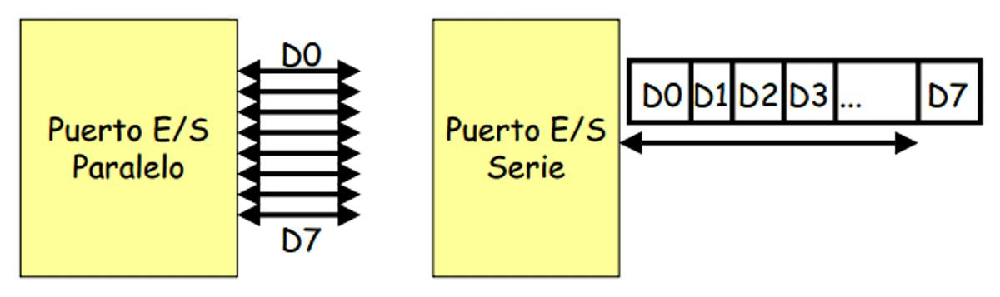
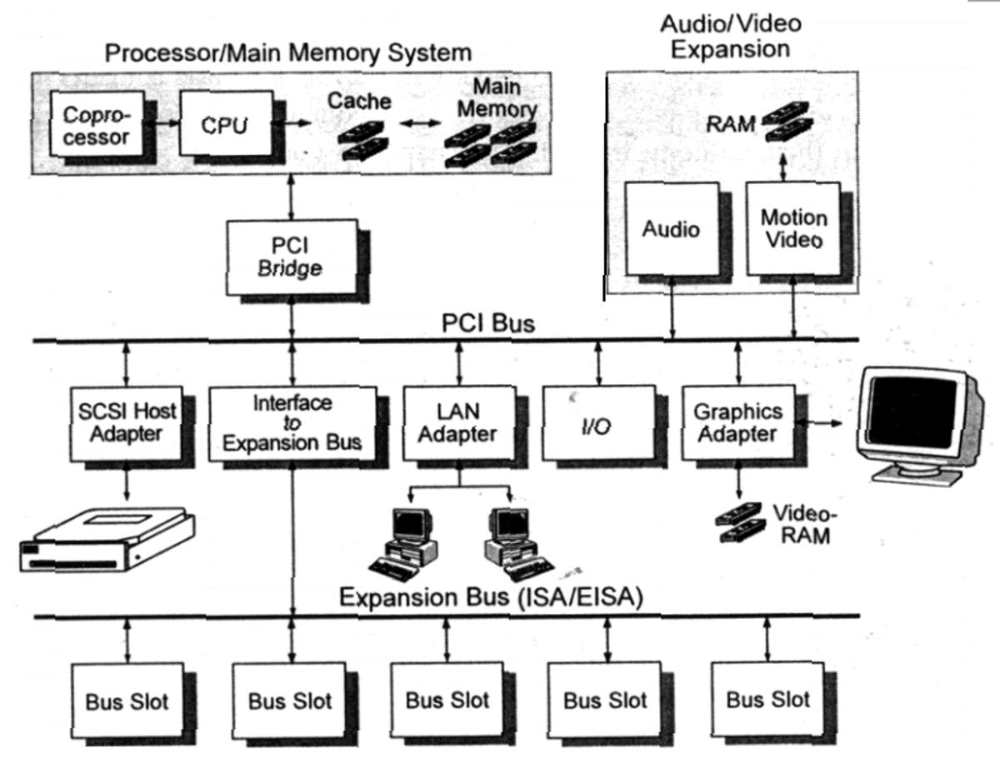
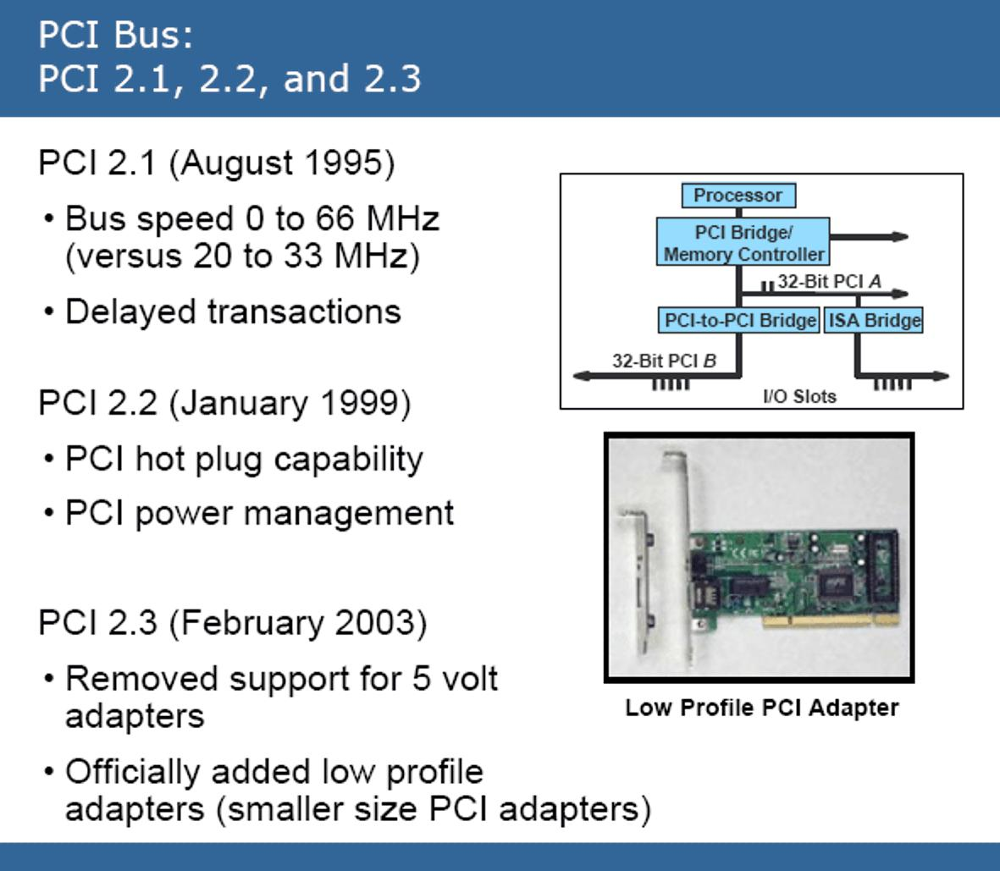
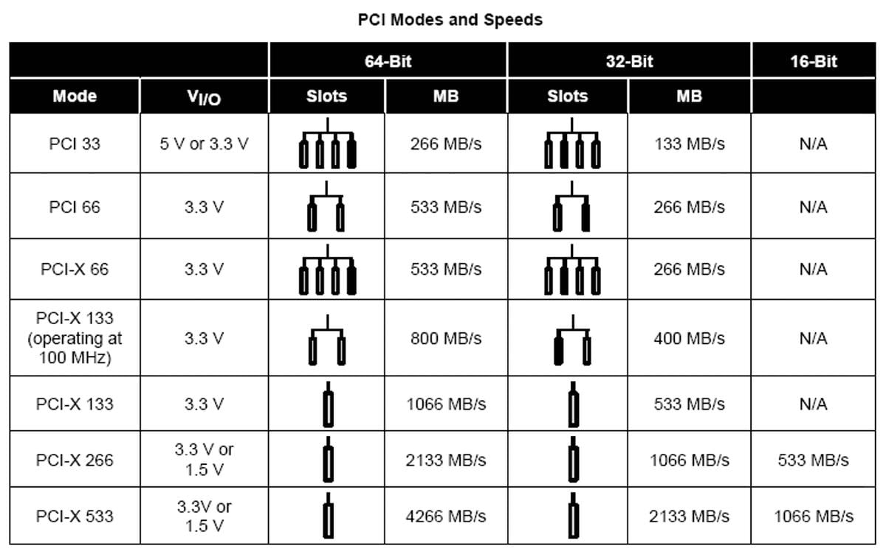
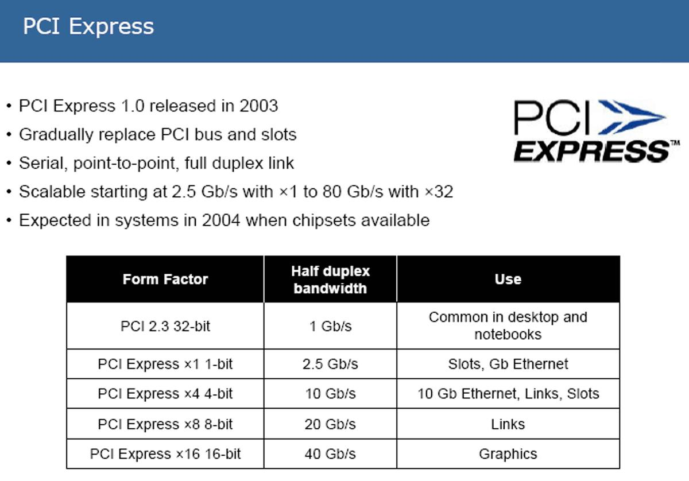
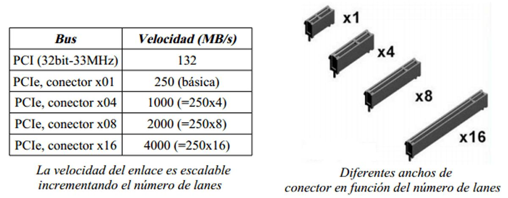
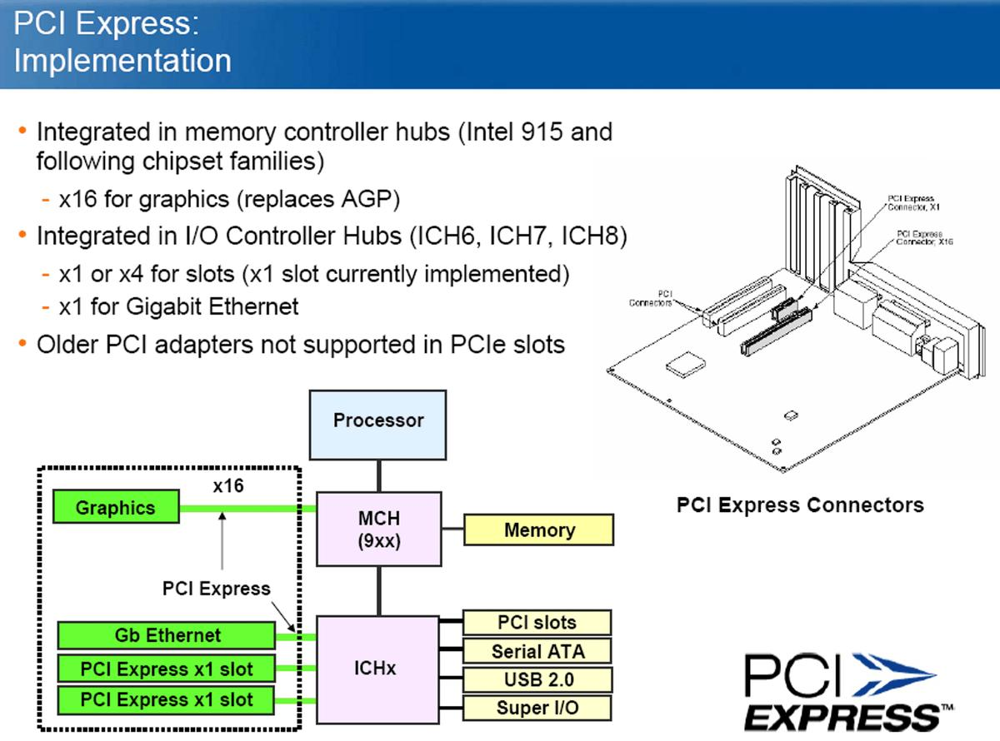
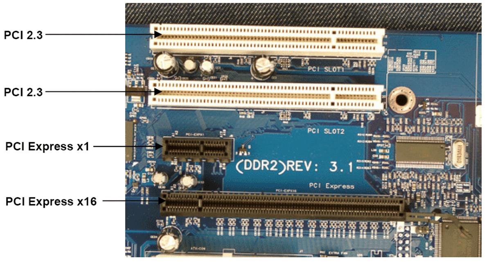

# 17. Buses paralelo PCI y PCI Express

**Presentación relacionada:** [Tema 15, 16, 17 y 18](../Tema%2015%2C%2016%2C%2017%20y%2018/README.md)

## Objetivo

- Describir el funcionamiento de los buses paralelos PCI y PCI Express.

## 17.1. Introducción

Como se ha visto en la conferencia pasada se puede definir un bus (o canal) como un sistema digital que transfiere datos entre los componentes de una computadora o entre varias computadoras. Está formado por cables o pistas en un circuito impreso, dispositivos como resistores y condensadores además de circuitos integrados. Se pueden clasificar atendiendo a su modo de trabajo en serie o paralelo.

En los primeros computadores electrónicos, todos los buses eran de tipo paralelo, de manera que la comunicación entre las partes del computador se hacía por medio de cintas o muchas pistas en el circuito impreso, en los cuales cada conductor tiene una función fija y la conexión es sencilla requiriendo únicamente puertos de entrada y de salida para cada dispositivo.

## 17.2. Arquitectura de los buses paralelos

Un bus paralelo tiene conexiones físicas complejas, pero la lógica es sencilla, que lo hace útil en sistemas con poco poder de cómputo. En los primeros microcomputadores, el bus era simplemente la extensión del bus del procesador y los demás integrados “escuchaban” las líneas de direcciones, en espera de recibir instrucciones.

En este tipo de bus, los datos son enviados por bytes al mismo tiempo, con la ayuda de varias líneas que tienen funciones fijas. La cantidad de datos enviada es bastante grande, siendo igual al ancho de los datos por la frecuencia de funcionamiento. Este tipo de bus en particular es usado en el procesador, discos duros, tarjetas de expansión y de video, impresoras, entre otros.

Poseen 3 tipos de líneas para su funcionamiento:

- Líneas de dirección: encargadas de indicar la posición de memoria o el dispositivo con el que se desea establecer comunicación.
- Líneas de control: encargadas de enviar señales de arbitraje entre los dispositivos. Entre las más importantes están las líneas de interrupción, DMA y los indicadores de estado.
- Líneas de datos: transmiten los bits, de manera que por lo general un bus tiene un ancho que es potencia de 2.

## 17.3. Bus PCI

El bus PCI (Peripheral Component Interconnect, Interconexión de Componente Periférico) es un bus de ordenador estándar para conectar dispositivos periféricos directamente a su placa base.

Estos dispositivos pueden ser circuitos integrados ajustados o tarjetas de expansión que se ajustan en conectores. Es un bus muy popular de ancho de banda elevado, independiente del procesador. Comparado con otras especificaciones comunes de bus, el PCI proporciona mejores prestaciones para los subsistemas de E/S de alta velocidad (por ejemplo, los adaptadores de pantalla gráfica, los controladores de interfaz de red, los controladores de disco, etc.). El estándar actual permite el uso de hasta 64 líneas de datos a 66 MHz. Pero no es precisamente su elevada velocidad la que hace atractivo al PCI. El PCI ha sido diseñado específicamente para ajustarse, económicamente a los requisitos de E/S de los sistemas actuales: se implementa con muy pocos circuitos integrados y permite que otros buses se conecten a este.

Intel empezó a trabajar en el PCI en 1990 pensando en sus sistemas basados en el Pentium. Muy pronto Intel cedió sus patentes al dominio público y promovió la creación de una asociación industrial (PCI SIG), para continuar el desarrollo y mantener la compatibilidad de las especificaciones del PCI. La arquitectura sobre la que se basa PCI, ver la siguiente figura, permitió que fuera ampliamente adoptado y se utilizara a gran escala en los computadores personales, estaciones de trabajo, y servidores.

Puesto que las especificaciones son de dominio público y están soportadas por una amplia banda de la industria de procesadores y periféricos, los productos PCI fabricados por compañías diferentes son compatibles.

**Figura 17.1.** Arquitectura del bus PCI.

### 17.3.1. Especificaciones de hardware de los buses PCI

El bus PCI es un bus que ofrece altas prestaciones, por sus características especiales, dos de ellas son las más importantes:

- El modo ráfaga. Esta es una característica especial que permite que una vez que se le proporciona una dirección inicial, puede transferir múltiples conjuntos de datos, de manera similar al modo ráfaga que ofrecen las memorias caché.
- La segunda característica es el soporte para el llamado arbitraje del bus (Bus mastering).

Esta es una característica que permite que si múltiples dispositivos están habilitados para dominar el bus, tiene que haber un sistema de arbitraje para evitar que múltiples dispositivos intenten manejar el bus de manera simultánea. Un número de esquemas diferentes son usados para esto. Esta característica debe estar soportada por el chipset de la placa base. Actualmente todas las placas base modernas incluyen esta característica.

El bus PCI puede ser configurado para que trabaje en modo síncrono o asíncrono, en función de cada placa base y del chipset integrado. En el modo síncrono, el más habitual en las placas base actuales PCI funciona a la mitad de la frecuencia de la memoria, que suele coincidir con la frecuencia base del bus de la placa base, la denominada frecuencia FSB (Front Side Bus).

Mientras que en el modo asíncrono la frecuencia del bus PCI puede ser configurada independientemente de la frecuencia de la memoria. Esta configuración se puede realizar solamente en aquellas placas base que lo permitan mediante jumpers o utilizando la BIOS.

A continuación se muestran algunas de las especificaciones más importantes de la versión de PCI más comúnmente usada en los PC:

- Reloj de 33,33 MHz con transferencias síncronas.
- Ancho de bus de 32 bits o 64 bits.
- Tasa de transferencia máxima de 133 MB por segundo en el bus de 32 bits (33,33 MHz × 32 bits ÷ 8 bits/byte = 133 MB/s).
- Tasa de transferencia máxima de 266 MB/s en el bus de 64 bits.
- Espacio de dirección de 32 bits (4 GB).
- Espacio de puertos I/O de 32 bits (actualmente obsoleto).
- 256 bytes de espacio de configuración.
- 3,3 V o 5 V, dependiendo del dispositivo.

Estas características son visibles en las siguientes figuras. La primera muestra la evolución desde PCI 2.1 hasta la 2.3 (figura 17.2) y en la figura 17.3 se muestra algunas de sus modos más usados.

**Figura 17.2.** Bus PCI 2.1 - 2.3.

El PCI está diseñado para permitir una cierta variedad de configuraciones basadas en microprocesadores, incluyendo sistemas tanto de uno como de varios procesadores. Por consiguiente, proporciona un conjunto de funciones de uso general. Utiliza temporización síncrona y un esquema de arbitraje centralizado.

**Figura 17.3.** Evolución de PCI, nótese como la capacidad de transferencia aumenta y el consumo de energía disminuye.

## 17.4. PCI Express

La elevada demanda de la velocidad que requieren muchas de las tarjetas de expansión del PC hizo necesaria la evolución del bus PCI, que comenzó a quedarse obsoleto, lo que provocó que en muchos casos se creara un verdadero cuello de botella a la hora de comunicar placa base y tarjetas de expansión.

Entre los nuevos desarrollos que surgen a partir de la obsolescencia de PCI se encuentra PCI Express que no es más que una evolución del PCI como su nombre lo sugiere. PCI Express incluye nuevas características avanzadas que le permitieron en un tiempo relativamente breve sustituir tanto a PCI como AGP. La enorme ventaja del uso de este bus, es que se consigue la unificación de todas las tarjetas de expansión de la placa base con un mismo tipo de bus.

Este bus está estructurado como carriles punto a punto, full-dúplex, trabajando en serie.

Sus características más importantes son:

- Es una red punto a punto de conmutación de paquetes.
- La red se construye mediante enlaces punto a punto full-dúplex + conmutadores. Cada enlace está compuesto por líneas. Cada línea es full-dúplex y consiste en dos pares de hilos, un par de transmisión y otro de recepción. Cada par es un canal símplex en el que la señal de tensión transmitida es diferencial (LVDS - Low Voltage Diferential Signaling), lo que mejora la inmunidad al ruido.
- Compatibilidad software con PCI. La interfaz software del bus (el “driver model”) permanece igual, no hay que cambiar los drivers del sistema operativo ni el software de sistema, todo queda exactamente igual.
- Conexión y cambio de tarjetas en caliente.

PCI Express ofrece un conjunto de conectores, que son 1x, 2x, 4x, 8x, 16x y 32x. el prefijo numérico expresa el factor de multiplicación, logrando velocidades de procesamientos altamente configurables a diferentes entornos. A continuación se muestran algunos de estos conectores y su uso.

- PCI Express 1x ofrece una tasa de transferencia de 250 Mb/s. Existen 1 o dos de estos en todas las placas madre actuales.
- PCI Express 2x ofrece una tasa de transferencia de 500 Mb/s. Este bus no es tan común y está reservado a los servidores.
- PCI Express 4x ofrece una tasa de transferencia de 1000 Mb/s también está reservado a los servidores.
- PCI Express 16x ofrece una tasa de transferencia de 4000 Mb/s es muy utilizado, está presente en todas las placas madre modernas, es el formato estándar de las tarjetas gráficas.
- PCI Express 32x ofrece una tasa de transferencia de 8000 Mb/s posee el mismo formato que el PCI Express 16x, a menudo es utilizado en las placas madre de gama alta para alimentar el bus SLI o Crossfire. Las referencias de estas placas madre por lo general poseen la mención “32”. Esto permite tener dos puertos PCI Express con formato 16 y cableados en 16 líneas, al contrario de los SLI clásicos, cableados en 2 x 8 líneas o Crossfire básicos, cableados en 1x16 + 1x4 líneas. Estas placas madre se caracterizan también por la presencia de un puente sur adicional, únicamente dedicado a este bus 32x.

## 17.5. Conclusiones

En esta clase se trataron temas relacionados con los buses paralelos y PCI, de muy alto empleo en los computadores. Se mostraron detalles técnicos del funcionamiento de los mismos, así como una breve descripción de la evolución de estos.

La tendencia en el desarrollo de los computadores es la imponer el bus PCI express, por su bajo consumo de corriente y por sobre todo, su elevada velocidad de transmisión.

<!-- navegación -->

---

[← Anterior: Capítulo 16](Cap%C3%ADtulo%2016%20-%20Buses%20serie%20USB%20y%20PS-2.md) | [Índice](README.md) | [Siguiente: Capítulo 18 →](Cap%C3%ADtulo%2018%20-%20Interfaces%20internas%20y%20externas.md)
