# 18. Interfaces internas y externas

**Presentación relacionada:** [Tema 15, 16, 17 y 18](../Tema%2015%2C%2016%2C%2017%20y%2018/README.md)

## Objetivo

- Describir el funcionamiento de las interfaces internas y externas.

## 18.1. Introducción

Hoy en día las computadoras presentan gran cantidad de interfaces, tanto internas como externas. Probablemente el mejor sitio para comenzar cuando se analizan los conectores de PC es la tarjeta madre. Casi todas las computadoras recientes tienen muchos conectores de interfaz internos y externos integrados dentro de la tarjeta madre. En esta conferencia se hará un estudio de las principales interfaces tanto internas como externas que componen al computador y se realizará una breve descripción de las más importantes.

## 18.2. Interfaces

Es prácticamente imposible diseñar una computadora personal con todos los dispositivos periféricos incluidos para suplir las necesidades de cada usuario. Existen tantas configuraciones potenciales de una PC como usuarios potenciales. Los servicios esenciales de la computadora personal incluidos dentro de la unidad del sistema, como la tarjeta madre, las unidades de disco y la memoria, pueden estandarizarse, pero además existe lo que cada usuario de computadora desea en cuanto a video, sonido, teclado, impresora y otros dispositivos periféricos adheridos a la computadora. La mezcla particular de dispositivos periféricos es lo que puede convertir los componentes principales de una computadora estándar en una estación de trabajo personalizada, una unidad de entretenimiento o una unidad de altas prestaciones. Para su mejor comprensión se clasificarán las interfaces en internas y externas.

### 18.2.1. Interfaces internas

Algunos de los componentes y conexiones que forman parte de la placa y que se van a detallar en la presente conferencia son:

- Microprocesador y Zócalo (Socket) del microprocesador.
- Memorias y ranuras de memoria.
- BIOS.
- Ranuras de expansión.
- Conectores internos y conectores eléctricos.
- Chipset de control.

Microprocesador El microprocesador es el elemento más importante del computador, es el cerebro de la máquina, se encarga de controlar todo el sistema. Un parámetro importante es la velocidad del procesador que se mide en mega-herzios (Mhz), es decir cantidad de “ordenes” por segundo que pueden ser ejecutadas por el procesador. Atendiendo a sus características físicas existen dos tipos:

- Microprocesadores de slot.
- Microprocesadores de pastilla.
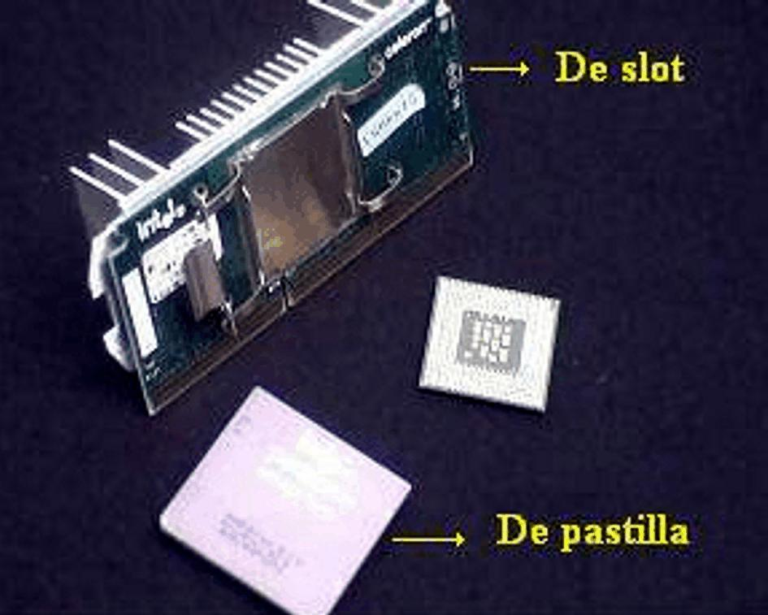

**Figura 18.1.** Tipos de microprocesadores.

Socket El zócalo o socket es el lugar en la placa donde se conecta el procesador, como es lógico el zócalo de un procesador de pastilla es diferente al de uno de slot.

En la figura siguiente se muestran distintas placas con distintos tipos de zócalo. Normalmente en cada placa solo hay un procesador a excepción de computadoras más potentes que pueden disponer de varios.

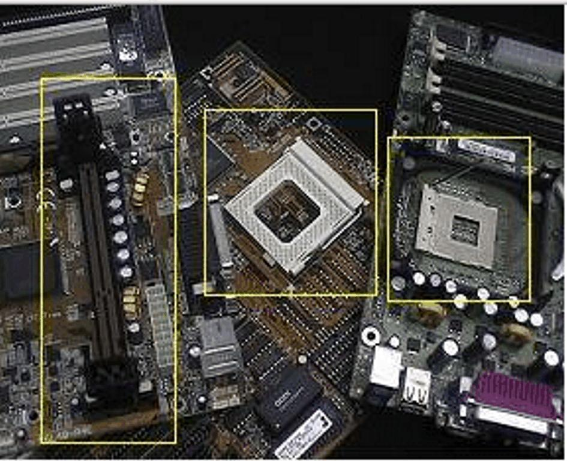

**Figura 18.2.** Tipos de sockets.

Memorias y ranuras de memoria La memoria principal o RAM (acrónimo de Random Access Memory, Memoria de Acceso Aleatorio) es el lugar donde el computador almacena los datos de usuario, del sistema y aplicaciones que se están utilizando en el momento presente. La unidad de medida es el Mega-bit indica el tamaño o cantidad de datos que se pueden almacenar, ejemplos del tamaño de las memorias son 32Mb, 64Mb, estos tamaños siempre son múltiplos de 2. La memoria RAM es imprescindible para el funcionamiento del computador y se borra cuando apagamos el computador. Debido a que todos los datos necesarios para la ejecución de programas y del sistema deben estar cargados en la memoria para ser ejecutados el rendimiento del computador depende en gran medida del tamaño en Mb de esta. Físicamente son pequeñas láminas finas de materiales sintéticos compuestas de varios chips soldados, cada una de ellas se denomina módulo. Existen diferentes tipos de memorias SIMM DIMM o RIMM entre otras que se diferencian en tamaño físico, velocidad de acceso, numero de conectores etc.

A la hora de ampliar la memoria de un computador es importante averiguar el tipo que se tiene, y cuanto se puede ampliar como máximo. Estos parámetros los establece el Chipset que estamos usando y la placa madre. Estos datos se encuentran en el manual de la placa que viene cuando se compra el computador. La siguiente figura muestra dos módulos de memoria.

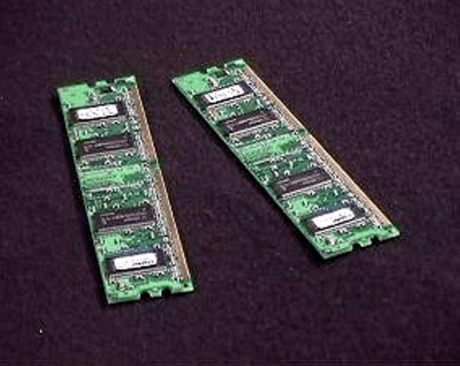

**Figura 18.3.** Dos tipos de memorias RAM.

Se denominan ranuras de memoria al lugar en la placa donde se colocan las memorias. El número de ranuras no es fijo, y depende de la placa madre.

En la figura 18.4 se muestran 4 ranuras agrupadas de dos en dos.

A la hora de poner la memoria hay que fijarse en la forma de la ranura ya que esta se adapta a la forma del módulo, sólo tiene una posición. Para quitarla hay que accionar hacia atrás en las pestañas blancas, estas pestañas sujetan la memoria e impiden sacarla si no se retiran.

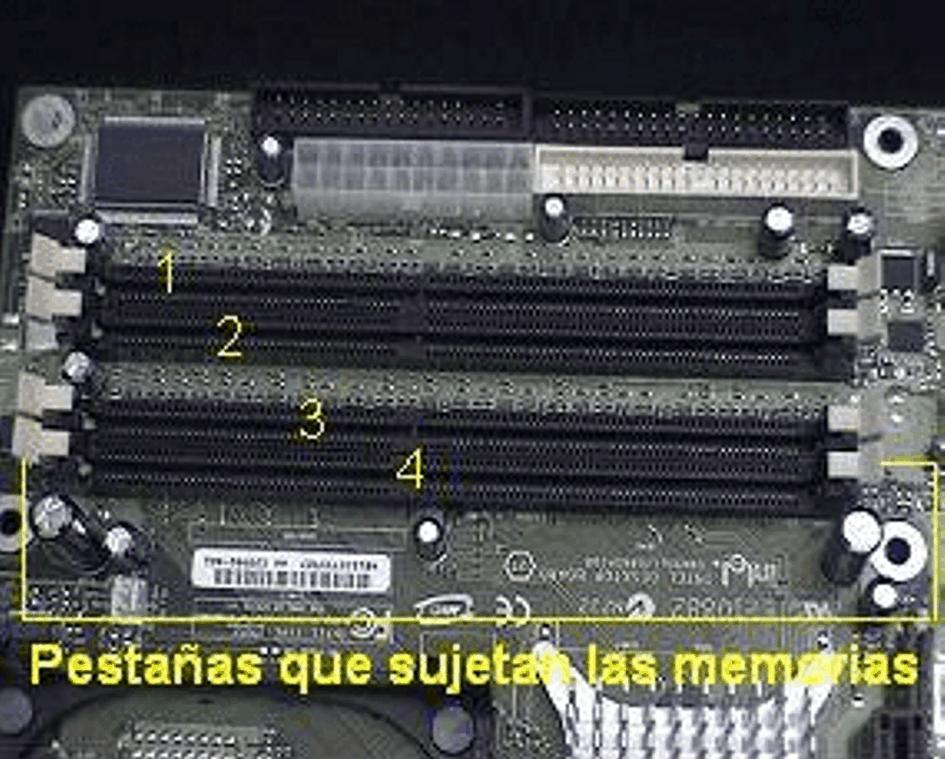

**Figura 18.4.** Nótese como están distribuidas las ranuras de memoria en la placa base.

BIOS BIOS (acrónimo de Basic Input-Output System, Sistema Básico de Entrada y Salida) es un pequeño programa incorporado en un chip de la placa base. Su finalidad es mantener cierta información básica en el arranque de la computadora. Esta información puede ser la configuración de nuestro disco duro, fecha hora del sistema prioridad de arranque, arranque desde la red, etc.

Una de las características de esta memoria es que es una memoria ROM, que significa que no se borra cuando se apaga el computador. Cuando esto ocurre, la configuración permanece grabada gracias a una pila de 3 voltios que incorpora el computador. Esto permite tener actualizada la configuración acerca del arranque de la PC y además mantiene actualizada la fecha y hora del sistema. A veces fallos en el arranque se pueden deber al desgaste de la pila y es necesario reemplazarla.

Cuando se instala un disco nuevo, memoria o un CD-ROM la BIOS guarda la configuración de dichos dispositivos para cargarla después en la memoria RAM en el arranque del computador, por eso en estos casos es aconsejable acceder a la BIOS y comprobar que ha sido correctamente reconocido.

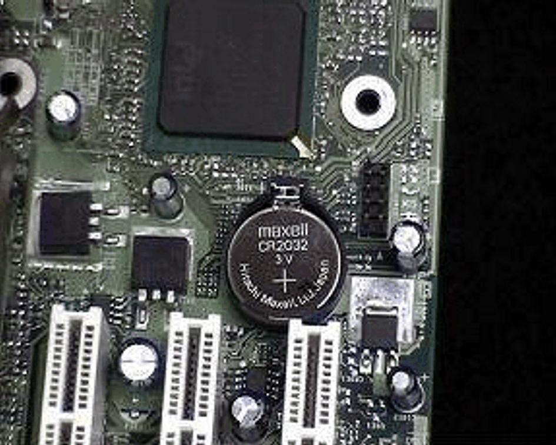

**Figura 18.5.** Pila del Sistema.

Ranuras de expansión Son las ranuras donde se conectan diversas tarjetas en el sistema. Ejemplos de tarjetas que se pueden instalar son tarjetas de video, audio, o red.

Recuerde que:

Existen diferentes tipos de ranuras, las más habituales en los computadores son las siguientes:

- ISA: son las más antiguas, aunque hoy en día casi no se utilizan algunas placas las incorporan para insertar dispositivos antiguos.

- PCI: son las habituales en los computadores actuales.
- AGP: normalmente solo hay una porque estas ranuras son de uso exclusivo para tarjetas de video: estas ranuras son aceleradoras de gráficos 3D.

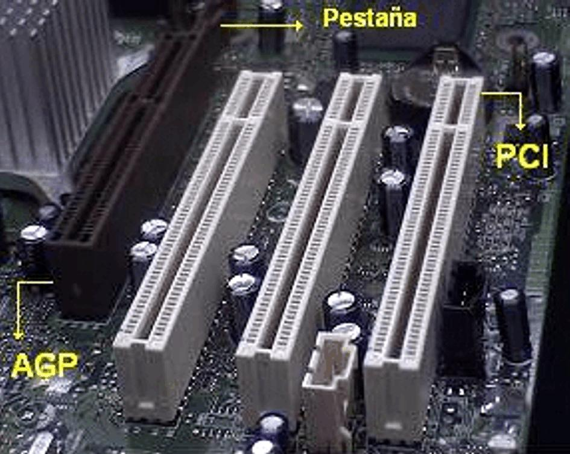

**Figura 18.6.** Ranuras de expansión.

Conectores internos y conectores eléctricos Hay dos tipos de conectores, los conectores o interfaces de datos y los conectores propiamente eléctricos.

Las interfaces de datos conectan los dispositivos a la placa y las conexiones eléctricas conectan la fuente de alimentación a los dispositivos incluida la placa. Todos los dispositivos excepto las tarjetas de las ranuras de expansión se conectan a la fuente de alimentación. Las tarjetas reciben la tensión a través de las ranuras de expansión.

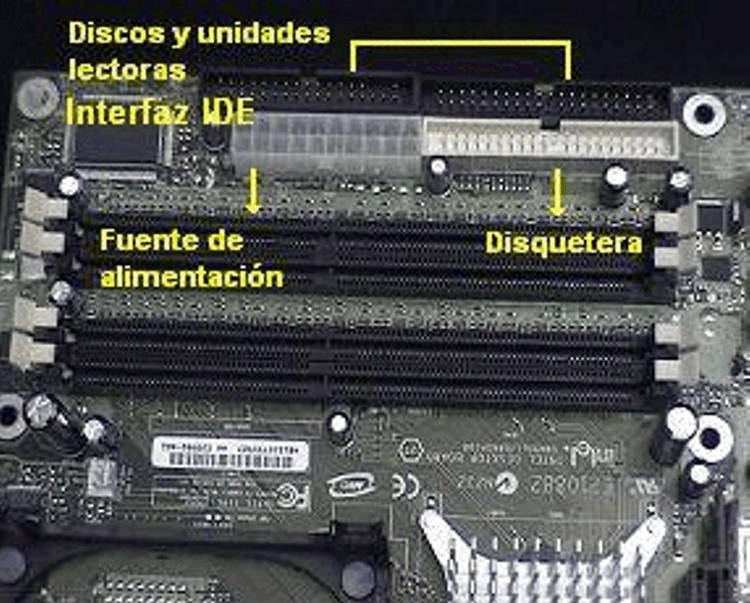

**Figura 18.7.** Conectores internos.

La fuente de alimentación proporciona la tensión al computador. Cada dispositivo tiene su conexión a la fuente, como se indica en la siguiente figura.

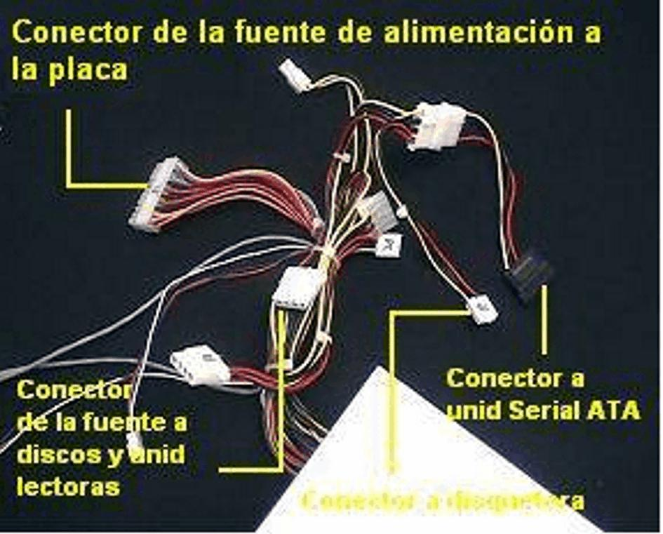

**Figura 18.8.** Conectores a la placa y los dispositivos.

Los cables que se utilizan para las interfaces de datos con la placa son diferentes según el tipo de dispositivos que se conecte.

Interfaz IDE Las interfaces IDE (Integrated Drive Electronics, electrónica de unidades integradas) se utilizan para conectar a al ordenador discos duros y grabadoras o lectores de CD/DVD. Estas interfaces son de bajo coste y alto rendimiento. Para la conexión de estos dispositivos es necesario un cable IDE. Ver figura siguiente.

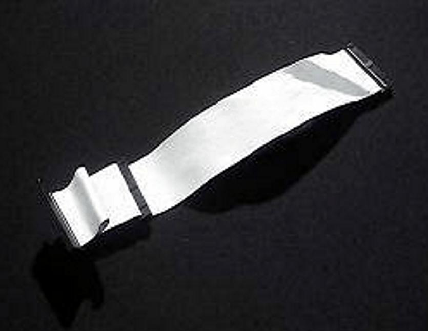

**Figura 18.9.** Cable IDE.

Interfaz Serial ATA Está diseñada para mejorar la interfaz IDE, y es totalmente compatible con el sistema operativo que se quiera utilizar, además las placas bases actuales soportan tanto IDE como Serial ATA.

Son unidades que operan a mayor velocidad, tienen mayor capacidad y reducen el consumo eléctrico. Además, el cable mediante el cual la unidad se conecta a la placa base es mucho más pequeño lo cual mejorar la ventilación y es menos sensible a las interferencias, por lo que permite crear cables más largos.

Si una placa no posee interfaz serial ATA se puede adquirir una tarjeta que se colocaría en una ranura de expansión PCI con un interfaz de este tipo.

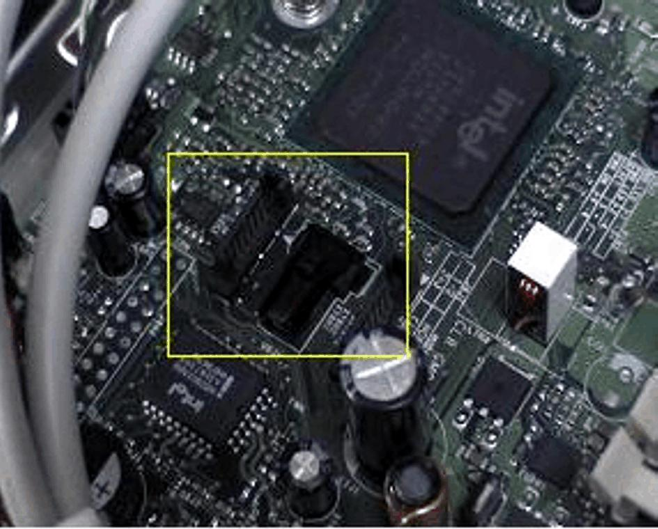

**Figura 18.10.** Interfaz serial ATA.

Los discos duros Serial ATA utilizan los cables serial ATA. Estos cables son diferentes a los cables IDE y como es lógico el conector de la placa a la que se conecta también. Para la disquetera tanto la interfaz como el cable son similares al IDE aunque más pequeño.

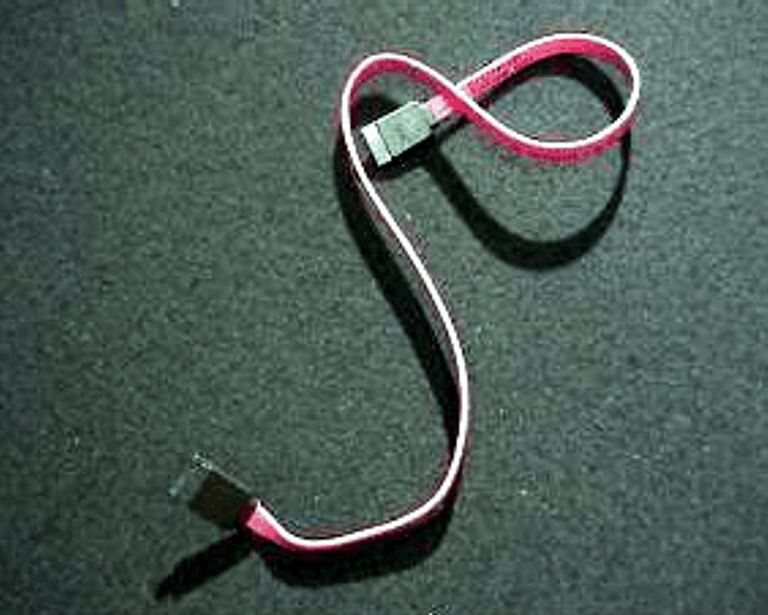

**Figura 18.11.** Cable de datos SATA.

Chipset de control Está formado por un conjunto de chips cuya finalidad es controlar algunas funciones concretas del computador y como interactúa el microprocesador con las memorias, puertos externos y ranuras de expansión. Que se obtenga el máximo rendimiento del microprocesador o que se puedan utilizar tecnologías avanzadas de memorias y periféricos depende del chipset.

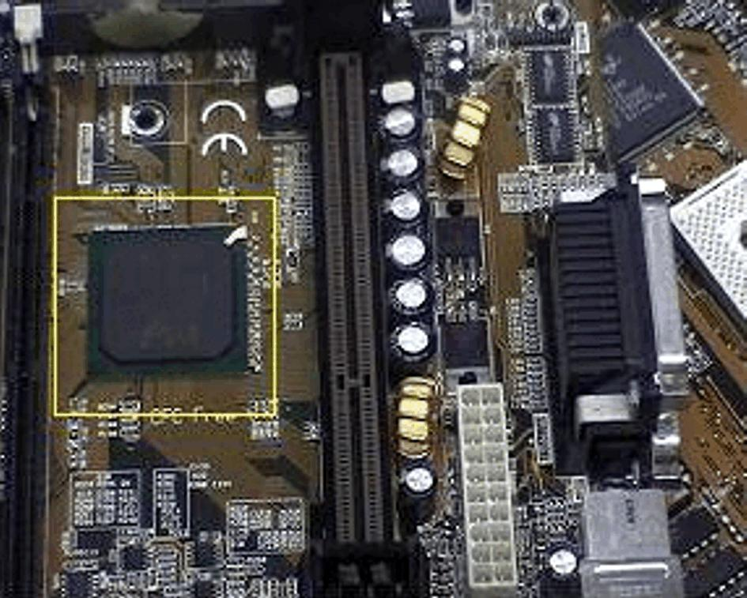

**Figura 18.12.** Chipset.

### 18.2.2. Interfaces externas

Los conectores externos permiten la conexión al computador de los “periféricos” nombre por el que se conocen a todos los dispositivos externos al computador como son el ratón, teclado, impresora, módem externo, scanner entre otros. A estas conexiones también se les denominan “puertos”. Normalmente se encuentran en la parte trasera del computador, aunque en la actualidad muchos computadores incorporan puertos USB y Audio en la parte delantera.

La conexión de ratón y teclado se realiza normalmente a los puertos PS2, estos puertos tienen un código de color, verde es para el ratón y morado es para el teclado. Actualmente existen ratones y teclados USB que podemos conectar a cualquiera de los puertos USB que tengamos.

El puerto serie permite conectar dispositivos como un módem externo o un ratón de los antiguos, el puerto paralelo se utiliza principalmente para las impresoras, el VGA es el puerto para conectar el monitor es decir es la salida de la tarjeta de video, el puerto de Red es para conectar el computador a una red, es un conector RJ45, aparentemente como el del teléfono pero más grande, por último la salida de audio permite conectar los altavoces micrófono y auriculares al computador.

En los computadores modernos estos puertos aparecen también en la parte delantera facilitando la conexión. En la figura 18.13 se muestra una computadora que tiene componentes denominados integrados. Se llaman así porque elementos como el audio la red o el vídeo, normalmente son tarjetas que se colocan en las ranuras de expansión, pero en los computadores actuales pueden venir integrados en el sistema, es decir forman parte de la placa y no se pueden quitar físicamente. Para quitarlos es necesario deshabilitarlos o en la BIOS o a través del panel de control del sistema si se trabaja en Windows.

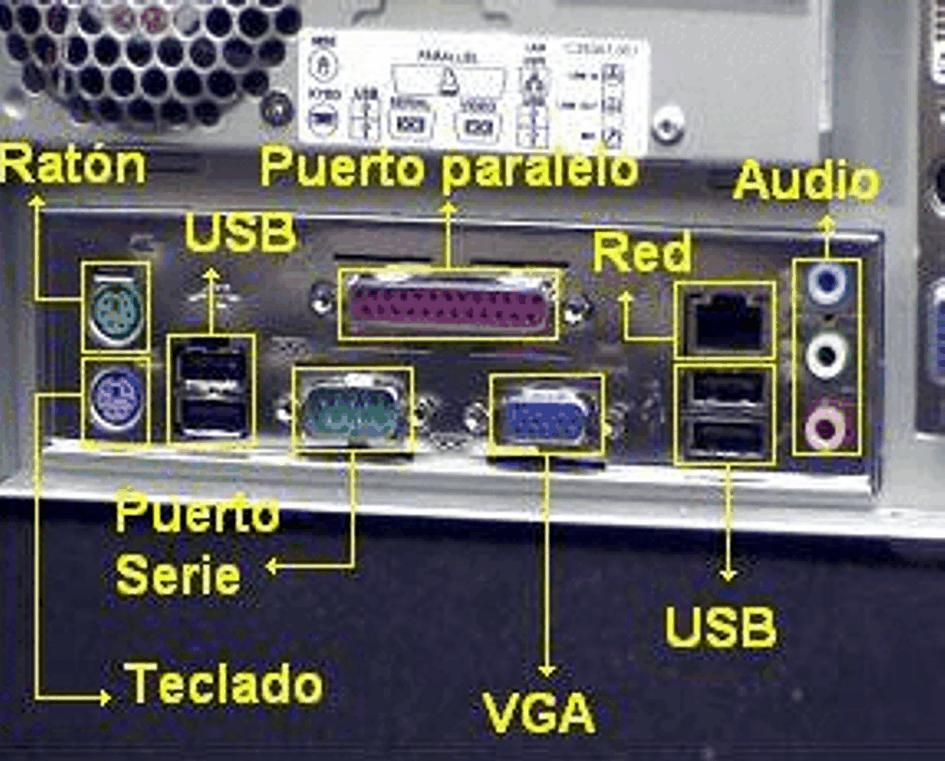

**Figura 18.13.** Conectores externos.

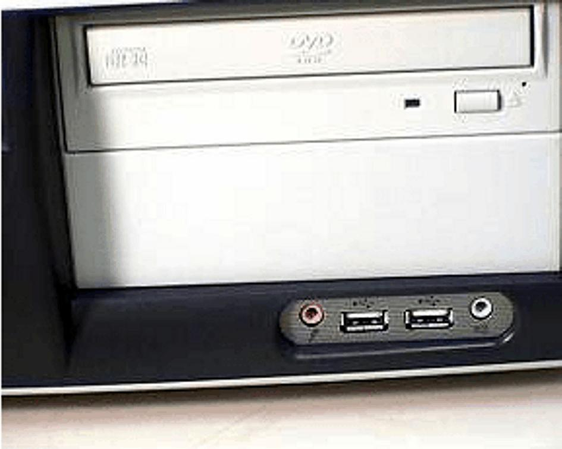

**Figura 18.14.** Puertos externos delanteros.

Otro puerto que se puede encontrar en los computadores actuales es el puerto FireWare. Sus puntos fuertes son la velocidad una amplia conectividad y que admite la conexión de hasta 63 dispositivos. Es muy recomendable para la transmisión desde un periférico al computador de grandes cantidades de datos, por ejemplo con dispositivos multimedia como las videocámaras y otros dispositivos de alta velocidad como las unidades de disco externo y las impresoras de última generación.

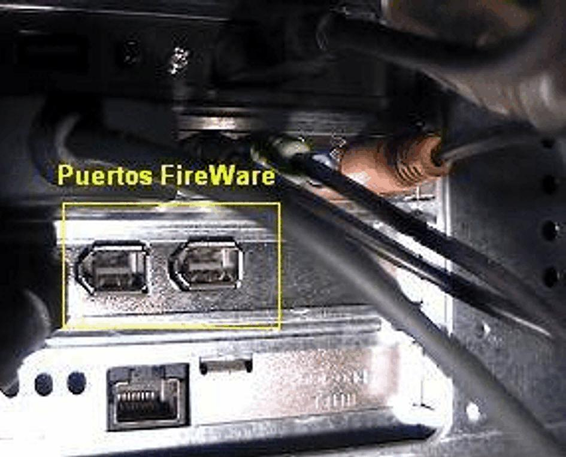

**Figura 18.15.** Puertos FireWire.

## 18.3. Conclusiones

Saber cuáles son las principales características de las interfaces internas y externas permite que se pueda utilizar la PC más acorde a sus prestaciones y le permite al usuario configurarla para el entorno de trabajo deseado. Entender estos sistemas ayudará a solucionar los problemas de fallas o de funcionamiento de una computadora. Si bien ha habido muchos avances en la tecnología de microprocesador, la arquitectura básica de una computadora personal se ha mantenido relativamente constante desde la presentación de la primera.
