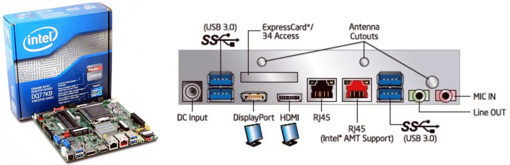
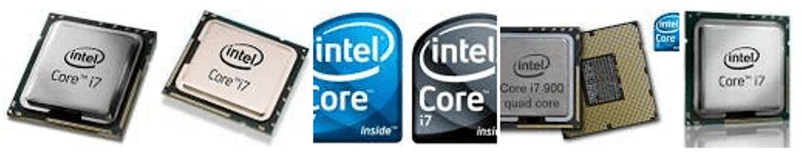
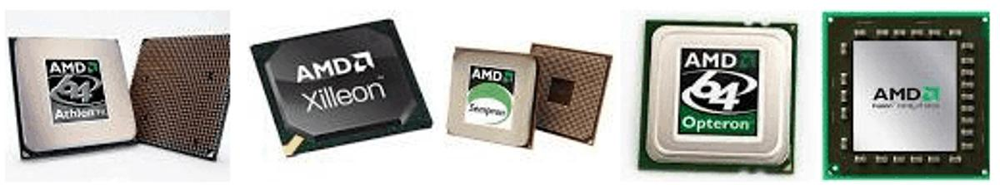
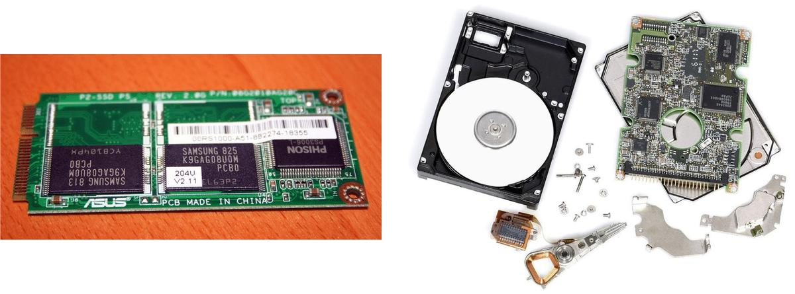
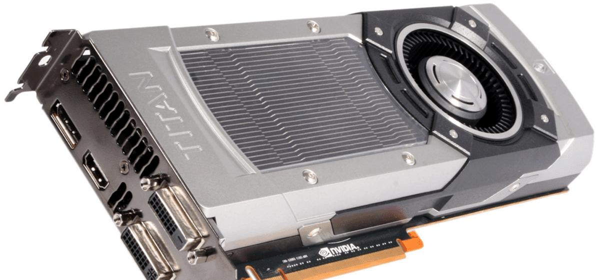
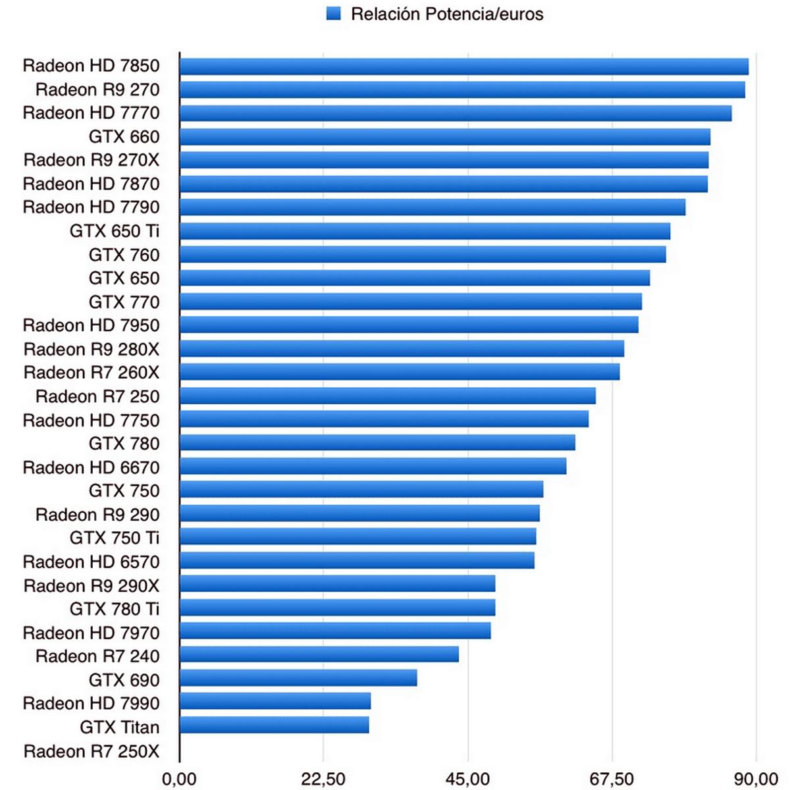
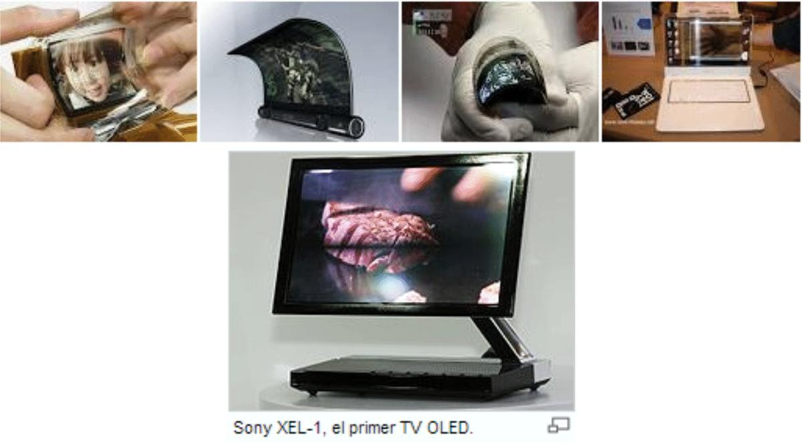

# 20. Parámetros técnicos de componentes comerciales

**Presentación relacionada:** [Tema 19 y 20](../Tema%2019%20y%2020/README.md)

## Objetivo

- Conocer los principales parámetros técnicos de componentes comerciales.

## 20.1. Introducción

Conocer los principales parámetros de los diferentes componentes comerciales que brindan los fabricantes permite la correcta asimilación de los nuevos recursos a una computadora, o, por otra parte la personalización del equipo de cómputo para la tarea destinada. No es lo mismo una simple PC de escritorio que utiliza una secretaria en una oficina que otra que se utiliza en la industria para modelar procesos, o simplemente para ser usada para juegos o renderización de imágenes.

Hoy existen muchos fabricantes y surgen nuevas tecnologías a un paso gigante. Es por eso que saber detalladamente las características de estos parámetros brinda la posibilidad de estimar costos y recursos, acorde a las potencialidades que se necesite alcanzar, la integración de nuevos dispositivos de manera segura, etc.

A continuación se hará un análisis de los principales rasgos a tener en cuenta para adquirir componentes comerciales. En base a esto se describirán los rasgos necesarios de los principales componentes presentes en una computadora de uso general.

## 20.2. Componentes comerciales

#### Motherboard

La tarjeta madre es él componente principal de la computadora, de ella dependen todos los demás componentes para funcionar y estar conectados entre sí, así como también de ella dependen el tipo de procesador, memoria RAM, puertos de expansión, y demás componentes que se integren al equipo. Él no dimensionar tal importancia sumado a la cantidad de marcas, modelos, tamaños y características actuales, hacen difícil la tarea de elegir alguna, es por esto que mayormente se desvía toda la atención al precio. ¿Cómo identificar la tarjeta madre adecuada?

Otros factores además del precio se deben considerar, pero es importante comenzar por determinar el desempeño que se requiere, lo que se define básicamente en 5 niveles:

1. Nivel Básico: generalmente estos usuarios ocupan la computadora para actividades hogareñas, es decir, no requieren de mayor performance para realizar las actividades. Para equipos de este nivel, se recomienda ensamblar procesadores con desempeño similar al de la motherboard.
2. Nivel Medio: aquí se concentran los usuarios empresariales, es decir, personas que tienen necesidades más exigentes que un nivel básico, en cuanto a rendimiento se refiere, por lo mismo, se requieren ensamblar procesadores de nivel más alto, pero no el más poderoso.
3. Estudiantes especializados: los usuarios de este nivel requieren tarjetas madre que incluyan los puertos más actualizados (USB 3.0 por ejemplo) y preferentemente componentes de última generación, ya que demandan una transferencia de datos más veloz.
4. Gamers: para este nivel, se buscan Motherboards con chips de audio específicos para alta definición, al igual que soporte para tarjetas de video y la expansibilidad de las mismas, así como distintos puertos de red, es decir, todo enfocado al mejor rendimiento en videojuegos o entretenimiento.
5. Overclock: las necesidades para este nivel son más robustas, ya que él objetivo es aumentar el rendimiento del procesador, por lo que busca tarjetas madre con diferentes botones o funciones automáticas cómo encendido, apagado, reiniciar, guardar configuraciones, entre otras cosas para facilitar esta tarea.

Hay también otros aspectos que debes considerar para adquirir una Motherboard:

- Tipo de procesador: las tarjetas madre se fabrican para una marca de procesador en específico (Intel o AMD), por lo que es primordial conocer los modelos y generación compatibles con ella.
- Capacidad máxima de memoria: la memoria RAM es él componente más fácil de cambiar, y se acostumbra que conforme pasa el tiempo se le va agregando más a la computadora, por lo que conocer la cantidad máxima de memoria RAM y los tipos que soporta es un buen consejo.
- Conectores de Disco Duro: asegúrate que él disco duro que deseas integrar sea soportado por la tarjeta madre, los cuales pueden ser un disco duro tradicional o unidad SSD.
- Cantidad de ranuras de expansión: estas ranuras permiten agregarle otros componentes a la tarjeta madre, cómo una tarjeta de WIFI, tarjeta de video o de sonido, etc. Asegúrate que tengan las necesarias para los componentes que deseas agregar a la PC.
- Soporte para RAID: esto permite utilizar 2 o más discos duros en conjunto cómo si fuera uno solo, ya sea para maximizar el espacio de almacenamiento y/o cómo respaldo en caso de falla de alguno de ellos.
- Overclocking: como se mencionó anteriormente el Overclocking, sirve para modificar la velocidad del procesador y aumentar su desempeño. Algunas tarjetas madre ya vienen preparadas para este propósito.
- Chipset: este conjunto de chips es el encargado de comunicar todos los componentes de la PC con el procesador. Cada tarjeta trae uno en especial, identificarlo e investigar sus características es una buena idea. Un ejemplo de esto son las nuevas tarjetas Asus con chipset Intel Z87.
- Cantidad de sistemas On-Board: cuanto menos cosas tenga integrada la tarjeta madre, mejor. Actualmente lo que integran de forma estándar las tarjetas madres de alta calidad son los puertos USB, la Red y él Audio.
- Marca: existen muchas marcas de fabricantes actualmente, como Asus, Gigabyte, ASRock, Biostar, ECS, entre otras. Cada una ofrece distintos precios, modelos y características diferentes, lo importante es identificar tus necesidades y requerimientos para elegir una buena opción.
- Características extras: algunas marcas incluyen características especiales o novedosas para aumentar la experiencia del usuario, cómo él caso de hasta 6 BIOS en algunas tarjetas Gigabyte o él Fan control en él modelo P8Z77 de Asus:

**Figura 20.1.** Dos vistas del Intel® Desktop Board DQ77KB.

#### Procesador

El procesador es el cerebro del ordenador. De sus capacidades dependerá tanto la velocidad a la que funcione como sus límites para poder ejecutar más o menos cosas. Actualmente existen dos grandes competidores que se disputan la supremacía del mercado: Intel y AMD.

Algunas de las características esenciales para describir su funcionamiento son: cantidad de núcleos, marca y modelo del procesador, frecuencia de reloj y la memoria de segundo nivel.

1. Núcleo simple/Multinúcleo: indica si el ordenador tiene varios procesadores trabajando a la vez o sólo uno. Que un ordenador tenga un procesador de doble núcleo no significa que vaya a tener el doble de capacidad que uno simple, aunque sí que mostrará una mejora notable para realizar operaciones complejas. Además, evita que se caliente más de la cuenta y facilita su refrigeración, por lo que alargará más su vida útil. La tendencia actual es que todos sean multinúcleos, pero los de núcleo simple todavía son más baratos y cumplen las expectativas de la mayoría de usuarios.
2. Marca y modelo del procesador: las marcas de procesadores para ordenador más extendidas son Intel y AMD. Las dos ofrecen excelentes productos en toda la gama de capacidades y ambas cuentan con procesadores de doble núcleo y núcleo simple. Para ordenadores de sobremesa, a partir del Pentium III (en Intel) y del Athlon 64 (en AMD) el rendimiento es óptimo. En casos concretos, como la edición de vídeo, audio o los videojuegos de última generación, hay que tender a modelos superiores. Los Intel ostentan por el momento la primacía en cuanto a velocidad de funcionamiento, mientras que AMD goza de mejor reputación entre los amantes de los juegos, y es reconocido por ofrecer precios más accesibles que los de su competidor.

**Figura 20.2.** Procesadores de la gama Core de Intel.

**Tabla 20.1.** : Algunos de los principales productos de Intel.

**Modelos Intel**

| Procesador | Frec. Reloj | Núcleos | Veloc. Bus | Pot. Térmica | Mem. Caché |
| --- | --- | --- | --- | --- | --- |
| Pentium II | 233-450 MHz | 1 | 66-100 MHz | 16.8-43 W | 32 KB |
| Pentium III | 450 MHz-1.4 GHz | 1 | 100-133 MHz | 17-34.5 W | 256-512 KB |
| Pentium 4 | 1.3-3.8 GHz | 1 | 400-1066 MHz | 21-115 W | 12+8-12+16 KB |
| Pentium 4 (Extreme edition) | 3.2-3.73 GHz | 1 | 800-1066 MHz | 92-115 W | 12+8-12+16 KB |
| Celeron | 266 MHz-3.6 GHz | 1, 2 | 66-800 MHz | 5.5-86 W | 8 KB-32 KB x2 |
| Core 2 Duo | 1.06-3.33 GHz | 1, 2, 4 | 533 MHz, 667 MHz, 800 MHz, 1066 MHz, 1333 MHz, 1600 MHz | 5.5 W-150 W | 32 KB x2 |

**Modelos Intel**

| Procesador | Frec. Reloj | Núcleos | Veloc. Bus | Pot. Térmica | Mem. Caché |
| --- | --- | --- | --- | --- | --- |
| Core i3 | 1.4-3.4 GHz | 2 | 1066 MHz, 1600 MHz, 2.5-5 GT/s | 35-73 W | 32x32 KB x2 |
| Core i5 | 1.06-3.6 GHz | 2, 4 | 2.5-5 GT/s | 17-95 W | 32x32 KB x2-32x32 KB x4 |
| Core i7 | 1.6-3.9 GHz | 6 | 4.8 GT/s, 6.4 GT/s | 45W-130W | 32x32 KB x4-32x32 KB x6 |

**Figura 20.3.** Procesadores AMD.

**Tabla 20.2.** : Algunos de los principales productos de AMD.

**Modelos AMD**

| Procesador | Frec. Reloj | Núcleos | Veloc. Bus | Pot. Térmica | Mem. Caché |
| --- | --- | --- | --- | --- | --- |
| Duron | 600-1800 MHz | 1 | 100-133 MHz | ,7 W-57 W | 128 KB |
| Athlon | 500-1400 MHz | 1 | 100-133 MHz | 31 W-72 W | 128 KB |
| Athlon XP | 1333-2333 MHz | 1 | 133-266 MHz | 48,5-76,8 W | 128 KB |
| Athlon XP | 1500-2200 MHz | 1 | 166-800 MHz | 35-62 W | 128 KB |
| Sempron LE | 1900-2200 MHz | 1 | 800 MHz HT | 45 W | 128 KB |
| Athlon 64 | 1000 MHz | 1 | 800 MHz HT-1 GHz HT | 8-89 W | 128 KB |
| Sempron X2 | 1800-2000 MHz | 2 | 800 MHz HT | 65 W | 8 KB x 2 |
| Athlon 64 X2 | 1900-3100 MHz | 2 | 800 MHz HT | 35-125 W | 128 KB x 2 |
| Athlon 64 FX | 2600-3000 MHz | 2 | 800 MHz HT | 110-125 W | 1 MB x 2 |
| Athlon X2 | 1900-2800 MHz | 2 | 800 MHz HT | 45-95 W | 512 KB x 2 |
| Phenom X3 | 900-2500 MHz | 3 | 1,8 GHz HT | 65-95 W | 512 KB x 3 |
| Phenom X4 | 1800-2600 MHz | 4 | 1,6-2 GHz HT | 65-125 W | 512 KB x 4 |
| Athlon II X2 | 1600-3400 MHz | 2 | 2 GHz HT | 25-65 W | 512 KB x 2-1 MB x2 |
| Athlon II X3 | 2200-3400 MHz | 3 | 2 GHz HT | 45-95 W | 128 KB x 3 |

**Modelos AMD**

| Procesador | Frec. Reloj | Núcleos | Veloc. Bus | Pot. Térmica | Mem. Caché |
| --- | --- | --- | --- | --- | --- |
| Phenom II X2 | 2800-3500 MHz | 2 | 2-2,2 GHz HT | 65-80 W | 8 KB x 2 |
| Athlon II X4 | 2200-3200 MHz | 4 | 2 GHz HT | 45-95 W | 128 KB x 4 |
| Phenom II X3 | 2400-3200 MHz | 3 | 1,8-2 GHz HT | 65-95 W | 512 KB x 3 |
| Phenom II X4 | 2000-3,4 GHz | 4 | 1,8-2 GHz HT | 65-125 W | 128 KB x 4 |
| Phenom II X6 | 2600-3,76 GHz | 6 | 2 GHz HT | 95-125 W | 8 KB x 6 |
| FX | 2800-4,3 GHz | 4, 6, 8 | 5, 2 GHz HT | 95-125 W | 2 MB x 2, 3, 4 |

3. La frecuencia de reloj: es muy común que uno de los principales datos que se mencionan en catálogos y publicidad de ordenadores sea que cuenta con un procesador de, por ejemplo, 2 Megaherzios. Este dato se refiere a la frecuencia de reloj del procesador, es decir, la cantidad de información que es capaz de gestionar el procesador por segundo. Su importancia no es determinante para un usuario medio. 4.
4. La memoria de segundo nivel: junto a la frecuencia de reloj, define la eficiencia del procesador. Su capacidad se mide en Megabytes (millones de bytes, la unidad de información básica más usada) y se sitúa entre los 256 Kilobytes y los dos Megabytes (diez veces más). Siempre que se encuentre entre estos dos parámetros, no habrá problema alguno.

#### La memoria RAM

Junto con el procesador y el disco duro, la memoria RAM es uno de los elementos clave en los que se debe fijar el comprador, puesto que indica cuánta información puede manejar el ordenador a la vez. Su capacidad debe situarse entre los 512 Megabytes y los 2048. Un buen procesador no puede trabajar de forma correcta sin una RAM amplia, aunque una RAM excesiva puede sobrecalentar a un procesador poco potente (en mayor medida si es portátil), por lo que conviene fijarse en que ambos datos estén compensados. En la siguiente tabla se muestra un resumen de la tecnología de fabricación.

**Tabla 20.3.** : Características de los tipos de memoria DDR.

| DDR SDRAM Standard | Bus clock (MHz) | Internal rate (MHz) | Prefetch (min burst) | Transfer Rate (MT/s) | Voltage | DIMM pins | Micro MM pins |
| --- | --- | --- | --- | --- | --- | --- | --- |
| DDR | 100-200 | 100-200 | 2n | 200-400 | 2.5/2.6 | 184 | 172 |
| DDR2 | 200-533 | 100-266 | 4n | 400-1066 | 1.8 | 240 | 214 |
| DDR3 | 400-1066 | 100-266 | 8n | 800-2133 | 1.2/1.5 | 240 | 214 |
| DDR4 | | | | 2133-4266 | 1.05/1.2 | | |

#### Disco duro

El disco duro es el gran almacén de datos del ordenador. Su capacidad se mide en Gigabytes (un Gigabyte equivale a mil millones de bytes) y puede alcanzar valores de cientos de Gigabytes.

Las características que se deben tener en cuenta en un disco duro son:

- Tiempo medio de acceso: tiempo medio que tarda la aguja en situarse en la pista y el sector deseado; es la suma del Tiempo medio de búsqueda (situarse en la pista), Tiempo de lectura/escritura y la Latencia media (situarse en el sector).
- Tiempo medio de búsqueda: tiempo medio que tarda la aguja en situarse en la pista deseada; es la mitad del tiempo empleado por la aguja en ir desde la pista más periférica hasta la más central del disco.
- Tiempo de lectura/escritura: tiempo medio que tarda el disco en leer o escribir nueva información: Depende de la cantidad de información que se quiere leer o escribir, el tamaño de bloque, el número de cabezales, el tiempo por vuelta y la cantidad de sectores por pista.
- Latencia media: tiempo medio que tarda la aguja en situarse en el sector deseado; es la mitad del tiempo empleado en una rotación completa del disco.
- Velocidad de rotación: revoluciones por minuto de los platos. A mayor velocidad de rotación, menor latencia media.
- Tasa de transferencia: velocidad a la que puede transferir la información a la computadora una vez que la aguja está situada en la pista y sector correctos. Puede ser velocidad sostenida o de pico.

**Figura 20.4.** Diferentes tipos de discos. A la izquierda un disco de estado sólido, y a la derecha un disco duro estándar.

Actualmente se ha introducido la tecnología de las unidades de estado sólido, las tienen el mismo uso que los discos duros y emplean las mismas interfaces, pero no están formadas por discos mecánicos, sino por memorias de circuitos integrados para almacenar la información. El uso de esta clase de dispositivos anteriormente se limitaba a las supercomputadoras, por su elevado precio, aunque hoy en día ya son muchísimo más asequibles para el mercado doméstico. Hoy en las modernas computadoras se pueden mezclar estas dos tecnologías, teniendo los discos tradicionales para almacenar los datos y uno de estado sólido para la velocidad de lectura/ escritura.

- La refrigeración: sirve para mantener la temperatura del procesador en valores bajos. El mecanismo habitual es un ventilador, que es el principal generador de ruido. Los modelos de refrigeración líquida son más eficientes, pero elevan bastante el consumo general de energía. Sin embargo, son recomendables para los videojugadores que fuerzan mucho el procesador.
- La conectividad inalámbrica: permite conectarse a Internet como para transmitir y recibir datos sin necesidad de cables. WIFI es la tecnología que permite acceder a las redes inalámbricas, y es importante contar con ella, sobre todo en portátiles. Bluetooth es la tecnología que pone al ordenador en contacto con dispositivos móviles como teléfonos o agendas electrónicas. No es muy usual encontrarla integrada en el equipo, pero un simple adaptador externo por USB (que no supera los 30 euros) cumple su función.
- Los dispositivos de lectura/grabación óptica: el lector/grabador suele serlo de CD y DVD. Si es “dual”, también llamado “multiformato”, puede leer y grabar los formatos comerciales DVD+/-R. De “doble capa” significa que puede grabar más de una capa de información en el disco óptico y por tanto puede guardar más datos. Es importante que el dispositivo sea “multiformato” y cumpla funciones de grabador además de lector. Si es de “doble capa”, tanto mejor, pero no es fundamental a no ser que se deba descargar periódicamente el disco duro a causa, por ejemplo, de un uso intensivo de las redes P2P.
- La tarjeta gráfica: interpreta las imágenes gráficas y es en sí misma un pequeño ordenador con procesador propio. Las principales marcas son ATI/AMD, NVIDIA e Intel. Aunque los ordenadores suelen disponer de una tarjeta gráfica incorporada de calidad suficiente para la mayoría de las funciones.

**Figura 20.5.** Tarjeta gráfica Titán.

**Figura 20.6.** La gráfica ordena los modelos de algunas tarjetas según su potencia/precio. Marzo 2013.

#### La pantalla

Hoy prácticamente han desaparecido las pantallas “de tubo” (CRT) por su excesivo peso y volumen. Nuevas tecnologías de fabricación han desplazado a estos, las más notables son LCD y LED.

Los LCD son por norma general mucho más económicos y fáciles de fabricar. En contraposición, OLED, aun es una tecnología complicada de fabricar, y aunque ahora son mucho más asequibles que hace algunos años, en términos de precio siempre salen perdiendo ante LCD.

**Figura 20.7.** Diferentes monitores OLED.

#### Otros complementos interesantes

- El teclado: aunque no se repara demasiado en él, es de los más importantes.
- El ratón: los ópticos han sustituido a los engorrosos de rueda que siempre hay que estar limpiando, pero necesitan superficies opacas y rugosas para funcionar de forma óptima. Los inalámbricos eliminan el problema del cable, siempre molesto, pero suelen perder la conexión y hay que sintonizarlos con demasiada frecuencia. Por otro lado, la forma del ratón puede provocar dolores en manos y dedos.
- La impresora: las tecnologías de impresión: el chorro de tinta y la láser. La primera funciona con cartuchos de tinta y está indicada para la impresión en color y de imágenes, aunque los consumibles son caros. Para imprimir textos en blanco y negro, la impresión láser es más barata a largo plazo. Conviene recordar que resulta más económico llevar las fotografías digitales a revelar a comercios donde cuenten con máquinas para tal fin.
- Las webcam: cada vez cobra más importancia con el auge de las videoconferencias de ordenador a ordenador. Hay numerosos modelos a precios muy asequibles. No conviene gastar excesivo dinero en ellas porque la calidad de la imagen que transmitan depende más del ancho de banda que de su óptica.

## 20.3. Conclusiones

En esta clase se han presentado los diversos elementos a tener en cuenta a la hora de escoger un computador. Se han dado detalles de los componentes de los computadores modernos, para facilitar la elección, siempre ajustados a las necesidades del usuario final.

Se describieron casi todos los componentes de los computadores modernos, los principales y más usados, que son los que determinan el funcionamiento de los computadores.

## Bibliografía

- [1] Thomas L. Floyd. (2006). Fundamentos de sistemas digitales 9ª Edición. Ed. PrenticeHall.
- [2] William Stallings (2006). Organización y arquitectura de computadores 7ª Edición. Ed. Prentice-Hall.
- [3] Prieto, A., Rojas, F., Castillo, P. A. y Prieto, B. (2010). Tecnología y Estructura de computadores. Madrid: Ed. Udima.
- [4] Hennessy, J. Y Patterson, D. (2007). Computer Architecture. A Quantitative Approach. Ed. Morgan Kaufmann.
