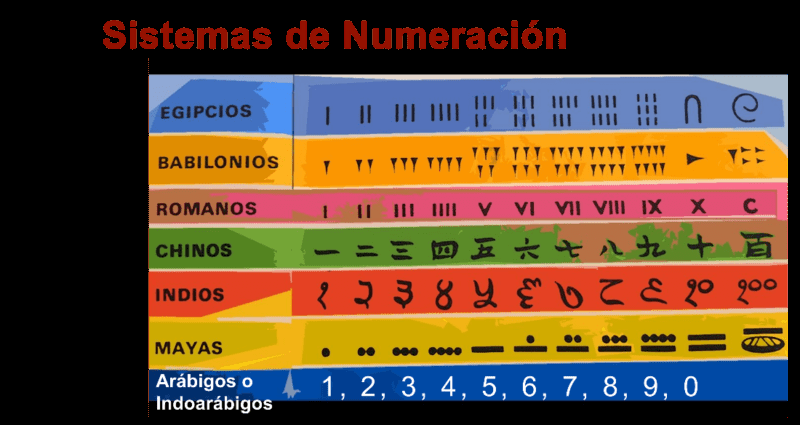
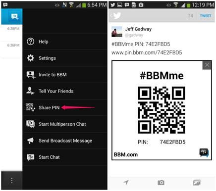
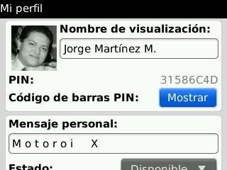
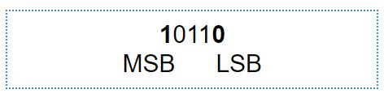
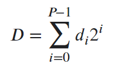
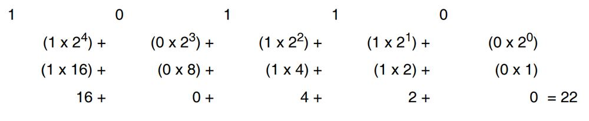
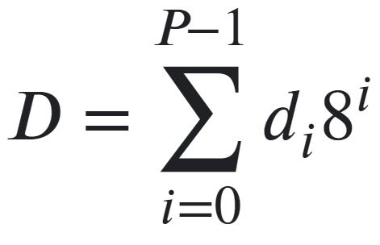
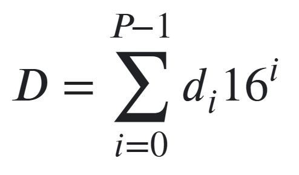
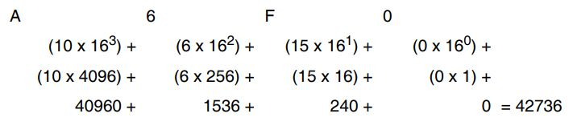

# Tema 3

**Lectura en el contenido completo:** [Capítulo 3 — Sistemas de numeración](../Contenido%20completo/Cap%C3%ADtulo%2003%20-%20Sistemas%20de%20numeraci%C3%B3n.md)

PDF de la presentación: [Tema 03.pdf](Tema%2003.pdf)

Ejercicios: [Tema 3 · Ejercicios](Ejercicios/README.md)

---

## Sistemas de numeración



| Sistema | Dígitos |
| --- | --- |
| Decimal | 0, 1, 2, 3, 4, 5, 6, 7, 8, 9 |
| Octal | 0, 1, 2, 3, 4, 5, 6, 7 |
| Binaria | 0, 1 |
| Hexadecimal | 0, 1, 2, 3, 4, 5, 6, 7, 8, 9, A, B, C, D, E, F |




## Hexadecimal

16 Dígitos

**31586C4D**

BBPin



## Los sistemas digitales utilizan el sistema de numeración binario

(0,1) (OFF, ON) (0v, 5v)

- 100101 binario (declaración explícita de formato)
- 100101b (un sufijo que indica formato binario)
- 100101B (un sufijo que indica formato binario)
- bin 100101 (un prefijo que indica formato binario)
- 100101<sub>2</sub> (un subíndice que indica base 2 (binaria) notación)
- %100101 (un prefijo que indica formato binario)
- 0b100101 (un prefijo que indica formato binario, común en lenguajes de programación)

## Contar en binario

| Binario | Decimal |
| --- | --- |
| 0 | 0 |
| 1 | 1 |
| 10 | 2 |
| 11 | 3 |
| 100 | 4 |
| 101 | 5 |
| 110 | 6 |
| 111 | 7 |

| Binario | Decimal |
| --- | --- |
| 1000 | 8 |
| 1001 | 9 |
| 1010 | 10 |
| 1011 | 11 |
| 1100 | 12 |
| 1101 | 13 |
| 1110 | 14 |
| 1111 | 15 |

bit → binary digit (dígito binario)

10110 es un número de cinco bits.

¿Hasta qué número en decimal puede contarse empleando un número binario de cuatro bits?

**Solución:** Con N=4, se puede contar hasta 2<sup>4</sup>-1=15. Es decir, hasta el número 15

MSB: bit más significativo, *Most Significant Bit*

LSB: bit menos significativo, *Least Significant Bit*



## Conversión de Binario a Decimal

dígitos [0, 1]



(10000100)<sub>2</sub> = (132)<sub>10</sub>

1 * 2<sup>7</sup> + 0 * 2<sup>6</sup> + 0 * 2<sup>5</sup> + 0 * 2<sup>4</sup> + 0 * 2<sup>3</sup> + 1 * 2<sup>2</sup> + 0 * 2<sup>1</sup> + 0 * 2<sup>0</sup> = 132

### Conversión Binario a Decimal



1000111<sub>2</sub> = 71<sub>10</sub>

## Conversión de Decimal a Binario

Convierta 291<sub>10</sub> en un número binario.

- 291/2 = 145 resto 1 (**LSB**)
- 145/2 = 72 resto 1
- 72/2 = 36 resto 0
- 36/2 = 18 resto 0
- 18/2 = 9 resto 0
- 9/2 = 4 resto 1
- 4/2 = 2 resto 0
- 2/2 = 1 resto 0
- 1/2 = 0 residuo 1 (**MSB**)

Por tanto, 291<sub>10</sub> = 100100011<sub>2</sub>

### Conversión Decimal a Binario

101<sub>10</sub> = 1100101<sub>2</sub>

## Contar en Octal

Sistema numérico de base ocho. En él existen ocho dígitos diferentes, desde cero hasta siete

| Octal | Decimal | Octal | Decimal |
| --- | --- | --- | --- |
| 0 | 0 | 10 | 8 |
| 1 | 1 | 11 | 9 |
| 2 | 2 | 12 | 10 |
| 3 | 3 | 13 | 11 |
| 4 | 4 | 14 | 12 |
| 5 | 5 | 15 | 13 |
| 6 | 6 | 16 | 14 |
| 7 | 7 | 17 | 15 |

dígitos [0, 1, 2, 3, 4, 5, 6, 7]



(204)<sub>8</sub> = (132)<sub>10</sub>

2 * 8<sup>2</sup> + 0 * 8<sup>1</sup> + 4 * 8<sup>0</sup> = 132

**Ejemplo:** Cuente en octal desde 666, hasta 710

**Solución:**

```
666
667 - La primera columna está llena.
670 - Se pone un cero y se suma uno a la segunda columna.
671
672
673
674
675
676
677 - Las primeras columnas están llenas.
700 - Se ponen ceros y se suma uno a la tercera columna.
701
702
703
704
705
706
707 - La primera columna está llena otra vez.
710 - Se pone un cero y se suma uno a la segunda columna.
```

### Conversión Binario a Octal

Convierta 10111101<sub>2</sub>, en un número octal

| 010 | 111 | 101 |
| --- | --- | --- |
| 2 | 7 | 5 |

Nótese que el grupo más significativo sólo tenía dos bits. Es por esto que se añadió en él un cero para completar tres bits. Por tanto, 10111101<sub>2</sub> = 275<sub>8</sub>

Convierta 10101010<sub>2</sub>, en un número octal

| 010 | 101 | 010 |
| --- | --- | --- |
| 2 | 5 | 2 |

El número 10101010 binario es el 252 Octal

### Conversión Octal a Binario

Por cada dígito octal se escriben los tres dígitos binarios correspondientes.

Por ejemplo, para convertir 3062<sub>8</sub>, en un número binario:

| 3 | 0 | 6 | 2 |
| --- | --- | --- | --- |
| 011 | 000 | 110 | 010 |

Por tanto, 3062<sub>8</sub> = 011000110010<sub>2</sub>

Nótese que el 2 se escribe como 010, con la adicción de un cero para completar los tres bits, y que el cero se escribe cómo 000 para mantener los tres lugares. La adición de ceros puede suprimirse en el dígito más significativo. Con esto, el 3 puede escribirse como 11 o 011

Por ejemplo, para convertir 377<sub>8</sub>, en un número binario:

**Solución:**

| 3 | 7 | 7 |
| --- | --- | --- |
| 011 | 111 | 111 |

Por tanto, 377<sub>8</sub> = 11111111<sub>2</sub>

## Sistema numérico hexadecimal

| Decimal | Binario | Hexadecimal |
| --- | --- | --- |
| 0 | 0000 | 0 |
| 1 | 0001 | 1 |
| 2 | 0010 | 2 |
| 3 | 0011 | 3 |
| 4 | 0100 | 4 |
| 5 | 0101 | 5 |
| 6 | 0110 | 6 |
| 7 | 0111 | 7 |
| 8 | 1000 | 8 |
| 9 | 1001 | 9 |
| 10 | 1010 | A |
| 11 | 1011 | B |
| 12 | 1100 | C |
| 13 | 1101 | D |
| 14 | 1110 | E |
| 15 | 1111 | F |

El sistema de numeración hexadecimal consta de dieciséis caracteres y se usan para representar números binarios ya que su conversión es sencilla.

El sistema hexadecimal es un sistema en base dieciséis, es decir, formado por dieciséis caracteres alfanuméricos.

dígitos [0, 1, 2, 3, 4, 5, 6, 7, 8, 9, A, B, C, D, E, F]



(86)<sub>16</sub> = (134)<sub>10</sub>

8 * 16<sup>1</sup> + 6 * 16<sup>0</sup> = 134

### Conversión Hexadecimal a Decimal

El número hexadecimal A6F0<sub>16</sub> significa:



Para distinguir un número hexadecimal de otro decimal, la base se escribe como subíndice.

En este caso sería: A6F0<sub>16</sub> = 42736<sub>10</sub>

### Conversión de Binario a Hexadecimal

Convierte 10111001<sub>2</sub>, en un número hexadecimal

| 1011 | 1001 |
| --- | --- |
| B | 9 |

El número 10111001<sub>2</sub> = B9<sub>16</sub>

**Ejemplo:** Convierte 11 1100 0000 1110<sub>2</sub>

El número 111 1100 0000 1110<sub>2</sub> = 3C0E<sub>16</sub>

### Conversión de Hexadecimal a Binario

**Ejemplo:** Convierte C3A6<sub>16</sub> en un número binario

| C | 3 | A | 6 |
| --- | --- | --- | --- |
| 1100 | 0011 | 1010 | 0110 |

Por lo tanto C3A6<sub>16</sub> = 1100001110100110<sub>2</sub>

## Sistema decimal codificado en binario (BCD)

En BCD cada dígito decimal está representado por cuatro bits

Por ejemplo, para convertir 3906<sub>10</sub>, a BCD

| 3 | 9 | 0 | 6 |
| --- | --- | --- | --- |
| 0011 | 1001 | 0000 | 0110 |

El resultado de convertir 3906 decimal a BCD es 0011100100000110

Ejemplo, transforme 11010010011<sub>BCD</sub>, en un número decimal

| 0110 | 1001 | 0011 |
| --- | --- | --- |
| 6 | 9 | 3 |

El número 11010010011<sub>BCD</sub> = 693<sub>10</sub>

## Conclusiones

- Hexadecimal
- Binario
- Decimal
- Octal
- BCD

## Estudio Autónomo

- Transforme 11000110011<sub>BCD</sub> en un número decimal.
- Convierta 3700<sub>10</sub> a BCD.
- Convierta 1000001001<sub>2</sub>, en un número hexadecimal.
- Convierta 10001001<sub>2</sub>, en un número octal.

<!-- navegación -->

---

[← Anterior: Tema 1 y 2](../Tema%2001%20y%2002/README.md) | [Índice](../README.md) | [Siguiente: Tema 3 · Ejercicios →](Ejercicios/README.md)
