# Tema 4 · Parte 1

**Lectura en el contenido completo:** [Capítulo 4 — Representación digital de la información](../../Contenido%20completo/Cap%C3%ADtulo%2004%20-%20Representaci%C3%B3n%20digital%20de%20la%20informaci%C3%B3n.md)

PDF de la presentación: [Tema 04 - Parte 1.pdf](Tema%2004%20-%20Parte%201.pdf)

---

## Representación digital de la Información

## Tipos de Señales

Pueden identificarse por tanto, dos tipos de señales: continuas y discretas

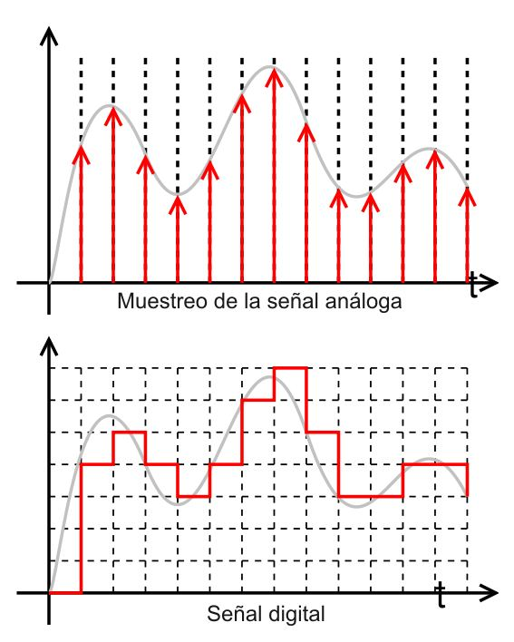

## Señales Continuas

- Analógicas
- Infinitos Valores
- Sonido, luz, tiempo, temperatura
- Radio
- Bajo consumo de Ancho de Banda
- \+ Sensible al ruido y fallo

## Señales Discretas

- Digitales
- Binario (0, 1)
- 2 Valores/niveles: 1 = On, Si, V; 0 = Off, No, F
- Finitos Valores
- DVD
- \+ Capacidad de transmisión
- \+ Fácil compartir información
- Son inmunes al Ruido

## Analógico a Digital

## Digital a Analógico

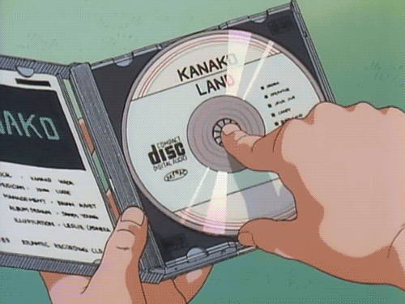

## Sistema binario - Operaciones aritméticas

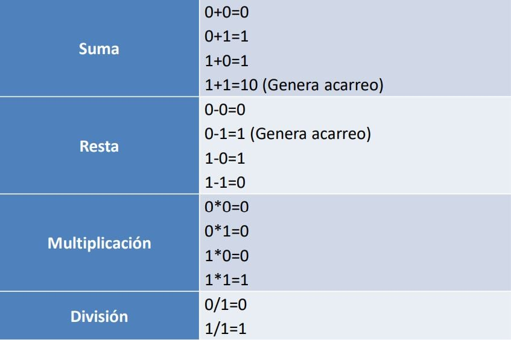

### Ejemplo de Suma:

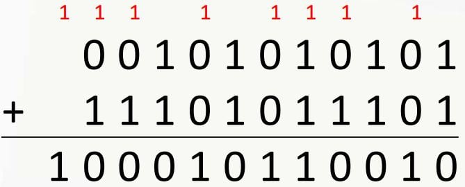

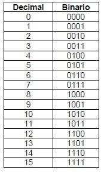

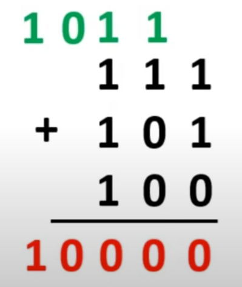

### Ejemplo de Resta:

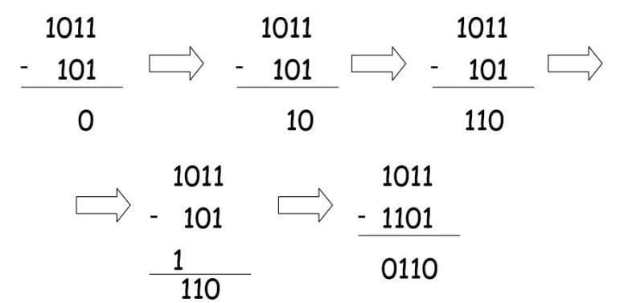

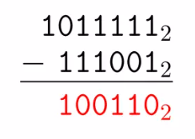

### Ejemplo de Multiplicación:

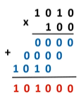

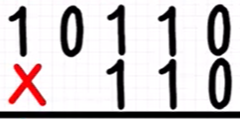

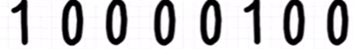

### Ejemplo de División:

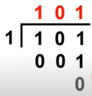

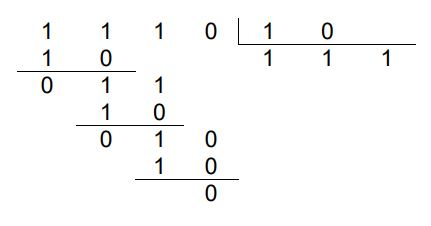

### Ejercicios de clase:

1 0 1 1 0 1 ÷ 1 1 0

### Ejemplo de División:

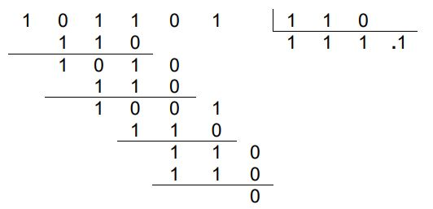

<!-- navegación -->

---

[← Anterior: Tema 4](../README.md) | [Índice](../../README.md) | [Siguiente: Tema 4 · Parte 2 →](../Parte%202/README.md)
