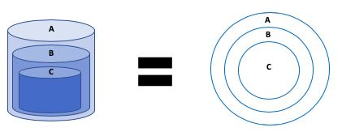
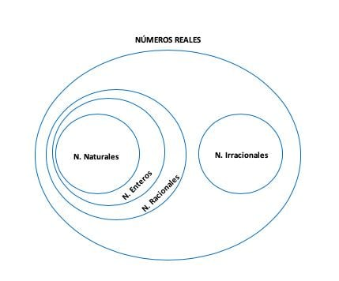
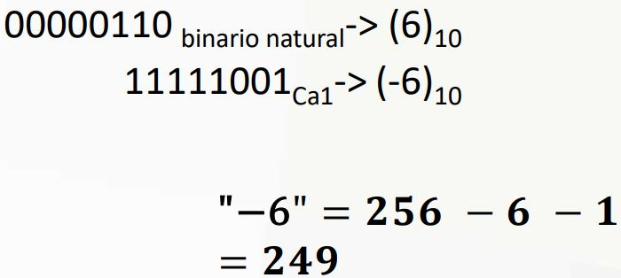
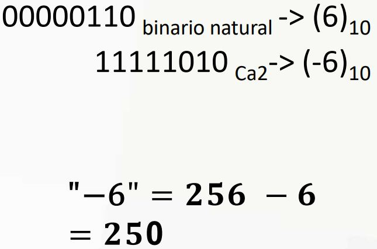
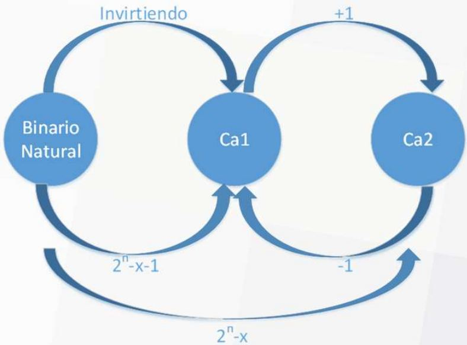
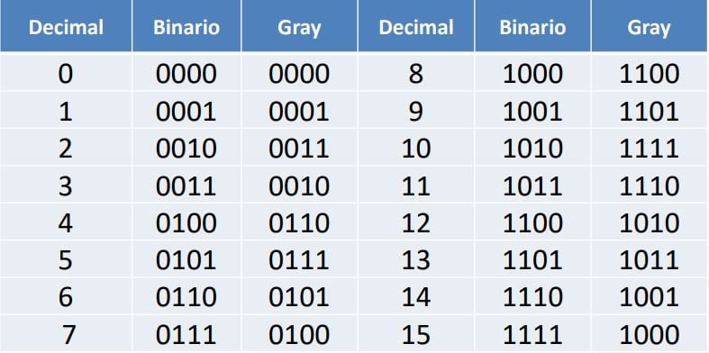
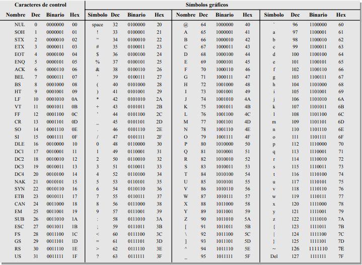

# Tema 4 · Parte 2

**Lectura en el contenido completo:** [Capítulo 4 — Representación digital de la información](../../Contenido%20completo/Cap%C3%ADtulo%2004%20-%20Representaci%C3%B3n%20digital%20de%20la%20informaci%C3%B3n.md)

PDF de la presentación: [Tema 04 - Parte 2.pdf](Tema%2004%20-%20Parte%202.pdf)

---

## Representación digital de la Información


## Esquema Matrioshka





## Representación de números enteros y reales

### Complemento a 1

-x = 2<sup>n</sup> - x - 1

X es el número inicial ( positivo ó negativo) y -x su complemento ( negativo ó positivo) que se quiere buscar.



### Complemento a 2

-x = 2<sup>n</sup> - x



```
10101011000
01010101000
```

## Transformar BinNat, Ca1 y Ca2



## Código Gray

Es un código sin pesos y no aritmético; es decir, no existen pesos específicos asignados a la posiciones de los bits. La característica más importante del código Gray es que sólo varía un bit de un código al siguiente.



## Código Gray (Binario → Gray)

(1 1 0 0 0 1 1 0)<sub>2</sub> = ( ? )<sub>Gray</sub>

```
1 1 0 0 0 1 1 0
1 0 1 0 0 1 0 1
```

(0 1 0 0 1 1)<sub>2</sub> = ( ? )<sub>Gray</sub>

```
0 1 0 0 1 1
0 1 1 0 1 0
```

## Código Gray (Gray → Binario)

(1 0 1 0 0 1 0 1)<sub>Gray</sub> = ( ? )<sub>2</sub>

```
1 0 1 0 0 1 0 1
1 1 0 0 0 1 1 0
```

## Código de caracteres - ASCII

- Código estándar americano para el intercambio de información. American Standard Code for Information Interchange
- El código ASCII dispone de 128 caracteres que se representan mediante un código binario de 7 bits. Realmente, el código ASCII puede considerarse como un código de 8 bits en el que el MSB siempre es 0.
- Los primeros 32 caracteres ASCII son comandos no gráficos, que nunca se imprimen o presentan en pantalla, y sólo se utilizan para propósitos de control.



<!-- navegación -->

---

[← Anterior: Tema 4 · Parte 1](../Parte%201/README.md) | [Índice](../../README.md) | [Siguiente: Tema 5 →](../../Tema%2005/README.md)
