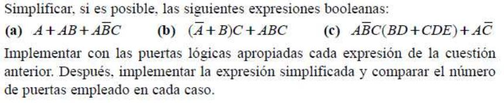
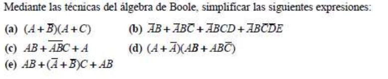
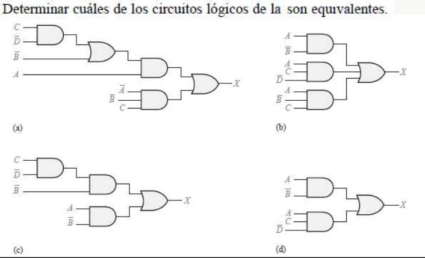

# Tema 5 · Ejercicios

Presentación de ejercicios. Tema relacionado: [Tema 5](../README.md).

**Lectura en el contenido completo:** [Capítulo 5 — Lógica binaria y Álgebra de Boole. Circuitos lógicos](../../Contenido%20completo/Cap%C3%ADtulo%2005%20-%20L%C3%B3gica%20binaria%20y%20%C3%81lgebra%20de%20Boole.%20Circuitos%20l%C3%B3gicos.md)

PDF de la presentación: [Tema 05 - Ejercicios.pdf](Tema%2005%20-%20Ejercicios.pdf)

---

## Ejercicios de Lógica binaria y Álgebra de Boole

## Álgebra de Boole

Simplificación | Ejercicios

Ejercicios de Lógica binaria y Álgebra de Boole. Circuitos Lógicos

Desarrolla la tabla de verdad de cada una de las siguientes expresiones suma de productos.

Desarrolla la tabla de verdad de cada una de las siguientes expresiones productos de sumas.

Diseña la tabla de verdad y su función lógica de un sistema que sea capaz de detectar las potencias de dos en su entrada.

Premisas:

Cuatro entradas - A, B, C, D

Una salida - F

El equipo de ingenieros militares han diseñado un prototipo de arma de destrucción masiva. Esta es capaz de destruir gran parte de faz de la tierra. El funcionamiento de esta arma es muy simple, para activarla se han establecido 3 pulsadores que funcionan de la siguiente manera:

El Capitán General puede activar la bomba. Ante la ausencia del Capitán General, el General del Ejército y el Teniente General pueden activarla siempre que los dos estén de acuerdo.

Pulsador 1: pulsador del Capitán General de las fuerzas armadas.

Pulsador 2: pulsador del General del Ejército.

Pulsador 3: pulsador del Teniente General.

Diseña la tabla de verdad y su función lógica

