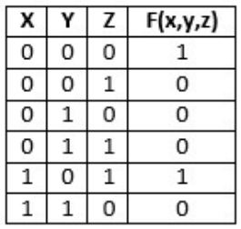
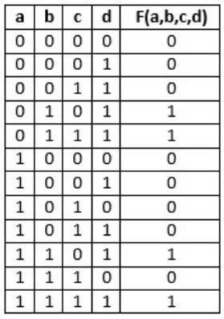
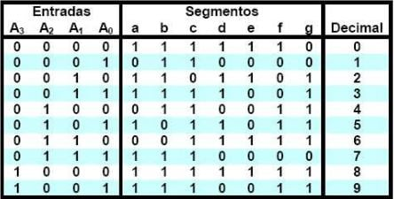
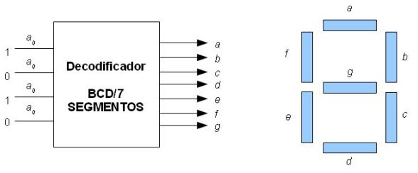

# Tema 6 · Ejercicios

Presentación de ejercicios. Tema relacionado: [Tema 6](../README.md).

**Lectura en el contenido completo:** [Capítulo 6 — Diseño y síntesis de circuitos lógicos combinacionales](../../Contenido%20completo/Cap%C3%ADtulo%2006%20-%20Dise%C3%B1o%20y%20s%C3%ADntesis%20de%20circuitos%20l%C3%B3gicos%20combinacionales.md)

PDF de la presentación: [Tema 06 - Ejercicios.pdf](Tema%2006%20-%20Ejercicios.pdf)

---

## Ejercicios de Diseño y síntesis de Circuitos lógicos Combinacionales

### Ejercicio

1) Dada la siguiente TV, sintetizar el circuito.

2) Dada la siguiente TV, sintetizar el circuito

3) Dada la siguiente TV, sintetizar el circuito

