# Tema 6

**Lectura en el contenido completo:** [Capítulo 6 — Diseño y síntesis de circuitos lógicos combinacionales](../Contenido%20completo/Cap%C3%ADtulo%2006%20-%20Dise%C3%B1o%20y%20s%C3%ADntesis%20de%20circuitos%20l%C3%B3gicos%20combinacionales.md)

PDF de la presentación: [Tema 06.pdf](Tema%2006.pdf)

Ejercicios: [Tema 6 · Ejercicios](Ejercicios/README.md)

---

## Diseño y síntesis de Circuitos lógicos Combinacionales

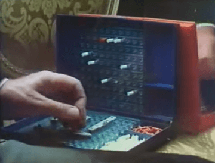

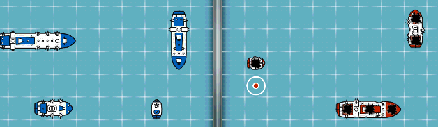

## Simplificación de funciones

### Mapa de Karnaugh

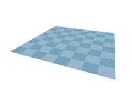

Permite la simplificación de funciones lógicas de forma efectiva. Es una forma de representar la tabla de la verdad de tal manera que la disposición de las combinaciones de valores es particularmente útil en cuanto a la simplificación de funciones.

## Mapa de Karnaugh - 3 Variables

Mapa de 3 Variables f(w,x,y):

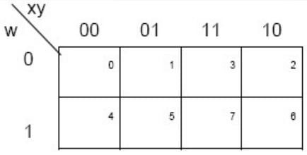

Mapa de 3 Variables f(w,x,z):

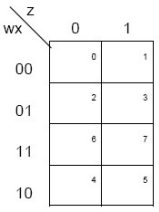

## Mapa de Karnaugh - 4 Variables

Mapa de 4 Variables f(w,x,y,z):

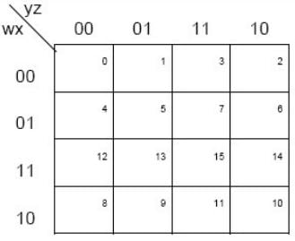

## Mapa de Karnaugh - Celdas adyacentes

La adyacencia se define por un cambio de una única variable.

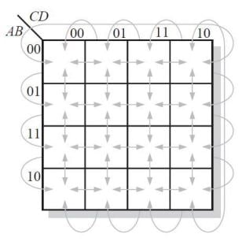

## Mapa de Karnaugh - 4 Variables

Ejemplo de minimización: Simplificar la siguiente función.

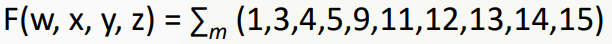

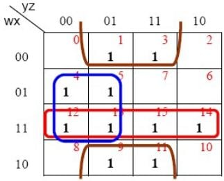

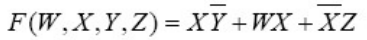

**Consideraciones sobre los grupos.**

- Los grupos se forman con # de áreas potencia de 2, es decir 1, 2, 4, 8 y 16.
- Se deben obtener la menor cantidad de grupos con la mayor cantidad de áreas en cada uno.
- En cada grupo debe haber al menos un 1 no contenido en otro grupo.
- Se aplica el teorema 6 a las áreas de cada grupo y las variables que representan al grupo son las que permanecen constantes en todas las áreas.
- El 0 es variable negada y el 1 variable sin negar.

## Mapa de Karnaugh - 3 y 4 Variables

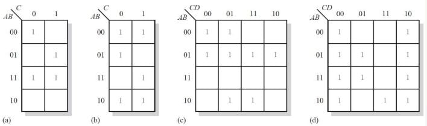

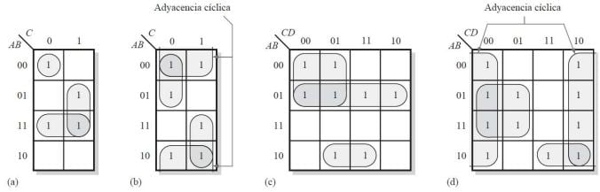

## Mapa de Karnaugh - 2 Variables

**Ejemplo**

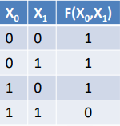

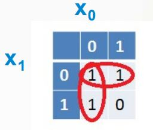

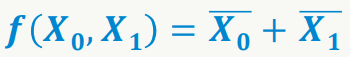

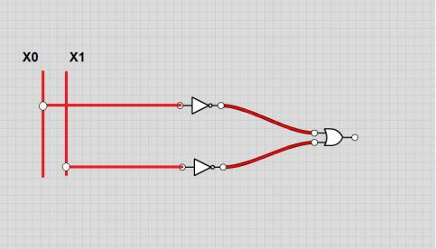

## Mapa de Karnaugh - 3 Variables

**Ejemplo**

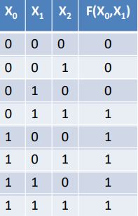

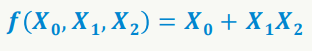

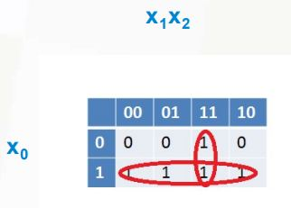

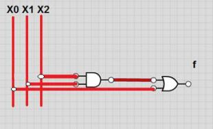

## Mapa de Karnaugh - 4 Variables

**Ejemplo**

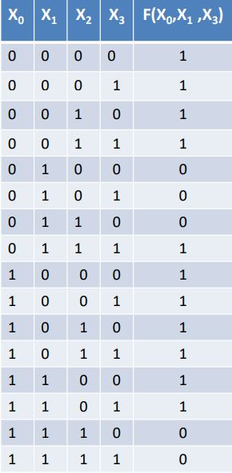

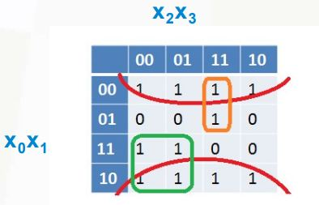

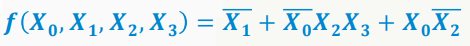

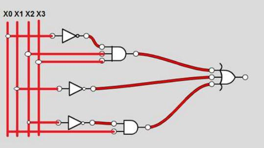

## Mapa de Karnaugh - Combinaciones opcionales

Las combinaciones de variables llamadas opcionales son aquellas que tienen lugar en cualquiera de estos dos casos:

- Aquellas que nunca pueden ocurrir.
- Aquellas que aunque pueden ocurrir, no importa si la función vale 0 ó 1.

Simplificar la siguiente función:

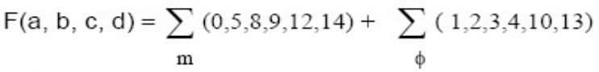

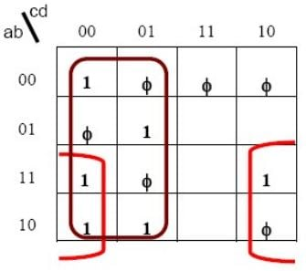

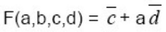

## Síntesis de Circuitos Uniterminales y Multiterminales

Los circuitos uniterminales son circuitos combinacionales que tienen una o varias entradas, pero una sola salida.

Para diseñar un circuito combinacional uniterminal, hay que tener en cuenta los siguientes pasos.

1. Obtener la Tabla de Verdad a partir de la descripción del problema.
2. Obtener la Forma Disyuntiva Normal (FDN) ó Forma Conjuntiva Normal (FCN).
3. Simplificar las funciones.
4. Diseñar el circuito.

**Ejemplo:** Dada la siguiente TV, sintetizar el circuito utilizando puertas NAND de 2 entradas.

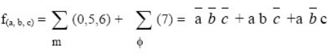

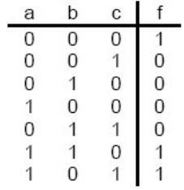

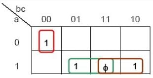

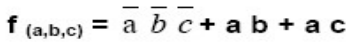

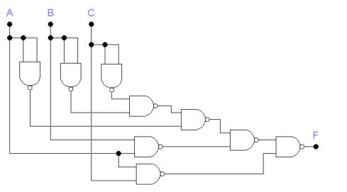

Los circuitos multiterminales o redes multiterminales son circuitos combinacionales que tienen varias salidas.

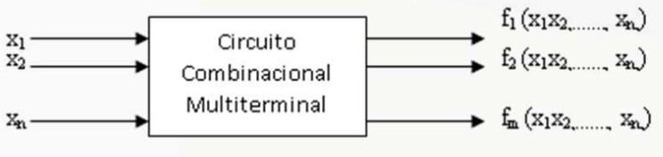

Los circuitos multiterminales pueden ser:

- Conversores de código.
- Codificadores.
- Decodificadores.

**Ejemplo 4:** Diseñar el conversor de código mostrado en la tabla. Recordar y tener en cuenta que el número decimal corresponde el número binario de las entradas no siempre tiene que estar en orden.

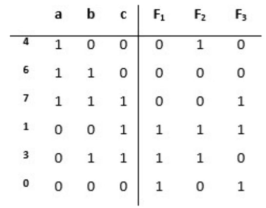

**Pasos a Seguir:**

- Obtener cada función y simplificarlas por separado, utilizando los Mapas de Karnaugh.

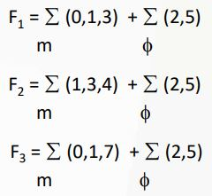

- Realizar el diseño de cada función teniendo en cuenta si hay términos repetidos.

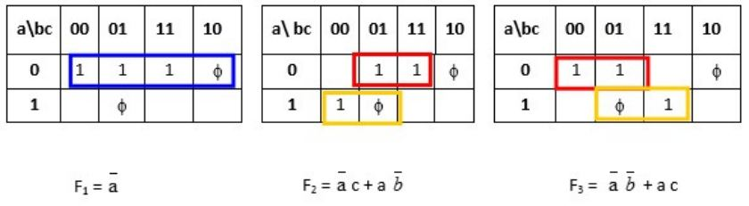

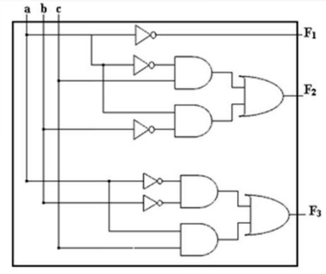

<!-- navegación -->

---

[← Anterior: Tema 5 · Ejercicios](../Tema%2005/Ejercicios/README.md) | [Índice](../README.md) | [Siguiente: Tema 6 · Ejercicios →](Ejercicios/README.md)
