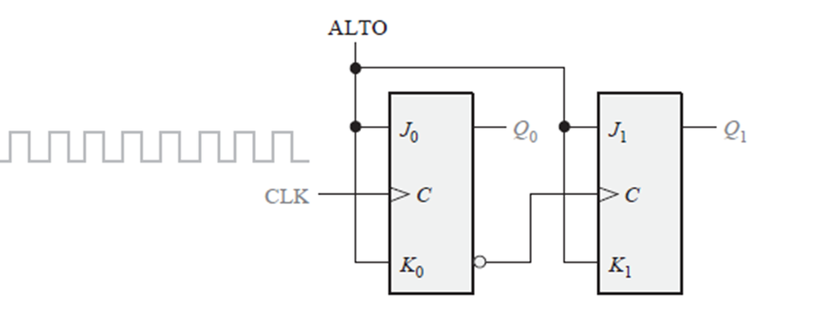

# Tema 7 · Ejercicios

Presentación de ejercicios. Tema relacionado: [Tema 7](../README.md).

**Lectura en el contenido completo:** [Capítulo 7 — Circuitos Secuenciales Sincrónicos (CSS)](../../Contenido%20completo/Cap%C3%ADtulo%2007%20-%20Circuitos%20Secuenciales%20Sincr%C3%B3nicos%20%28CSS%29.md)

PDF de la presentación: [Tema 07 - Ejercicios.pdf](Tema%2007%20-%20Ejercicios.pdf)

---

## Ejercicios de Circuitos Secuenciales Sincrónicos (CSS)

## Problema 1

Para el contador asíncrono de la figura, dibujar el diagrama de tiempos completos para ocho impulsos de reloj, indicando las formas de onda de la señal de reloj, de Q0 y de Q1.

Ejercicios de Circuitos Secuenciales Sincrónicos (CSS)

## Problema 2

Ejercicios de Circuitos Secuenciales Sincrónicos (CSS)

Problema 3

Problema 4
