# Tema 7

**Lectura en el contenido completo:** [Capítulo 7 — Circuitos Secuenciales Sincrónicos (CSS)](../Contenido%20completo/Cap%C3%ADtulo%2007%20-%20Circuitos%20Secuenciales%20Sincr%C3%B3nicos%20%28CSS%29.md)

PDF de la presentación: [Tema 07.pdf](Tema%2007.pdf)

Ejercicios: [Tema 7 · Ejercicios](Ejercicios/README.md)

---

## Circuitos Secuenciales Sincrónicos (CSS)

**Vídeo:** Latch — circuitos secuenciales

## Circuitos Lógicos

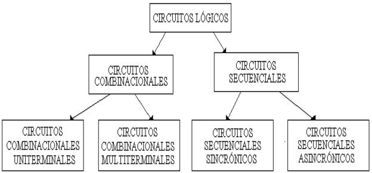

## Circuitos Secuenciales Síncronos

Son aquellos CSS en los que las salidas sólo cambian en instantes de tiempo gobernados por pulsos de otro circuito que recibe el nombre de reloj.

Ejemplos de CSS: Contadores síncronos, registros, detectores de secuencias.

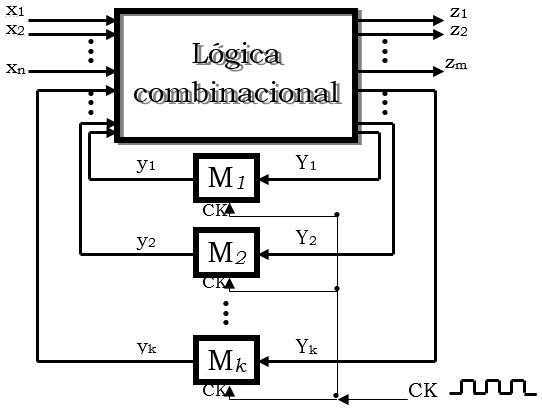

## Máquina de estados finitos

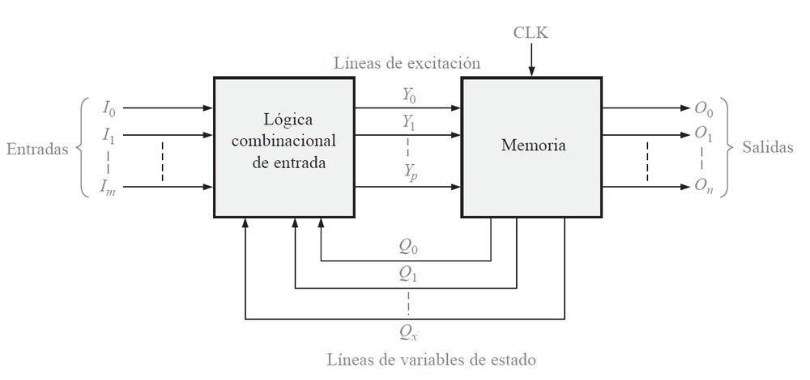

## Circuitos Secuenciales Síncronos

**Señal de reloj (ck)**

Son aquellos CSS en los que las salidas sólo cambian en instantes de tiempo gobernados por pulsos de otro circuito que recibe el nombre de reloj.

**Forma de Ondas**

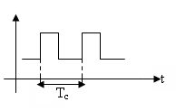

Tc: Período de reloj

## Circuitos Secuenciales Asíncronos

Son aquellos CS en los que las salidas no dependen de una relación temporal fija.

Ejemplos de CSA: Contadores asíncronos.

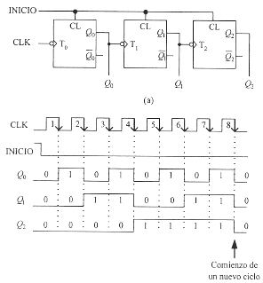

## Clasificación

- **Síncronos**
  - Señal de reloj global
  - Facilidad de diseño
  - Velocidad limitada
- **Asíncronos**
  - No existe señal de reloj global
  - Dificultad de diseño

## Latch

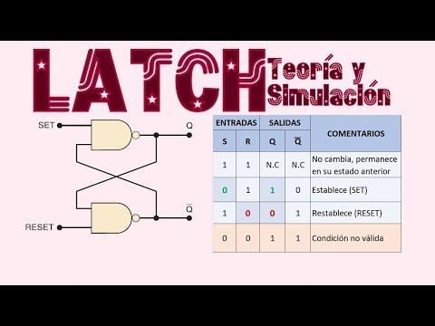

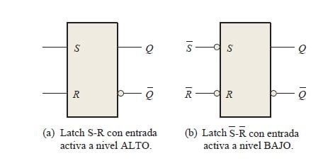

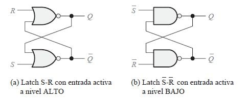

## Biestable - SR

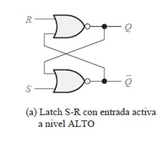

- **S** = set
- **R** = reset
- **Q** = salida
- **Q̅** = salida negada

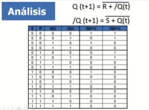

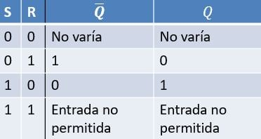

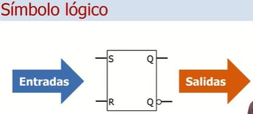

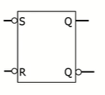

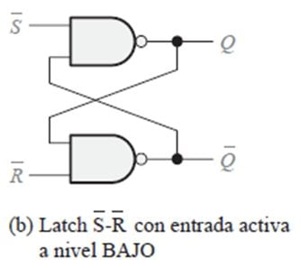

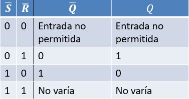

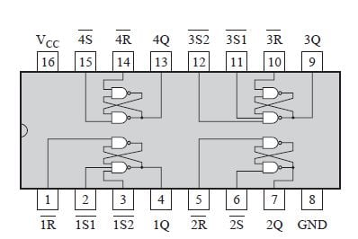

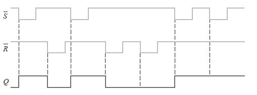

## Biestable - RS con reloj

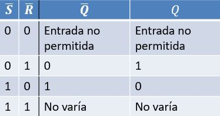

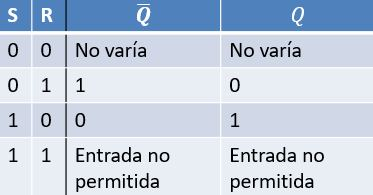

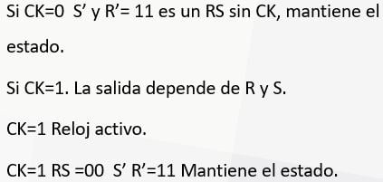

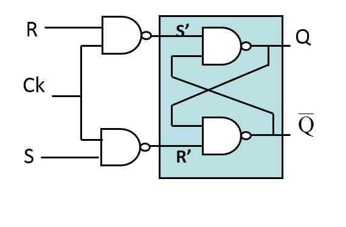

## Biestable - Tipos de entradas CLK

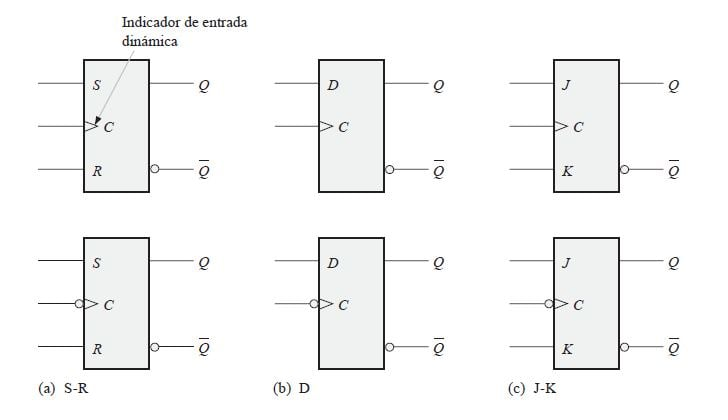

## Biestable - JK

Se comporta igual que el RS pero la entrada 11 ya no es una entrada de inestabilidad, es *Q*(*t* + 1) = *Q*(*t*)', además está gobernada por un reloj.

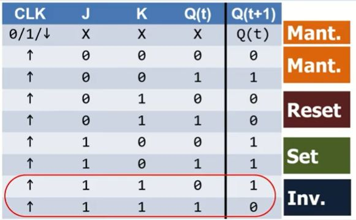

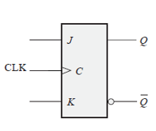

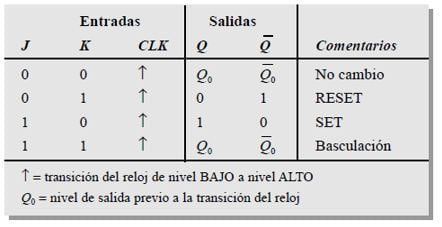

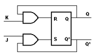

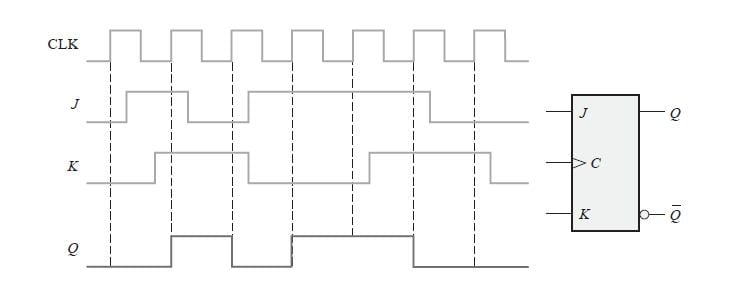

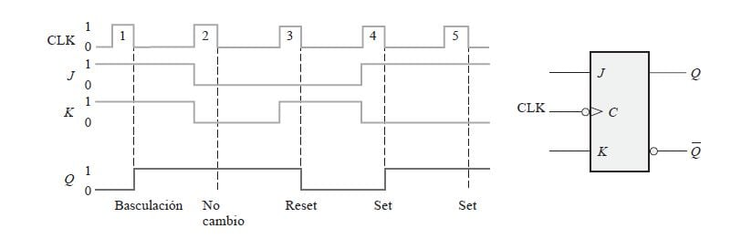

## Biestable - D

Almacenador por excelencia ya que no cambia la información.

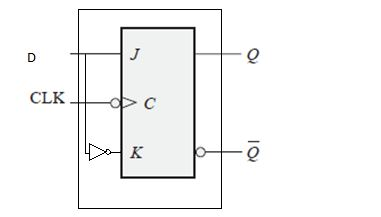

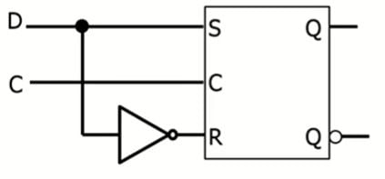

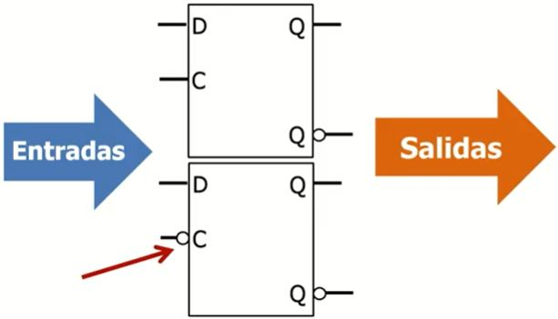

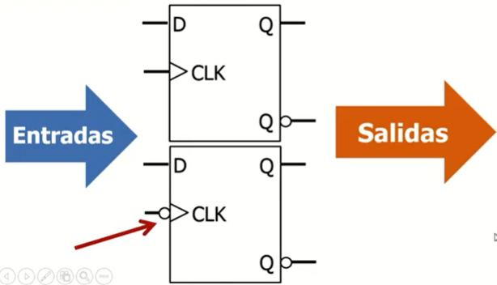

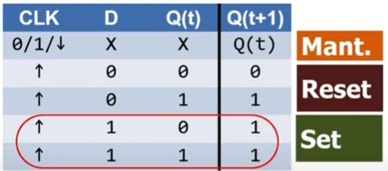

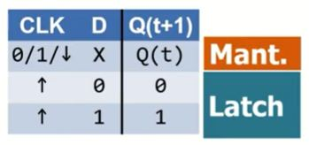

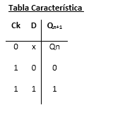

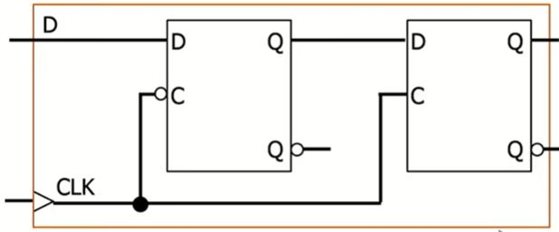

## Biestable - T

Se construye con un biestable JK uniendo sus entradas.

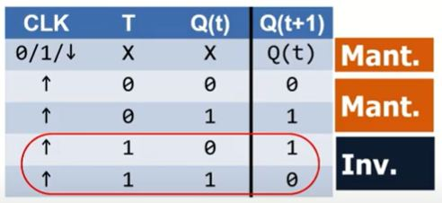

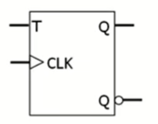

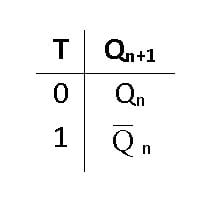

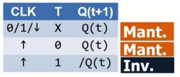

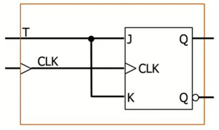

## Resumen de FlipFlops

RS, D, JK, T

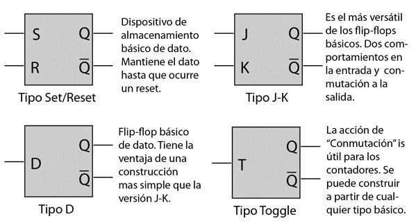

## RS con flanco

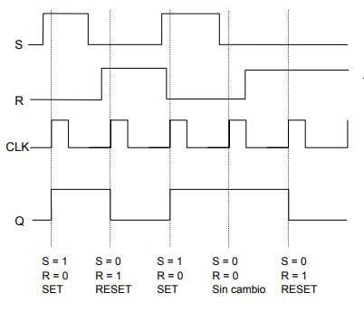

## D con flanco

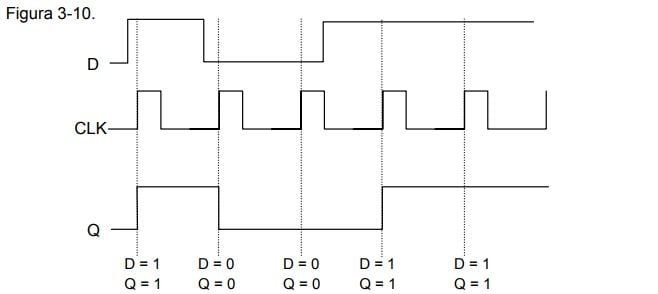

## JK con flanco

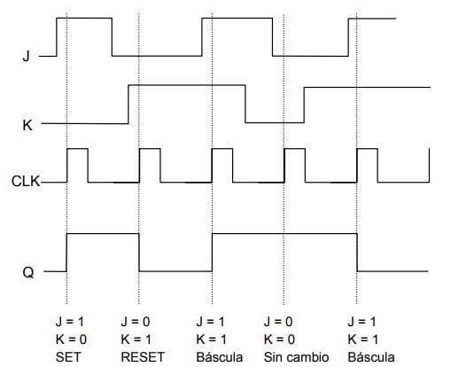

## T con flanco

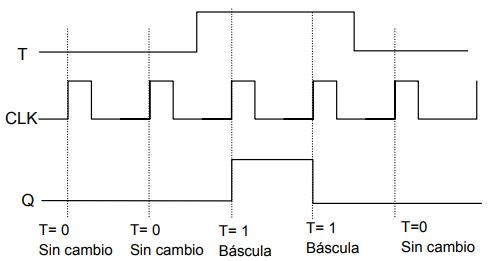

## Contadores

Un contador en es un circuito secuencial construido a partir de biestables y puertas lógicas capaz de almacenar y contar los impulsos (a menudo relacionados con una señal de reloj), el cómputo se realiza en código binario, es decir 0 y 1.

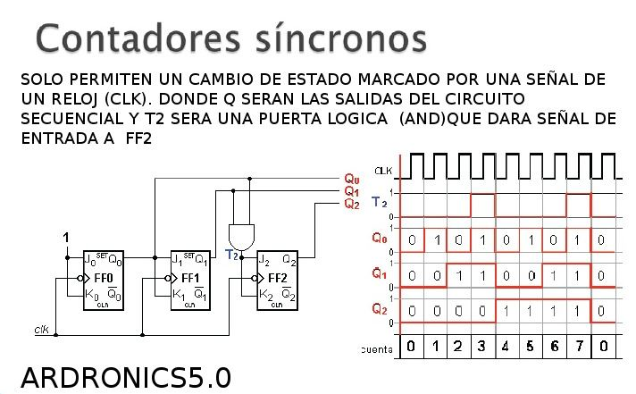

## Contador asíncrono binario de 2 bits

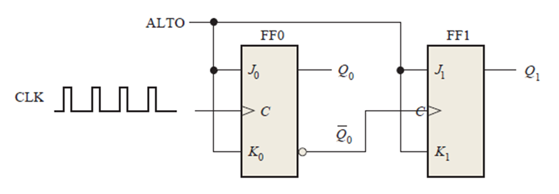

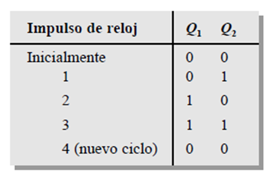

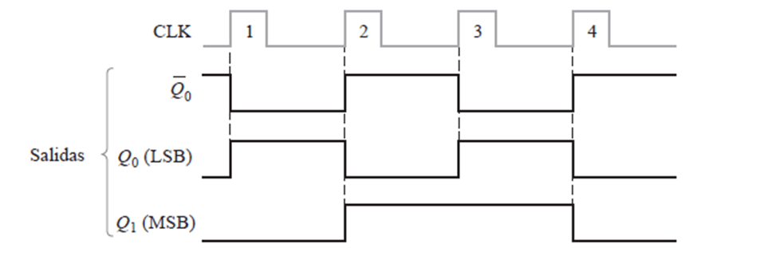

## Contador asíncrono binario de 3 bits

## Contador de décadas asíncrono

## Contador módulo 12 con reiniciación asíncrono

## Contador síncrono 2 bits

## Contador síncrono 3 bits

## Contador síncrono 4 bits

## Módulos

- Mod - 2
- Mod - 4
- Mod - 8
- Mod - 10

## Diseño de contadores síncronos

**Ejercicio - implementar contador síncrono 3 bits**

**1 - Diagrama de estados**

**2 - Tabla de estado siguiente**

**3 - Tabla de transiciones JK**

**4 - Mapas de Karnaugh**

**5 - Expresiones lógicas**

- J0 = K0 = 1
- J1 = K1 = Q0
- J2 = K2 = Q1Q0

**6 - Circuito lógico**

## Diseño de contadores síncronos

1. Diagrama de estados

   

2. Tabla de estado siguiente

   

3. Tabla de transiciones

   

4. Mapas de Karnaugh

   

5. Expresiones lógicas para las entradas

   

   

6. Implementación del contador

   

<!-- navegación -->

---

[← Anterior: Tema 6 · Ejercicios](../Tema%2006/Ejercicios/README.md) | [Índice](../README.md) | [Siguiente: Tema 7 · Ejercicios →](Ejercicios/README.md)
