# Tema 1 y 2

**Lectura en el contenido completo:** [Capítulo 1 — Evolución y características de los sistemas de cómputo](../Contenido%20completo/Capitulo%201%20-%20Evoluci%C3%B3n%20y%20caracter%C3%ADsticas%20de%20los%20sistemas%20de%20c%C3%B3mputo.md) · [Capítulo 2 — Arquitectura y organización de los sistemas de cómputo modernos](../Contenido%20completo/Capitulo%202%20-%20Arquitectura%20y%20organizaci%C3%B3n%20de%20los%20sistemas%20de%20c%C3%B3mputo%20modernos.md)

PDF de la presentación: [Tema 1 y 2.pdf](Tema%201%20y%202.pdf)

---

## Evolución y Características de los sistemas de cómputo

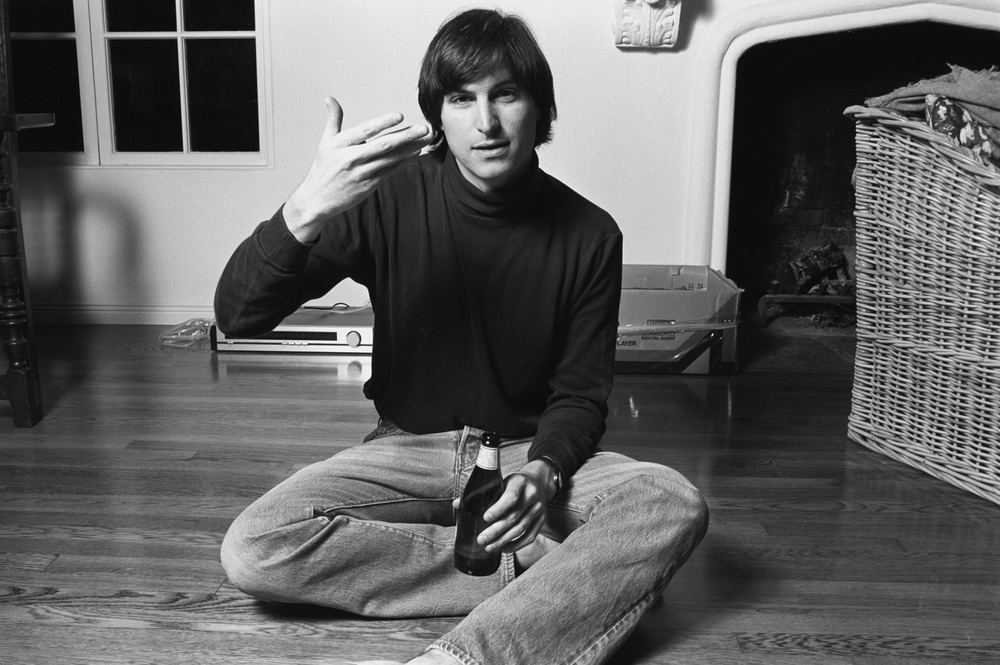

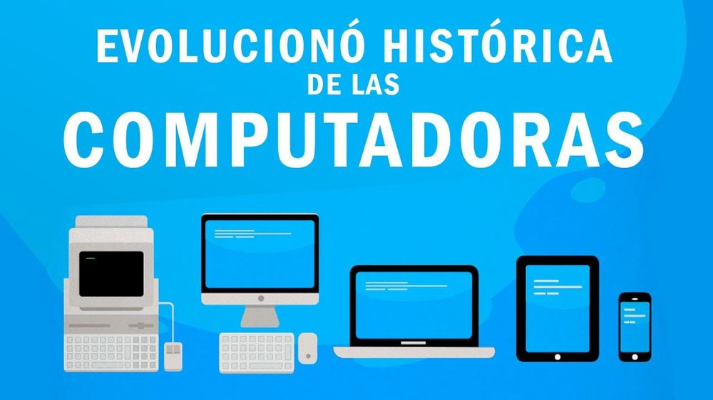

## ENIAC

**Vídeo:** ENIAC — primer computador electrónico

Enlace: [https://www.youtube.com/watch?v=uRtt7xxZL8w](https://www.youtube.com/watch?v=uRtt7xxZL8w)

Primer Computador Electrónico

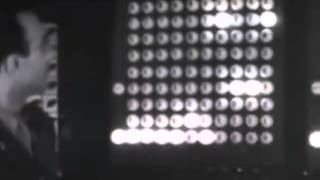

## Primera Generación de Computadores Comerciales

**Vídeo:** Primera generación — tubos de vacío

Enlace: [https://www.youtube.com/watch?v=OmNaQPWpaKQ](https://www.youtube.com/watch?v=OmNaQPWpaKQ)

Tubo de Vacío 1946 - 1958

El componente principal es el tubo de vacío

Puede resolver problemas algebraicos y estadísticos con matrices

Lenguaje Máquina

Tarjetas Perforadas

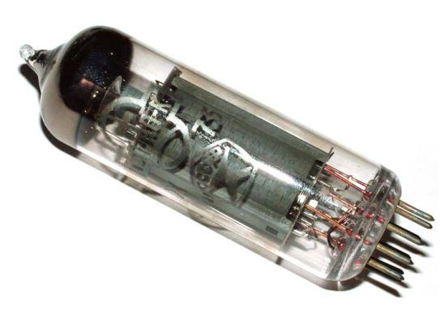

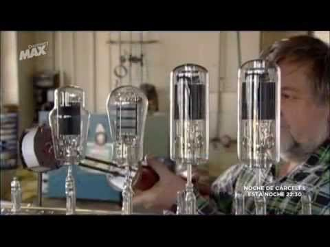

## El UNIVAC

**Vídeo:** UNIVAC — primer computador comercial

Enlace: [https://www.youtube.com/watch?v=s7VBoVpKhi4](https://www.youtube.com/watch?v=s7VBoVpKhi4)

Primer Computador Comercial

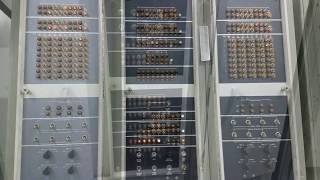

## Segunda Generación

**Vídeo:** Segunda generación — transistores

Enlace: [https://www.youtube.com/watch?v=slXlx0o0JZA](https://www.youtube.com/watch?v=slXlx0o0JZA)

Los Transistores

El componente principal es el transistor

El transistor es un dispositivo más pequeño que los tubos de vacío, por lo tanto, el computador ocupa menos espacio y se abarata la fabricación

Opera a mayor velocidad

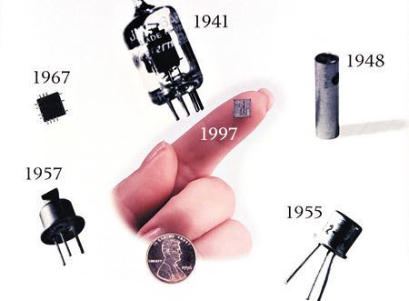

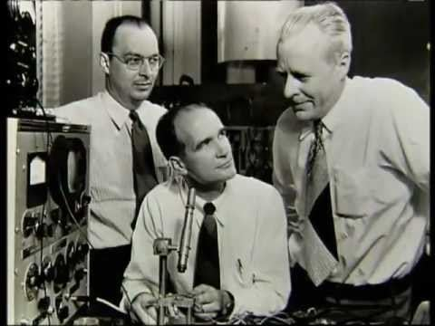

## Y… que tiene que ver esto con la actualidad? música

**Vídeo:** Relación con la actualidad

Enlace: [https://www.youtube.com/watch?v=KLJxAY8bsCk](https://www.youtube.com/watch?v=KLJxAY8bsCk)

## Tercera Generación

**Vídeo:** Tercera generación — circuitos integrados

Enlace: [https://www.youtube.com/watch?v=cFEKrYvrr7U](https://www.youtube.com/watch?v=cFEKrYvrr7U)

**Vídeo:** Vídeo adicional (short)

Enlace: [https://www.youtube.com/watch?v=pjqoYyZhbtY](https://www.youtube.com/watch?v=pjqoYyZhbtY)

**Vídeo:** Vídeo adicional (short)

Enlace: [https://www.youtube.com/watch?v=xkypLAJDnEY](https://www.youtube.com/watch?v=xkypLAJDnEY)

**Vídeo:** Vídeo adicional (short)

Enlace: [https://www.youtube.com/watch?v=5hRs28Fx27c](https://www.youtube.com/watch?v=5hRs28Fx27c)

**Vídeo:** Vídeo adicional

Enlace: [https://www.youtube.com/watch?v=xrVPSCZ-Z-0](https://www.youtube.com/watch?v=xrVPSCZ-Z-0)

Los Circuitos Integrados

El componente principal es el circuito integrado

Disminución del volumen y agrupación de elementos en una placa de silicio.

Ahorro de energía

Utilización de la computadora por varios usuarios al mismo tiempo.

Reducción de espacio

Multiprogramación

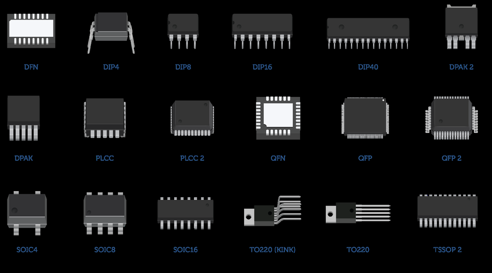

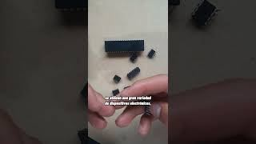

## Últimas Generaciones

**Vídeo:** Últimas generaciones (nota del presentador, desde 4:36)

Enlace: [https://www.youtube.com/watch?v=VJ3qydWTmvA](https://www.youtube.com/watch?v=VJ3qydWTmvA)

- Memoria Semiconductora

- Microprocesador

- INTEL

- PowerPC

- ARM

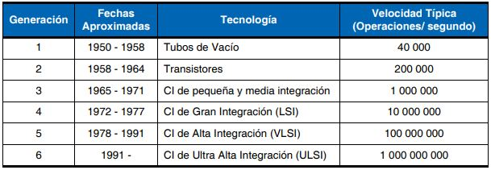

## Arquitectura y organización de los sistemas de cómputo modernos

## La arquitectura describe lo que hace la computadora. La organización describe cómo lo hace.

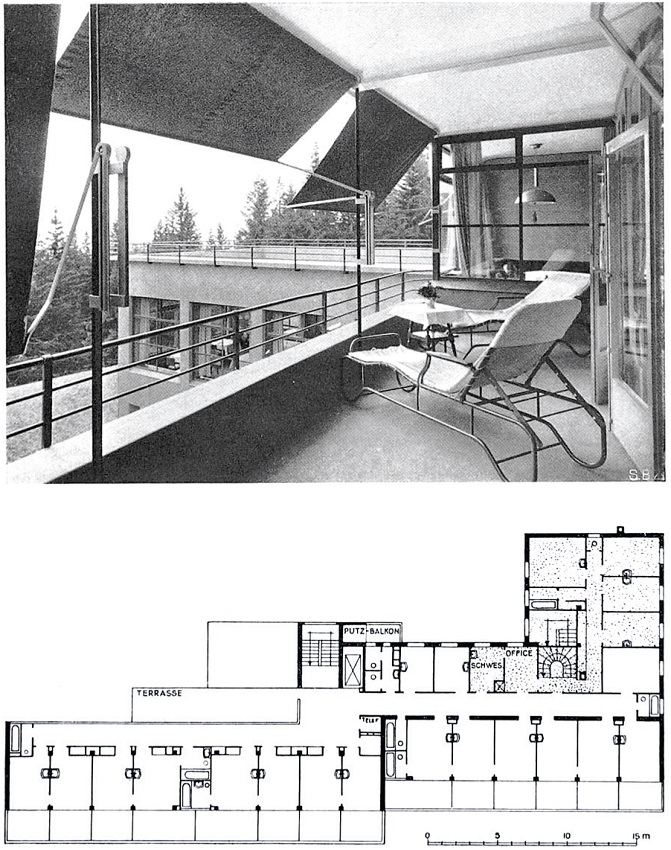

## Vamos a construir…

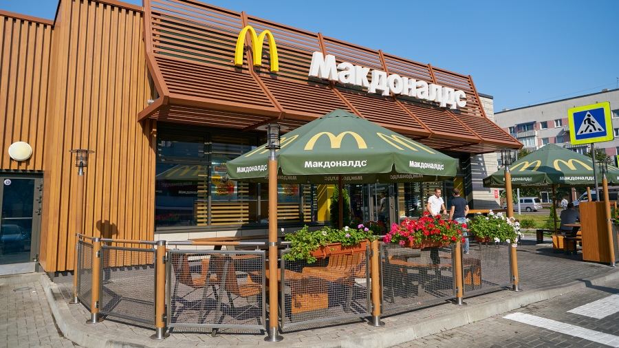

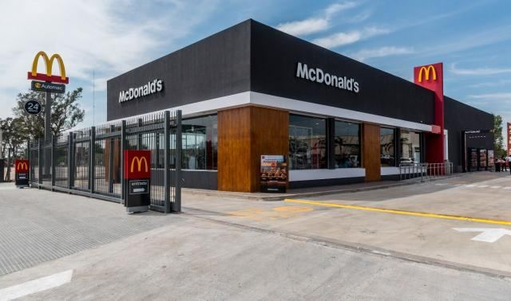

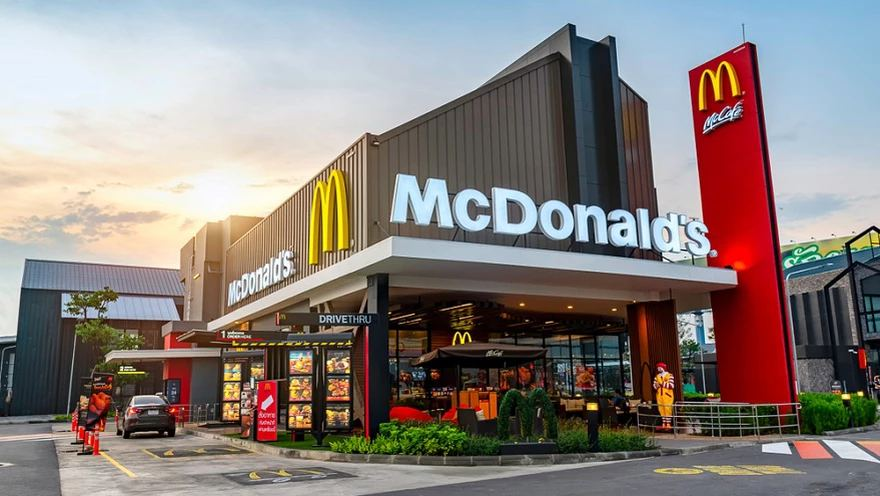

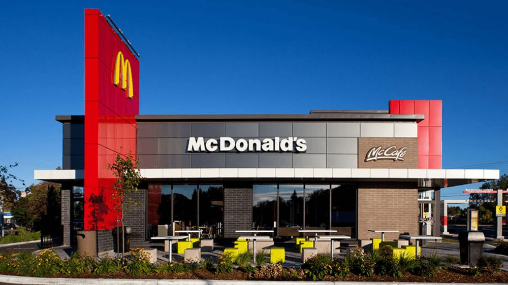

## Advanced Risc machines Ltd.

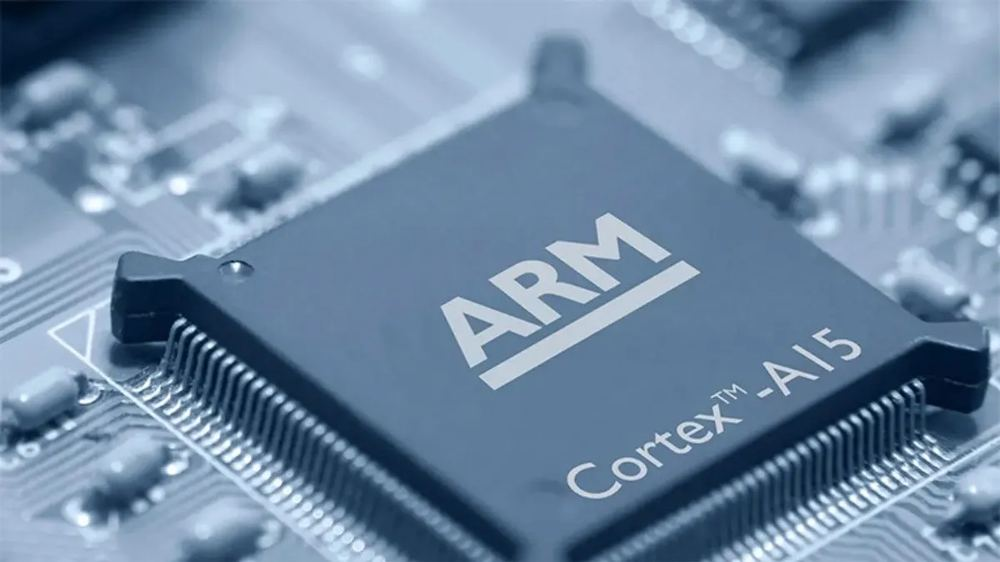

## Arquitectura y organización de los sistemas de cómputo modernos

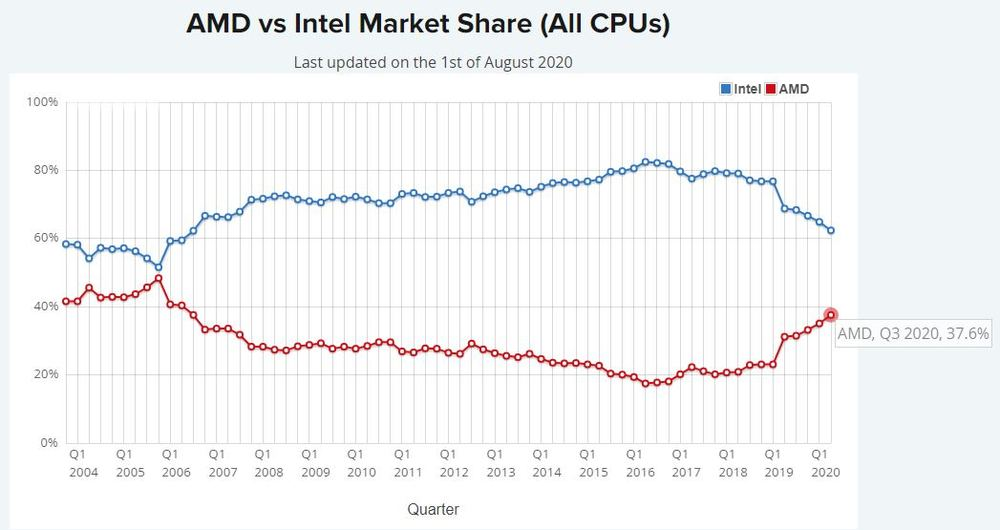

## Arquitectura de Referencia

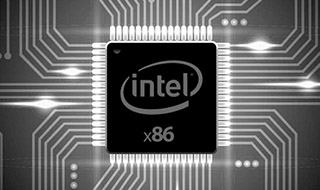

## Arquitectura Instrucciones (nº de puertas) Número de bits (ancho de puertas) Protocolos de entrada/salida (Ventanas)

Organización

Señales de Control (menú autoservicio, etiquetamiento de baños)

Interfaz (mesas)

Memoria (Lista de órdenes)
