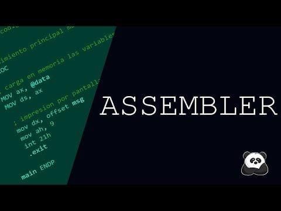
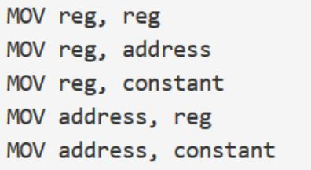
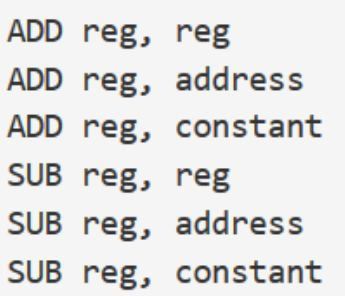
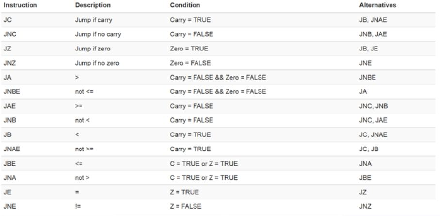
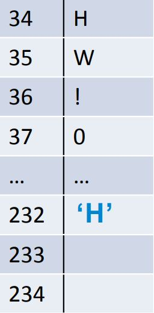
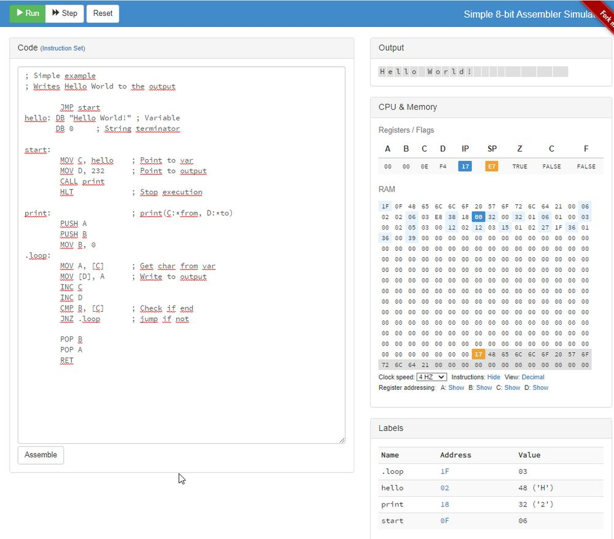
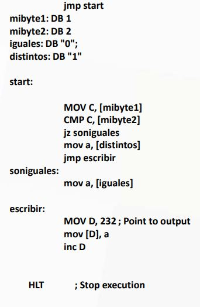

# Tema 11 y 12

**Lectura en el contenido completo:** [Capítulo 11 — Arquitecturas IA-32 e IA-64](../Contenido%20completo/Cap%C3%ADtulo%2011%20-%20Arquitecturas%20IA-32%20e%20IA-64.md) · [Capítulo 12 — Set de instrucciones Intel](../Contenido%20completo/Cap%C3%ADtulo%2012%20-%20Set%20de%20instrucciones%20Intel.md)

PDF de la presentación: [Tema 11 y 12.pdf](Tema%2011%20y%2012.pdf)

---

## Arquitecturas IA-32 e IA-64

## Características de IA-32

- La arquitectura de una CPU de 32 bits es un adjetivo empleado para describir enteros, dirección de memoria y unidades de datos, en general; que comprenden hasta 32 bits o en su defecto, cuatro octetos.
- Desde un inicio, los sistemas operativos de 32 bits utilizaban Windows 95.
- Soporta un total de 4 GB de memoria RAM y esto se puede extender hasta 64 GB, dependiendo del procesador que emplee el ordenador.
- A partir del año 1982, se evidenció que los CPU de 32 bits presentaban la capacidad de aumentar el rendimiento del sistema.
- Se conoce que el rango de valores naturales que se pueden almacenar en 32 bits, van desde 0 hasta 4.294.967.295.
- Los buses de datos y de direcciones son más anchos que 32 bits, a pesar de que éstas se almacenen internamente en el procesador como cantidades de 32 bits.

## Características de IA-64

- Generalmente, la arquitectura de computadora de 64 bits comprende unidades de datos que llegan hasta los 24 bits o, en su defecto, ocho octetos de ancho en total.
- Los procesadores de 64 bits tienen alrededor de una década en el mercado, siendo introducidos masivamente en los ordenadores. Ya que, desde 1960, han existido en las supercomputadoras.
- En cuanto a la seguridad y agilidad, esta tecnología es la mejor que existe, hasta el momento.
- Este tipo de procesadores presentan la capacidad de direccionar teóricamente hasta 16 exabytes de memoria.
- Permite aprovechar un máximo de 192 GB, es decir, 48 veces más de lo que es capaz de soportar un CPU de 32 bits.

## Diferencias

- En vista de que, los procesadores de 32 bits no muestran tanta capacidad, con respecto a esta particularidad, a diferencia de los de 64 bits.
- Si, posees un PC de 8 o 16 GB de RAM, un sistema operativo de 32 bits únicamente será capaz de aprovechar un máximo de 4 GB. Lo cual, puede influir al momento de abrir cierta cantidad de aplicaciones al mismo tiempo.
- CPU de 64 bits son mucho mejores, cuanto se trata de la capacidad de gestionar la memoria RAM de un equipo. Por ello, si eres de los usuarios que emplea su computador apegado directamente a la multifunción, lo mejor es que uses un procesador de 64.
- Más allá de instalar mucha más memoria RAM en el sistema, los procesadores de 64 bits también exhiben un uso más eficiente de dicha RAM.
- La eficacia durante los procesos, la CPU de 32 bits no es la más óptima y, por el contrario, la de 64 bits si lo es.
- Cuando se habla de una mayor velocidad, no significa que las aplicaciones instaladas en el equipo de 64 bits sean siempre las más rápidas, ya que esto depende de la forma de funcionar, las exigencias de cada aplicación y del estado del sistema en su momento.

## Set de Instrucciones Intel

### Introducción

Se realizará una introducción al set de instrucciones de Intel. Se examinarán las operaciones básicas y sobre todo aquellas que tienen relación directa con las estructuras de los lenguajes de alto nivel.

### Lenguaje ensamblador y Lenguaje Máquina

**Vídeo:** Lenguaje ensamblador

[](https://www.youtube.com/watch?v=KbEqb2utOFU)


**Vídeo:** Lenguaje ensamblador (II)

[](https://www.youtube.com/watch?v=Fkz_2RxHYCc)


**Vídeo:** Lenguaje ensamblador (vídeo adicional)

[](https://www.youtube.com/watch?v=i15kfJPhG0Y)

Se denomina lenguaje máquina a los valores numéricos que la parte física de la computadora o hardware es capaz de interpretar.

- Para los humanos es más difícil de lidiar y nada eficiente.
- Se ideó el lenguaje ensamblador identificando las operaciones con un texto comprensible llamado nemotécnico

Para realizar una operación de suma o resta, el procesador lo codifica con un número determinado, en ensamblador se determina con add y subs.

### Lenguaje ensamblador




Simulador: <http://schweigi.github.io/assembler-simulator/index.html>

### Modos de direccionamiento

**Inmediato**

El operando está en la misma instrucción.

```
ADD reg, constant
Add A, 5, reg,
```

**Directo**

La instrucción contiene la dirección donde está el operando.

- **Absoluto:** El operando se aloja en memoria
- **Mediante registro:** El operando se aloja en un registro

### Juegos de instrucciones

```
label: instruction operands ; Comment
```

**Constantes:**

- Decimal: 200
- Decimal: 200d
- Hex: 0xA4
- Octal: 0o48
- Binary: 101b
- Character: 'A'
- String: "Hello World!"
- Registros de propósito general: A, B, C, D
- Registro puntero de Pila: Stack pointer register: SP
- Registro puntero de Instrucción: IP

### Copiar un valor

Copiar el valor desde origen a destino



### Definición de variable / Constante

```
DB constant
```

### Sumar / Restar

Sumar o Restar dos números (afecta a Zero y Carry Flag)



### Incrementar / Decrementar

Incrementa o decrementa un registro en una unidad (afecta a Zero y Carry Flag)

```
INC reg
DEC reg
```

### Multiplicación / División

Multiplica o divide el registro A entre el valor dado. (afecta a Zero y Carry Flag)

- MUL reg
- MUL address
- MUL constant
- DIV reg
- DIV address
- DIV constant

**Operaciones lógicas** (afecta a Zero y Carry Flag)

- AND reg, reg
- AND reg, address
- AND reg, constant
- OR reg, reg
- OR reg, address
- OR reg, constant
- XOR reg, reg
- XOR reg, address
- XOR reg, constant
- NOT reg

### Registros de desplazamiento

Desplazamiento aritmético (afecta a Zero y Carry Flag)

- SHL reg, reg
- SHL reg, address
- SHL reg, constant
- SHR reg, reg
- SHR reg, address
- SHR reg, constant

### Comparaciones

- CMP reg, reg
- CMP reg, address
- CMP reg, constant

Compara dos valores y activa el Flag Zero si son iguales. Se usa esta instrucción conjuntamente con la de salto.

### Salto incondicional

- jmp address

Realiza un salto incondicional a otro punto de memoria definida.

### Salto Condicional



### Llamada a subrutina

- CALL address

**Salida de subrutina**

- RET

**Apilar**

- POP reg

**Desapilar**

- PUSH reg
- PUSH address
- PUSH constant

### Para la ejecución del programa

- HLT

### Ejemplo Hola Mundo!

```
        JMP start
hello:  DB "HW!" ; Variable
        DB 0 ; String terminator

start:
        MOV C, hello ; Point to var
        MOV D, 232 ; Point to output
        MOV B, 0

loop:
        MOV A, [C] ; Get char from var
        MOV [D], A ; Write to output
        INC C
        INC D
        CMP B, [C] ; Check if end
        JNZ loop ; jump if not

        HLT
```

| Registro / flag | Valor |
| --- | --- |
| Z= | |
| Ca= | |
| A= | ‘H’ |
| B= | 0 |
| C= | 34 |
| D= | 232 |



### Lenguaje Ensamblador





<!-- navegación -->

---

[← Anterior: Tema 8, 9 y 10](../Tema%2008%2C%2009%20y%2010/README.md) | [Índice](../README.md) | [Siguiente: Tema 13 y 14 →](../Tema%2013%20y%2014/README.md)
