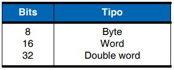

# Tema 13 y 14

**Lectura en el contenido completo:** [Capítulo 13 — Arquitectura de procesadores RISC](../Contenido%20completo/Cap%C3%ADtulo%2013%20-%20Arquitectura%20de%20procesadores%20RISC.md) · [Capítulo 14 — Set de instrucciones ARM](../Contenido%20completo/Cap%C3%ADtulo%2014%20-%20Set%20de%20instrucciones%20ARM.md)

PDF de la presentación: [Tema 13 y 14.pdf](Tema%2013%20y%2014.pdf)

---

## Arquitectura de procesadores RISC

## Arquitectura de ARM

La arquitectura ARM incorpora varias características, algunas únicas y otras muy optimizadas respecto al resto de arquitecturas:

Arquitectura de carga y almacenamiento (load-store).

Instrucciones de longitud fija de 32 bits.

Formatos de instrucción de 3 direcciones.

Todas las instrucciones se ejecutan en un ciclo de reloj.

Modos de direccionamiento simples.

Control sobre la unidad aritmética lógica en cada instrucción de procesamiento de datos.

Modos de direccionamiento con incremento y decremento automático de punteros.

Carga y almacenamiento de múltiples instrucciones.

Set de instrucciones ortogonal, regular o simétrico.

Arquitectura “Thumb”.

## Funcionamiento

Modo usuario, USR, User Mode

Modos “excepciones”

## Acceso a la memoria

