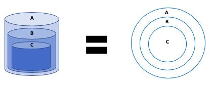
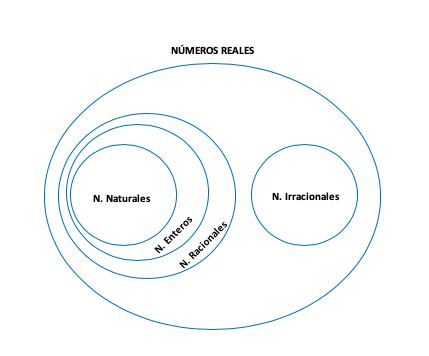
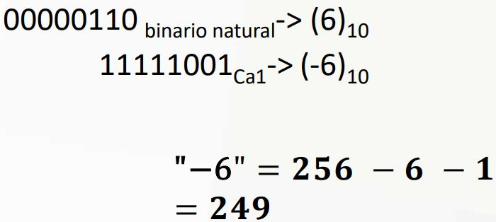
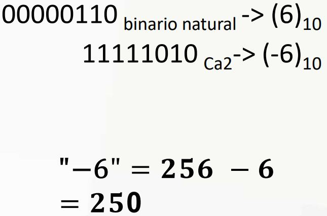
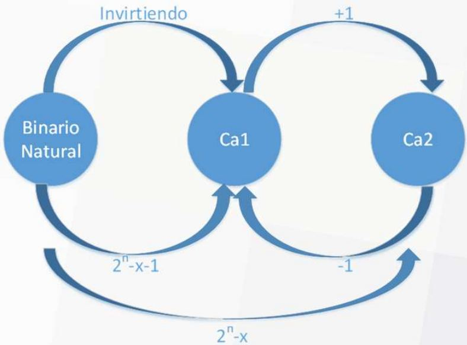
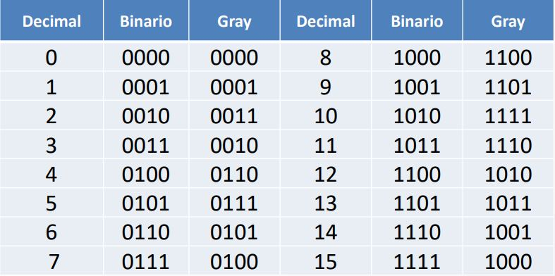
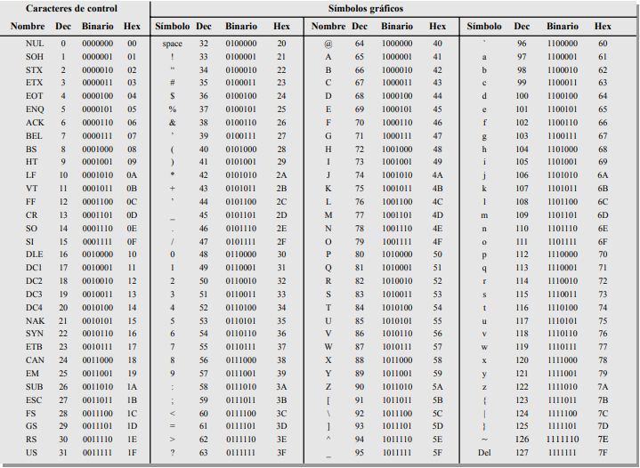

# Tema 4 - 2da Parte

**Lectura en el contenido completo:** [Capítulo 4 — Representación digital de la información](../Contenido%20completo/Capitulo%204%20-%20Representaci%C3%B3n%20digital%20de%20la%20informaci%C3%B3n.md)

PDF de la presentación: [Tema 4 - 2da Parte.pdf](Tema%204%20-%202da%20Parte.pdf)

---

## Representación digital de la Información

## Esquema Matrioshka

## Representación de números enteros y reales

Complemento a 1

- x = 2n - x - 1

X es el número inicial ( positivo ó

negativo) y -x su complemento ( negativo ó positivo) que se quiere buscar.

Complemento a 2

- x = 2n - x

1 0 1 0 1 0 1 1 0 0 0

0 1 0 1 0 1 0 1 0 0 0

## Transformar BinNat, Ca1 y Ca2

## Código Gray

Es un código sin pesos y no aritmético; es decir, no existen pesos específicos asignados a la posiciones de los bits. La característica más importante del código Gray es que sólo varía un bit de un código al siguiente.

## Código Gray (Binario → Gray)

1 1 0 0 0 1 1 0

(1 1 0 0 0 1 1 0)2 = ( ? )Gray

+

1 0 1 0 0 1 0 1

0 1 0 0 1 1

(0 1 0 0 1 1)2 = ( ? )Gray

0 1 1 0 1 0

## Código Gray (Gray → Binario)

1 0 1 0 0 1 0 1

(1 0 1 0 0 1 0 1)Gray = ( ? )2

+

1 1 0 0 0 1 1 0

## Código de caracteres - ASCII

Código estándar americano para el intercambio de información. American Standard Code for Information Interchange

El código ASCII dispone de 128 caracteres que se representan mediante un código binario de 7 bits.

Realmente, el código ASCII puede considerarse como un código de 8 bits en el que el MSB siempre es 0 .

Los primeros 32 caracteres ASCII son comandos no gráficos, que nunca se imprimen o presentan en pantalla, y sólo se utilizan para propósitos de control.

