# Tema 5

**Lectura en el contenido completo:** [Capítulo 5 — Lógica binaria y Álgebra de Boole. Circuitos lógicos](../Contenido%20completo/Capitulo%205%20-%20L%C3%B3gica%20binaria%20y%20%C3%81lgebra%20de%20Boole.%20Circuitos%20l%C3%B3gicos.md)

PDF de la presentación: [Tema 5.pdf](Tema%205.pdf)

---

## Lógica binaria y Álgebra de Boole

**Vídeo:** Álgebra de Boole — George Boole

Enlace: [https://www.youtube.com/watch?v=LggsK5Tk4jY](https://www.youtube.com/watch?v=LggsK5Tk4jY)

## Circuitos Combinacionales y Secuenciales

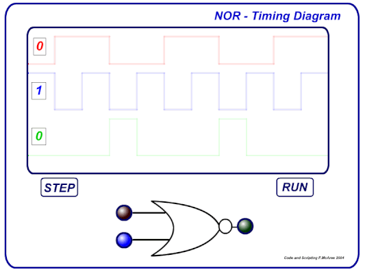

## Circuitos Combinacionales:

El valor de la salida depende del estado de las entradas, es decir de la combinación de las entradas.

Estos circuitos se dividen en circuitos combinacionales uniterminales (una salida) y circuitos combinacionales multiterminales (varias salidas).

## Circuitos Secuenciales:

El valor de la salida depende del estado de las entradas y del estado anterior de la propia salida, es decir de la secuencia por la que haya pasado la salida.

Se dividen en circuitos secuenciales sincrónicos y circuitos secuenciales asincrónicos.

## Ejemplo de Circuito Combinacional

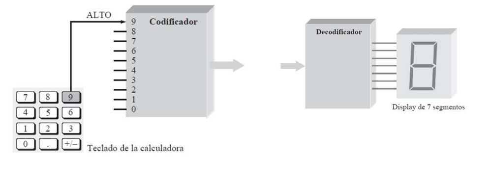

## Ejemplo de Circuito Secuencial

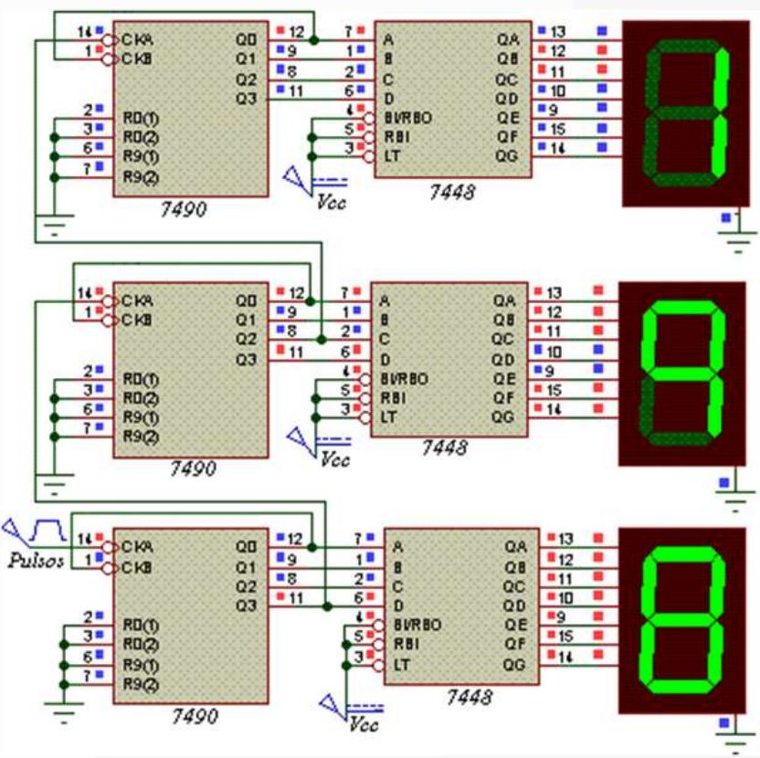

## Definiciones

Variable:

Es un símbolo que se utiliza para representar magnitudes lógicas. Cualquier variable puede tener un valor de 0 o de 1. Por ejemplo: A = 1

Complemento:

El complemento es el inverso de la variable y se indica

mediante una barra encima de la misma.Por ejemplo: si A = 1; entonces A = 0

“A” se lee como “A negada”

También puede escribirse como A

_

,

Literal:

Es una variable o complemento de una variable.

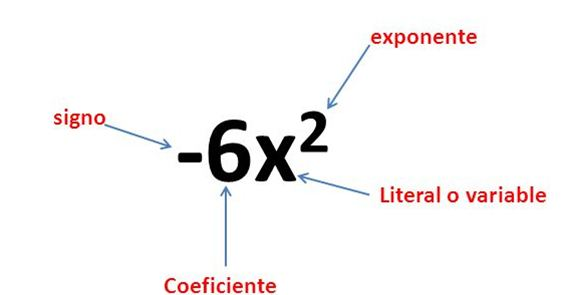

## Adición booleana

OR (Suma booleana): La combinación OR de dos variables resulta verdadera ó 1 cuando al menos una de ellas es verdadera ó 1.

| SUMA - OR |  |  |
| --- | --- | --- |
| X | Y | X+Y |
| 0 | 0 | 0 |
| 0 | 1 | 1 |
| 1 | 0 | 1 |
| 1 | 1 | 1 |

## Operaciones

Puerta lógica - OR (Suma booleana)

| SUMA - OR |  |  |
| --- | --- | --- |
| X | Y | X+Y |
| 0 | 0 | 0 |
| 0 | 1 | 1 |
| 1 | 0 | 1 |
| 1 | 1 | 1 |

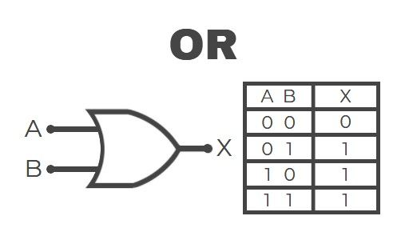

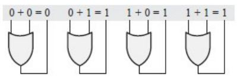

## Puerta lógica - OR

Funcionamiento

Funcionamiento con tren de impulsos

Si se aplican las dos señales de entrada, A y B, de la Figura a la puerta OR, ¿cuál es la señal de salida resultante?

Expresiones booleanas

Ejemplo práctico

Sistema que detecta las puertas abiertas en un coche.

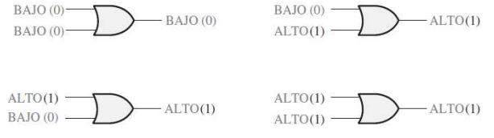

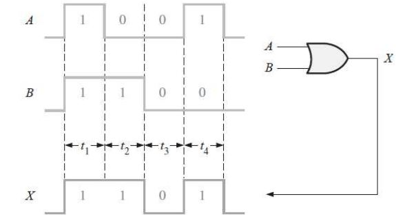

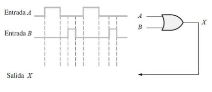

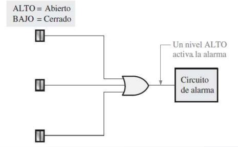

## Operaciones

AND (Multiplicación booleana):La combinación AND de dos variables resulta verdadera ó 1 cuando las dos variables son verdaderas ó 1.

| MULTIPLICACIÓN - AND |  |  |
| --- | --- | --- |
| X | Y | X . Y |
| 0 | 0 | 0 |
| 0 | 1 | 0 |
| 1 | 0 | 0 |
| 1 | 1 | 1 |

## Puerta lógica - AND (Multiplicación booleana)

| MULTIPLICACIÓN - AND |  |  |
| --- | --- | --- |
| X | Y | X . Y |
| 0 | 0 | 0 |
| 0 | 1 | 0 |
| 1 | 0 | 0 |
| 1 | 1 | 1 |

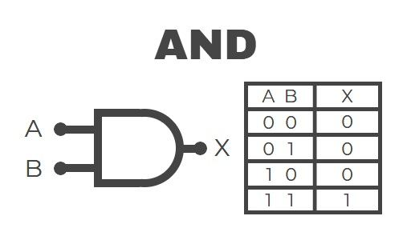

## Puerta lógica - AND

Funcionamiento

Funcionamiento con tren de impulsos

Ejercicio: Si se aplican las formas de onda A y B de la figura a las entradas de una puerta AND, ¿cuál es la forma de onda resultante de salida?

Expresiones booleanas

Ejemplo práctico

Sistema que detecta el no abrocharse los cinturones de seguridad en los coches

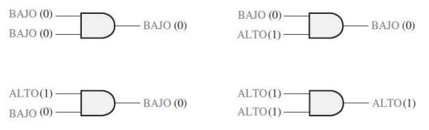

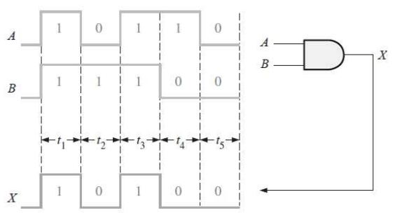

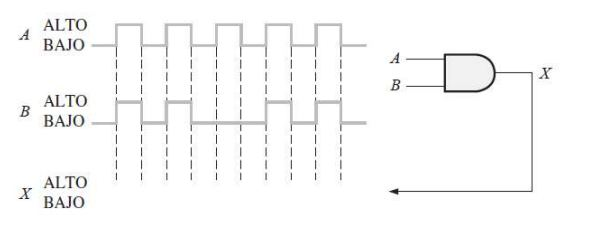

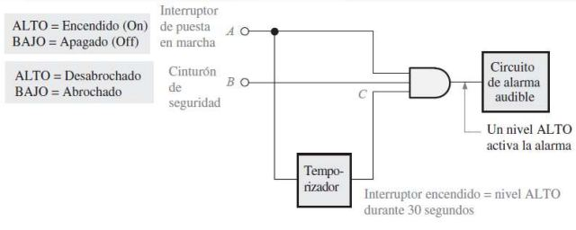

## Operaciones

NOT: Negado o complemento de una variable o función

| NOT |  |
| --- | --- |
| X | X' |
| 0 | 1 |
| 1 | 0 |

## Puerta lógica - NOT (El inversor)

| NOT |  |
| --- | --- |
| X | X' |
| 0 | 1 |
| 1 | 0 |

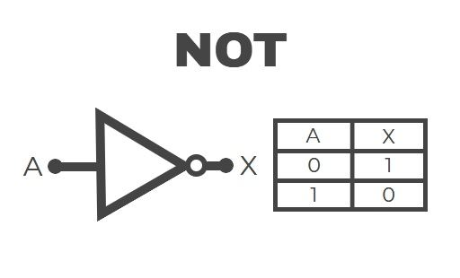

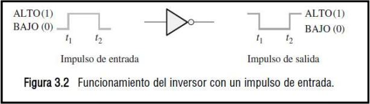

## Puerta lógica - NAND

| Entradas |  | Salida |
| --- | --- | --- |
| A | B | X |
| 0 | 0 | 1 |
| 0 | 1 | 1 |
| 1 | 0 | 1 |
| 1 | 1 | 0 |
| 1 = ALTO, 0 = BAJO |  |  |

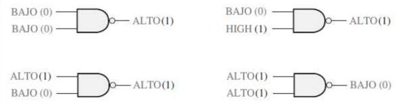

## Puerta lógica - NOR

| Entradas |  | Salida |
| --- | --- | --- |
| A | B | X |
| 0 | 0 | 1 |
| 0 | 1 | 0 |
| 1 | 0 | 0 |
| 1 | 1 | 0 |
| 1 = ALTO, 0 = BAJO |  |  |

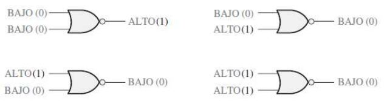

## Puerta lógica - OR Exclusiva XOR

| Entradas |  | Salida |
| --- | --- | --- |
| A | B | X |
| 0 | 0 | 0 |
| 0 | 1 | 1 |
| 1 | 0 | 1 |
| 1 | 1 | 0 |

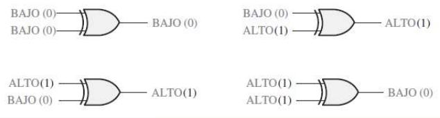

## Puerta lógica - NOR Exclusiva XNOR

| Entradas |  | Salida |
| --- | --- | --- |
| A | B | X |
| 0 | 0 | 1 |
| 0 | 1 | 0 |
| 1 | 0 | 0 |
| 1 | 1 | 1 |

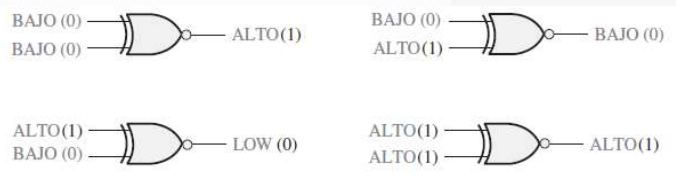

## Resumen

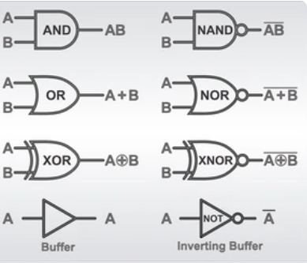

## Operaciones

Función de conmutación:

Expresiones de conmutación:

Una función booleana o de conmutación es una expresión algebraica de variables booleanas con las operaciones +, * y complemento. La prioridad de los operadores, en caso de haber varios, es: paréntesis, complementos, productos y sumas.

## Tabla de verdad:

Representa a una sola función de conmutación, pero esta función puede escribirse con diferentes expresiones equivalentes entre sí.

## Álgebra de Boole

1854 → George Boole

Es considerado como uno de los fundadores del campo de las ciencias de la computación

1938 → Sharon (álgebra de conmutación)

Demostró que se podía utilizar en el análisis y la síntesis de la conmutación y de los circuitos digitales

Leyes conmutativas

Leyes asociativas

Leyes distributivas

Reglas del álgebra booleana

1. 𝑨 + 𝟎 = 𝑨

Si aplicamos la operación OR a una variable cualquiera y a 0, el resultado es siempre igual a la variable. Si 𝑨 es 1, la salida es igual a 1 y, por tanto, igual a 𝑨. Si 𝑨 es 0, la salida es 0 e igualmente idéntica a 𝑨.

2. 𝑨 + 𝟏 = 𝟏

Si se aplica la operación OR a una variable y a 1, el resultado es siempre igual a 1. Un 1 en una entrada de una puerta OR produce siempre un 1 en la salida, independientemente del valor de la otra entrada.

3. 𝑨 ⋅ 𝟎 = 𝟎

Si se aplica la operación AND a una variable y a 0, el resultado es siempre igual a 0. Siempre que una de las entradas de una puerta AND sea 0, la salida siempre es 0, independientemente del valor de la otra entrada.

4. 𝑨 ⋅ 𝟏 = 𝑨

Si se aplica la operación AND a una variable y a 1, el resultado es siempre igual a la variable. Si la variable A es 0, la salida de la puerta AND será siempre 0, mientras que si A es 1, la salida será 1, dado que las dos entradas son 1.

5. 𝑨 + 𝑨 = 𝑨

Si se aplica la operación OR a una variable consigo misma, el resultado es siempre igual a la variable. Si A es 0, entonces 0 + 0 = 0, mientras que si A es 1, 1 + 1 =1.

6. 𝑨 + 𝑨´ = 𝟏

Si se aplica la operación OR a una variable y a su complemento, el resultado es siempre igual a 1.

7. 𝑨 ⋅ 𝑨 = 𝑨

Si se aplica la operación AND a una variable consigo misma, el resultado siempre es igual a la variable. Si A = 0, entonces 0 ⋅ 0 = 0, y si A = 1, entonces 1 ⋅ 1 = 1

8. 𝑨 ⋅ 𝑨´ = 𝟎

Si se aplica la operación AND a una variable y a su complemento, el resultado es siempre igual a 0. Esta regla se basa en que siempre A o 𝐴̅será 0, y además en que cuando se aplica un 0 a una de las entradas de una puerta AND, la salida siempre es 0

9. 𝑨´´= 𝑨

El complemento del complemento de una variable es siempre la propia variable. El complemento de la variable A es 𝐴̅y el complemento de 𝐴̅será de nuevo A, que es la variable original.

10. 𝑨 + 𝑨B = 𝑨

Esta regla se puede obtener aplicando la ley distributiva y las reglas 2 y 4, de la siguiente forma:

11. 𝑨 + 𝑨´B = 𝑨+B

12. (𝑨 + B)(𝑨 + C) = 𝑨 + BC

Formas Canónicas

Se llama término canónico de una función lógica a todo producto o suma en el cual aparecen todas las variables (ó sus complementos) de esa función.

A los términos productos se les llama productos canónicos (minterms) y a los términos suma se les llama, sumas canónicas (maxterms).

Formas Disyuntiva Normal (FDN)

Se basa en la operación OR de los términos o combinaciones que hacen 1 la función. Los términos o combinaciones lo componen el AND de las variables.

Mintérminos

Formas Conjuntiva Normal

Se basa en la operación AND de los términos o combinaciones que hacen 0 la función. Los términos o combinaciones lo componen el OR de las variables. De aquí se deriva el término Suma estándar (SE), que es el OR de todas las variables de la función complementadas o no. Es decir, para representar la función se unen en AND las SE para las cuales la función vale 0

Maxtérminos

Leyes de DeMorgan

Puertas lógicas - NAND - NEGATIVA-OR

Puertas lógicas - NOR - NEGATIVA-AND

Simplificación

A la hora de aplicar el álgebra booleana, hay que reducir una expresión a su forma más simple o cambiarla a una forma más conveniente para conseguir una implementación más eficiente.

Requiere un profundo conocimiento del álgebra booleana y una considerable experiencia en su aplicación, por no mencionar también un poquito de ingenio y destreza.

Ejercicios

Aplicación de los teoremas de DeMorgan

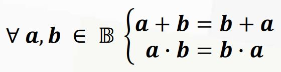

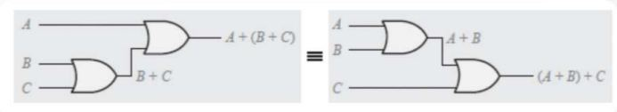

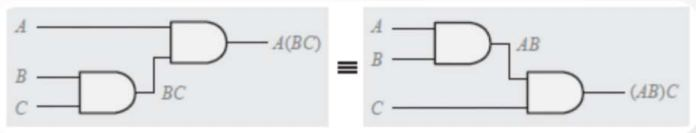

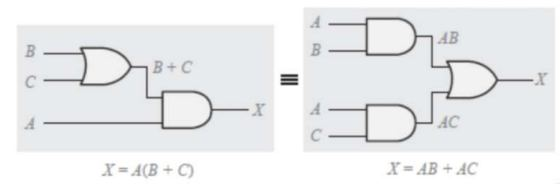

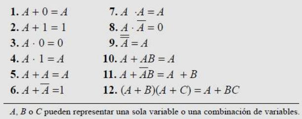

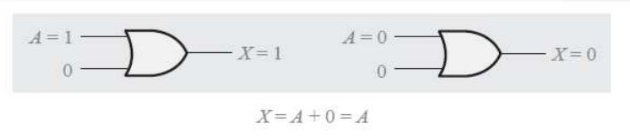

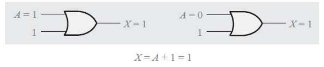

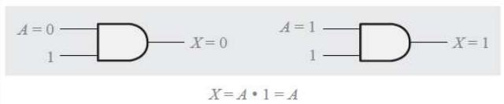

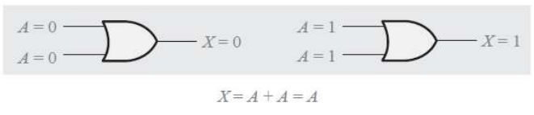

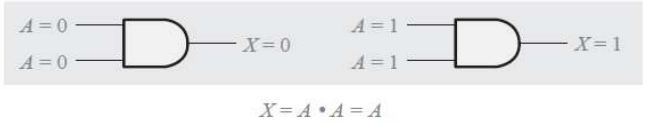

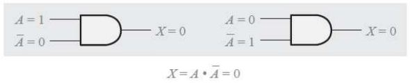

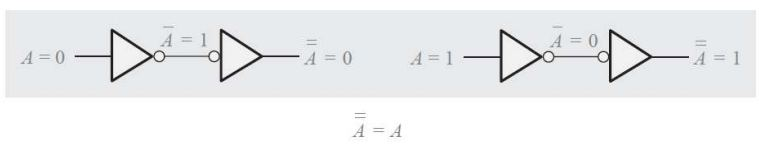

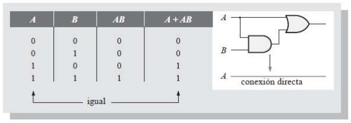

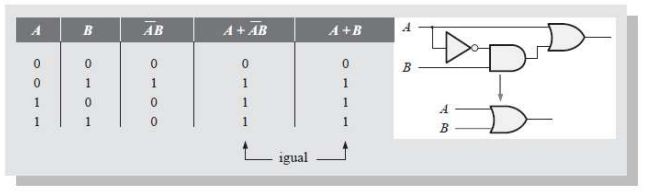

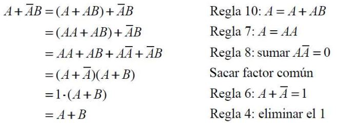

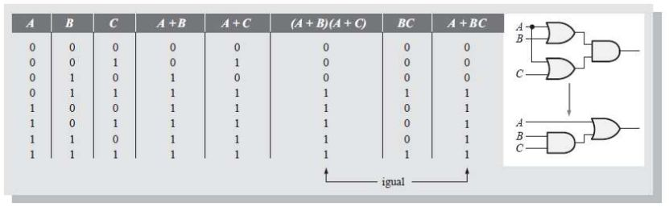

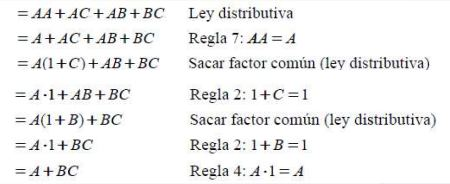

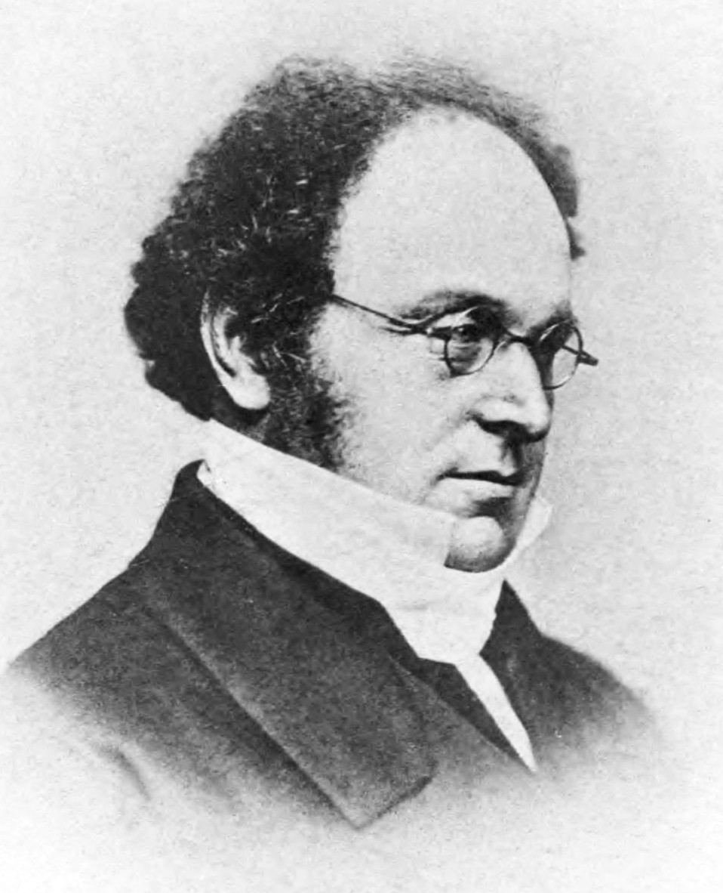

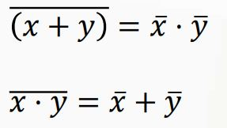

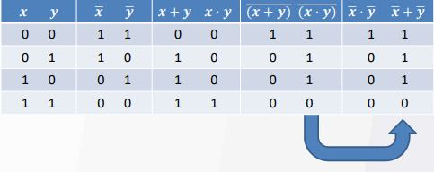

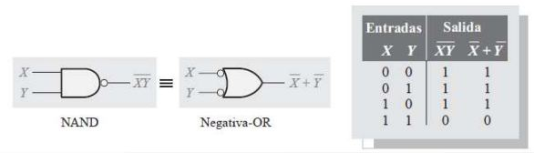

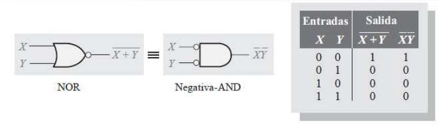

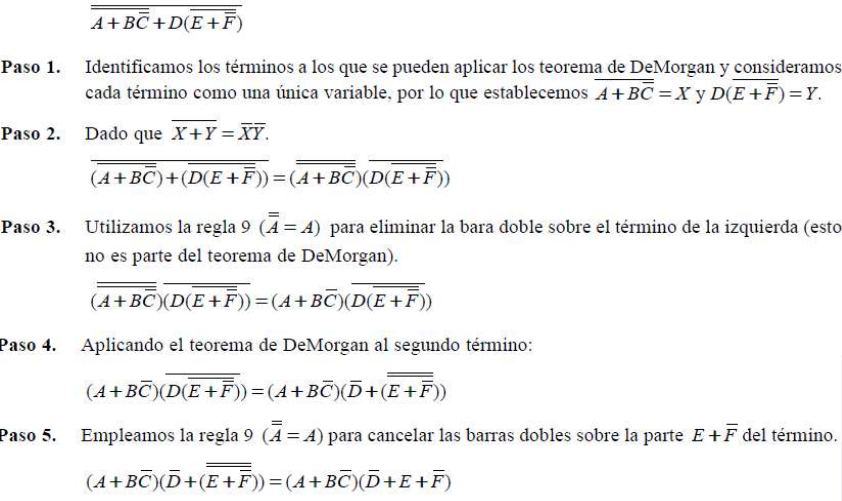

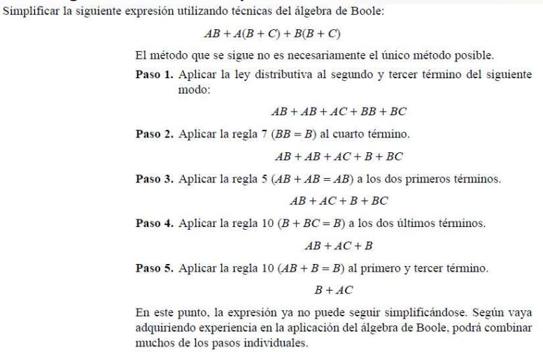

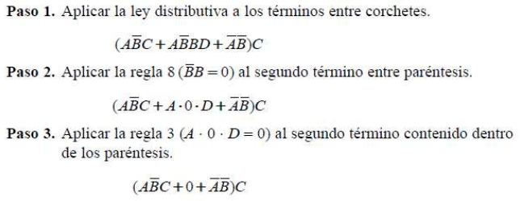

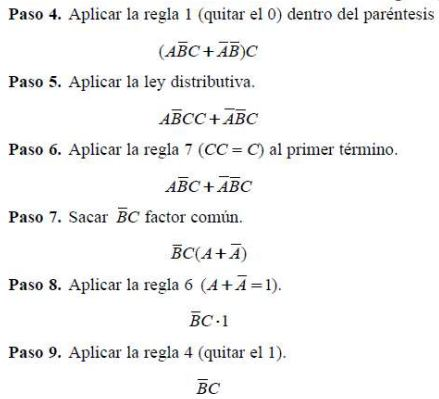
