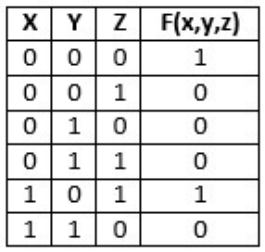
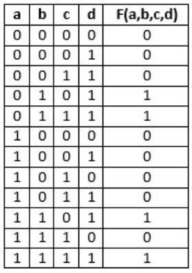
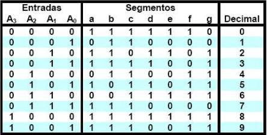
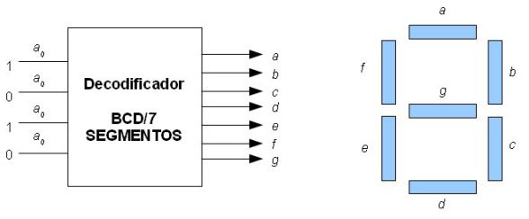

# Tema 6 - TEO - Ejercicios

Presentación de ejercicios. Tema relacionado: [Tema 6](../Tema%206/README.md).

**Lectura en el contenido completo:** [Capítulo 6 — Diseño y síntesis de circuitos lógicos combinacionales](../Contenido%20completo/Capitulo%206%20-%20Dise%C3%B1o%20y%20s%C3%ADntesis%20de%20circuitos%20l%C3%B3gicos%20combinacionales.md)

PDF de la presentación: [Tema 6 - TEO - Ejercicios.pdf](Tema%206%20-%20TEO%20-%20Ejercicios.pdf)

---

## Ejercicios de Diseño y síntesis de Circuitos lógicos Combinacionales

## Ejercicio

1) Dada la siguiente TV, sintetizar el circuito.

Ejercicios de Diseño y síntesis de Circuitos lógicos Combinacionales

2) Dada la siguiente TV, sintetizar el circuito

3) Dada la siguiente TV, sintetizar el circuito

