# Tema 7

**Lectura en el contenido completo:** [Capítulo 7 — Circuitos Secuenciales Sincrónicos (CSS)](../Contenido%20completo/Capitulo%207%20-%20Circuitos%20Secuenciales%20Sincr%C3%B3nicos%20%28CSS%29.md)

PDF de la presentación: [Tema 7.pdf](Tema%207.pdf)

---

## Circuitos Secuenciales Sincrónicos (CSS)

**Vídeo:** Latch — circuitos secuenciales

Enlace: [https://www.youtube.com/watch?v=FN4ctCaa-cQ](https://www.youtube.com/watch?v=FN4ctCaa-cQ)

## Circuitos Lógicos

Circuitos Secuenciales Sincrónicos (CSS)

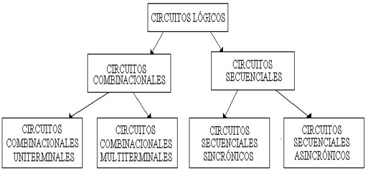

## Circuitos Secuenciales Síncronos

Circuitos Secuenciales Sincrónicos (CSS)

Son aquellos CSS en los que las salidas sólo cambian en instantes de tiempo gobernados por pulsos de otro circuito que recibe el nombre de reloj.

Ejemplos de CSS: Contadores síncronos, registros,

detectores de secuencias.

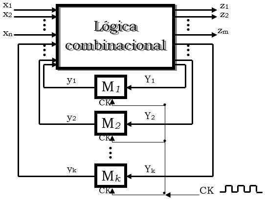

## Máquina de estados finitos

Circuitos Secuenciales Sincrónicos (CSS)

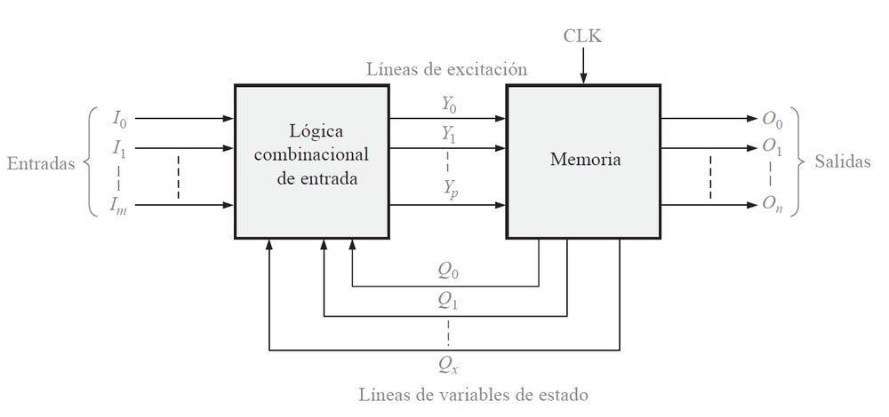

## Circuitos Secuenciales Síncronos

Circuitos Secuenciales Sincrónicos (CSS)

Señal de reloj (ck)

Son aquellos CSS en los que las salidas sólo cambian en instantes de tiempo gobernados por pulsos de otro circuito que recibe el nombre de reloj.

Forma de Ondas

Tc: Período de reloj

## Circuitos Secuenciales Asíncronos

Circuitos Secuenciales Sincrónicos (CSS)

Son aquellos CS en los que las salidas no dependen de una relación temporal fija.

Ejemplos de CSA: Contadores asíncronos.

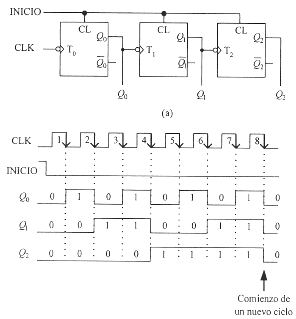

## Circuitos Secuenciales Sincrónicos (CSS)

Clasificación

Síncronos

  - Señal de reloj global

  - Facilidad de diseño

  - Velocidad limitada

Asíncronos

  - No existe señal de reloj global

  - Dificultad de diseño

Latch

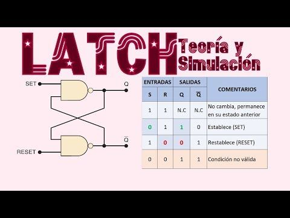

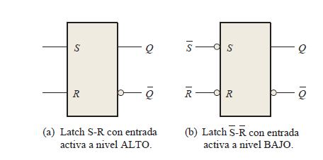

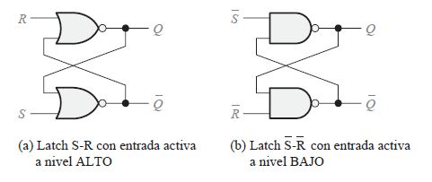

## Biestable - SR

Circuitos Secuenciales Sincrónicos (CSS)

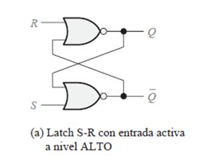

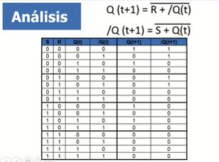

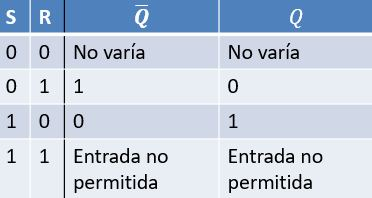

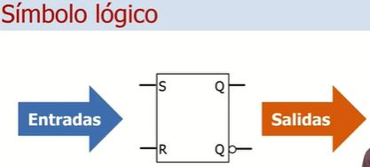

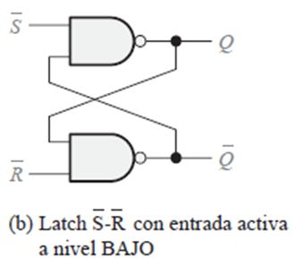

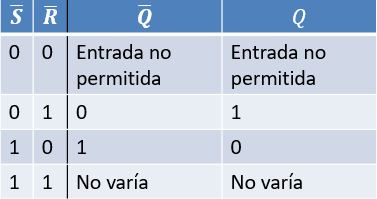

## Circuitos Secuenciales Sincrónicos (CSS)

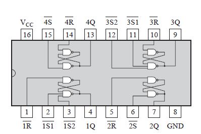

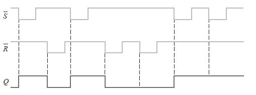

## Biestable - RS con reloj

Circuitos Secuenciales Sincrónicos (CSS)

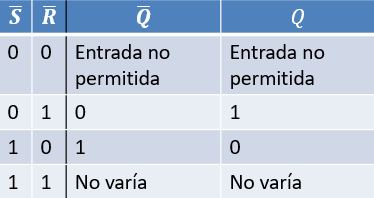

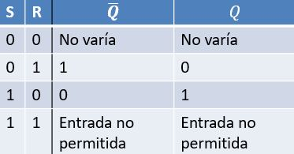

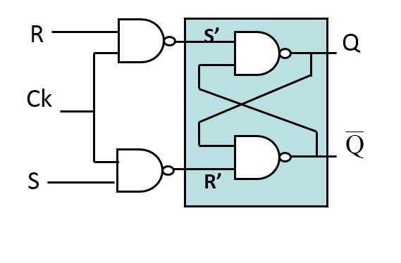

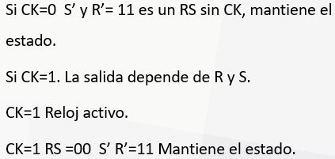

## Biestable - Tipos de entradas CLK

Circuitos Secuenciales Sincrónicos (CSS)

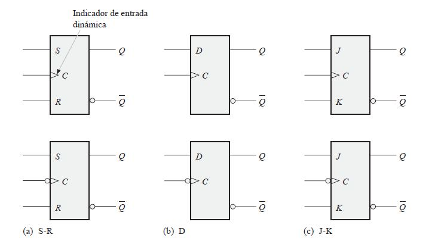

## Biestable - JK

Circuitos Secuenciales Sincrónicos (CSS)

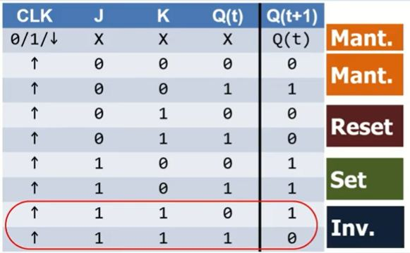

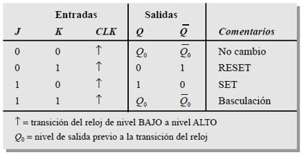

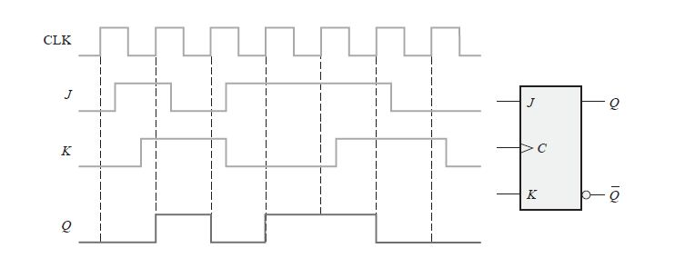

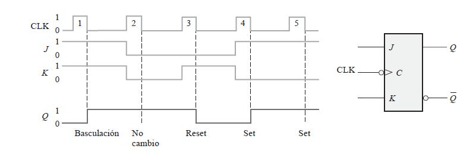

## Biestable - D

Circuitos Secuenciales Sincrónicos (CSS)

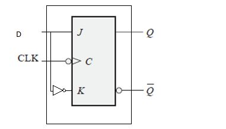

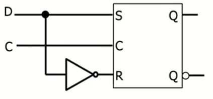

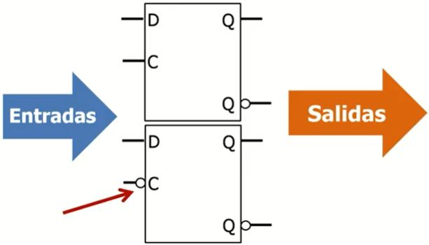

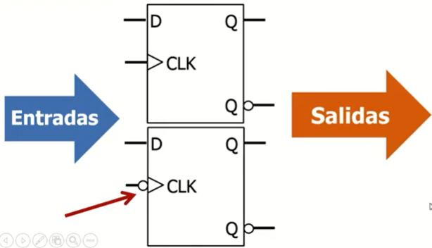

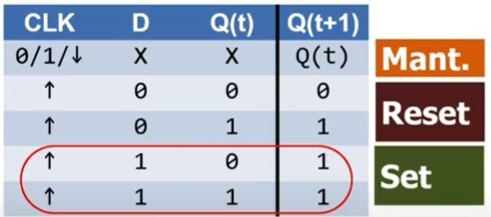

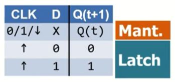

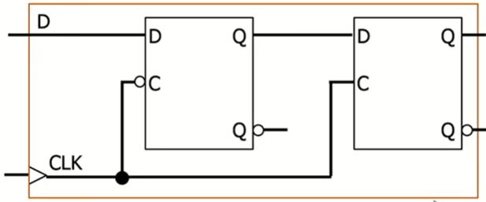

## Biestable - T

Circuitos Secuenciales Sincrónicos (CSS)

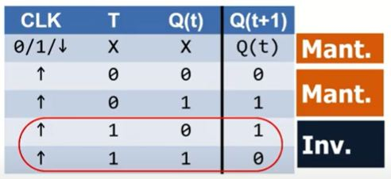

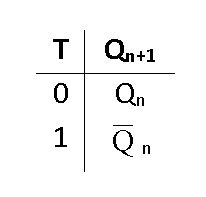

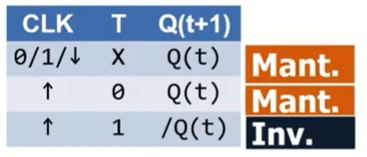

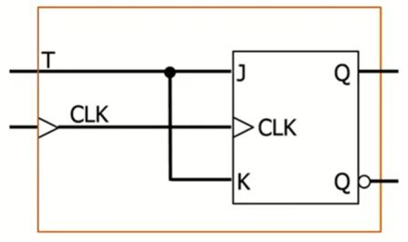

## Resumen de FlipFlops RS, D, JK, T

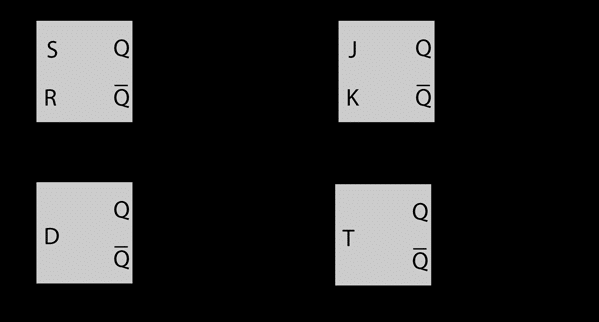

## RS con flanco

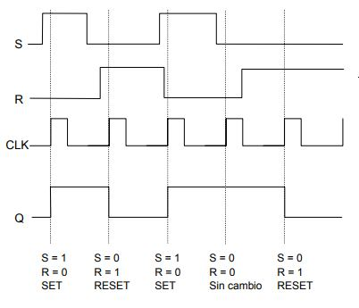

## D con flanco

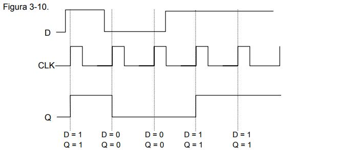

## JK con flanco

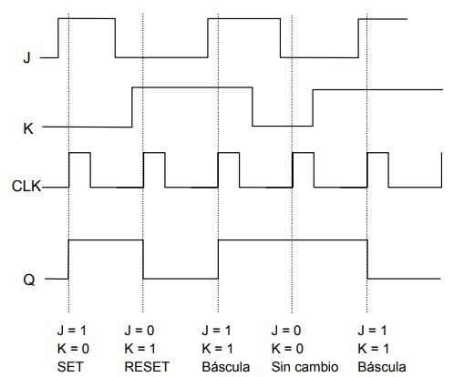

## T con flanco

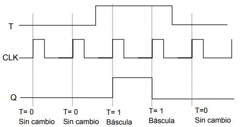

## Contadores

Circuitos Secuenciales Sincrónicos (CSS)

Un contador en es un circuito secuencial construido a partir de biestables y puertas lógicas capaz de almacenar y contar los impulsos (a menudo relacionados con una señal de reloj), el cómputo se realiza en código binario, es decir 0 y 1.

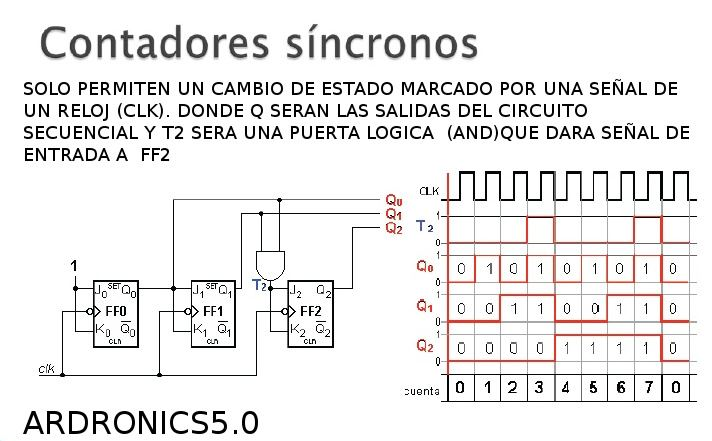

## Contador asíncrono binario de 2 bits

Circuitos Secuenciales Sincrónicos (CSS)

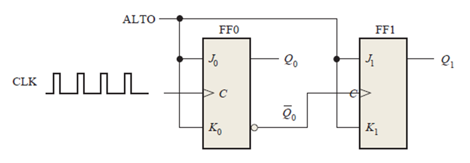

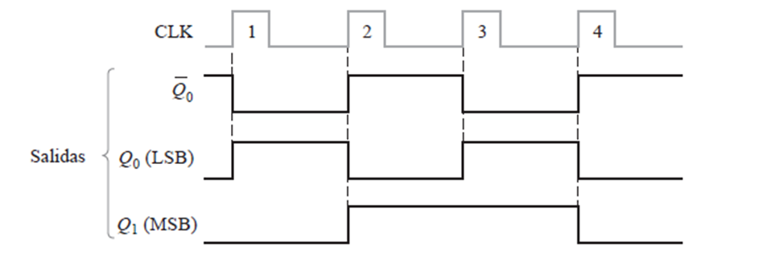

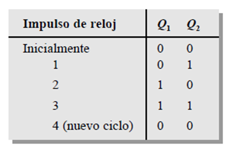

## Contador asíncrono binario de 3 bits

Circuitos Secuenciales Sincrónicos (CSS)

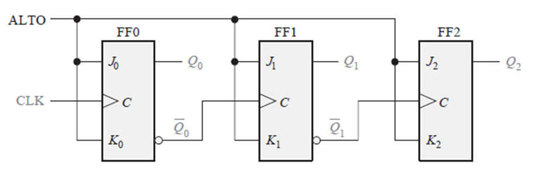

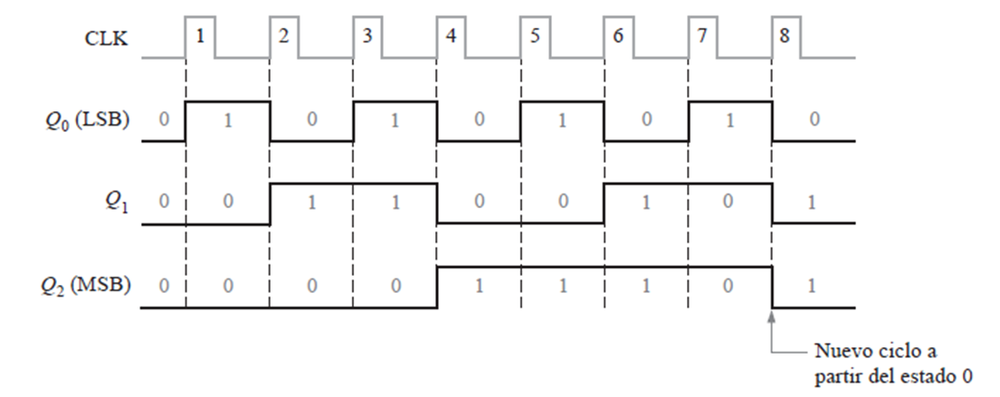

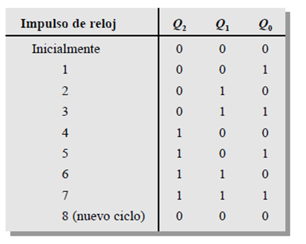

## Contador de décadas asíncrono

Circuitos Secuenciales Sincrónicos (CSS)

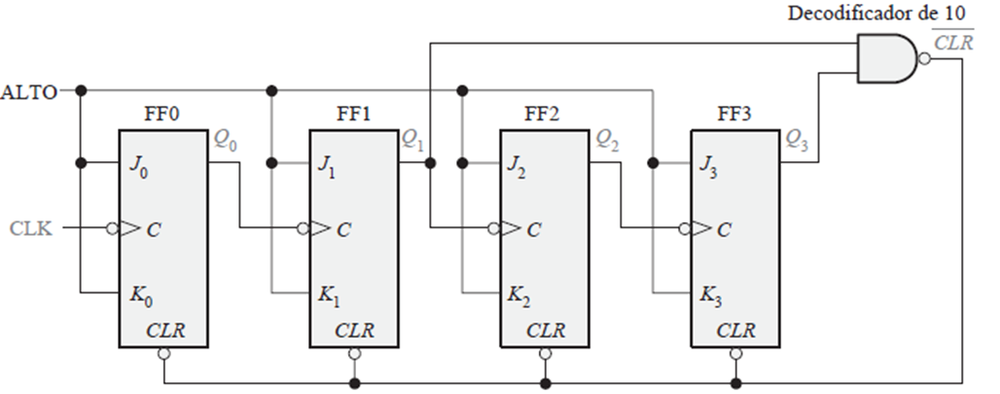

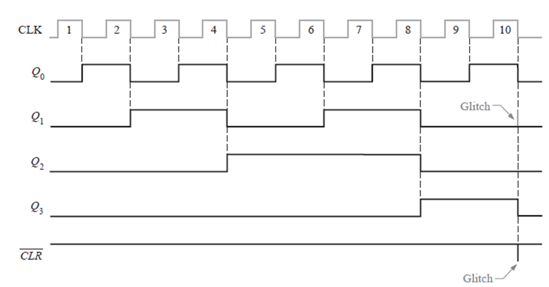

## Contador módulo 12 con reiniciación asíncrono

Circuitos Secuenciales Sincrónicos (CSS)

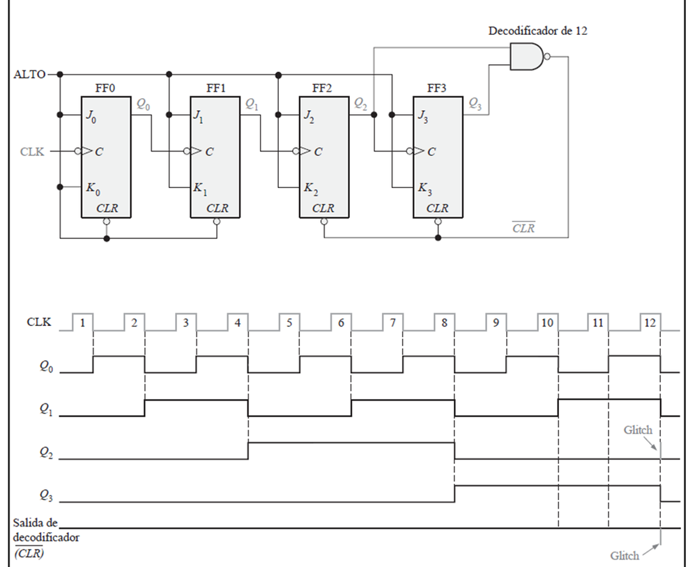

## Contador síncrono 2 bits

Circuitos Secuenciales Sincrónicos (CSS)

## Contador síncrono 3 bits

Circuitos Secuenciales Sincrónicos (CSS)

## Contador síncrono 4 bits

Circuitos Secuenciales Sincrónicos (CSS)

## Mod - 2 Mod - 4 Mod - 8 Mod - 10

Circuitos Secuenciales Sincrónicos (CSS)

## Diseño de contadores síncronos

Circuitos Secuenciales Sincrónicos (CSS)

Ejercicio - implementar contador síncrono 3 bits

1 - Diagrama de estados

2 - Tabla de estado siguiente

3 - Tabla de transiciones JK

4 - Mapas de Karnaugh

5 - Expresiones lógicas

J0 = K0 = 1

J1 = K1 = Q0

J2 = K2 = Q1Q0

6 - Circuito lógico

Diagrama de estados

Tabla de estado siguiente

Tabla de transiciones

Mapas de Karnaugh

Expresiones lógicas para las entradas

Implementación del contador

